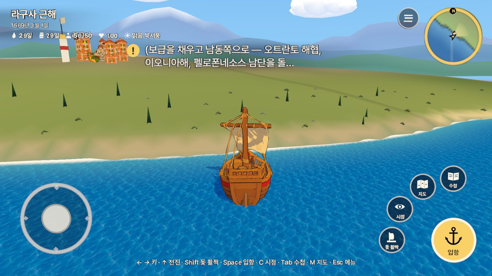

**Grand Voyage**는 16세기 바다를 3D 셀 셰이딩으로 그린 항해 게임입니다. 항구 마을을 걸어 다니며 선원을 모으고 물과 식량을 실은 뒤, 바람과 날씨를 읽으며 바다로 나갑니다. 교역으로 번 금화로 배를 키우고, 해전을 치르고, 세력의 전쟁에 뛰어들어 공훈을 쌓는 일이 한 바퀴씩 이어집니다.

## 어느 항로부터 볼까요?

| 하고 싶은 일 | 펼쳐 볼 곳 |
| --- | --- |
| 라구사에서 첫 항해를 시작한다 | [첫 출항 준비](/start/first-voyage/) · [조작과 화면](/start/controls/) |
| 선장을 골라 첫 임무를 맡는다 | [마리나·니콜라·야코로 선장전 시작하기](/start/captains/) |
| 세계지도에서 항구와 보급할 곳을 찾는다 | [세계 해도](/atlas/world-map/) · [전체 항구 56곳](/atlas/ports/) |
| 배를 키우고 전쟁에 참가한다 | [선장의 하루와 이야기 진행](/start/course/) · [시스템과 규칙](/systems/rules/) |
| 물건값과 배의 정원을 비교한다 | [교역품 도감](/atlas/goods/) · [선박 도감](/atlas/ships/) |
| 저장한 항해를 이어간다 | [저장과 이어하기](/systems/pilot/) |
| 마리나의 이야기를 읽는다 | [서장부터 읽기](/novel/threeflags/prologue/) · [13부와 네 결말 차례](/novel/threeflags/) · [단편 외전](/novel/threeflags/lantern/) |
| 새로 실린 글을 확인한다 | [11월 23일 안내서 소식](/updates/2026-11-23/) |

## 게임과 소설

웹 브라우저와 Android용 게임은 시험 배포 중입니다. 이 안내서에서는 첫 항해부터 엔딩 뒤의 자유 항해까지 다룹니다. 게임의 진행도는 각자의 저장 칸에 남습니다. 소설은 로그인 없이 읽을 수 있고, 결말은 별도 페이지에 있습니다.
