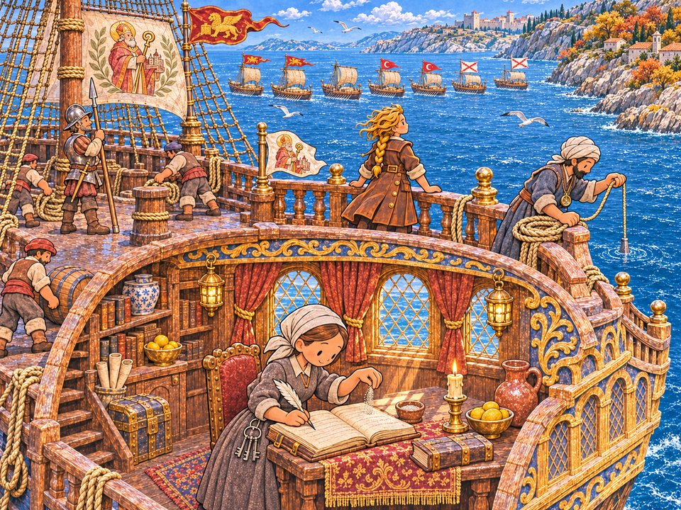
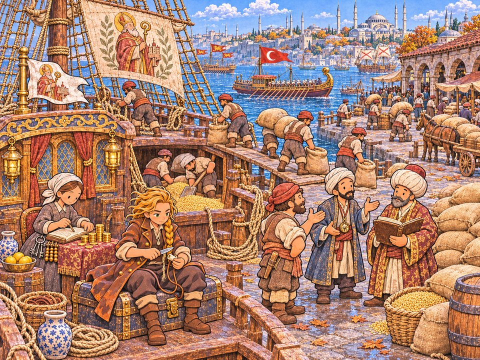
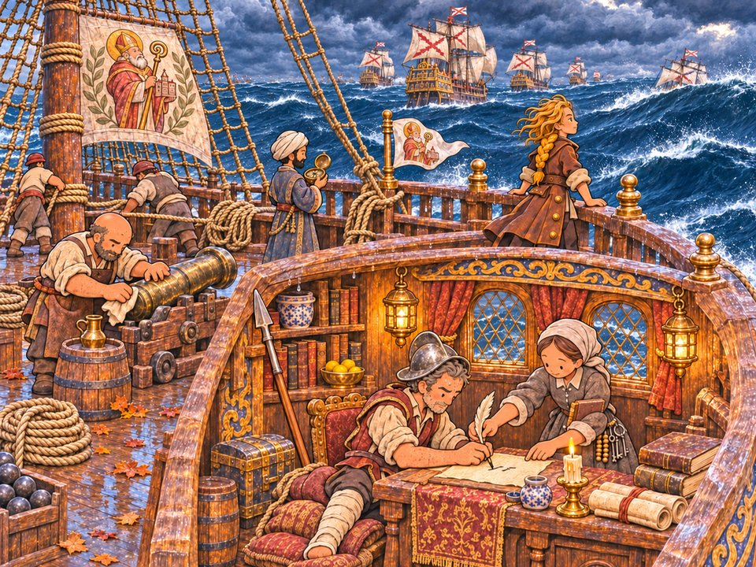
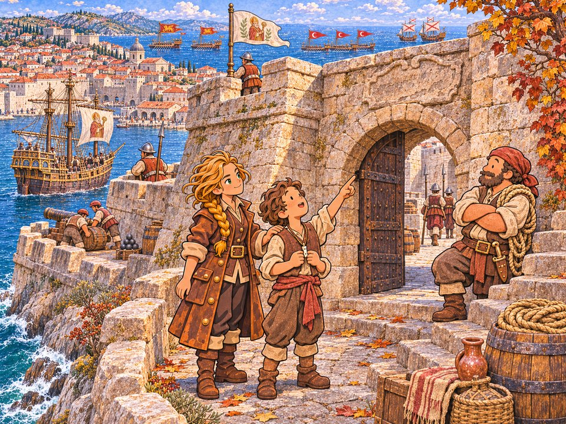

## 결말 하나 ― 사자의 장부

마리나의 오른손이 맨 왼쪽의 붉은 밀랍을 집었다. 날개 달린 사자 인장이 찍힌 베네치아의 종이였다.

마라는 말없이 탁자 모퉁이의 가죽 주머니에서 잉크병과 깃펜을 꺼냈다. 마리나는 서류 끝을 짚었다가 이내 손을 떼고 종이를 말아 쥐었다. 성벽 안에서는 서명하지 말라던 원로원 서기의 말이 남아 있었다. 마리나는 촛불을 끄지 않은 채 방파제 밖 정박지에 매인 스베티 블라호로 걸음을 옮겼다. 그날 밤 선실 탁자 위에서 붉은 밀랍 아래 이름이 적혔다.

한 해 뒤, 1575년 가을. 아드리아해의 물빛이 맑았다.

스베티 블라호는 달마티아 연안을 따라 베네치아로 가는 소금 배와 곡물 배 여섯 척의 앞장을 서고 있었다. 돛대 위에는 붉은 사자 깃발이 바람을 받았고, 그 아래에 라구사의 흰 성 블라호 깃발이 나란히 걸려 있었다. 잔잔한 물결 위로 갈매기 떼가 낮게 날아올랐다. 여름 내내 바다를 건너온 약탈선 그림자조차 보이지 않는 달이었다.

갑판 위에서는 로브로가 선원들을 불러 모아 젖은 닻줄을 사리고, 돛줄 매듭을 하나씩 다시 조였다. 뱃머리 쪽 그늘에는 디에고가 다친 왼쪽 다리를 조금 끌며 걸어와 창을 세우고 수평선을 살폈다. 지난해 튀니스에서 입은 상처는 아물었으나 걸을 때마다 미세하게 절뚝거림이 남았다. 배가 베네치아 부두에 닿을 때마다 뭍에 내리지 않겠다던 하산은, 뱃전에 기대어 서서 다림줄을 내리며 얕은 모래턱을 짚어 냈다.

선실로 내려온 마리나는 가죽 서류 주머니에서 며칠 전 베네치아에서 건네받은 편지 한 통을 꺼냈다. 아르세날레로 돌아간 토마 벤드라민이 보낸 것이었다. 왼손의 남은 세 손가락으로 꾹꾹 눌러 쓴 글씨는 거칠었으나 줄이 반듯했다. 편지에는 붉은 벽돌 담장 안 시험장에서 젊은 포수들에게 청동 포 다루는 법과 심지 재는 법을 가르치고 있다는 소식과, 스베티 블라호 뱃고물의 「루이스」 포구에는 바닷바람에 녹이 슬지 않게 기름 헝겊을 자주 대 주라는 당부가 적혀 있었다.

탁자 앞에서는 마라가 가죽 장부를 펴고 있었다. 선실 창문으로 들어온 햇빛이 낡은 종이 귀퉁이의 소금 얼룩을 비추었다. 주판알을 두 번 튕긴 마라가 깃펜을 들어 이번 달 칸을 채웠다. 묵직한 펜촉이 종이를 긁고 지나가는 소리가 선실 안에 낮게 울렸다.

「잃은 것 없음」

마라가 장부 끝에 적은 줄을 내려다보며 모래를 뿌려 말렸다.

"다섯 해 넘게 장부를 쓰면서 이 말을 적어 보기는 처음이에요, 선장님." 마라가 장부 끈을 매며 말했다.

"다음 달에도 같으면 좋겠소." 마리나가 대답했다.

"삯이 전쟁 때의 반도 안 되니 어음 이자 갚기는 빠듯해요. 그래도 화약 값과 수리비가 안 나가니 남는 몫은 그만해요."

마리나는 고개를 한 번 끄덕이고 선실 계단을 올라 갑판으로 나왔다. 가을 햇살이 돛베 위로 쏟아졌고, 뒤따라오는 상선들의 흰 돛이 물결 위에 가지런히 늘어섰다. 로브로가 외치는 구령에 맞춰 돛이 조금씩 더 팽팽해졌다.

마리나는 뱃전 난간을 짚고 동쪽을 바라보았다. 아드리아해의 잔잔한 물결 너머, 머나먼 파마구스타 쪽 수평선이 맑은 하늘과 맞닿아 있었다. 바람이 불어와 마리나의 겉옷 깃을 스치고 지나갔다.

## 결말 둘 ― 초승달 아래

마리나의 오른손이 가운데 놓인 금가루의 서명을 집었다. 종이 끝에서 옅은 정향과 장미수 냄새가 배어 나왔다.

마리나는 붉은 밀랍과 검은 밀랍이 찍힌 두 양피지를 말아 탁자 저쪽으로 밀어 두었다. 마라가 주판알을 한 번 쓸어내린 뒤 새 장부의 첫 장을 폈다. 방파제 밖 배로 나가기 전, 마리나는 목에 걸린 뼈 호루라기를 겉옷 안으로 집어넣었다.

한 해 뒤, 1575년 가을. 이스탄불의 곡물 부두.

금각만 안쪽 물 위에는 크고 작은 상선과 갤리들이 빽빽하게 닻을 내리고 있었다. 부두 돌바닥마다 밀과 보리를 담은 삼베 자루가 산처럼 쌓였고, 짐꾼들의 목쉰 외침이 바다 쪽으로 번져 나갔다. 스베티 블라호는 붉은 사자도 부르고뉴 십자도 아닌, 라구사의 흰 성 블라호 깃발만을 돛대에 매단 채 부두 안쪽에 매여 있었다. 마리나의 배는 싸우는 배가 아니었다. 마리나의 선단이 에게해와 이스탄불을 오가며 맡은 일은 술탄의 조공국 상선으로서 곡식과 목재를 실어 나르는 것이었다.

배에서 내린 나무 판자 위에서 하산이 오스만 곡물 감독관과 나란히 서서 말을 옮기고 있었다. 하산이 손가락으로 자루 수를 짚어 보이자 감독관이 고개를 끄덕이고 장부에 도장을 눌렀다. 갑판 위에서는 로브로가 선원들을 재촉해 선창 덮개를 열고 곡식 자루를 끌어올렸다. 베네치아 사람인 토마 벤드라민은 지난가을 라구사에서 배를 내려 고향 아르세날레로 돌아갔고, 에스파냐 병사 디에고 역시 나폴리로 가는 상선을 타고 떠났다.

부두 바깥쪽 물길에는 오스만의 날렵한 갤리 한 척이 닻을 내린 채 망을 보고 있었다. 뱃머리에는 라구사식 둥근 나무 장식이 햇볕을 받아 어른거렸다. 니콜라의 배였다. 곡물 선단이 에게해를 건너오는 내내 니콜라의 갤리는 포구를 덮은 채 한 걸음 뒤에서 물길을 지켜 주었다.

잠시 뒤, 부두 끝 돌길 쪽에서 사람들이 일제히 길을 비키며 고개를 숙였다. 긴 비단 겉옷을 두른 사내가 호위 병사 몇을 거느리고 걸어오고 있었다. 이제 클르치 알리라 불리는 오스만의 대제독이었다. 제독은 스베티 블라호의 뱃머리 아래에서 걸음을 멈추더니, 곁에 선 하산을 향해 짙은 칼라브리아 말로 짧게 물었다.

"칼라브리아의 뱃사람이 아직도 물길을 잘 보느냐."

하산이 가슴에 손을 얹고 고개를 숙여 대답했다. 제독은 마리나 쪽을 한 번 힐끗 보고는 더 말없이 부두 안쪽으로 걸음을 옮겼다.

선실로 내려온 마라가 장부 끝 줄을 짚으며 깃펜을 내려놓았다.

"이스탄불 부두는 셈이 빠르네요, 선장님. 밀 포대 값도, 호위 삯도 내릴 때마다 바로바로 금화로 떨어져요."

"약속한 날짜를 어기지 않으니 상회 어음도 줄어드는구려." 마리나가 말했다.

"그렇지요. 다만 나폴리 쪽 항구에서는 우리 배를 곱게 보지 않을 테니, 당분간 들어가지 않는 게 낫겠어요."

마리나는 대꾸하지 않고 선실 의자에 앉아 겉옷 안에서 뼈 호루라기를 꺼내 들었다. 야코가 탄 나폴리 함대와는 이제 다른 편이 되었으나, 에게해를 오가는 동안 아직 바다에서 마주친 적은 없었다. 마리나는 바닷바람과 땀에 절어 해진 호루라기의 낡은 가죽 끈을 칼로 끊어 냈다. 그리고 서랍에서 기름 먹인 새 가죽 끈을 꺼내 구멍에 꿰고 손가락으로 단단히 매듭을 지었다.

## 결말 셋 ― 왕의 은

마리나의 오른손이 맨 오른쪽의 검은 밀랍을 집었다. 빳빳한 양피지 끝에 찍힌 왕관 방패 인장이 등잔불 빛을 받아 어둡게 번득였다.

마라는 묵묵히 잉크병 마개를 열었다. 마리나는 방파제 밖 스베티 블라호로 돌아와 선실 탁자 위에 계약서를 폈다. 지난해 봄 베네치아 부두에서 썼던 「한 철」이라는 말 대신, 이번에는 기한을 길게 적어 넣고 이름을 서명했다.

한 해 뒤, 1575년 가을. 지브롤터 너머 큰 바다.

배 밑바닥을 때리는 물결이 지중해와는 달랐다. 길고 묵직하게 밀려오는 너울이 스베티 블라호의 높은 뱃고물을 들어 올렸다가 내려놓을 때마다, 돛대 전체가 굵은 소리를 내며 기우뚱거렸다. 은을 실은 에스파냐 왕의 큰 상선 넷이 묵직하게 물살을 가르며 나아갔고, 마리나의 배와 호위 선단은 그 양옆과 뒤를 따라 뱃머리를 세웠다. 선두에는 부르고뉴 십자 깃발과 흰 성 블라호 깃발을 함께 단 야코의 갈레온이 앞장을 서고 있었다.

그날 새벽, 바람이 잠깐 잦아들어 두 배가 가까이 붙었을 때 야코가 뱃전 난간 너머로 소리를 질렀다. 라 골레타에서 나온 뒤로 말수가 줄었던 야코였다.

"바닷물 빛깔이 검지 않으냐. 저 너머는 끝이 안 보인다."

"물길만 놓치지 않으면 갈 만하다." 마리나가 손바닥을 입에 모으고 마주 외쳤다.

스베티 블라호 갑판 위에서는 로브로가 젖은 밧줄을 붙잡고 선원들에게 돛줄을 조금 더 풀라고 소리쳤다. 물보라가 갑판 널빤지를 쉴 새 없이 적셔 걸을 때마다 장화 밑창이 미끄러졌다. 토마 벤드라민은 뱃고물의 청동 포 「루이스」 곁에 서서 큰 물보라에 쇠붙이가 녹슬지 않도록 기름 먹인 헝겊으로 쉼 없이 포신을 문질렀다. 뱃머리에 선 하산은 놋쇠 나침반을 손바닥에 올린 채, 처음 보는 서쪽 바다의 물결 높이와 바람 방향을 눈으로 재며 키잡이에게 손짓을 보냈다.

선실 안쪽 등잔불 아래에서는 마라가 장부와 함께 낡은 양피지 한 장을 펼쳐 두고 있었다. 그 맞은편에 디에고가 앉아 있었다. 다친 왼쪽 다리를 의자 옆으로 길게 뻗은 디에고는 투박한 손가락으로 깃펜을 어설프게 쥔 채 땀을 흘리고 있었다. 마라가 깃펜 끝을 고쳐 잡아 주며 낮은 목소리로 일렀다.

"힘을 너무 주지 마세요. 종이가 찢어져요."

디에고는 희끗한 머리를 숙이고 숨을 죽인 채 잉크를 찍었다. 마른 근육이 뭉친 손등이 깃펜을 잡을 때마다 미세하게 떨렸다. 이윽고 거친 획 몇 개가 모여 양피지 위에 또렷한 낱말 하나가 맺혔다. 제 이름이 아니었다.

「루이스」

디에고는 제가 쓴 글자를 한참 내려다보다가 손등으로 입가를 한 번 훔쳤다. 마라는 말없이 모래 통을 기울여 잉크 위에 얇게 뿌렸다.

"잘 쓰셨어요." 마라가 말했다. "이제 다음 줄을 써 보세요."

마리나는 선실 계단을 올라 다시 갑판으로 나왔다. 바람에 젖은 돛베가 팽팽하게 부풀어 오르며 뱃전을 울렸다. 사방 어디를 둘러보아도 뭍의 그림자는 보이지 않았다. 앞쪽 야코의 갈레온 돛대가 큰 너울 너머로 잠깐 가려졌다가 다시 솟아올랐다. 끝없이 이어지는 짙푸른 물결이 뱃전을 때리며 하얀 거품을 쏟아 냈다.

## 결말 넷 ― 팔지 않는 것

마리나의 오른손이 세 봉인을 한꺼번에 밀었다. 붉은 사자와 금가루의 서명, 검은 방패가 찍힌 세 장의 양피지가 탁자 저쪽 가장자리로 미끄러져 나갔다.

마라는 아무 말 없이 밀려난 종이 세 장을 거두어 돌돌 말아 묶었다. 마리나는 등잔 심지를 끄기 전에 벽에 걸린 가죽 주머니에서 낡은 쇠 칼을 꺼내 쥐었다. 그날 밤 부니치 상회에서는 어느 나라의 계약서에도 이름이 적히지 않았다.

한 해 뒤, 1575년 가을. 라구사 원로원의 곡물 선단.

스베티 블라호는 이제 오직 라구사의 흰 성 블라호 깃발 하나만을 돛대에 달고 다녔다. 원로원의 곡물 선단을 맡은 마리나는 봄에 베네치아 부두에 밀 자루를 부렸고, 여름에는 이스탄불로 가는 길목의 항구에 보리를 내렸으며, 초가을에는 나폴리 창고에 소금을 넘겼다. 세 깃발이 걸린 항구를 차례로 돌며 곡식을 내리는 동안, 베네치아 부두에 닿았을 때 하산은 배에 남아 물길을 보았고, 토마 벤드라민은 아르세날레로 돌아가겠다며 뭍으로 내렸다. 디에고 역시 나폴리에서 내린 뒤 다시 배로 오르지 않았다. 배에는 갑판장 로브로와, 올해 처음 배를 탄 로브로의 조카 안테가 남아 갑판을 지켰다.

스베티 블라호가 모처럼 고향 라구사 방파제 안쪽에 닻을 내린 날 오후였다. 선실 탁자 위에는 오랫동안 바다를 떠돌며 바닷물에 젖고 귀퉁이가 닳은 지중해 해도가 펼쳐져 있었다. 마라가 낡은 작은 쇠 칼을 집어 들어 마리나에게 건넸다.

마리나는 칼날 끝을 해도의 못 머리에 대었다. 먼저 아드리아의 세 항구에서 금색 밀랍을 긁어냈고, 이어서 튀니스와 상자에서 꺼낸 키프로스의 못에서도 노란 밀랍 조각을 모두 벗겨 냈다. 마지막으로 붉은 밀랍이 묻어 있던 베네치아와 코르푸, 칸디아의 못까지 깨끗이 긁어내자 해도 위에는 색깔 없는 놋쇠 못 머리만 남았다. 탁자 위로 붉고 노란 밀랍 부스러기가 수북이 쌓였다.

"이젠 어느 항구가 누구 것인지 표가 안 나겠어요." 마라가 장부를 덮으며 말했다. "올해 남긴 이문은 원로원 세금과 삯을 빼고 나니 은화 몇 닢이 전부예요."

"그걸로 다음 항해 밀가루는 살 수 있소." 마리나가 칼을 탁자에 내려놓으며 대답했다.

선실 밖 부두에서 선원들 웃음소리가 들려왔다. 마리나가 갑판으로 올라가 보니 짐 내리기를 마친 로브로가 조카 안테를 데리고 성채 쪽 돌계단을 걸어 올라가고 있었다. 마리나도 천천히 뒤를 따랐다.

로브리예나츠 성채 정문 아래에 선 열두 살 남짓한 안테가 고개를 뒤로 젖히고 돌에 새겨진 글자를 손가락으로 하나씩 짚으며 떠듬떠듬 읽었다.

"자유는…… 세상의 금을 다 주어도…… 팔지 않는다."

안테가 고개를 돌려 마리나를 올려다보며 물었다.

"그럼 조공은 뭐예요?"

마리나는 대답하지 않았다. 대신 제 목에 걸려 있던 낡은 가죽 끈을 벗겨, 손가락 길이의 깎은 뼈 호루라기를 안테의 목에 걸어 주었다. 안테가 가슴 위로 내려온 하얀 호루라기를 두 손으로 감싸 쥐었다.

성채 아래 바위틈으로 가을 파도가 밀려들어 하얗게 부서졌다.
