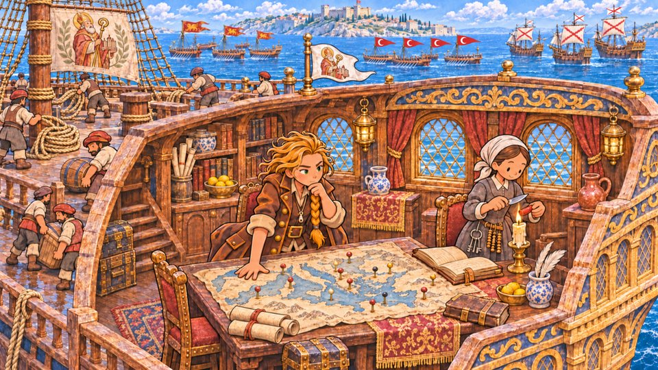

1569년 봄, 아드리아해의 작은 공화국 라구사. 죽은 오빠 대신 아버지의 배와 빚을 물려받은 부니치 상회의 선장 마리나 부니치는 이스탄불 조공선 호위를 마치고 돌아온 이듬해 봄, 탁자 위에 나란히 놓인 세 나라의 계약서를 마주합니다. 날개 달린 사자의 베네치아, 초승달의 오스만, 왕관 방패의 에스파냐. 어릴 적 한 성벽에서 「누가 어느 깃발 아래 있든, 라구사 배는 라구사 배를 쏘지 않는다」고 맹세한 두 친구 니콜라와 야코는 이미 저마다 다른 깃발을 골랐습니다.

마리나는 올케이자 장부꾼인 마라, 포수장 토마, 에스파냐 하사 디에고, 항해사 하산과 함께 키프로스와 레판토, 튀니스를 지나며 항구가 주인을 바꾸는 것을 해도 위의 못으로 셉니다. 항해 도중 항구와 조선소, 선술집에서 마주치는 여러 선장의 이야기도 길목마다 스쳐 지나갑니다. 본문은 1부 끝에서 붉은 사자(베네치아)의 봉인을 집고, 5부 끝 둘째 계약에서 사자에 남은 뒤, 9부 끝 셋째 계약에서 왕관 방패(에스파냐)로 옮겨 13부까지 가는 길을 따라갑니다. 2부부터 9부까지는 각 부 끝에 「다른 깃발 아래에서(초승달·왕관 방패)」 장을, 10부부터 13부까지는 「다른 깃발 아래에서(사자로 남았다면·초승달이었다면)」 장을 두어 다른 봉인을 골랐을 때의 이야기도 함께 전합니다. 실제 사건과 인물이 나오지만 마리나와 그 선단은 지어낸 것이며, 시대는 큰 틀만 따릅니다.

:::caution[줄거리 공개]
이 소설에는 처음부터 네 가지 결말까지 모든 줄거리가 들어 있습니다.
:::

## 차례

| 차례 | 내용 |
| --- | --- |
| [서장 ― 성벽 위의 세 아이](/novel/threeflags/prologue/) | 1556년 여름 라구사 성채 문 위의 글, 세 아이의 맹세와 호루라기 |
| [1부 ― 세 개의 봉인](/novel/threeflags/part1/) | 1569 봄~1570.3. 라구사 교역, 이스탄불 조공 사절 호위, 열네 해 만의 성벽과 세 봉인 |
| [2부 ― 이오니아의 여름](/novel/threeflags/part2/) | 1570 봄~여름. 코르푸의 지팡이, 첫 포성과 안툰, 사에티아 시운전, 다른 깃발 아래에서(초승달·왕관 방패) |
| [3부 ― 붉은 밀랍](/novel/threeflags/part3/) | 1570 가을. 에게해 봉쇄선, 아드리아 약탈선, 니코시아 함락과 금색 못, 다른 깃발 아래에서(초승달·왕관 방패) |
| [4부 ― 파마구스타의 겨울](/novel/threeflags/part4/) | 1570 겨울~1571 봄. 밤의 봉쇄 돌파, 화덕 앞의 줄, 맡긴 곡식, 밀린 삯, 다른 깃발 아래에서(초승달·왕관 방패) |
| [5부 ― 보라 바람](/novel/threeflags/part5/) | 1571 여름. 메시나의 편지, 보라 바람 속 호루라기, 파마구스타 소문, 다시 놓인 세 봉인, 다른 깃발 아래에서(초승달·왕관 방패) |
| [6부 ― 레판토](/novel/threeflags/part6/) | 1571 가을. 메시나·고메니차, 10월 7일 해전, 하산 구조, 얻은 항구 없음, 다른 깃발 아래에서(초승달·왕관 방패) |
| [7부 ― 깎은 수염, 자른 팔](/novel/threeflags/part7/) | 1571 겨울~1572 봄. 브라가딘의 집, 오스만 함대 재건 소문, 작은 항구 위임, 다른 깃발 아래에서(초승달·왕관 방패) |
| [8부 ― 모돈 앞바다](/novel/threeflags/part8/) | 1572 여름~가을. 끝없는 대치, 열병과 수리비, 우스코크 소탕, 다른 깃발 아래에서(초승달·왕관 방패) |
| [9부 ― 라구사의 겨울](/novel/threeflags/part9/) | 1572 겨울~1573 봄. 세 나라로 갈 곡식, 1573년 3월 단독 강화, 한 철의 봉인, 다른 깃발 아래에서(초승달·왕관 방패) |
| [10부 ― 검은 밀랍](/novel/threeflags/part10/) | 1573 여름~가을. 메시나 출정, 튀니스 입성과 검은 못, 에스파냐의 큰 갈레온, 다른 깃발 아래에서(사자로 남았다면·초승달이었다면) |
| [11부 ― 새 성채](/novel/threeflags/part11/) | 1573 겨울~1574 봄. 새 성채와 노인, 오지 않는 돈, 오스만 봉쇄선 돌파, 하산의 측량선, 다른 깃발 아래에서(사자로 남았다면·초승달이었다면) |
| [12부 ― 석호의 밤](/novel/threeflags/part12/) | 1574 여름. 모래톱의 재회, 썰물의 물길, 석호의 밤과 호루라기, 맡은 항구의 연기, 다른 깃발 아래에서(사자로 남았다면·초승달이었다면) |
| [13부 ― 다시 탁자 위에](/novel/threeflags/part13/) | 1574 가을. 금색 밀랍, 네 해 반, 본국으로 가는 다섯 배, 다시 탁자 위에, 다른 깃발 아래에서(사자로 남았다면·초승달이었다면) |
| [결말 ― 세 깃발과 흰 깃발](/novel/threeflags/endings/) | 1575 가을. 사자의 장부, 초승달 아래, 왕의 은, 팔지 않는 것 |

## 9부 곁에서 읽는 단편

[신호등의 매듭](/novel/threeflags/lantern/)은 다른 곡물선을 호위한 겨울을 돌아봅니다. 9부를 읽은 뒤 펼치세요.
