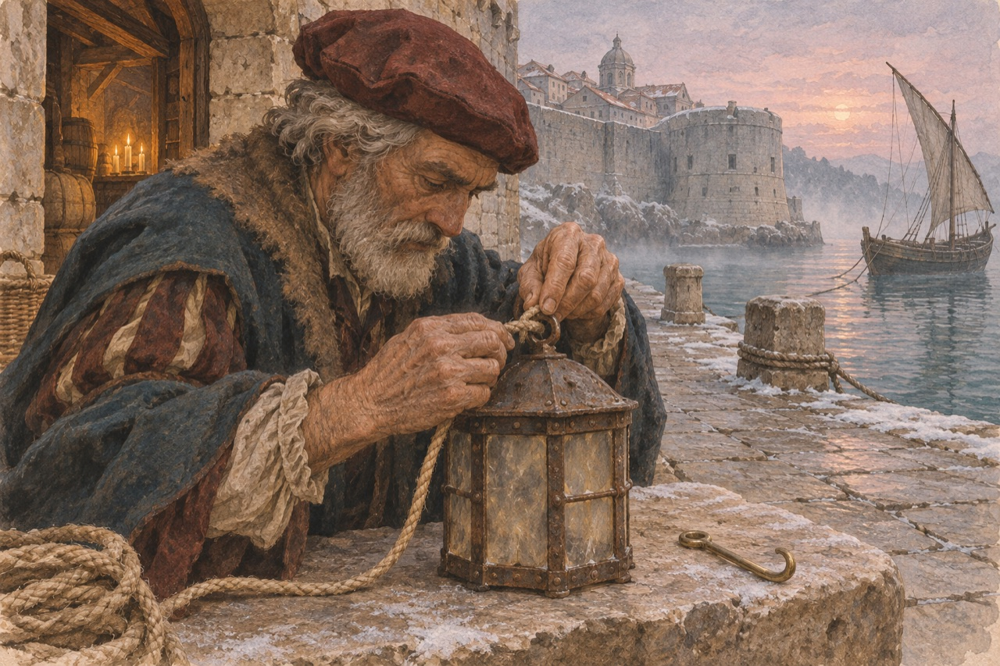

9부 「라구사의 겨울」에서 마리나가 다른 곡물선을 따라갔던 항로의 이야기.

라구사로 돌아온 늙은 선장이 가장 먼저 산 것은 심지 한 뼘이었다. 밀을 한 톨도 못 가져온 사람이 밀랍초를 사 간다는 말이 나올까 봐, 기름집 문이 열리기 전부터 뒤꼍에서 기다렸다. 주인은 돈을 받고 심지를 기름에 두 번 적셔 헝겊에 싸 주었다. 배 이야기는 묻지 않았다. 묻지 않는 것도 이 항구 사람들의 솜씨였다.

등롱은 방파제 돌벤치 밑에 있었다. 떠나기 전에 손자가 수선해 달라고 두고 간 것이었다. 한쪽 뿔판이 빠지고, 위에 달린 놋쇠 갈고리가 반쯤 펴져 있었다. 선장은 갈고리를 돌 위에 올려놓고 손바닥으로 눌렀다. 두 번, 세 번. 굽지 않았다.

“줄이 더 빠르겠소.”

목소리를 먼저 알아들었다. 마리나 부니치였다. 선장은 자리를 비켜 주지 않았다. 마리나는 돌계단 한 단 아래에 앉아 주머니에서 삼끈을 꺼냈다.

“우리가 보낸 신호는 보셨소?”

이 말을 하려고 억류된 동안 밤마다 입 안에서 순서를 바꿔 봤다. 이제 말하고 보니 겨우 여덟 마디도 되지 않았다.

“불 하나를 봤소.” 마리나가 대답했다. “그게 선미등인지 신호인지 알 수 없었소.”

그는 손가락으로 등롱의 빈 뿔판 자리를 짚었다. 오트란토에서 안개가 내렸을 때, 막내 수부가 웃옷으로 불을 두 번 가렸다 놓았다. 바람에 자락이 날려 두 번째는 반도 가리지 못했다. 앞서간 배에서는 그저 불 하나가 흔들리는 것으로 보였을 터였다.

“우리가 따라가던 배에는 아이들이 타고 있었소.” 마리나가 말했다.

“그건 물은 적 없소.”

마리나는 입을 다물었다. 창고 안에서 삽이 바닥을 긁었다. 누군가 저울에 밀을 다는 중이었다. 선장은 그 소리를 마흔 해 들었는데 오늘처럼 한 삽과 다음 삽 사이가 긴 적은 없었다.

“막내가 제 탓인 줄 아오. 제 손이 떨려 우리가 잡혀갔다고.”

“그 아이가 어디 있소?”

“저기.”

창고 문이 열리자 자루를 어깨에 멘 청년이 나왔다. 몸값을 빌려준 상인에게 봄까지 품을 팔기로 한 아이였다. 배를 타고 싶으냐고 물으면 날마다 다른 대답을 했다. 마리나는 그를 부르지 않았다. 짐을 진 사람이 고개를 돌리면 목을 다친다는 것을 알고 있었다.

선장은 삼끈을 받아 고리에 꿰었다. 이가 성했을 때에는 끝을 물고 한 손으로 매듭을 맸지만 이제는 두 손이 다 필요했다. 그동안 마리나가 등을 들었다.

“오늘 저녁에 방파제 끝에 서 주겠소? 신호 두 가지를 시험하고 싶소. 아이가 등불을 내리면 손을 들고, 불을 가렸다 놓으면 팔을 내리시오. 안 보이면 가만히 계시오.”

해 질 무렵, 청년은 빈 등롱 안에 새 심지를 넣고 겨울 바다 쪽으로 걸어 나갔다. 마리나가 방파제 건너에서 한쪽 팔을 들었다. 아이가 등에 웃옷을 씌웠다 벗겼다. 건너편의 팔이 내려갔다. 다시 해도 보였다. 세 번째에는 비가 와서 아무것도 보이지 않았다.

선장은 그때 비로소 아이의 어깨를 두드렸다.

“저거 봐라. 안 보이는 날도 있다.”

청년은 한참 불을 바라보다가 심지를 반 마디 낮췄다. 항구로 돌아가는 길에는 제가 먼저 등롱을 들었다. 선장은 젖은 돌계단에서 빈손 하나를 난간에 얹었다. 봄에 누가 다시 배를 타게 될지는 아직 아무도 묻지 않았다.

[9부로 돌아가기](/novel/threeflags/part9/) · [10부 읽기](/novel/threeflags/part10/)
