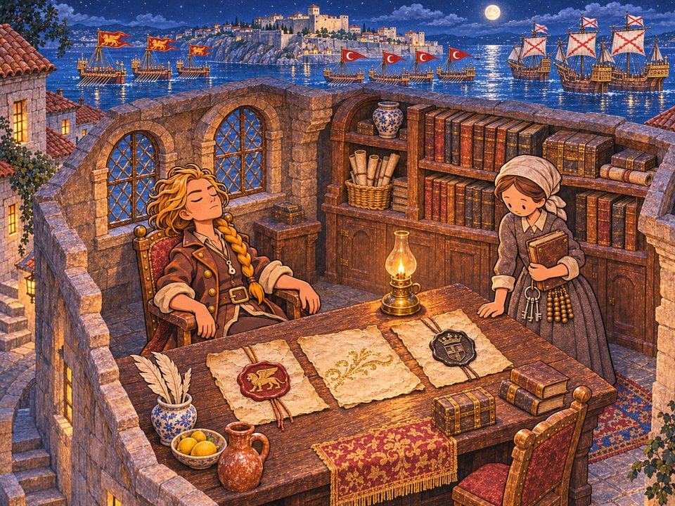
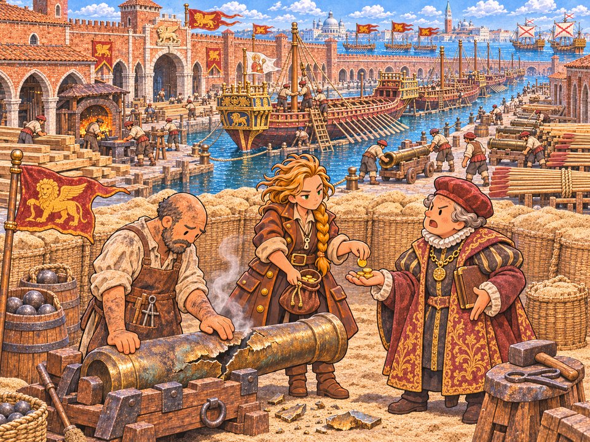

## 1. 소금과 금 궤

1569년 봄, 라구사 항구.

소금 가마니에서 뿜어져 나오는 텁텁한 내음과 젖은 양모의 노린내가 부두를 채웠다. 뱃전 아래에서는 봄 물결이 돌벽을 찰싹이며 때렸다.

스베티 블라호는 두 달 만에 고향 부두에 닻을 내렸다. 돛대 셋을 세우고 뱃고물을 높게 올린 덩치 큰 상선, 카락이었다. 주돛 한가운데 그려진 성 블라호의 붉은 겉옷이 바닷바람에 물결쳤다. 갑판에서는 밧줄 감는 소리와 인부들의 거친 숨소리가 뒤섞였다.

마리나는 난간을 짚은 채 부두를 내려다보았다. 목에는 깎은 뼈 호루라기가 걸려 있었다.

부두 돌바닥에는 마라가 서 있었다. 허리춤의 열쇠 꾸러미와 주판 구슬 줄이 걸을 때마다 짤랑거렸다. 마라는 짐을 나르는 인부들 사이를 오가며 가죽 장부에 짐 수를 적었다. 소금 가마니가 바닥에 내려놓일 때마다 하얀 가루가 돌 틈으로 흩날렸다.

마리나가 사다리를 밟고 내려오자 마라가 장부를 접지도 않은 채 내밀었다.

"소금 백스무 가마니, 양모 마흔 뭉치. 지난겨울을 넘겨 세 달 치 장부를 맞추고도 남는 게 얇아요."

"값은 어떻소."

"베네치아 은행가 자코모 그리마니 쪽 어음 이자가 또 불었어요. 올 들어 석 달째 이자만 갚고 있어요. 과부 혼자 장부를 붙잡고 앉았으니 은행가 쪽에서 더 만만히 보는 모양이에요. 다음 달까지 원금 일부라도 넣지 않으면 상회 창고에 저당이 붙을 판이에요."

마라는 마리나의 먼저 간 오빠의 아내, 곧 마리나의 올케이자 부니치 상회 전 주인의 며느리였다. 오빠가 폭풍에 배를 잃고 떠난 뒤로, 마라는 홀로 상회의 어음과 장부를 껴안고 시누이의 배가 돌아오기만을 기다려 왔다. 오빠가 이어받았어야 할 아버지의 배와 빚은, 어려서부터 그 배에서 밧줄을 잡아 온 마리나가 물려받았다.

마리나는 허리의 가죽 주머니에서 접힌 어음 사본을 만져 보았다. 부니치 상회의 오래된 빚은 베네치아 은행가의 어음으로 묶여 있었다. 아버지가 남긴 배와 상회를 지키려면 매달 돌아오는 기일을 넘길 수 없었다.

그때 부두 동쪽 끝에서 말발굽 소리와 쇠 바퀴 구르는 소리가 울렸다. 사람들이 양옆으로 길을 비켰다. 공화국 병사들이 에워싼 수레 위에는 쇠 띠를 두른 참나무 궤짝이 실려 있었다. 붉은 관복을 입은 귀족 둘이 수레 뒤를 따랐다.

"조공 사절이군." 마리나가 고개를 돌렸다.

해마다 원로원의 사절이 오스만 술탄에게 바칠 금을 싣고 이스탄불로 떠났다. 궤짝 안에는 금화 만 이천오백 두카트가 들어 있었다. 마라는 수레가 멈추고, 원로원 사절 비토 드르지치가 앞장서서 부두 끝 관선으로 오르는 것을 말없이 지켜보았다. 인부 넷이 끙끙거리며 금 궤짝을 들어 갑판 위로 옮겼다.

"저 금이 바다를 건너면 또 한 해가 조용하겠지요." 마라가 주판 구슬을 한 알 밀었다.

마리나는 목에 걸린 뼈 호루라기를 손가락으로 쥐었다.

"올해도 조용할지 모르지. 사절 얼굴이 지난해보다 굳어 있소."

수레 뒤를 따르던 원로원 서기 하나가 부두를 가로질러 스베티 블라호 앞으로 걸어왔다. 서기는 마리나의 겉옷과 뱃머리에 실린 청동 포 두 문을 훑어보더니 품에서 밀랍 찍힌 종이를 꺼냈다.

"선장, 원로원에서 이오니아해와 에게해를 지날 호위선을 구하오. 이번 사절은 뱃길로 이스탄불까지 가야 하는데, 봄바다에 해적이 잦소. 삯은 금화로 치르겠소."

마라가 주판을 든 채 마리나를 돌아보았다. 마리나는 어음 사본이 들어 있는 주머니를 한 번 누르고는 서기에게 손을 내밀었다.

"스베티 블라호가 앞장을 서겠소. 내일 새벽 썰물에 맞춰 닻을 올리리다."

서기가 물러간 뒤, 부두 끝 조선소 쪽에서 흰 수염에 톱밥이 묻은 사내, 스테판 코바치가 톱과 먹통을 쥔 채 걸어와 스베티 블라호의 뱃전을 두드려 보았다.

"겨울 파도에 뱃머리 이음새가 좀 벌어졌군, 마리나 선장." 스테판이 굵은 손가락으로 판자 틈을 짚었다. "출항하기 전에 내 목수들을 시켜 역청을 한 번 더 먹여 두겠소."

그 곁을 지나던 카밀라 벨라가 검은 양털 망토를 여미며 마라 쪽으로 고개를 끄덕였다. 제노바 억양이 남은 짧은 숨소리 끝에 소금 묻은 가죽 장부를 옆구리에 낀 여선장이었다.

"봄바다가 열리니 이스탄불 소금 값보다 모직물 값이 먼저 오르고 있소." 카밀라가 짧게 일러 주고는 제 프리깃 쪽으로 발길을 돌렸다. "에게해 물길에서 다시 봅시다."

## 2. 이스탄불로 가는 조공선

5월의 에게해는 낮에는 푸르고 밤에는 서늘했다.

스베티 블라호는 원로원 사절 비토 드르지치와 젊은 부사절이 탄 조공선의 반 마장 뒤를 따랐다. 뒤따르는 배의 선창 밑에는 쇠 띠를 두른 참나무 궤짝과 함께 술탄의 궁정에 바칠 은그릇과 라구사산 모직물이 실려 있었다. 비토 드르지치는 백발이 성성한 노인이었으나, 갑판 난간에 설 때마다 허리를 곧추세우고 항로를 살폈다. 젊은 부사절은 귀족 가문에서 처음 사절단에 뽑혀 나온 이였는데, 뱃전이 조금만 기울어도 밧줄을 꽉 쥐며 동쪽 수평선을 살폈다.

이오니아해를 내려와 펠로폰네소스 남단을 돌아 에게해 섬들 사이로 접어들자, 낮부터 불어오던 북서풍이 한결 눅어졌다. 키오스 섬 서쪽 물길에는 옅은 안개가 낮게 깔려 돛대 끝이 흐릿했다. 갑판장 로브로가 뱃머리 밧줄을 고쳐 매며 하늘을 올려다보았다.

"선장, 이런 날에는 섬 그늘에 숨어 있던 놈들이 노를 젓고 나옵니다." 로브로가 뱃전 아래 검은 물을 가리켰다. "바람이 죽으면 덩치 큰 카락이 먼저 굼떠지지요. 노를 쓰는 갤리옷이라면 반 시진 안에도 뱃구리에 붙소."

마리나는 대답 대신 돛대에 오른 파수꾼을 올려다보았다. 갑판 뒤편에서는 선원들이 화승에 불씨를 옮겨 두고 청동 포 옆에 포탄 바구니를 끌어다 놓았다. 정오 종이 울리고 얼마 지나지 않아 망대에서 짧은 외침이 떨어졌다.

"오른쪽 섬 바위 뒤에서 작은 배 둘이 나옵니다!"

낮은 돛을 접고 긴 노를 뻗은 갤리옷 두 척이었다. 뱃머리에 깃발도 달지 않은 무적선이었다. 두 배는 물결을 가르며 스베티 블라호와 조공선 사이를 파고들려 했다. 뒤따르던 조공선 갑판에서 사절단의 호위 병사들이 창과 화승총을 들고 난간으로 몰렸다. 비토 드르지치가 부사절의 팔을 잡아 선실 문 안쪽으로 밀어 넣는 모습이 보였다.

"조공선을 바람 위쪽으로 붙여라!" 마리나가 키잡이에게 소리쳤다. "로브로, 뱃머리 돛을 내려 속력을 줄이시오. 우리가 뒤쪽을 막는다."

스베티 블라호가 무겁게 선회하며 두 무적선의 앞길을 가로막았다. 뱃머리 포 덮개를 벗기자 눅눅하게 젖었다 마른 흑색 화약 냄새가 갑판으로 번졌다. 마리나가 뱃고물 포수에게 손짓했다.

"뱃머리 앞물을 때려라. 아직 사람 맞추지 마라."

첫 발은 적선의 뱃머리 앞 물기둥을 높게 세웠다. 짠 물보라가 한꺼번에 갑판을 덮치자 앞서 오던 갤리옷의 노잡이들이 박자를 잃고 흔들렸다. 두 번째 포탄이 적선의 앞돛대 횡목을 스치고 지나갔다. 부서진 나무 조각이 빗발처럼 갑판에 떨어졌다.

뒤따르던 다른 갤리옷은 스베티 블라호의 높은 뱃구리와 쇠 띠를 두른 선체를 보더니 노를 거꾸로 저어 물러나기 시작했다. 상선치고 포신 구경이 굵고 선원의 움직임이 군선 못지않다는 것을 알아차린 눈치였다. 앞서던 배도 키를 꺾어 바위 그늘 쪽으로 꽁무니를 뺐다.

"쫓으리까?" 로브로가 밧줄 칼을 쥔 채 물었다.

"놔두시오. 우리 짐은 해적이 아니라 금 궤짝이오. 헛되이 화약을 태울 것 없소."

마리나는 조공선 쪽으로 깃발 신호를 올려 항로를 다시 잡았다. 비토 드르지치는 갑판 난간에 기대어 숨을 고르다가 마리나 쪽을 향해 모자를 벗어 짧게 들어 보였다. 젊은 부사절은 그제야 굳어 있던 어깨를 풀고 갑판 위에 주저앉아 물통을 찾았다. 이틀 뒤 해질녘, 붉은 노을 아래로 다르다넬스 해협 어귀가 드러났다.

선실로 내려가자 마라가 등잔불 아래서 잉크병을 열고 있었다. 뱃전이 흔들리는 통에 책상 모서리에 놓인 나침반 바늘이 잘게 떨렸다. 마라는 장부 첫 줄에 그날 날짜와 쓰인 화약통 수를 적고는 깃펜을 내려놓았다.

"포탄 네 발, 화약 한 통 반. 조공선 선체에는 긁힌 자리 하나 없어요."

"그걸로 충분하오. 사절단 배에 기별이 왔을 텐데, 내일 아침이면 갈라타 부두에 닻을 내린다 하오."

"고생하셨어요. 조공 호위 삯을 받으면 선원들에게 밀린 몫부터 돌려요." 마라가 장부를 덮으며 말했다.

마리나는 탁자 위에 놓인 조공 호위 계약서를 한 번 쓸어내렸다. 붉은 밀랍 인장 없이, 라구사 공화국의 흰 종이에 적힌 검은 글씨였다. 창밖에서는 해협의 짙은 물결이 뱃전을 찰싹이며 부서졌다.

## 3. 금 궤의 수령증

이스탄불 금각만은 썩은 해초와 숯 연기, 그리고 갓 깎은 소나무 냄새가 한데 섞여 있었다. 사흘 밤낮을 더 달려 마르마라해를 건너는 동안 바다 위에는 다시 바람이 살아났다.

6월의 햇볕이 갈라타 언덕 아래 병기창 아치를 비추는 아침, 스베티 블라호와 조공선은 세관 부두 앞바다에 닻을 내렸다. 수면 위에는 초승달 깃발을 매단 오스만 갤리 수십 척이 줄지어 떠 있었고, 작은 거룻배들이 그 사이를 부지런히 오갔다. 언덕 위로 솟은 모스크의 둥근 지붕 아래로 갈라타 상인들의 돌창고들이 빽빽하게 늘어서 있었다.

사절 비토 드르지치와 부사절은 공화국 서기 둘과 호위 병사를 거느리고 뭍으로 올랐다. 쇠 띠를 두른 참나무 궤짝이 다시 수레에 실려 궁정 문 쪽으로 향했다. 뒤따르는 짐꾼들의 어깨 위에는 술탄의 궁정에 바칠 은그릇 상자와 붉은 라구사 모직물 꾸러미가 얹혀 있었다. 마리나는 부두 돌계단에 남아 사절단이 관청 마당으로 들어가는 뒷모습을 지켜보았다.

세관 부두 앞에서는 터번을 두른 서기들이 상선마다 올라와 짐 목록을 대조하고 있었다. 라구사 배는 조공국의 배라 하여 관세가 낮았으나, 서기들은 여전히 자루마다 꼬챙이를 찔러 보며 후추와 소금 무게를 달았다. 로브로가 갑판 위에서 세관원들에게 건넬 작은 은화 몇 닢을 쥐고 순서를 기다렸다.

정오가 지나서야 사절단 서기가 두꺼운 양피지 한 장을 들고 부두로 내려왔다. 술탄의 재무관이 찍은 금빛 먹 도장이 선명한 수령증이었다. 만 이천오백 두카트를 틀림없이 받았다는 증서와 함께, 한 해 동안 라구사 상선의 안전을 보장한다는 칙허장 사본이 딸려 있었다.

비토 드르지치가 수령증을 가죽 통에 넣으며 마리나에게 금화 자루를 내밀었다.

"공화국이 약속한 호위 삯이오. 한 닢도 모자라지 않으니 세어 보시오."

"사절 어른께서 세셨다면 다시 셀 것 없소."

마리나가 자루를 받아 들었을 때, 부두 위 돌계단 쪽에서 익숙한 웃음소리가 들렸다.

"성 블라호의 뱃머리가 금각만에 들어왔는데도 내게 기별도 없더구나."

돌아보니 키가 크고 붉은 기가 도는 머리를 한 사내가 터번 대신 라구사식 둥근 모자를 쓴 채 걸어 내려오고 있었다. 오스만식 긴 겉옷 허리춤에 짧은 곡도를 찬 니콜라 라스티치였다. 긴 콧수염 끝이 햇볕 아래서 붉게 빛났다.

"니콜라." 마리나가 금화 자루를 로브로에게 넘기고 계단 아래로 마주 나갔다.

니콜라는 마리나의 어깨를 세게 두드렸다. 그의 옷자락에서 정향과 바닷소금 냄새가 함께 풍겼다.

"사절단 배를 호위해 왔다더군. 에게해에서 해적 두 척을 쫓았다는 소문이 벌써 갈라타 부두까지 돌았다. 역시 네 뱃머리가 튼튼해."

"네 옷차림이 더 낯설다. 이제 술탄의 갤리를 모는 게냐."

"갈라타 우리 집안 상관이 오스만 해군에 목재와 삼베를 대고 있어. 지난해 가을부터는 아예 술탄 함대의 보급 호위선을 맡았다." 니콜라가 곁에 선 오스만 서기에게 터키 말로 짧은 인사를 건네고는 다시 마리나 쪽으로 몸을 숙였다. 목소리가 낮아졌다. "동쪽 바다 공기가 심상치 않다. 베네치아가 가진 키프로스 섬 쪽으로 병기창에서 포와 노를 밤낮으로 실어 내고 있어. 라구사 배라고 해도 내년 봄부터는 뱃길이 좁아질 거다."

마리나는 부두 너머 병기창 지붕 위로 피어오르는 검은 연기를 바라보았다. 아치 안에서 쇠망치 두드리는 소리가 쉴 새 없이 들려왔다.

"그럼 너도 전쟁에 나가는 거냐."

"배를 몰다 보면 피할 수 없겠지. 다만 깃발이 달라도 우리끼리 총부리를 겨눌 일은 없어야 하지 않겠나." 니콜라가 웃음을 거두고 겉옷 안쪽 주머니에서 밀랍으로 봉한 작은 편지 한 통을 꺼내 마리나의 손에 쥐여 주었다.

"라구사로 돌아가거든 우리 집 문턱에 들러 우리 어머니께 이것 좀 전해 다오. 갈라타에서 잘 지낸다고만 말씀드려. 내가 탄 배 이야기는 길게 하지 말고."

"알았다." 마리나가 편지를 받아 겉옷 안주머니에 넣었다.

니콜라는 부두에 매어 둔 제 거룻배로 내려가기 전에 뒤를 한 번 돌아보았다.

"겨울이 지나면 성벽 위에서 보자, 마리나. 야코도 나폴리에서 돌아온다고 했다."

거룻배의 노가 금각만의 탁한 물결을 가르고 멀어졌다. 마리나는 안주머니 속 편지 모서리를 손가락으로 한 번 눌러 보고 스베티 블라호로 돌아왔다.

## 4. 안나의 집과 겨울 어음

라구사의 늦가을은 돌담 틈으로 스며드는 습한 바람으로 시작되었다.

11월 초, 스베티 블라호는 알렉산드리아에서 실어 온 후추와 목화 뭉치를 부두 창고에 내리고 닻을 묶었다. 마리나는 선원들에게 그달 치 삯을 나눠 준 뒤, 혼자서 좁은 돌계단 골목을 올라 성벽 안쪽의 라스티치 집을 찾았다. 골목 돌벽마다 비에 젖은 이끼 냄새가 배어 있었다.

문 앞에는 작은 올리브나무 한 그루가 바람에 잎을 떨구고 있었다. 마리나가 나무 문을 두드리자, 검은 머리 수건을 두른 백발의 노파가 문을 반쯤 열었다. 니콜라의 어머니 안나였다. 세월이 내려앉은 얼굴이었으나 눈매는 아들과 닮아 길고 또렷했다.

"마리나, 네가 왔구나." 안나가 문설주를 잡은 채 안으로 들어오라고 손짓했다.

부엌 화덕 위에서는 쇠 냄비에 담긴 생선 수프가 조용히 끓고 있었다. 좁은 나무 탁자 위에는 닳은 촛대와 마른 빵 한 덩이가 놓여 있었다. 마리나는 안주머니에서 니콜라가 건넨 편지를 꺼내 탁자 위에 놓았다. 밀랍 봉인 위로 아들의 필체가 적혀 있었다.

안나는 편지를 바로 뜯지 않고 손바닥으로 봉투 위를 천천히 쓸어내렸다. 손마디가 굵고 거칠었다.

"살아는 있더냐."

"건강합니다. 갈라타 상관 일도 잘 풀리고 있고, 술탄의 배를 몰면서도 모자는 라구사 것을 쓰고 다닙니다."

안나가 짧게 숨을 내쉬었다. 눈가에 주름이 깊게 잡혔다.

"어느 깃발 아래 있든 제 몸만 성하면 되지. 다만 내년에는 바다가 시끄러워진다는 소문이 골목마다 돌더구나. 니콜라도, 야코도, 너도 다 배를 타니 내가 성 블라호 성당에 초를 세 개씩 켠다."

안나는 작은 나무 상자에서 말린 무화과 한 줌을 싸서 마리나의 손에 쥐여 주었다. 촛불 아래서 안나의 굽은 어깨가 벽에 길게 그림자를 드리웠다.

"마라에게 전해 주어라. 겨울에 장부 맞추느라 눈이 침침할 테니, 촛불 아래서 씹으라고. 네 오라버니가 떠나고 혼자 그 큰 장부를 끌어안고 있는 게 늘 마음에 걸린다."

"꼭 전하겠습니다, 어머님. 겨울이 지나기 전에 다시 들르지요."

집을 나서자 성벽 너머에서 저녁 종소리가 울렸다. 돌바닥에 떨어진 올리브 잎이 장화 밑창에 밟혀 바스락거렸다. 항구 쪽으로 내려오는 길에 스폰자 궁의 불 꺼진 회랑이 어둠 속에 잠겨 있었다.

부니치 상회로 돌아온 마리나는 마라가 켜 둔 호롱불 아래 앉았다. 긴 참나무 탁자 위에는 이스탄불 조공 호위 삯으로 받은 금화와 알렉산드리아 항해에서 남은 은화가 줄지어 놓여 있었다. 마라는 주판알을 하나씩 짚으며 베네치아 은행가 자코모 그리마니에게 보낼 겨울 어음 이자를 따로 떼어 가죽 주머니에 담았다. 주머니 안쪽에서 묵직한 은화들이 서로 부딪치며 둔탁한 소리를 냈다.

"이걸 보내면 올겨울 창고 저당은 막아요." 마라가 주머니 끈을 조이며 말했다. "하지만 원금은 아직 손도 못 댔어요. 내년 봄 기일이 돌아오면 이자만으로는 안 넘어갈 겁니다. 소금 배 한 척으로 갚을 수 있는 빚이 아니에요."

"니콜라도 봄이 되면 동쪽 바다가 시끄러울 거라고 했소." 마리나가 손바닥으로 탁자 모서리를 짚었다. "겨울 동안 배 밑창의 해초를 긁어내고 밧줄을 갈아 매 두어야겠소. 로브로에게 조선소 목수를 부르라고 이르리다."

"수리비까지 치르면 상회 금고에 남는 게 거의 없어요."

"배가 썩으면 빚도 못 갚소."

마리나는 어음 사본 옆에 놓인 라구사의 작은 지도를 내려다보았다. 안나가 건넨 무화과 꾸러미에서 달고 마른 내음이 났다. 바깥에서는 겨울비가 창문을 두드리기 시작했다.

"봄이 오기 전에 큰 삯을 주는 자리를 찾아야겠소. 어느 바다든."

마라는 대답 대신 무화과 꾸러미를 장부 옆에 내려놓고, 촛불 심지를 가위로 짧게 잘라 불빛을 돋우었다. 창고 지붕을 때리는 빗소리가 밤이 깊도록 잦아들지 않았다.

## 5. 세 개의 봉인

1570년 3월, 스폰자 궁 안뜰은 아침부터 쇠와 금이 부딪치는 소리로 시끄러웠다. 세관이자 조폐소인 이 돌건물 한쪽에서는 묵직한 저울추가 오르내리며 짐 무게를 달았고, 다른 쪽에서는 금화를 두드려 무게를 재는 소리가 울렸다. 창고에서 풍기는 후추와 말린 무화과 냄새가 회랑 그늘에 고여 있었다.

통관을 기다리는 선장들이 돌기둥 아래 모여 서 있었다. 저마다 항구 소문을 주고받느라 목소리가 낮게 깔렸다. 이층 회랑 난간에 원로원 서기가 나타나자 안뜰의 소음이 잦아들었다.

"이달의 수장과 원로원의 뜻을 전하오." 서기의 목소리가 돌벽에 울렸다. "공화국은 누구의 편도 아니오. 선장이 제 배로 맺는 계약은 선장의 일이오. 다만 이 성벽 안에서 맺지는 마시오."

선장들 사이에서 낮은 웅성거림이 번졌다. 지중해 동쪽 끝에 전운이 돈다는 소문이 봄바람과 함께 항구마다 퍼져 있었다. 서기가 회랑 안쪽으로 사라지자 선장들은 흩어져 각자의 배나 골목 안 상관으로 발걸음을 돌렸다. 마리나는 서류 주머니 끈을 조여 매고 안뜰을 빠져나왔다.

부니치 상회로 돌아온 뒤, 그날 하루 동안 세 사람이 따로따로 문턱을 넘었다.

낮에는 베네치아 함대 감독관의 서기 마테오 모로가 찾아왔다. 그는 외투 깃을 세운 채 골목 양쪽을 살피더니, 상회 문을 닫고 나서야 가죽 가방에서 양피지 한 장을 꺼냈다. 아래쪽에는 붉은 밀랍으로 찍은 날개 달린 사자 인장이 선명했다.

"코르푸에 계신 베니에르 감독관께서 보냈소. 동쪽 바다가 심상치 않소. 짐을 나를 큰 배와, 싸움에 쓸 작은 배를 함께 구하시오. 넉 달 치 삯을 미리 치르겠소."

서기가 돌아가고 해가 기울 무렵, 터번을 두른 상인이 뒷문으로 들어왔다. 술탄의 명을 전하는 사절인 차우시를 따라 라구사에 온 시리아 출신 상인이었다. 그의 옷자락에서는 정향과 장미수 냄새가 배어 나왔다. 상인은 두꺼운 향내 나는 종이를 펴 보였다. 종이 위에는 금가루를 뿌린 술탄의 서명이 반짝였다.

"술탄의 함대는 곡식과 화약을 실을 라구사 배를 찾고 있소. 오스만 항구마다 세금을 면해 줄 것이오. 조공국 배라 하여 괄시하는 일도 없을 거요."

밤이 깊어 호롱불을 켰을 때, 마지막 손님이 문을 두드렸다. 나폴리 부왕의 대리인이었다. 검은 망토를 벗은 그는 젖은 소금 냄새를 풍기며 묵직한 양피지를 탁자에 놓았다. 검은 밀랍 봉인 위로 왕관과 방패 문양이 돋을새김되어 있었다.

"에스파냐 왕의 깃발 아래 서면 나폴리 부두를 마음대로 쓰고, 삯도 두둑이 받게 될 것이오. 카락처럼 큰 배는 왕의 함대에서도 귀하게 대접하오."

세 대리인이 모두 돌아간 뒤, 상회의 좁은 방에는 호롱불 기름 타는 냄새만 남았다.

긴 참나무 장부 탁자 위에 계약서 세 장이 나란히 놓였다. 붉은 사자, 금가루 서명, 검은 왕관 방패. 마라는 탁자 모퉁이에 서서 말없이 세 봉인을 내려다보았다. 마리나는 호롱불 심지를 돋우지도 않은 채 의자 등받이에 기대어 눈을 감았다.

## 6. 열네 해 만의 성벽

밤바람은 차고 매웠다. 로브리예나츠 성벽 위 돌바닥에는 낮의 열기가 한 점도 남아 있지 않았다. 돌계단을 오르는 마리나의 가죽 장화 밑창이 차가운 석회암을 긁었다.

마리나가 계단 끝에 올라서자 성벽 난간에 기대어 서 있던 그림자 둘이 고개를 돌렸다. 열네 해 전과 같은 자리였다. 성채 정문 아래쪽 아치에는 어둠에 잠긴 돌글씨가 묵묵히 걸려 있었다.

"늦었구나, 마리나."

니콜라였다. 금각만에서 본 라구사식 둥근 모자에 오스만식 긴 겉옷 차림 그대로였다. 서른둘이 된 그는 여전히 붉은 기 도는 머리에 긴 콧수염을 기르고 있었다. 그 옆에는 작고 다부진 몸집의 야코가 서 있었다. 서른의 야코는 짧은 갈색 머리에 에스파냐식 검은 겉옷을 입고 흰 주름 깃을 세우고 있었다.

"너희 둘 다 벌써 정한 모양이구나." 마리나가 둘의 옷차림을 훑으며 말했다.

니콜라가 긴 겉옷 안쪽을 톡톡 두드렸다.

"술탄의 서명이 든 계약서가 여기 있다. 갈라타 우리 집안 상관이 얽혀 있기도 하고, 지난해 금각만에서 본 뒤로 이쪽 배를 계속 타기로 했다. 게다가 나는 이제 남의 바다 말로도 꿈을 꾼다."

니콜라가 터키 말로 짧은 농담을 던지고는 씩 웃었다.

야코가 팔짱을 끼며 낮게 말했다.

"나는 나폴리 부왕의 종이를 품에 넣었다. 거기 내 약혼자 키아라가 기다리고 있어. 내년 봄에는 혼인을 올리기로 했다. 에스파냐 배를 타면 나폴리 항구를 제집처럼 드나들 수 있지."

두 친구의 시선이 마리나에게 쏠렸다. 아래쪽 라구사 항구에는 검은 바다 위로 닻을 내린 배들의 등불이 별처럼 흩어져 있었다.

"나는 아직 정하지 못했다." 마리나가 난간 돌을 손바닥으로 쓸었다.

"셋이 다 다른 배를 타게 생겼군." 야코가 중얼거렸다.

"배는 달라도, 그때 한 말은 같아." 니콜라가 손을 내밀었다. "누가 어느 깃발 아래 있든, 라구사 배는 라구사 배를 쏘지 않는다."

야코가 말없이 고개를 끄덕이며 손을 얹었다. 마리나는 목에 걸린 뼈 호루라기를 들어 입술에 물었다.

길게 한 번, 짧게 한 번, 다시 길게 한 번.

맑고 날카로운 호루라기 소리가 밤바다 위로 길게 뻗어 나갔다. 항구 아래 어딘가에서 개 짖는 소리가 작게 들릴 뿐, 바다는 어둠 속에 잠겨 있었다. 마리나는 호루라기를 쥔 채 두 친구의 얼굴을 번갈아 보았다.

## 7. 고르는 자리와 아르세날레

아침 햇살이 스베티 블라호 선실의 작은 창으로 비스듬히 들어왔다. 마리나는 이른 아침에 배를 라구사 방파제 밖 정박지로 내보내 닻을 내린 참이었다. 성벽 안에서 계약하지 말라는 원로원의 명을 지킨 셈이었다. 창밖에서는 닻줄이 뱃전을 긁는 소리와 봄 물결이 선체를 두드리는 소리가 들렸다.

선실 탁자 위에는 어젯밤과 같은 세 통의 계약서가 나란히 놓여 있었다. 맨 왼쪽에는 붉은 밀랍에 날개 달린 사자가 찍힌 베네치아의 종이, 가운데에는 금가루로 술탄의 서명을 새긴 오스만의 종이, 맨 오른쪽에는 검은 밀랍의 왕관 방패가 찍힌 에스파냐의 종이였다. 마리나는 세 봉인을 차례로 내려다보았다. 가운데를 집으면 니콜라와 함께 오스만 항구마다 세금을 면하고 곡식과 화약을 나르게 된다. 오른쪽을 집으면 야코 곁에서 나폴리 부두를 드나들며 굵은 삯을 받는다. 왼쪽을 집으면 당장 베네치아 은행가의 이자 기일을 막을 선금을 쥘 수 있다.

마리나의 오른손이 망설임 끝에 맨 왼쪽의 붉은 밀랍을 집었다. 금가루 서명과 검은 왕관 방패가 찍힌 두 통은 말아서 탁자 한쪽으로 밀어 두었다.

마리나가 깃펜을 잉크병에 찍어 계약서 아래 빈칸을 채웠다. 넉 달 치 삯을 미리 받고, 카락 스베티 블라호에 더해 갤리 두 척을 베네치아에서 꾸려 선단을 이룬다는 조항이었다. 마리나의 손끝에 묻은 잉크가 손마디에 검은 얼룩을 남겼다.

"성벽 안에서는 맺지 말랬으니 여기서 맺소." 마리나가 깃펜을 내려놓으며 말했다.

맞은편에 앉은 마라가 좁은 선실 탁자 모퉁이에서 주판알을 한 번에 쓸어내렸다.

"깃발을 고른 게 아니에요. 빚쟁이를 고른 거지."

"자코모 그리마니의 어음을 갚으려면 베네치아 금화가 필요하오. 넉 달 치 선금을 받으면 올해 이자는 막을 수 있소."

"그 다음 넉 달은요?"

"그때는 또 그때 셈을 맞추겠소."

마라가 입술을 꾹 다물고 더 말하지 않았다. 그녀는 빚 장부 옆에 새 양피지 한 장을 꺼내 먹으로 선을 그었다.

마리나는 서명을 마친 뒤, 빈 양피지 한 장을 더 끌어당겼다. 깃펜 끝을 다듬고 계약서의 조항을 첫 줄부터 끝 줄까지 제 손으로 한 자씩 베껴 쓰기 시작했다. 삯을 주는 날, 보급을 대는 방식, 배가 부서졌을 때의 값까지 빠짐없이 옮겨 적었다. 잉크가 마르기를 기다려 모래를 뿌렸다가 털어 내고, 사본을 접어 겉옷 안주머니에 깊숙이 찔러 넣었다. 원본은 베네치아 서기에게 보낼 몫이었다. 나머지 두 통의 계약서는 인편에 돌려보낼 참이었다.

"로브로에게 출항 준비를 시키시오." 마리나가 일어나 겉옷을 여몄다. "사흘 뒤에 베네치아로 닻을 올리겠소."

*(만약 마리나가 이 자리에서 가운데 봉인이나 오른쪽 봉인을 집었다면, 이야기는 2부부터 「다른 깃발 아래에서」 장으로 갈라진다.)*

베네치아의 아침은 석회와 송진 냄새로 열렸다.

아르세날레의 붉은 벽돌 담장 안으로 들어서자 귀가 먹먹할 만큼 거친 망치질 소리가 밀려왔다. 길게 뻗은 중앙 운하를 따라 선체만 갖춘 갤리들이 물 위에 떠서 천천히 움직이고 있었다. 물길 양옆으로는 미리 깎아 둔 참나무 늑골과 돛대, 노 묶음이 산더미처럼 쌓여 있었다.

선체가 작업대 하나를 지날 때마다 일꾼들이 줄지어 서서 돛대를 세우고, 다음 자리에서는 긴 노를 끼워 넣고, 그 다음 자리에서는 뱃머리에 청동 포를 실었다. 땀에 젖은 목수 하나가 톱밥을 털어 내며 마리나 일행에게 턱짓으로 자랑했다.

"전시가 되면 하루에 한 척씩도 물에 띄워 내보낸다는 곳이오. 깎고 맞추는 걸 미리 해 두니 빠를 수밖에."

마리나는 운하 옆 돌길을 따라 포 시험장으로 걸어갔다. 쇠와 화약 냄새가 매캐하게 코를 찔렀다. 모래를 채운 두꺼운 방벽 뒤쪽에서 그을린 나무 받침대들이 줄지어 서 있었다.

시험장 한쪽 모래 언덕 앞에서는 고함이 오가고 있었다. 가죽 앞치마를 두른 사내 하나가 감독관 앞에서 허리를 굽히지 않고 버티고 서 있었다. 대머리에 눈썹이 불에 그을린 마흔여덟쯤의 사내였다. 왼손을 들었을 때 약지와 새끼손가락 둘이 없는 것이 눈에 띄었다.

발치에는 포신이 길게 찢어져 나간 청동 포 한 문이 식어 가며 매캐한 연기를 뿜고 있었다.

"금 간 쇠를 녹여 부어 놓고 내 탓이라니! 장약은 정량만 넣었소." 사내가 쉰 목소리로 소리쳤다.

"시끄럽다, 토마 벤드라민. 시험장에서 포를 터뜨렸으니 벌금을 물고 나가거라." 감독관이 장부를 덮으며 혀를 찼다.

사내는 찢어진 포신을 거친 손으로 한 번 쓸어내렸다. 왼손의 남은 세 손가락이 검은 그을음에 묻혔다.

"미안하다, 파올로. 내가 쇠 결을 못 알아봤구나."

사내가 터진 포를 사람 이름 부르듯 부르자 감독관이 코웃음을 쳤다. 마리나가 걸음을 옮겨 감독관 앞을 막아섰다.

"포수장의 벌금이 얼마요."

감독관이 마리나의 검붉은 겉옷과 허리춤을 훑어보더니 금화 액수를 불렀다. 갤리 노잡이 열 명의 한 달 삯과 맞먹는 적지 않은 돈이었다. 마리나는 계약할 때 미리 받아 둔 금화 주머니를 풀어 셈해 주었다. 묵직한 금화 열 닢이 감독관의 손바닥에 떨어졌다.

토마 벤드라민이 고개를 돌려 마리나를 보았다. 화약 그을음이 내려앉은 눈썹 아래 두 눈이 가늘어졌다.

"라구사 사람인가 보군. 내 빚을 대신 갚아 봤자 자네 배에는 쏠 포도 변변치 않을 텐데."

"내 갤리 두 척에 포를 얹어야 하오. 이름까지 붙여 가며 아끼는 사람이라면 믿고 맡길 만하지."

토마는 찢어진 포 「파올로」를 한 번 더 돌아보더니, 땅에 떨어져 있던 쇠 화승 막대를 주워 허리띠에 꽂았다. 그는 가죽 앞치마 끈을 풀지 않은 채 마리나를 따라나섰다.

"포는 깃발을 모르오, 선장. 화약과 쇠만 알 뿐이오."

베네치아 부두로 돌아온 마리나는 선금으로 아르세날레에서 갓 나온 중형 갤리 두 척을 빌려 꾸렸다. 가볍고 날랜 라 콜롬바, 뱃머리가 조금 더 단단한 산타 엘레나. 스베티 블라호까지 합쳐 세 척의 선단이 되었다. 로브로가 스베티 블라호의 뱃전에 서서 노와 밧줄을 챙겼다.

부두 앞 선술집 골목에서는 노잡이를 모으는 북소리가 둥둥 울렸다. 마리나는 삯을 받고 스스로 노를 잡는 자유민 노잡이들만 골라 명부에 올렸다. 두 갤리에 들어갈 노잡이들을 모으느라 사흘이 꼬박 걸렸다. 늙은 어부, 농사를 접고 나온 달마티아 젊은이, 뱃일에서 뼈가 굵은 선원들이 한 명씩 이름을 올리고 계약금을 받아 갔다.

마지막 날 오후, 마리나가 라 콜롬바의 갑판을 살피는 동안 바로 옆 부두에 댄 베네치아 관선 갤리에서 쇠사슬 끌리는 소리가 났다. 뱃전 위로 발목에 쇠고랑을 찬 죄수 노잡이들이 줄지어 올라가고 있었다. 등줄기에 마른 채찍 자국이 남은 사내 하나가 물통을 받아 들며 고개를 숙였다. 옆에서 지켜보던 로브로가 침을 삼켰다. 마리나는 시선을 거두고 로브로에게 닻줄을 살피라고 일렀다.

선실 좁은 탁자 위에서는 마라가 주판알을 튕기고 있었다. 촛불 아래 펼쳐진 장부에는 세 줄의 셈이 나란히 적혀 있었다.

노잡이와 선원 삯. 한 달 치 군량. 화약과 납탄 값.

"갤리 두 척이 늘어나니 한 달에 나가는 돈이 스베티 블라호 한 척 몰 때의 네 곱입니다." 마라가 손가락으로 세 번째 줄을 짚었다. "선금으로 받은 넉 달 치는 여름을 넘기기도 빠듯해요. 게다가 자코모 그리마니 쪽 이자 기일도 코앞입니다."

마리나는 탁자 위에 새로 깐 지중해 해도를 내려다보았다. 아직 못이 하나도 박히지 않은 새 양피지 위로 베네치아와 아드리아해의 해안선이 선명했다.

"그래서 물건을 실어 나르며 싸움도 해야 하오. 내일 새벽에 코르푸로 내려가오."

마라가 장부 모퉁이에 잉크 점을 찍어 닫았다. 촛불 심지가 타닥거리며 작은 불꽃을 튀겼다.
