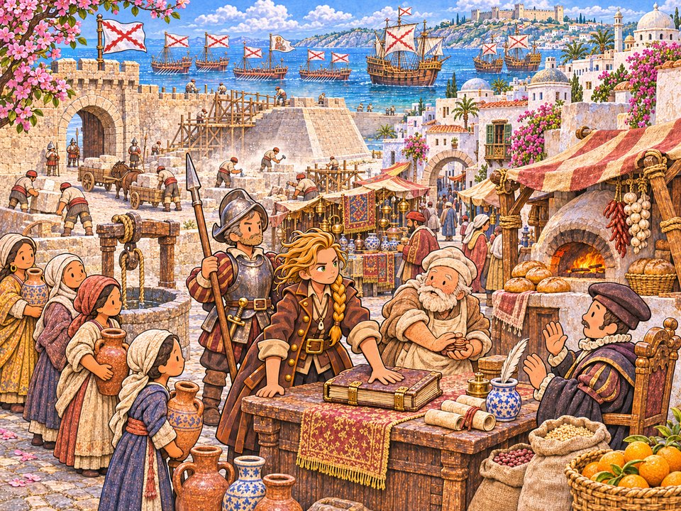

## 1. 새 성채와 노인

성문 밖 모래땅에 돌과 흙을 나르는 수레바퀴 소리가 새벽부터 어스름까지 끊이지 않았다.

병사들과 일꾼들이 튀니스 성문 바깥쪽 낮은 언덕에 새로운 요새를 쌓기 시작했다. 돌출 보루 네 모서리를 밖으로 뾰족하게 내밀어 대포를 걸 수 있게 만든 「새 성채」였다. 공사장에서는 석회 가루가 바람에 날리고 인부들의 목쉰 고함이 끊이지 않았다. 마리나의 선단은 나폴리와 메시나에서 실어 온 곡식과 석회, 참나무 목재를 성채 공사장과 군항 창고에 웃돈을 받고 넘겨, 불어난 여섯 척의 삯과 군량을 맞추었다.

나흘째 되던 날 오후, 마리나는 디에고와 함께 군량 명부 몇 장을 들고 성안 시장으로 들어갔다. 좁은 골목 양옆에 짠 고기와 말린 대추야자, 구리 주전자를 깐 좌판이 늘어서 있었고, 군데군데 붉은 모자를 쓴 이곳 상인들이 창을 든 병사들의 눈치를 살피며 물건을 덮고 있었다. 골목 어귀 우물가에는 물을 길으려는 아낙들이 줄을 서 있었고, 에스파냐 보병 둘이 창을 세운 채 세금 징수원을 따라 좌판을 돌며 동전을 걷고 있었다.

빵 굽는 화덕 앞 좌판에서 징수원과 늙은 상인이 목소리를 높이고 있었다. 수염이 하얗고 등 굽은 노인이 구리 동전 몇 닢을 손바닥에 올린 채 내밀지 않고 버티는 참이었다. 징수원이 마리나를 보더니 허리를 굽혀 인사를 하고, 손에 든 장부를 들어 보였다. 성채 쌓는 비용과 수비대 군량 몫으로 시장 좌판마다 하루 세금을 더 매긴 장부였다.

노인이 가늘게 뜬 눈으로 마리나의 검붉은 모직 겉옷과 목에 걸린 뼈 호루라기를 훑어보았다.

"배를 몰고 온 선장이오?" 노인이 이탈리아 말과 아랍 말을 섞어 투박하게 물었다. "저쪽 요새 돌을 쌓는 건 당신들인데, 왜 화덕 앞 빵 값에까지 세금을 붙이오."

노인은 손에 쥔 동전을 다시 앞치마 주머니에 쓸어 넣으며 낮게 덧붙였다.

"깃발이 바뀌어도 세금은 우리가 냅니다."

마리나는 두 해 반 전 겨울, 파마구스타의 어두운 창고 안에서 밀가루 묻은 손을 내밀던 빵집 주인 니코스를 떠올렸다.

시장 골목 끝 우물가에서는 여전히 물통을 인 여인들이 줄을 서서 기다리고 있었다. 마리나는 징수원의 손에서 세금 장부를 받아 들어 덮었다.

"이번 철 시장 세금은 걷지 마시오." 마리나가 징수원에게 말했다. "한 철 미루고, 군량 값은 배에서 내린 몫으로 달아 두시오."

"하지만 나폴리 재무관의 명부가……."

"명부에는 내가 서명하겠소."

징수원이 마지못해 고개를 숙이고 물러났다. 노인은 고맙다는 말 없이 화덕 안쪽 불씨를 긴 나무 삽으로 뒤적였다. 마리나가 몸을 돌려 성문 밖으로 나설 때, 시장 바닥 돌길 위로 땀에 절은 돌 나르는 인부들의 행렬이 다시 길게 지나갔다.

## 2. 성채의 석회와 곡식

11월 하순, 마리나의 선단은 다시 시칠리아 해협을 건너 메시나로 갔다. 튀니스 성문 밖 새 성채의 돌벽을 올릴 석회와 포대를 짤 참나무 대들보, 그리고 겨울을 날 밀가루를 실어 나르기 위해서였다.

메시나 부두 창고 앞은 이른 아침부터 짐수레가 뒤엉켜 소란스러웠다. 로브로가 선원들을 불러 모아 스베티 이반과 산타 마리아의 선창에 석회 가마니를 차곡차곡 쟁였고, 마라는 부두 계단 위에서 시칠리아 상인과 참나무 판자 값을 한 닢씩 깎았다. 상인이 손가락 네 개를 펴 보이자 마라가 주판알을 두 번 튕기며 고개를 저었다.

"석회 가마니 밑에는 반드시 마른 짚을 깔아라." 로브로가 소리쳤다. "바닷물이 스며들면 배 밑창에서 돌처럼 굳어 버린다. 그날로 배를 못 쓰게 된단 말이다."

디에고 오르티스는 부두 한편에서 병사들에게 말린 대구와 짠 고기 통을 지게에 지워 스베티 블라호 갑판으로 나르게 했다. 뱃고물에서는 토마 벤드라민이 아르세날레에서 받아 온 여분 화약통에 기름 먹인 천을 덧대어 습기를 막았다.

짐을 다 싣고 메시나를 떠나 시칠리아 남쪽 끝을 돌아 내려갈 때였다. 안개 낀 새벽바다 저편, 트리폴리 방면에서 북상하던 오스만 정찰 갤리 두 척이 보급 선단의 뱃머리를 가로막고 나섰다. 선창마다 무거운 석회와 곡식을 실은 탓에 카락과 갈레온들의 움직임이 무뎠다. 바람마저 잦아들어 돛이 힘을 받지 못하는 시간이었다.

마리나가 스베티 블라호의 뱃머리를 돌려 정찰선 앞을 막아섰다. 토마 벤드라민이 왼손의 남은 세 손가락으로 화승 심지를 잡아 당기며 청동 포 「안툰」의 포신을 낮추었다.

"너무 가까이 붙이지 마시오." 토마가 외쳤다. "배가 무거우니 뱃머리를 스치기만 해도 판자가 깨지오."

「안툰」이 뿜어낸 포탄이 앞선 오스만 갤리의 노를 부러뜨리며 물기둥을 세웠다. 물보라가 갑판 앞쪽까지 들이쳤고, 화약 연기가 안개와 섞여 뱃전을 덮었다. 로브로가 즉시 돛줄을 당겨 배를 돌리자, 뒤따르던 산 로렌초와 두브라바가 양쪽에서 포문을 열었다. 두 척의 정찰선은 보급선들이 틈을 내어 주지 않자 곧 뱃머리를 돌려 남동쪽 안개 속으로 사라졌다.

이틀 뒤 튀니스 부두에 닿은 마리나는 석회와 참나무 목재를 모두 성채 공사장에 내려놓았다. 야코가 성문 밖 흙먼지를 뒤집어쓴 채 부두로 걸어 나와, 짐을 부리는 마리나의 선원들에게 물통을 건넸다.

"이 돌벽이 봄까지 다 올라갈지 모르겠구나." 야코가 흙 묻은 소매를 털며 중얼거렸다. "인부들은 늘 모자라고, 나폴리에서 올 석공들은 소식이 없다."

"성채 돌벽에 대포를 걸 포대 자리부터 먼저 다져야 하지 않겠냐." 마리나가 성문 바깥 낮은 언덕을 가리키며 물었다.

"수비대장 가브리오 세르벨로니 장군이 보루 네 모서리부터 뾰족하게 쌓으라고 재촉하고 있다." 야코가 쓴웃음을 지으며 대답했다. "그래도 네가 메시나에서 실어 온 석회 가마니 덕분에 내일부터는 흙 대신 돌을 붙일 수 있겠다."

부두 한쪽에서는 디에고 오르티스가 젊은 병사 루이스와 함께 석회 가마니를 당나귀 수레에 싣고 있었다. 마라는 성채 공사장 서기와 마주 앉아 참나무 대들보와 석회 값을 장부에 달아 두었다. 마리나는 말없이 야코의 어깨를 한 번 두드리고 부두 창고로 발길을 돌렸다. 해가 기울며 튀니스 성벽 위로 붉은 모래바람이 불어왔다.

## 3. 오지 않는 돈

12월 들어 바다 바람이 차가워졌다. 항구 바깥쪽 물결이 검푸르게 일었고, 새 성채의 돌벽은 절반쯤 올라간 채 찬 비를 맞고 있었다.

돈 후안이 나폴리로 돌아가기 전날, 항구 앞 부두에서 짧은 작별 사열이 열렸다. 은빛 흉갑 위에 검은 모직 망토를 걸친 스물여섯의 총사령관은 기함 사다리 앞에 서서 수비대 장수들과 선장들의 인사를 받았다. 스베티 블라호의 선장으로서 줄 맨 끝에 선 마리나와, 나폴리 갈레온의 선장 야코도 그 자리에 있었다.

돈 후안이 성벽과 아직 덜 쌓인 새 성채 쪽을 돌아보았다. 젊은 사령관의 얼굴이 겨울 바람에 붉게 상기되어 있었다. 나폴리 함대의 장수들이 마리나를 「제독 대리」라 부르며 선단 여섯 척의 지휘를 맡기고 앞줄로 세워 주었으나, 정작 마리나가 다음 달 군량과 병사들 삯이 담긴 서류를 내밀자 돈 후안은 종이를 훑어보지도 않고 옆의 부관에게 넘겼다.

"짐과 병사는 나폴리에서 봄이 오기 전에 다시 보내겠소." 돈 후안이 말머리를 돌리며 혼잣말처럼 낮게 중얼거렸다. "형님은 이 항구를 지도에서만 보시네."

사열이 끝나자 돈 후안의 기함은 닻을 올리고 시칠리아 쪽으로 뱃머리를 돌렸다. 부두에 남은 것은 수비대와 라 골레타 요새의 병사들, 그리고 마리나의 라구사 선단 여섯 척뿐이었다. 바다 건너 북쪽 하늘에는 먹구름이 낮게 깔려 있었고, 닻줄을 감아 올리는 기함의 뱃노래가 바람에 묻혀 금세 끊겼다.

겨울이 깊어졌으나 왕의 배는 오지 않았다. 시칠리아에서 온 작은 연락선 두 척만 편지 꾸러미를 내렸을 뿐, 삯을 실은 금 궤는 하나도 부려지지 않았다.

스베티 블라호의 선실은 등잔불을 두 개나 켜도 어두웠다. 마라가 장부를 펴고 주판알을 튕길 때마다 잦아든 기침 소리가 섞였다.

"두 달 치 삯이 밀렸어요." 마라가 장부 끝 줄을 손가락으로 눌렀다. "스베티 블라호와 다섯 배의 선원 몫이 금화 천사백 닢, 거기에 새 성채 수비대에 내준 밀가루와 소금 값이 팔백 닢이에요. 상회 어음에 이자가 또 붙습니다."

마리나는 대꾸 없이 선실 밖으로 올라갔다. 갑판 아래 부두 돌바닥에는 라 골레타 요새로 들어갈 짐을 지키던 에스파냐 병사들이 모닥불을 피우고 모여 앉아 있었다. 밀린 삯 때문에 불평이 터져 나올 만한 자리였으나, 사내들의 목소리는 낮게 가라앉아 있었다.

디에고 오르티스가 모닥불 곁에서 병사들에게 마른 고기와 빵 조각을 나누어 주고 있었다. 창자루에 기대어 서 있던 젊은 병사 루이스가 얇은 가죽 장화를 내려다보며 한숨을 내쉬자, 디에고가 아무 말 없이 제 몫으로 받은 빵 반쪽을 루이스의 손에 쥐여 주었다.

"배부른 소리 마라, 루이스." 디에고가 굵은 목소리로 말했다. "나폴리에서 올 돈은 늦어도 봄에는 온다. 그때까지 창끝이나 닦아 두어라."

루이스는 빵을 받아 들고 말없이 고개를 끄덕였다. 모닥불에서 젖은 나무가 타며 매운 연기를 뿜었다.

## 4. 오스만 봉쇄선 돌파

1574년 2월, 시칠리아와 북아프리카 사이의 겨울 바다는 사나웠다.

튀니스의 굶주림이 깊어지자, 마리나는 나폴리에서 직접 구해 온 밀과 소금, 약재를 싣고 다시 남쪽 바다로 내려왔다. 그러나 라 골레타 외항 앞바다에는 이미 트리폴리와 알제에서 올라온 오스만 사략선과 봉쇄선 다섯 척이 진을 치고 있었다. 겨울 빗속에서도 적선들의 붉은 등불이 수평선 너머로 드문드문 떠 있었다.

폭풍우가 몰아치던 밤, 시라쿠사에서 합류한 호위 선단 선실에 에스파냐 쪽 선장 둘이 마리나와 마주 앉았다. 한 사람은 세비야 인디아스 선단의 항해 장부를 맡았던 상선장 프란시스코 모랄레스였고, 다른 한 사람은 기니 해안을 오가던 과묵한 포르투갈 항해사 디오고 알메이다였다.

"봉쇄선이 어귀를 막았으니 정면으로 밀고 들어가면 짐배가 먼저 부서집니다." 프란시스코 모랄레스가 장부 끝을 손가락으로 두드리며 말했다. 세비야에서 큰 대양 나우를 몰며 배 밑창 무게를 귀신같이 맞추던 사내답게, 그는 탁자 위의 짐 목록부터 살폈다. "내 나우는 흘수가 깊어 얕은 여울을 타지 못하니, 카락과 작은 배가 앞장서서 불빛을 끌어 주셔야겠소. 짐이 물에 젖으면 이번 겨울 튀니스는 끝장이오."

옆에 앉은 디오고 알메이다는 말없이 나침반만 손바닥에 올려놓고 고개를 한 번 끄덕였다. 젖은 양털 모자 아래로 물방울이 떨어졌으나, 디오고는 닦을 생각도 하지 않고 바람 방향만 가늠했다. 바람과 조류의 결을 읽을 때면 입을 다문 채 눈빛으로만 길을 짚는 사내였다.

"자정이 지나면 조류가 바깥에서 안쪽으로 바뀝니다." 하산이 탁자 모서리에 턱을 괸 채 말했다. "그 물살을 타면 등불을 끄고도 미끄러져 들어갈 수 있소."

자정이 지나 빗줄기가 굵어지자, 마리나의 스베티 블라호와 디오고 알메이다의 카라벨랑이 불을 끈 채 앞장을 섰다. 뒤에서는 프란시스코 모랄레스의 나우와 라구사 배들이 바짝 꼬리를 물었다. 거친 파도가 뱃전을 때릴 때마다 소금기 어린 물보라가 선원들의 얼굴을 덮쳤다.

오스만 봉쇄선 두 척이 빗속에서 등불을 치켜들고 다가오자, 디오고가 과묵하게 키를 꺾어 얕은 모래턱 바깥쪽으로 적선을 유인했다. 적선이 뱃머리를 돌리며 화승총을 쏘아 댔으나, 빗발 속에 총알은 허공으로 흩어졌다. 마리나의 「안툰」이 빗소리를 뚫고 두 번 불을 뿜는 사이, 프란시스코의 보급 나우가 열린 틈을 타 라 골레타 방파제 안쪽으로 미끄러져 들어갔다.

다음 날 아침, 부두에 내려진 밀 포대 앞에서 프란시스코가 마라와 짐 목록을 맞추었다. 마라는 물에 젖은 포대가 하나도 없음을 확인하고 고개를 끄덕였다.

"겨울 폭풍을 뚫고 이만한 짐을 무사히 대어 준 선장은 처음 보오." 프란시스코가 장부책을 덮으며 감탄했다. "다음 항해에는 나폴리에서 화승총 탄환 상자도 함께 실어 옵시다."

"어젯밤 어두운 여울로 적선을 끌어낸 것은 디오고 선장의 키 잡는 솜씨 덕분이오." 마리나가 옆에 서 있던 디오고 알메이다를 가리켰다.

디오고는 젖은 망토의 물기를 털어 내며 짧은 미소만 지은 채 말없이 제 배의 갑판으로 돌아갔다. 부두 끝에서는 로브로와 선원들이 밤사이 찢긴 돛줄을 갈아 끼우느라 분주했다.

## 5. 하산의 측량선

봄바람이 불기 시작한 4월 초, 튀니스 외항의 물빛이 조금씩 맑아졌다.

그러나 성문 밖 새 성채의 돌벽은 여전히 반쯤만 쌓인 채 멈추어 있었고, 나폴리에서 온 연락선은 이번에도 삯 대신 「여름까지 버티라」는 종이 한 장만 내려놓고 떠났다. 부두 어귀에 쌓여 있던 밀가루 포대도 바닥이 보이기 시작했다. 성안 시장 화덕 앞에서는 다시 밀가루 한 줌을 구하려는 아낙들이 새벽부터 줄을 섰다.

어느 달 없는 밤, 스베티 블라호의 뱃머리에 서 있던 하산이 조용히 마리나를 불렀다.

"선장님, 요새 뒤쪽 석호의 물길을 미리 재어 두어야겠소." 하산의 시선이 라 골레타 요새 뒤편 어두운 물가로 향했다. "저쪽 큰 바다로 적이 몰려오면, 여섯 척 큰 배가 빠져나갈 길만으로는 부족합니다. 내가 젊을 적 이 성문 안에서 지낼 때, 썰물이 빠지면 아낙들이 물고기를 잡으러 걸어 들어가던 모래톱을 본 적이 있소."

"야코의 갈레온 포수들이 성벽 안에 남아 있는데, 만약 요새가 에워싸이면 큰 배가 석호 쪽으로 못 들어갈 텐데." 마리나가 나직이 물었다.

"그래서 바닥이 평평한 거룻배가 다닐 물길만이라도 밤에 짚어 두어야 합니다." 하산이 놋쇠 다림줄을 들어 보이며 대답했다.

그날 자정 무렵, 하산은 바닥이 평평한 작은 거룻배 한 척을 내리고 로브로와 함께 노를 저어 석호 안쪽으로 들어갔다. 마리나도 뱃머리에 엎드려 하산이 내리는 다림줄을 함께 잡았다. 밤공기가 차가웠으나 석호 안쪽 물결은 잔잔했다.

석호 안쪽은 바깥 바다와 달리 파도가 없었으나, 물밑 모래톱이 복잡하게 얽혀 있었다. 하산은 노잡이들에게 헝겊을 감은 노를 천천히 젓게 하면서, 열 걸음마다 놋쇠 추가 달린 다림줄을 물속에 내려 깊이를 쟀다. 줄이 올라올 때마다 하산은 엄지와 검지로 물젖은 매듭을 만져 길이를 가늠했다.

"여기는 무릎까지밖에 안 차오." 하산이 젖은 줄을 걷어 올리며 속삭였다. "썰물이 가장 깊게 빠지는 자정 무렵이면 사람도 걸어서 건널 만큼 얕은 모래턱이 둘 있소. 대신 요새 뒤편 수문 아래까지는 물길이 한 길 넘게 파여 있어 거룻배가 닿을 수 있소."

로브로가 노를 멈추고 숨을 고르며 수문 쪽 돌벽을 올려다보았다. 짙은 어둠 속에서 요새의 돌담은 거대한 짐승의 등처럼 버티고 서 있었다.

"성벽이 무너지면 다친 사람들이 이 수문으로 내려올 수밖에 없겠구려." 로브로가 낮게 중얼거렸다. "다만 수문 아래 돌계단이 낡아서 밤에는 발을 헛디디기 쉽겠소."

하산은 작은 양피지 조각에 석호 안쪽의 모래톱 위치와 물길 방향을 목탄으로 표시해 두었다. 이따금 요새 성벽 위에서 에스파냐 보초병이 든 횃불 빛이 물 위를 스치고 지나갈 때마다, 작은 배는 숨을 죽이고 갈대숲 그늘 아래 멈추어 섰다. 물새 몇 마리가 갈대밭에서 놀라 날아올랐으나 곧 어둠 속으로 사라졌다.

갑판 바닥에 괸 찬물이 발목을 적실 즈음, 거룻배 뱃전이 얕은 돌턱에 스르륵 걸렸다. 로브로가 숨을 삼키며 노 끝으로 바닥을 짚어 조용히 밀어내자, 하산은 젖은 손끝으로 양피지 모서리에 굵은 선을 하나 더 그었다.

"썰물 때는 이 돌턱만 피하면 수문 아래까지 배가 닿소." 하산이 속삭였다.

새벽녘 본선으로 돌아온 마리나는 하산이 그린 작은 쪽지를 겉옷 안주머니 깊숙이 접어 넣었다. 갑판 위에서는 토마가 이슬 맞은 포신을 마른 천으로 닦고 있었다. 포구 끝에서 떨어진 물방울이 마른 떡갈나무 갑판 위에 검은 점을 하나 남겼다.

## 6. 봄의 어음과 장부

5월이 되자 동쪽 바다에서 불길한 소문이 부두를 타고 건너오기 시작했다.

이스탄불 금각만에 오스만 대함대가 모이고 있다는 이야기였다. 백 척이 아니라 이백 척이 넘는 함대가 올여름 튀니스를 되찾으러 내려온다는 전갈에, 라 골레타 수비대의 얼굴빛이 어두워졌다. 부두 선술집마다 선원들이 모여 앉아 나폴리에서 구원 함대가 언제 뜰 것인지 낮은 소리로 수군거렸다.

스베티 블라호 선실 안, 마라는 촛불을 켜고 라구사에서 날아온 어음 청구서를 정리하고 있었다. 겨울 내내 나폴리에서 삯이 내려오지 않은 탓에, 마리나의 선단은 마요르카와 시칠리아에서 빌린 돈으로 여섯 척의 선원들을 먹여 살려야 했다. 종이 위에는 붉은 잉크로 적은 이자 숫자만 길게 늘어서 있었다.

"이자가 눈덩이처럼 불었어요." 마라가 장부 끝을 손가락으로 누르며 낮게 한숨을 쉬었다. "나폴리 재무청의 서류가 종잇조각으로 남기 전에, 여름이 오기 전 한 번은 정산을 받아야 해요. 지금대로라면 라구사 상회 창고까지 저당 잡히게 생겼습니다."

"야코도 성벽 공사 때문에 군량 창고를 털어 쓰고 있소." 마리나가 탁자 위 해도의 검은 밀랍 못을 보며 대답했다. "그래도 배를 뺄 수는 없지. 저 성벽에 라구사 선원들이 절반은 올라가 있소. 어음 이자는 내가 뱃머리로 막을 테니, 장부는 그대로 버텨 주시오."

"선장님, 다섯 배 선주들에게 줄 용선료 기일도 다음 달 초예요." 마라가 주판알을 한 번에 쓸어내리며 덧붙였다. "메시나에서 온 상인들이 벌써부터 빚 독촉 편지를 보내고 있어요."

"시칠리아 작은 항구에서 걷은 세관 몫이라도 먼저 떼어 메시나로 보내시오." 마리나가 목에 건 뼈 호루라기를 만지며 대답했다. 마라는 말없이 고개를 끄덕이고 주석 잔에 남은 식은 물을 마셨다. 등잔 심지가 타 들어가며 기름 냄새가 좁은 선실에 배어들었고, 마라는 잉크가 다 마른 깃펜 촉을 다시 잉크병에 담갔다.

"세관 몫을 떼어 내면 다음 달 선원들 급료가 모자랍니다." 마라가 펜을 멈추고 마리나를 올려다보았다. "두 배 중 하나를 팔지 않으면 여름을 넘기기 어렵다는 말도 선주들 사이에서 돌고 있어요."

"배를 팔면 당장 야코 쪽 사람들을 태워 나올 뱃전이 줄어드오." 마리나가 탁자 모서리를 손바닥으로 짚었다. "내 몫의 몫배당을 먼저 깎고, 선원들에게는 메시나 밀과 올리브유로 급료를 대신 치르겠다고 일러 주시오."

선실 바깥 갑판에서는 디에고 오르티스가 젊은 병사 루이스와 함께 모자란 화약통 수를 세며 창고 문을 잠그고 있었다. 루이스는 이제 한층 단단해진 얼굴로 화약통 마개를 두드리며 숫자를 세었다.

"디에고 하사님, 이 통은 습기가 조금 찼습니다." 루이스가 말하자, 디에고가 묵직한 손으로 루이스의 어깨를 두드리며 "햇볕에 말리면 쓸 수 있으니 뱃머리 양지쪽으로 옮겨 놓아라" 하고 일렀다.

하산은 뱃머리에 서서 동쪽 수평선의 짙은 안개를 오래 바라보았다. 바람 냄새에 여름의 열기가 섞이기 시작한 날이었다.

마라는 깃펜 끝에 검은 잉크를 찍어 그 봄의 마지막 줄을 채웠다.

「쉰한 달, 밀린 삯 금화 이천이백. 성채 세금 유예, 석호 물길 표시.」

모래를 뿌려 잉크를 말리는 소리가 조용한 선실 안에 번졌다. 창밖으로 여름을 앞둔 뜨거운 바람이 튀니스 성벽 너머에서 불어오기 시작했다. 문틈으로 들어온 모래 먼지가 장부 위 잉크 자국 옆에 가늘게 내려앉았다.

---

## 다른 깃발 아래에서 ― 사자로 남았다면

*(9부 끝의 탁자에서 마리나가 붉은 사자 깃발에 남았다면, 이야기는 이 길로 흐른다.)*

### 아드리아 겨울 호위

1573년 겨울, 아드리아해의 북동풍인 보라 바람이 거세게 몰아쳤다. 짠 소금기를 머금은 돌풍이 돛줄을 때릴 때마다 밧줄에 낀 성에가 갑판 위로 후드득 떨어졌다.

겨울이 오며 호위 선단 여덟 척 가운데 두 척은 베네치아 병기창으로 돌아가고, 마리나의 스베티 블라호 뒤에는 달마티아 연안을 따라 올라가는 소금 배와 곡물 배 여섯 척이 남았다. 싸움이 없는 바다였으나 겨울 파도는 여전히 사나워, 자다르 부근 여울을 지날 때마다 상선들의 뱃전이 삐걱거렸다. 돛대에 걸린 붉은 사자 깃발도 젖어 무겁게 늘어졌다.

자다르 부두에서 선단이 하루를 묵을 때, 톱밥 묻은 수염을 쓸어내리는 바스티안 모로의 크라벨이 마리나의 배 옆에 닻을 내렸다. 굵은 팔뚝에 역청 자국이 남은 바스티안은 부두 나무 통에 걸터앉아 스베티 블라호의 뱃전을 눈으로 훑었다.

"감독관 보좌, 선미 키 아래 이음새가 겨울 파도에 조금 벌어졌소." 바스티안이 수염을 쓸며 말했다. 손끝에 굳은살이 두껍게 박인 사내였다. "내일 아침 썰물 때 배를 얕은 모래밭에 대시오. 내 목수들을 데리고 가서 참나무 쐐기를 박아 주겠소. 겨울 바다는 작은 틈 하나를 그냥 두면 선창까지 다 젖소."

"보라 바람이 내일 새벽에도 잦아들지 않을 텐데, 목수들이 물속에 들어갈 수 있겠소?" 마리나가 선미 난간을 짚으며 물었다.

"물이 차서 그렇지 썰물 때는 발목밖에 안 찰 거요." 바스티안이 쇠망치를 들어 허리춤에 꽂았다. "대신 화덕에 역청 솥을 두 개는 걸어 두시오. 쐐기를 박자마자 뜨거운 걸 부어야 얼지 않고 달라붙소."

다음 날 새벽, 바스티안의 목수들이 횃불을 밝히고 뱃바닥 이음새에 역청과 마른 삼실을 쑤셔 넣었다. 망치로 쐐기를 두드리는 소리가 새벽 안개를 뚫고 부두에 울렸다. 찬 바람에 역청이 금세 굳어 주걱 끝에서 부서지자, 바스티안은 혀를 차며 화덕 불을 더 지피라고 소리를 질렀다. 토마 벤드라민은 그 곁에서 청동 포 「안툰」의 포가 나사를 조였고, 디에고 오르티스는 갑판 위에서 선원들에게 따뜻한 보리 죽을 나누어 주었다. 하산은 뱃머리에 서서 밀물이 들어오는 시간을 쟀다.

저녁이 되어 수리를 마친 바스티안과 마리나는 부두 선술집에서 뜨거운 포도주 한 잔을 나누었다. 바스티안은 제 몫의 잔을 비우며 베네치아 상인들이 평시 호위 삯을 깎으려 한다는 소문을 일러 주었다. 마리나는 말없이 잔을 내려놓고 바깥 부두의 붉은 사자 깃발을 바라보았다. 바람이 불 때마다 젖은 깃발 끝이 마스트를 툭툭 쳤다.

### 원로원의 흰 깃발

1574년 봄, 마리나는 아드리아해 호위를 잠시 멈추고 고향 라구사로 내려와 원로원 문을 두드렸다.

남쪽 바다에서 다시 전운이 감돈다는 소문이 돌기 시작하자, 베네치아와 라구사 상인들은 중립 깃발을 단 곡물 선단을 지중해 서쪽으로 보낼 선장을 찾고 있었다. 베네치아가 오스만과 강화를 맺은 덕에, 라구사 배들은 양쪽 항구를 모두 드나들 수 있는 유일한 길목에 서 있었다.

스폰자 궁 안뜰에서 원로원 서기를 만난 마리나는 베네치아 감독관의 통행 허락서와 함께, 이번 여름 튀니스와 시칠리아 방면으로 곡물을 나르겠다는 청원서를 내밀었다. 안뜰 저울추 앞에서는 소금과 밀의 무게를 재는 상인들의 목소리가 시끄러웠고, 회랑 바닥에는 젖은 양털 자루에서 떨어진 물기가 얕게 고여 있었다. 손가락 끝에 검은 잉크가 묻은 원로원 서기는 종이 끝의 붉은 사자 도장을 한참 들여다보다가 고개를 갸웃거렸다.

"베네치아가 전쟁에서 빠졌으니, 라구사 배가 흰 성 블라호 깃발을 달고 곡식을 나르는 것을 막을 이유는 없소." 서기가 말했다. "다만 배에 실린 베네치아산 청동 포 두 문은 어떻게 하겠소? 중립 선단이 포를 매단 채 튀니스 앞바다를 드나들면 오스만 함대가 그냥 지나치지 않을 것이오."

"포는 부두 창고에 내려놓고 갈 수 없소, 서기 나리." 마리나가 곁에 선 로브로를 한번 보고 대답했다. "지중해 서쪽에는 깃발도 달지 않은 사략선들이 우글거립니다. 포를 내리면 밀 자루를 싣고 나오기도 전에 바다 한가운데서 배를 뺏깁니다."

서기는 깃펜 끝으로 책상을 톡톡 두드리며 한숨을 쉬었다. "그럼 화약과 쇠붙이 짐은 한 톨도 싣지 말고, 포구는 돛천으로 덮어 묶어 두시오. 어느 나라 성벽 아래에 배를 대든 공화국의 중립을 어기지 마시오. 그걸 어겼다가는 원로원 장부에 이름이 지워질 줄 아시오."

서기가 도장을 찍은 허락서를 받아 든 마리나는 항구로 돌아와 돛대 줄을 잡았다. 그해 초여름, 마리나의 선단은 베네치아와 라구사 원로원의 허락을 받아 붉은 사자 깃발을 내리고 중립 곡물 선단의 흰 성 블라호 깃발만을 돛대에 단 채 튀니스 앞바다로 들어갔다. 베네치아가 전쟁에서 빠진 덕에, 마리나의 배는 오스만 봉쇄선 바깥과 에스파냐가 지키는 안쪽 항구를 모두 드나들 수 있었다. 항구 바깥쪽 물빛은 붉은 흙물과 섞여 탁했고, 얕은 모래톱 너머로 하얀 석회 벽을 바른 집들이 아침 햇볕 아래 솟아 있었다.

갑판 위에서 로브로는 오랜만에 흰 깃발 하나만 펄럭이는 돛대 끝을 올려다보며 긴 숨을 내쉬었다. 이제 배는 누구의 편도 아닌 중립의 곡물선이었다. 흰 천 위를 지중해의 마른 바람이 쓸고 지나갔다.

### 석호의 물길

튀니스에 닿기 전 메시나 부두에 들른 마리나는 단단한 시칠리아 밀 백 포대와 소금 가마니, 참나무 판자를 선창 가득 실었다. 부두 돌바닥에는 밀가루 먼지와 마른 짚이 날렸고, 짐을 싣는 인부들의 등줄기마다 땀이 배어 나왔다.

부두 한편에서는 나폴리 함대의 야코 소르고가 출항을 앞두고 병사들을 싣고 있었다. 마리나가 부두 돌계단에서 야코와 짧게 눈인사를 나누는 사이, 야코가 귓속말로 튀니스의 성벽 사정이 넉넉지 않다고 일러 주었다. 마라는 시칠리아 상인회 창고에서 웃돈을 얹은 셈서를 맞추느라 바쁘게 주판알을 튕겼다.

"중립 선단이라서 세관에서도 짐칸을 잘 열지 않네요." 마라가 장부 끝을 덮으며 말했다. "하지만 오스만과 에스파냐 양쪽 수역에 모두 입항세를 내야 하니 몫을 잘 챙겨야 합니다."

"그쪽은 마라 네가 쥔 셈대로 가면 돼. 뱃머리는 딴 데 묶어 둘 테니." 야코가 턱짓으로 부두 끝을 가리켰다.

튀니스에 닿은 그날 밤, 부두에는 이미 에스파냐의 새 성채 공사 때문에 일꾼들의 함성이 늦도록 울리고 있었다. 마리나는 짐을 부린 뒤, 어둠이 깊어지기를 기다려 하산을 불렀다.

"사람들 눈에 띄지 않게 라 골레타 성문 밖 석호 쪽 물길을 재어 두어야겠소." 마리나가 나직이 말했다. "야코가 요새 안에 들어가면, 올여름 큰 싸움이 날 때 바깥으로 나올 길이 마땅치 않을 것이오."

하산은 고개를 끄덕이고 작은 거룻배에 다림줄을 실었다. 자정이 지나 썰물이 빠지자 두 사람은 헝겊 감은 노를 저어 얕은 석호 안쪽으로 들어갔다. 물 비린내와 젖은 갈대 냄새가 코끝을 찔렀고, 멀리 성벽 위에서는 초병이 들고 가는 등불이 천천히 움직였다.

성벽 모퉁이에서 횃불 빛이 물 위로 번지자 마리나는 노를 멈추고 뱃전을 낮췄다. 하산은 숨을 죽인 채 다림줄을 쥔 손가락을 까딱여 뱃머리를 갈대숲 그늘로 붙였다. 횃불이 지나가고 어둠이 다시 내려앉자 하산이 납추를 조용히 물속에 내렸다.

"이쪽 모래턱은 발목까지밖에 안 오오." 하산이 젖은 다림줄을 걷어 올리며 속삭였다. "만약 올여름 큰 싸움이 터지면, 큰 배는 밖에 세워 두고 작은 배로만 이 물길을 빠져나올 수 있소."

"모래턱이 밀물 때도 드러나오?" 마리나가 낮게 물었다.

"밀물 때는 허리까지 차지만, 물빛이 달라서 바닥을 아는 사람만 지나갈 수 있소."

마리나는 하산이 짚어 주는 물길의 깊이를 머릿속에 새겼다. 본선으로 돌아온 마라는 등잔불 아래에서 가죽 장부를 펴고 쉰한 번째 달의 줄을 적었다.

「쉰한 달, 흰 깃발 허락. 메시나 밀 백 포대, 석호 물길 표시.」

선실 창밖에서는 새 성채 돌을 나르는 수레바퀴 소리가 밤늦도록 그치지 않았다.

---

## 다른 깃발 아래에서 ― 초승달이었다면

*(1부부터 초승달 깃발 아래 있었다면, 이야기는 이 길로 흐른다.)*

### 카파의 보리

1574년 겨울, 흑해 북쪽 끝 카파 부두는 살을 에는 듯한 추위 속에 잠겨 있었다. 부두 돌바닥마다 살얼음이 끼어 짐꾼들의 발걸음이 조심스러웠고, 밧줄마다 낀 얼음 껍질이 도르래에 갈리며 사각거리는 소리를 냈다.

클르치 알리의 대원정을 앞두고 이스탄불 병기창의 밀가루와 화약 값이 치솟자, 마리나의 선단 여덟 척은 보스포루스 해협을 거슬러 올라와 카파와 트라페준타에서 모은 단단한 보리 포대와 화약통, 참나무 목재를 선창 가득 실었다.

카파 부두 창고 앞에서 짐꾼들을 지휘하던 이는 검은 양털 모자를 깊게 눌러쓴 사내, 케림 아가였다. 목소리를 높이는 법 없이 손짓 하나로 노잡이들과 짐꾼들을 움직이는 사람이었다. 그때 크레인 도르래가 얼어붙어 화약통을 매단 그물이 갑판 위에서 멈칫하자, 케림은 재빨리 젖은 장갑을 벗고 밧줄을 쥔 짐꾼의 손등을 두드려 속도를 늦췄다.

"마리나 카푸단, 선창 바닥에 화약통을 먼저 넣고 그 위로 보리 포대를 덮으시오." 케림이 장부 끝을 짚으며 나직이 일렀다. "겨울 흑해는 파도가 험해서 습기가 차면 화약이 다 죽소. 덮개 천에도 역청을 한 번 더 먹여 두어야 하오."

"화덕을 갑판 위에 오래 피워 둘 수 없으니 부두 화로에서 녹인 역청을 통째로 날라와야겠소." 마리나가 꽁꽁 언 도르래 축에 기름을 부으며 대답했다. "보리 포대는 젖은 것이 없소?"

"창고 안쪽 말린 것만 골라 냈소." 케림이 목례하고 짐칸 쪽으로 걸음을 옮겼다.

그 곁에는 백발이 성성한 노인, 무스타파 카심이 커다란 보선의 키를 살피고 있었다. 무스타파는 굵은 나무 키를 손바닥으로 쓰다듬으며 에게해 남쪽 물결 이야기를 들려주었다.

"배가 클수록 물살을 타는 법을 알아야 하오." 무스타파가 나지막이 웃으며 말했다. "올여름 튀니스로 갈 때면 큰 배와 작은 배가 섞여 갈 테니, 키를 잡는 솜씨가 돛만큼이나 중요해질 거요."

"겨울 흑해에서 실어 온 참나무들이 이스탄불 병기창 마당을 다 채웠소." 마리나가 부두를 돌아보며 대답했다. "이 배들만 다 띄우면 여름 출정에는 부족함이 없겠소."

그때 부두 돌계단 위에서 니콜라가 젖은 양털 외투를 걸친 채 걸어 내려와 "어머님께 드릴 모피 한 장도 카파 상관에서 구해 두었다" 하고 웃었다. 이스탄불 금각만으로 돌아온 마리나의 선단은 보급 부두에 곡식과 화약을 부렸다. 마라는 촛불 아래서 주판알을 쓸어내리며 묵은 빚의 큰 덩이를 덜어 냈음을 확인했다. 이제 스베티 블라호의 선실 탁자 위에는 다급한 독촉장 대신 흑해의 넉넉한 교역 장부가 남았고, 창밖 금각만의 물살 위로는 얼음을 깨고 나가는 노 소리가 길게 번졌다.

### 시칠리아 앞 봉쇄선

1574년 봄, 에게해 남쪽과 이오니아해 어귀의 바다가 다시 거칠어졌다.

이스탄불 병기창이 여름 원정을 준비하는 사이, 시칠리아와 나폴리를 떠난 에스파냐 보급 선단이 튀니스의 새 성채로 향한다는 소식이 닿았다. 클르치 알리는 마리나에게 선단 일부를 이끌고 남쪽 바닷길로 나가 그 보급선을 끊으라는 명을 내렸다.

크레타 남쪽 바깥바다에서 마리나의 여덟 척은 쌍키를 쥔 라자크 벤 투안의 랑카란과, 굵은 수염을 쓸며 갑판에 선 만수르 알리의 아체 갈리와 합류했다. 라자크는 조종간을 능숙하게 돌리며 바람의 결을 탔고, 만수르 알리는 우렁찬 구령으로 노꾼들을 다독였다.

안개가 걷힌 새벽, 수평선 너머로 에스파냐 호위 갤리 두 척과 짐배 셋이 모습을 드러냈다. 짐배들은 갑판까지 닿을 만큼 묵직한 목재와 밀 포대를 싣고 느리게 항해하고 있었다.

"정면에서 뱃머리를 맞대지 말고, 양쪽 날개로 갈라 서시오." 만수르 알리가 갑판 위에서 칼을 들어 올리며 외쳤다.

마리나의 스베티 블라호가 왼쪽으로 돌아 들어가자, 토마 벤드라민이 청동 포 「마테」의 심지에 불을 댔다. 포탄이 에스파냐 호위선 한 척의 돛대를 부수며 바다에 물기둥을 세웠다. 화약 연기가 갑판을 뒤덮어 앞이 보이지 않자, 조타수 로브로가 젖은 돛줄을 걷어차며 "오른쪽 너울에 뱃머리가 밀린다!" 하고 소리쳤다. 마리나가 직접 키잡이 곁으로 달려가 키를 함께 잡아 돌렸다.

라자크의 랑카란이 바람을 가로질러 적선의 옆구리를 찌르자, 호위선 사공들이 노를 거꾸로 저어 달아났다. 만수르의 아체 갈리가 짐배들의 퇴로를 막아서자, 짐배 두 척은 화약통과 밀 포대를 버리지 못한 채 항복의 흰 깃발을 올렸다. 갑판 위에는 부러진 돛대 조각과 젖은 밀가루 자루들이 흩어져 있었고, 소금기를 머금은 연기가 선원들의 목을 매캐하게 찔렀다.

"다친 선원은 없소?" 나포한 짐배로 건너간 마리나가 물었다. 적선 선장은 찢어진 모자를 벗어 들며 "포탄에 돛대만 부러졌을 뿐 사람은 다 살았소" 하고 고개를 숙였다.

"화약통은 먼저 우리 쪽 뱃창으로 옮기시오." 라자크가 랑카란의 현측에서 건너오며 말했다. "나머지 밀 포대는 바닷물이 들기 전에 갑판에 덮개를 씌워야 하오."

"선원들은 갑판 한쪽에 모아 물과 비스킷을 나누어 주시오." 마리나가 적선 선장의 어깨를 짚고 대답했다.

마리나는 포로로 잡은 선원들을 다치지 않게 갑판에 내려놓고, 빼앗은 밀가루 포대를 오스만 군항 창고로 돌렸다. 붉은 초승달 깃발 아래 묶인 적선 두 척의 갑판에서 부러진 돛대 끝이 파도에 흔들리며 삐걱거렸다.

### 출정 전야의 돛

5월 말, 이스탄불 금각만 바깥 바다는 출정을 앞둔 이백쉰 척의 대함대로 가득 찼다.

붉은 바탕에 흰 초승달을 그린 깃발이 숲처럼 솟아올랐고, 육군 사령관 시난 파샤의 군사들이 수송선마다 줄지어 올랐다. 부두의 술집과 조선소는 밤낮없이 불을 밝힌 채 마지막 닻줄을 고치고 화약을 실었다. 뱃노래 소리와 대장간 망치 소리가 해가 진 뒤에도 그치지 않았다.

출항을 사흘 앞둔 밤, 마리나의 선실 탁자 앞에 니콜라가 찾아왔다. 붉은 기 도는 머리칼에 짠 바닷바람이 배어 있었고, 왼쪽 눈썹 위의 칼자국이 등잔불 빛에 짙게 보였다. 니콜라는 갑판에서 가져온 작은 포도주 주전자를 탁자에 내려놓았다.

"결국 내려간다, 마리나." 니콜라가 포도주 잔을 만지작거리며 입을 열었다. "이백쉰 척이 넘으니 이번에는 라 골레타든 새 성채든 버틸 재간이 없을 거다. 시난 파샤가 육지에 병사를 오만이나 내린다더구나."

"야코가 거기 있겠지." 마리나가 탁자 위 해도의 튀니스 검은 못을 내려다보며 말했다. "나폴리 함대에서 배를 내리지 않았으면 틀림없이 성벽 안에 있을 거다."

니콜라가 한숨을 내쉬며 고개를 끄덕였다.

"겨울에 라구사 상선이 전한 편지를 보니, 어머님께서도 나폴리 쪽 소식을 묻더구나." 니콜라가 낮게 덧붙였다. "우리가 이기는 쪽에 서서 돌아가도, 모래톱에서 그 녀석 얼굴을 마주 보아야 할 일을 생각하면 속이 편치 않다. 그 녀석도 고집이 꺾일 놈은 아니지 않느냐."

"우리가 먼저 성벽 아래 모래톱에 내려설 수 있다면, 그때 길을 터 주자꾸나." 마리나가 니콜라의 잔을 채우며 말했다. "지난번 호루라기 소리를 잊은 것은 아닐 테지."

"호루라기를 불어도 성벽 안이 아수라장일 텐데 들릴지 모르겠다." 니콜라가 잔 가장자리를 손가락으로 훑으며 중얼거렸다. "시난 파샤의 공병들이 벌써 흙포대와 대포를 바지선에 실었더구나. 성벽부터 무너뜨리고 들어갈 작정이야."

"그래서 우리가 얕은 모래톱 쪽으로 먼저 붙어야 하는 거다." 마리나가 해도의 튀니스 만을 가리키며 대답했다. "큰 갤리가 못 들어가는 썰물 물길이면, 작은 거룻배로 성문 밖 사람들을 끌어낼 수 있어."

선실 밖에서는 로브로가 마지막 닻줄을 점검하는 소리가 들렸다. 문틈으로 젖은 돛천과 역청 냄새가 스며들었고, 멀리 병기창 부두에서는 출정 나팔 소리를 맞추는 뿔피리가 길게 울렸다. 마라는 조용히 가죽 장부 끝에 그 봄의 마지막 줄을 채웠다.

「쉰한 달, 흑해 몫으로 빚 크게 덜어 냄. 보급 선단 나포 둘. 이백쉰 척 출정 전야.」

마라가 장부 끈을 단단히 묶는 동안, 마리나는 옷깃 안쪽의 뼈 호루라기를 만지며 어두운 금각만 바깥을 내다보았다. 바닷바람이 돛대를 흔들며 출정을 재촉했다.
