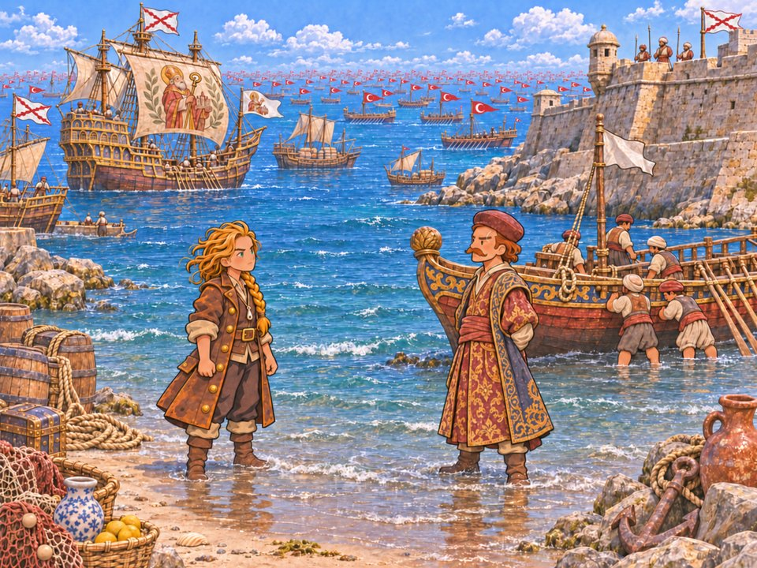
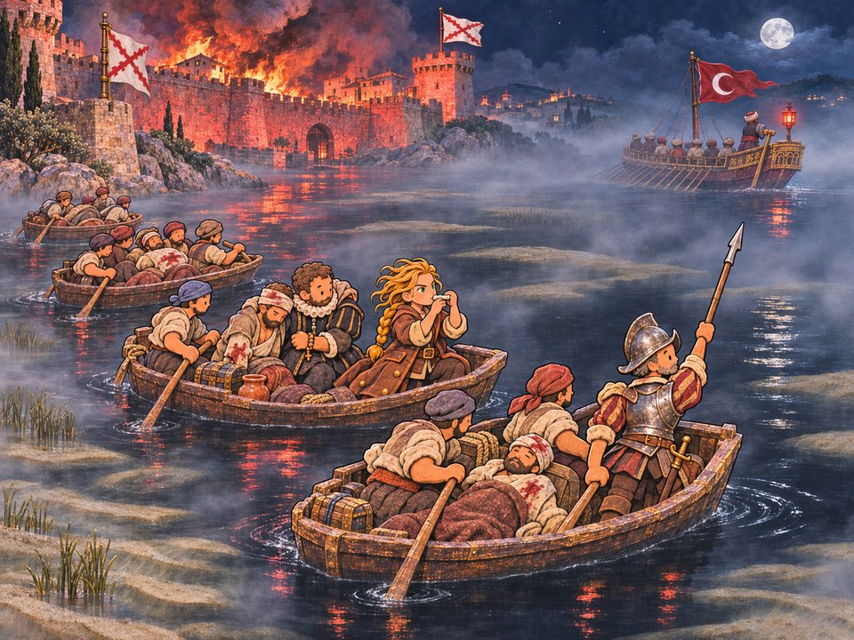
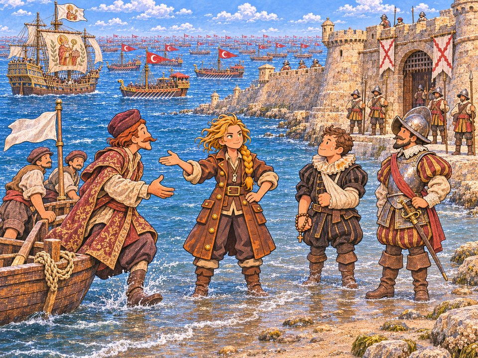
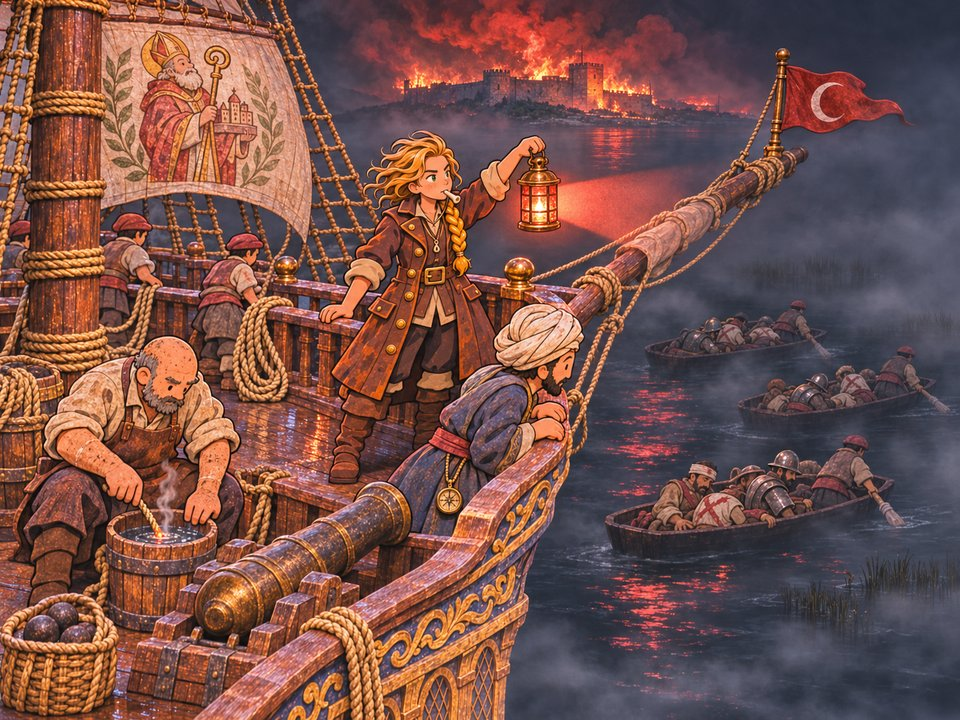

## 1. 모래톱의 재회

1574년 7월, 튀니스 앞바다.

뜨거운 여름 아지랑이 너머, 동쪽 수평선이 검게 변했다. 처음에는 구름 띠처럼 보였으나, 해가 중천에 오를수록 하얀 삼각돛과 사각돛이 하늘과 바다 사이를 빈틈없이 메웠다. 백 척이 아니었다. 이백쉰 척이 넘는 큰 함대였다. 오스만의 대제독 클르치 알리와 육군 사령관 시난 파샤가 이끄는 배들이 항구 밖 깊은 바다에 길게 반원을 그리며 닻을 내렸다.

다음 날 아침, 오스만 함대 본진에서 흰 깃발을 매단 작은 갤리 한 척이 조심스럽게 항구 어귀로 다가왔다. 항복을 권하는 사절선이었다. 에스파냐 수비대는 사절을 성안으로 들이지 않고, 성벽 아래 얕은 모래톱에서 이야기를 듣기로 했다.

마리나는 뱃머리에 서서 다가오는 사절선의 뱃머리를 보았다. 둥글고 투박하게 깎아 세운 라구사식 나무 장식이 햇볕을 받아 어른거렸다. 배가 모래톱 가장자리에 닿자, 오스만식 긴 겉옷을 입고 라구사식 모자를 눌러쓴 큰 키의 사내가 물가로 뛰어내렸다. 붉은 기 도는 머리에 깎은 턱, 긴 콧수염이었다.

네 해 전 봄, 라구사 성벽 위에서 헤어진 뒤로 처음으로 얼굴을 마주 보는 자리였다. 마리나는 혼자 모래톱을 걸어 내려갔다. 파도가 발목 아래 모래를 쓸고 지나갔다.

두 사람은 서너 걸음 거리를 두고 멈춰 섰다. 가까이서 본 니콜라의 얼굴은 바다 볕에 짙게 그을려 있었고, 왼쪽 눈썹 위에는 옅은 칼자국이 남아 있었다.

"사절 통역을 자청해서 나왔다." 니콜라가 먼저 입을 열었다. 목소리는 예전처럼 낮고 단단했다. "이백오십 척이 넘는다. 육지에는 병사가 오만은 넘게 내릴 거다. 구원 함대는 안 온다. 왕의 돈도 안 왔지."

마리나는 뒤쪽 라 골레타 요새와 반쯤 쌓다만 새 성채의 돌벽을 흘끗 보았다. 성벽 위에서는 포구들이 바다를 향해 입을 벌리고 있었으나 병사들의 그림자는 드물었다.

"수비대가 문을 열 생각은 없어 보인다." 마리나가 말했다.

니콜라가 한 걸음 가까이 다가왔다. 모래 밟히는 소리가 작게 났다.

"이번에는 우리가 이긴다." 니콜라가 낮은 목소리로 말했다. "야코를 데리고 나가."

"야코는 요새 안에 있어."

니콜라의 시선이 잠시 모래톱 너머 라 골레타 요새의 높은 돌벽에 머물렀다. 두 사람은 열여덟 해 전의 맹세를 입에 올리지 않았다. 마리나의 목에 걸린 뼈 호루라기도 겉옷 안에 잠잠히 들어 있었다.

니콜라는 세 해 전 가을 레판토의 연기 속을 빠져나갔던 배가 제 배였는지 말하지 않았다. 마리나도 묻지 않았다.

"열흘이면 외곽 성채에 포대가 닿을 거다." 니콜라가 몸을 돌리며 말했다. "내 배는 동쪽 봉쇄선에 선다."

니콜라가 작은 거룻배에 올라타자 노잡이들이 물을 밀었다. 물살을 가르는 노 소리가 햇볕 뜨거운 바다 위로 멀어졌다. 마리나는 모래톱에 젖은 발자국을 남기며 요새 쪽 부두로 걸어 올라갔다.

## 2. 썰물의 물길

며칠 뒤부터 오스만 포대의 포격이 시작되었다. 라 골레타 요새가 육지와 바다 양쪽에서 에워싸였다.

야코는 요새 안에 갇혀 있었다. 포위가 시작되기 전, 나폴리 함대의 갈레온들이 본국으로 철수할 때 야코는 배의 큰 포와 선원 반을 내려 요새 수비를 거들고 남은 참이었다. 마리나의 선단 여섯 척은 외항의 모래톱 바깥 물길에 닻을 내린 채 포탄이 오가는 성벽을 바라보고 있었다.

스베티 블라호의 선실. 포성 때문에 탁자 위 등잔불이 미세하게 흔들렸다. 마리나와 마라, 토마, 디에고, 하산, 그리고 갑판장 로브로가 해도 둘레에 모여 섰다.

"구원은 오지 않소." 마리나가 해도 위 라 골레타 자리를 손가락으로 짚었다. "돈 후안은 시칠리아에 있고, 에스파냐 왕의 함대는 오지 않소."

"하지만 야코 선장과 우리 병사들이 안에 있소." 디에고가 탁자 가장자리를 투박한 손으로 짚으며 말했다. "루이스도 어제 보급선을 타고 들어갔다가 발이 묶였소. 버리고 갈 수는 없소."

마라가 장부 대신 작은 종이쪽지 한 장을 탁자에 내려놓았다.

"배 여섯 척에 남은 밀가루가 열흘 치예요." 마라의 목소리는 가라앉아 있었다. "물통도 반밖에 안 남았어요. 큰 배 여섯 척이 안쪽으로 들어가면 포에 다 부서집니다."

선실 안에 잠시 무거운 침묵이 흘렀다. 바깥 바다에서 멀리 묵직한 대포 소리가 두 번 울렸다. 토마가 턱수염을 쓸며 마리나를 보았다.

그때, 탁자 반대편에 서 있던 하산이 손을 뻗어 튀니스와 라 골레타 사이 안쪽 물길을 짚었다.

"큰 배로는 못 들어가오." 하산이 말했다. "하지만 요새 뒤쪽 석호는 다르오. 썰물이 가장 깊게 빠지는 자정 무렵이면, 바닥이 얕아 오스만 갤리들도 안으로 들어오지 못하오. 사람이 걸어서 건널 수 있을 만큼 얕은 모래톱이 둘 있소."

마리나가 하산의 손끝을 따라 해도의 좁은 물길을 보았다.

"큰 배는 여기에 두고, 바닥이 평평한 거룻배로 들어가면 되오?" 마리나가 물었다.

"네 척이면 되오." 하산이 고개를 끄덕였다. "물길은 내가 잡겠소. 단, 달이 뜨기 전에 나와야 하오."

로브로가 팔짱을 풀며 선실 문 쪽으로 돌아섰다.

"거룻배 노를 젓는 건 내가 맡겠소. 소리 안 나게 헝겊을 감아 두지."

"포가 없으니 어둠 속에서는 들키지 않는 게 먼저요." 토마가 포대 쪽을 돌아보며 덧붙였다. "다친 사람들을 실으면 배가 가라앉듯 낮아질 테니, 노잡이 말고는 짐을 다 내려놓고 가야 하오."

마리나는 허리의 서류 주머니를 한 번 눌렀다. 탁자 위 해도의 검은 밀랍 못이 등잔불 빛을 받아 어둡게 빛났다.

## 3. 피난선 호위와 서지중해

포격이 날로 거세지던 7월 말, 마리나는 라 골레타 외항의 짐배 두 척에 먼저 거두어 놓은 부상자와 아낙, 아이들을 나누어 태우고 시칠리아 쪽으로 1차 피난선단을 내보냈다.

오스만 함대의 포위망이 아직 서쪽 외항까지 완전히 닫히기 전이었다. 짐배 갑판 위에서는 로브로가 다친 병사들을 돛대 그늘 아래 눕히고, 젖은 붕대를 갈아 감을 맑은 물을 한 통씩 돌렸다. 마리나는 스베티 이반과 두브라바를 붙여 피난민 배를 시칠리아 남쪽 해안까지 호위한 뒤, 급히 팔마와 메시나로 전갈을 보내 구원을 청하기로 했다.

서쪽 바다로 뱃머리를 돌린 지 이틀째 되는 날 새벽, 시칠리아 서쪽 해협에서 마리나는 구원 함대 대신 나폴리와 팔마에서 정찰을 나온 에스파냐 선장 둘을 만났다. 비스케이 바다 출신으로 말수가 적은 정찰 선장 가스파르 데 소토의 자브라, 그리고 대양 너머 강어귀의 전사들을 이끄는 거친 노 배 선장 바스코 페레이라의 대 알마디아였다.

두 척의 정찰선이 스베티 블라호 옆에 바짝 붙어 닻줄을 건네자, 가스파르 데 소토가 먼저 갑판으로 건너왔다. 검게 그을린 얼굴에 검은 양털 모자를 깊게 눌러쓴 가스파르는 마리나에게 모자만 한 번 벗어 보인 뒤, 손가락으로 남쪽 수평선의 검은 연기만 가리켰다.

"나폴리와 메시나 부두에는 아직 배가 모자라오." 가스파르가 짧게 말했다. 뱃사람 특유의 쉰 목소리가 바람에 묻혔다가 다시 들렸다. "돈 후안 공자께서 함대를 모으고 계시나, 올여름 안에 이백쉰 척을 맞서 내려갈 형편이 못 됩니다. 시칠리아 부왕도 섣불리 갤리를 내어 주지 않고 있소."

곁에 선 바스코 페레이라가 굵은 팔짱을 낀 채 갑판 난간을 두드렸다. 팔뚝에 굵은 흉터가 여러 개 남은 바스코는 거친 파도를 보듯 눈을 가늘게 뜨고 남쪽을 노려보았다.

"큰 배가 못 가면 작은 노 배라도 붙여서 얕은 물가로 찔러 들어가야지." 바스코가 거칠게 내뱉었다. "구원군을 기다리다가는 라 골레타 성벽 돌 하나도 못 건지오. 내 대 알마디아는 물밑이 얕아도 쑥 들어가니, 필요하면 석호 어귀까지 노를 저어 보겠소."

"큰 배도 못 들어가는 곳에 노 배를 들이밀면 뭍의 포대에 다 부서질 뿐이오." 마리나가 고개를 저으며 대답했다. "지금 급한 것은 이 피난민 배 두 척을 메시나 방파제 안쪽까지 무사히 데려다주는 일이오. 요새 안에 남은 병사들은 내가 다시 돌아가서 빼내 와야 하오."

그때 뒤따르던 피난민 배 갑판에서 밧줄이 끊어지며 물통 두 개가 굴러떨어지는 소리가 요란하게 울렸다. 갑판에 앉아 있던 아낙들이 놀라 비명을 지르자, 로브로가 곧장 보트를 붙여 건너가 굴러다니는 물통을 밧줄로 다시 동여맸다.

"다친 사람들이 앉은 판자 아래가 미끄러우니 마른 모래라도 뿌려 두시오." 가스파르가 젖은 갑판을 내려다보며 일렀다. "시칠리아 남쪽 곶을 돌면 바람이 한결 자겠소."

"물통 하나가 터져서 마실 물이 모자랄 텐데, 우리 배에 실린 여분 통을 두 개 넘겨주겠소." 바스코가 노잡이들에게 손짓하며 소리쳤다. "마리나 선장, 이 사람들이 메시나에 내리면 우리한테도 전갈 하나만 띄워 주시오."

가스파르가 말없이 고개를 끄덕여 자브라의 뱃머리를 북쪽으로 돌렸고, 바스코는 마리나의 배에 여분의 노와 마른 빵 상자 몇 개를 건네주고 뒤를 따랐다. 피난민 배들이 시칠리아 남쪽 해안선 너머로 안전하게 들어가는 것을 확인한 뒤, 마리나는 곧바로 튀니스 외항으로 뱃머리를 돌렸다. 해협의 거센 물살이 뱃머리 나무판을 묵직하게 때렸다.

## 4. 석호의 밤

자정이 넘은 석호는 먹물을 풀어 놓은 듯 어두웠다.

마리나의 선단에서 내린 바닥이 평평한 작은 배 네 척이 헝겊을 감은 노를 저어 얕은 물길을 미끄러지듯 나아갔다. 물밑 모래바닥이 배 밑창에 사각거리며 스치는 소리가 어둠 속에서 크게 들렸다. 앞배 뱃머리에 엎드린 하산이 손짓으로 물길 방향을 잡았다. 마리나와 디에고는 두 번째 배에 탔다. 오른쪽 멀리 불타는 라 골레타 성벽 쪽에서 붉은 연기와 화약 냄새가 바람을 타고 낮게 깔렸다.

요새 뒤편 무너진 수문 아래 돌계단에 배 네 척이 소리 없이 닿았다. 물가까지 나와 있던 에스파냐 병사 몇이 다친 동료들을 부축해 계단을 내려오고 있었다.

돌벽 그늘 아래, 얼굴에 검댕이 묻고 팔에 붕대를 감은 야코가 서 있었다.

"어서 타라." 마리나가 배에서 뛰어내리며 낮게 말했다. "물이 들어오기 전에 빠져나가야 한다."

야코가 고개를 저었다. 야코의 손에는 부러진 칼자루가 들려 있었다.

"내 갈레온에서 내린 포수들이 아직 성벽 위에 남았다. 나 혼자 나갈 수 없다."

"성벽은 이미 무너지고 있어. 네가 남는다고 버틸 수 있는 자리가 아니다."

"그래도 안 된다." 야코의 눈빛이 어둠 속에서 굳어 있었다.

그때, 수문 위쪽 돌계단에서 신음 소리가 들렸다. 들것에 실린 병사 여럿이 좁은 계단을 내려오고 있었고, 그 뒤로 다리를 절며 부축을 받는 병사들이 줄을 이었다. 배 네 척의 바닥이 이미 얕은 물 위에서 휘청거렸다.

"선장님, 다친 사람들을 싣고 노를 저을 사공이 모자랍니다." 디에고가 쉰 목소리로 말했다. "안에서 싸울 수 있는 사람도 다 배로 타야 노를 젓습니다."

야코가 들것에 실린 병사들을 한참 내려다보았다. 다친 이 가운데 절반은 야코의 갈레온에서 함께 내린 라구사 선원들이었다. 야코는 들고 있던 칼자루를 허리띠에 꽂고, 곁에 선 병사의 겨드랑이에 팔을 넣어 일으켰다.

"타자." 야코가 짧게 말했다.

배 네 척에 다친 병사와 선원들을 빈틈없이 싣고 다시 석호 가운데로 빠져나왔을 때였다. 썰물이 끝나가며 바닷물이 조금씩 차오르고 있었다. 왼쪽 얕은 여울 너머 안개 속에서 붉은 등불 하나가 천천히 이쪽으로 다가오는 것이 보였다. 오스만의 순찰 갤리였다. 거리로 보아 등불이 물길을 비추면 작은 배 넷은 그대로 드러날 판이었다.

앞배의 노들이 일제히 멈췄다. 디에고가 소리 없이 창을 들어 올렸다.

마리나는 옷깃 안쪽에서 차가운 뼈 호루라기를 꺼내 입술에 물었다. 그리고 어두운 물 위를 향해 숨을 모아 불었다.

길게 한 번. 짧게 한 번. 다시 길게 한 번.

맑고 날카로운 호루라기 소리가 석호의 젖은 공기를 가르고 등불 쪽으로 날아갔다. 물결 소리만 들렸다. 저쪽 배에서는 아무런 호루라기 소리도 돌아오지 않았다. 화승총 소리도 나지 않았다.

잠시 뒤, 붉은 등불이 천천히 왼쪽으로 방향을 틀더니 안개 속 깊은 바다 쪽으로 멀어져 갔다.

마리나는 입술에서 호루라기를 떼고 젖은 소매로 물기를 훔쳤다. 로브로가 다시 노를 물에 넣었다.

## 5. 맡은 항구의 연기

석호에서 피난민들을 본선으로 끌어올린 지 사흘째 되던 날 밤, 시칠리아 쪽에서 작은 연락선 한 척이 급히 닿았다.

마리나가 맡고 있던 시칠리아 서쪽 트라파니 부근의 작은 항구 앞바다에 오스만 함대의 별동대인 바르바리 갤리옷 네 척이 올라와 방파제를 포위했다는 소식이었다. 튀니스 포위망에 묶여 있던 마리나의 후방 보급 기지를 흔들어 놓고, 시칠리아 서쪽 바닷길을 끊으려는 속셈이었다. 트라파니 창고에는 선단의 밀과 화약이 절반 넘게 남아 있었고, 야코 역시 "네 보급 기지부터 막아라. 여기 포위망은 내가 버틴다" 하고 고개를 끄덕였다.

마리나는 다친 병사들과 야코를 스베티 이반과 산타 마리아에 나누어 남긴 뒤, 스베티 블라호와 갈레온 산 로렌초 두 척만 몰고 급히 북쪽으로 뱃머리를 돌렸다. 야코는 붕대 감은 팔을 안은 채 뱃전 난간까지 나와 마리나의 출항을 지켜보았다.

이틀 밤낮을 달려 트라파니 부근 항구 어귀에 닿았을 때, 방파제 위 망루에서는 이미 검은 연기가 피어오르고 있었다. 매운 짚 타는 냄새와 짠 바닷바람이 뒤섞여 코끝을 찔렀고, 항구 돌벽에 부딪친 파도가 하얀 포말을 튀겼다. 바르바리 갤리옷들이 항구 입구에 줄지어 닻을 내리고 안쪽 창고에 불화살을 쏘아 대는 참이었다. 부두 안쪽에서는 항구 관리와 어부들이 양동이로 물을 길어 창고 지붕에 끼얹느라 아우성이었다.

"정면 바람을 타고 그대로 들이받는다." 마리나가 키잡이에게 명했다. "저놈들은 항구 입구를 막는 데만 정신이 팔려 뒤를 못 보고 있소."

"바람이 항구 안쪽으로 거세게 밀려 들어가서 뱃머리를 세우면 옆구리가 노출됩니다!" 로브로가 키를 쥔 채 얼굴을 찌푸리며 소리쳤다. "방파제 돌턱에 닿기 전에 돛을 반만 접어야 합니다!"

"토마가 첫 포를 쏘는 순간 돛줄을 내리시오." 마리나가 앞쪽 난간을 붙잡고 대답했다. "한 번에 못 부수면 우리가 갇히오."

스베티 블라호가 순풍을 받아 바닷물을 가르며 돌진하자, 토마 벤드라민이 왼손의 남은 세 손가락으로 화승 심지를 쥐고 「안툰」의 꼬리에 불을 붙였다. 연달아 터진 포성이 항구 돌벽에 부딪쳐 울렸다. 쇠구슬이 바르바리 갤리옷 선두 배의 돛대를 꺾어 버리자 갑판 위가 순식간에 아수라장이 되었다. 적선에서 쏜 불화살 하나가 스베티 블라호의 앞돛 아래 감아 둔 돛천에 꽂히며 불꽃을 튀겼으나, 마라와 선원 두 명이 곧장 젖은 담요를 덮어 눌러 껐다.

산 로렌초가 뒤따라 포문을 열며 갤리옷 한 척의 뱃전을 부수자, 항구 안에 갇혀 있던 수비대 병사들이 방파제 위에서 창을 흔들며 함성을 질렀다. 세 척의 바르바리 갤리옷은 노를 거꾸로 저어 서쪽 바다로 달아났다. 항구 창고의 밀가루와 화약은 무사했다.

이튿날 아침, 항구 관리가 잿가루가 묻은 얼굴로 달려 나와 마리나에게 허리를 굽혔다. 소매 끝이 불에 그을린 관리는 숨을 몰아쉬며 마리나의 손목을 잡았다.

"하룻밤만 늦었어도 창고 안 시칠리아 밀이 다 탈 뻔했소." 관리가 쉰 목소리로 말했다. "오스만 별동대가 이 항구를 노린 걸 보니, 튀니스 바깥 바다를 돌던 사략선들이 길을 일러 준 모양이오."

"망루가 부서졌으니 당분간은 방파제 끝에도 보초를 둘씩 세워 두시오." 마리나가 화약통 열 개를 가리키며 대답했다. "여분 화약과 마른 고기 상자는 여기 내려놓고 가오."

마리나는 방파제 수비대장에게 망가진 망루를 보수하라고 일렀다. 그리고 곧바로 다시 불타는 튀니스 쪽으로 배를 돌렸다. 부두 돌계단 위에서 어부들이 양동이를 든 채 멀어지는 배를 배웅했다.

## 6. 함락 전야의 장부

8월 20일 무렵, 다시 튀니스 외항으로 돌아온 스베티 블라호 갑판에서는 멀리 라 골레타 성벽의 돌담이 무너져 내리는 소리가 멎지 않고 들려왔다.

성벽 위 에스파냐 깃발은 반쯤 찢긴 채 검은 연기 속에 잠겨 있었다. 마리나의 선단 여섯 척은 외항 모래톱 바깥 물길에 닻을 내린 채, 작은 어선이나 헤엄쳐 나오는 피난민들을 한 사람이라도 더 건져 올리려 뱃전에 밧줄 사다리를 매달아 두었다. 바람이 뭍에서 바다 쪽으로 불 때마다 매운 화약 냄새와 젖은 숯 냄새가 갑판을 덮었다.

배 밑창에서 올라온 디에고 오르티스가 땀에 젖은 손으로 마리나에게 종이쪽지 한 장을 건넸다. 어젯밤 작은 거룻배를 타고 빠져나온 병사가 전해 준 말이었다. 디에고의 굵은 손끝이 미세하게 떨리고 있었다.

"루이스 그 젊은 놈이……." 디에고의 굵은 목소리가 잠깐 갈라졌다. "마지막 배에 다친 동료들을 먼저 밀어 넣고, 성벽 무너진 틈에 혼자 남았다고 하오. 튀니스 부두에서 내 몫 빵 반쪽을 떼어 주었던 그 애송이가, 끝내 배에 오르지 않았단 말이오."

"내가 거룻배를 하나 더 내렸으면 그 아이도 탔을 것이오." 마리나가 젖은 난간을 쥔 채 낮게 말했다.

"아니오, 선장님." 디에고가 성벽 쪽 연기를 바라보며 고개를 저었다. "배에 더 실을 자리가 없었소. 제 손으로 부두 끈을 밀어냈다는구려."

곁에서 듣던 로브로가 말없이 밧줄 사다리 매듭을 한 번 더 당겨 묶었다. 뱃고물 쪽에서는 토마 벤드라민이 아직 이름이 없는 새 청동 포 한 문 곁에 말없이 서 있었다. 포신 옆구리에 빗물이 흘러내렸으나 토마는 닦을 생각도 하지 않았다.

선실 안으로 내려온 마라는 촛불 아래에서 낡은 가죽 장부를 펼쳤다. 지난겨울 이후 튀니스에서 데리고 나온 사람 수와 트라파니 항구 수비에 쓴 화약 값을 셈한 뒤, 마라가 쉰석 번째 달의 마지막 칸에 깃펜을 댔다. 장부 종이 가장자리에 갑판에서 묻어 들어온 검은 재가 점점이 찍혀 있었다. 마라는 손등으로 잿가루를 털어 내려다 잉크가 번지자, 작은 쇠 칼 끝으로 종이 겉면을 살짝 긁어냈다.

"이제 요새 안에서는 더 나올 배도 보이지 않네요." 마라가 잉크를 찍으며 낮게 말했다. "나폴리에서 올 돈도, 구원 함대도 끝내 오지 않았어요. 트라파니에 내려놓은 화약 값까지 합치면, 라구사 상회로 돌아가도 선원들 겨울 삯이 빠듯합니다."

"일단 살려 나온 사람들부터 메시나 부두에 내려놓고 봅시다." 마리나가 젖은 겉옷을 벗어 의자 등받이에 걸었다. "장부 빈칸은 살아 돌아간 뒤에 채워도 늦지 않소. 다친 이들에게는 선창에 남은 보리 죽이라도 데워 주어야 하오. 로브로에게 솥에 물을 올리라고 일러 두었소."

마라는 한 번 더 주판알을 확인하고 쉰네 번째 달의 줄을 적었다.

「쉰네 달, 라 골레타 포위. 석호에서 거룻배 넷, 호루라기 셋째.」

선실 창밖으로, 밤하늘을 붉게 물들이는 요새의 불길이 어두운 물결 위에 길게 비치고 있었다. 갑판 위에서 파도에 부딪치는 빈 거룻배의 나무 뱃전이 둔탁하게 울렸고, 젖은 돛줄을 감는 소리가 밤바다로 흘러갔다.

---

## 다른 깃발 아래에서 ― 사자로 남았다면

*(9부 끝의 탁자에서 마리나가 붉은 사자 깃발에 남았다면, 이야기는 이 길로 흐른다.)*

### 통행 값

1574년 여름, 튀니스 앞바다의 붉은 흙물 위로 뜨거운 아지랑이가 피어올랐다.

라구사 원로원과 베네치아의 허락을 받아 흰 성 블라호 깃발만을 돛대에 단 마리나의 선단은, 오스만 함대의 선발대가 닻을 내리기 직전 튀니스 안쪽 물길에 들어섰다. 베네치아가 전쟁에서 빠진 덕에 마리나의 중립 곡물 선단은 오스만 봉쇄선 바깥과 에스파냐가 지키는 안쪽 항구를 모두 드나들 수 있었다.

부두는 전쟁 소문으로 들끓고 있었다. 에스파냐 수비대가 성문 밖에 새 성채를 쌓느라 일꾼들을 몰아넣고, 동쪽 바다에서는 오스만의 대함대가 내려온다는 말이 돌면서 밀가루와 소금, 소나무 판자 값이 두 배 넘게 뛰었다. 마리나는 메시나와 라구사에서 싣고 온 단단한 밀 백 포대와 소금 가마니, 참나무 판자를 항구 창고에 부렸다. 부두 돌계단 위에서는 짐꾼들이 땀을 비 오듯 흘리며 밀 포대를 져 날랐다.

마라가 군항 재무관 앞에서 웃돈을 얹은 셈서를 맞추는 동안, 오스만 정찰 갤리 한 척이 외항 어귀까지 다가와 중립 선단의 통행세를 요구했다. 뱃머리에 검은 수염을 기른 오스만 정찰 선장이 밧줄 사다리를 잡고 올라와 선창 덮개를 열어 보라고 손짓했다. 갑판 위에서 정찰 선장의 눈길이 돛천으로 덮어 묶어 둔 청동 포신에 닿자, 그의 미간이 좁혀졌다.

"중립 곡물선이 무슨 대포를 두 문이나 달고 다닙니까?" 정찰 선장이 거친 억양으로 물으며 칼자루에 손을 얹었다. "포대에 불을 댕길 심지도 선창에 숨겨 둔 것이 아니오?"

"베네치아 영해 바깥 사략선들을 막으려고 라구사 출항 때부터 달고 나온 포요." 마리나가 겉옷 안의 흰 깃발 통행 허가서를 꺼내 보이며 대답했다. "원하시면 선창을 열어 보시오. 배 안에 실은 건 밀과 소금뿐이오. 어느 쪽 깃발에도 화약은 팔지 않았소. 원로원의 인장이 찍힌 종이를 확인해 보시오."

마라는 한 걸음 앞으로 나서며 정찰선 사공들 앞으로 마른 생선 몇 상자와 맑은 물통을 내밀었다. 짠 소금기가 배어 있는 생선 상자에서 비린내가 훅 끼쳤으나, 목이 마른 정찰선 사공들은 물통을 보자 금세 눈빛이 풀렸다.

정찰선 선장은 마리나의 겉옷 안쪽 뼈 호루라기를 한 번 힐끗 보더니, 생선 상자를 받아 싣고 물러났다. 정찰선이 물러난 뒤에도 부두의 긴장은 풀리지 않았다. 창고 문밖 우물가에서는 물통을 인 여인들이 길게 줄을 서 있었고, 성문 밖에서는 돌을 나르는 수레바퀴 소리가 밤늦도록 끊이지 않았다.

로브로가 뱃전 난간에 쌓인 붉은 흙먼지를 손등으로 쓸어내며 하늘을 올려다보았다. 뜨거운 바람이 사막 쪽에서 불어오고 있었다.

### 화덕과 모래톱

마리나는 성안 시장의 좁은 골목으로 걸어 들어갔다. 새 성채 돌을 쌓느라 시장 좌판마다 세금을 붙인 탓에 빵 값이 하늘을 찌르고 있었다.

"성채 돌을 쌓느라 시장에까지 세금을 붙이니 빵 값이 하늘을 찌르네요. 깃발이 바뀔 때마다 굶는 건 화덕 앞 사람들이에요." 마라가 장부를 덮으며 낮게 중얼거렸다.

마리나는 상회 몫으로 남겨 둔 밀가루 스무 포대를 시장 화덕 앞 수염 하얀 늙은 상인에게 값없이 내어 주고, 선실로 돌아와 해도에 검은 밀랍을 입힌 튀니스 못을 조용히 내려다보았다. 노인은 고맙다는 말 대신 긴 나무 삽으로 화덕 안쪽 불씨를 뒤적이며 마리나의 검붉은 겉옷 자락만 한 번 쳐다보았다.

그해 7월이 되자, 뜨거운 여름 아지랑이 너머 동쪽 수평선을 메우며 이백쉰 척의 오스만 함대가 튀니스 앞바다에 닻을 내렸다. 클르치 알리와 시난 파샤가 이끄는 대함대였다. 흰 삼각돛과 사각돛이 하늘과 바다 사이를 빈틈없이 메웠다.

다음 날 아침, 오스만 함대 본진에서 흰 깃발을 매단 사절선 한 척이 성벽 아래 얕은 모래톱으로 들어왔다. 뱃머리에 둥근 라구사식 나무 장식을 단 배였다. 물가로 뛰어내린 것은 오스만식 긴 겉옷에 라구사식 둥근 모자를 눌러쓴 니콜라였다. 네 해 전 라구사 성벽 위에서 헤어진 뒤로 처음으로 두 발로 땅을 밟고 마주 보는 자리였다.

에스파냐 수비대는 사절을 성안으로 들이지 않고, 모래톱 위에서 이야기를 듣기로 했다. 성문 쪽에서 걸어 내려온 수비대 대표 곁에는 팔에 붕대를 감고 흰 주름 깃을 세운 야코 소르고가 서 있었다. 나폴리 함대가 본국으로 철수할 때 배의 큰 포와 라구사 선원들을 내려 요새에 남았던 야코였다.

마리나는 중립 곡물 선단의 선장 자격으로 두 친구 사이에 섰다. 파도가 발목 아래 모래를 쓸고 지나갔다.

"구원 함대는 안 온다." 니콜라가 먼저 입을 열었다. 왼쪽 눈썹 위의 칼자국이 햇볕에 그을려 선명했다. "이백오십 척이 넘는다. 육지에는 병사가 오만은 넘게 내릴 거다. 이번에는 우리가 이긴다. 야코, 너라도 배를 타고 나가라. 키아라가 나폴리에서 아직 기다리고 있지 않느냐."

야코가 뒤쪽 라 골레타 요새의 높은 돌벽을 흘끗 돌아보더니 고개를 저었다. 입술이 바싹 말라 갈라져 있었다.

"내 갈레온에서 내린 포수들과 라구사 선원들이 아직 성벽 위에 있다. 나 혼자 살겠다고 문을 열어 줄 수는 없다. 혼인은 이 성벽을 지킨 뒤에나 생각할 일이다."

니콜라의 시선이 마리나에게 닿았다. 마리나는 겉옷 안에 걸린 차가운 뼈 호루라기를 손바닥으로 꽉 쥐었으나, 열여덟 해 전의 맹세를 입에 올리지 못했다. 두 친구가 서로 다른 깃발 아래서 고집을 꺾지 않는 사이, 중립의 흰 깃발을 단 마리나만이 모래톱 위에 서서 양쪽의 그림자를 함께 밟고 있었다. 성벽 위 포구들이 바다를 향해 입을 벌리고 있었으나 병사들의 그림자는 드물었다. 뜨거운 햇볕 아래 쇠 투구가 둔하게 빛났다.

니콜라가 몸을 돌려 사절선에 오르며 마리나에게만 들리게 낮게 말했다.

"내 배는 동쪽 봉쇄선에 선다. 석호 쪽 물길이 얕으니 밤에는 조심해라."

니콜라의 배가 멀어지고 야코가 성문 안으로 사라진 뒤, 마리나는 스베티 블라호 선실로 내려왔다. 마라가 낡은 가죽 장부를 펼치고 먹물을 찍었다. 바깥에서는 오스만 진영에서 대포 수레를 끄는 둔탁한 소리가 들려오기 시작했다. 마리나는 탁자 위 해도의 튀니스 못을 손가락으로 한 번 눌렀다. 두 친구가 서로 총포를 겨누는 사이에서 흰 깃발을 단 채 서 있어야 하는 사정이, 마리나의 어깨를 무겁게 내리눌렀다.

### 등불을 끄고

8월 하순, 라 골레타 요새를 향한 포격이 밤낮없이 이어지기 시작했다.

마리나의 스베티 블라호는 외항의 모래톱 바깥 물길에 닻을 내리고 있었다. 중립 곡물 선단이라는 명분 덕에 오스만 함대도, 성벽의 수비대도 마리나의 배에 포를 쏘지 않았으나, 바다 위에는 화약 연기와 불씨가 바람을 타고 끊임없이 날아왔다. 갑판 판자 위로 떨어지는 잿가루를 로브로와 선원들이 빗자루로 쓸어 내야 할 정도였다.

어둠이 내린 어느 밤, 하산이 놋쇠 나침반과 다림줄을 들고 뱃머리에 엎드렸다. 젖은 손끝에서 모래 알갱이가 떨어져 내렸다. 하산이 잡은 얕은 석호 바깥쪽 여울에 스베티 블라호가 소리 없이 닻을 옮겨 내렸다. 그때 조류가 갑자기 바뀌며 닻줄이 바위 틈에 스쳐 삐걱거리는 소리를 내자, 하산은 재빨리 두 손을 들어 갑판 위 선원들의 발걸음을 멈추게 했다.

"성벽 뒤편 수문 쪽이 무너지기 직전이오." 디에고 오르티스가 뱃전에 기대어 서서 낮은 목소리로 말했다. "요새 안의 야코 선장과 라구사 선원들이 빠져나오려면 이 얕은 석호 물길밖에 없소. 내일 밤 자정 썰물이 가장 깊게 빠질 때가 마지막 틈일 거요."

"야코 녀석이 순순히 성벽을 비울까." 마리나가 어두운 성벽 쪽을 바라보며 중얼거렸다. "고집을 부리다가 다친 선원들까지 다 묻히면 안 되는데."

"그때는 우리가 수문 아래까지 배를 대고 끌어내야지요." 하산이 다림줄을 감아 쥐며 나직이 대답했다. "썰물 물길을 내가 짚어 두었으니, 야코 선장도 빈 배를 보고 나면 생각이 바뀔 거요."

마리나는 로브로에게 명해 선미와 뱃머리의 등불을 모두 끄게 하고, 뱃전 아래 물가만 희미하게 비추는 작은 등잔 하나만 남겼다. 갑판 위에서는 토마 벤드라민이 「안툰」의 포대 곁에 엎드려 어둠 속 동쪽 봉쇄선 쪽을 살피고 있었다. 젖은 화승 냄새가 바람에 실려 코끝을 스쳤다.

선실 안으로 내려온 마라는 낡은 가죽 장부를 펼치고 쉰네 번째 달의 끝 줄을 적었다. 잉크가 마를 때까지 마라는 주판알도 튕기지 않고 등잔 심지만 낮추었다.

「쉰네 달, 모래톱의 두 친구. 화덕 밀가루 스무 포대, 등불 끄고 석호 대기.」

멀리 오른쪽 성벽 쪽에서 붉은 연기와 화약 냄새가 밤바다 위로 낮게 깔렸다. 마리나는 선실 밖으로 올라와 뱃전 난간을 짚고 내일 밤을 기다렸다. 뱃바닥에 부딪치는 석호의 얕은 물결이 찰박거리며 밤새 이어졌고, 돛대 끝에서는 흰 깃발이 바람을 피해 낮게 접혀 있었다. 갑판 한쪽에서는 디에고가 창날을 마른 천으로 닦고 있었다.

---

## 다른 깃발 아래에서 ― 초승달이었다면

*(1부 또는 9부 끝의 탁자에서 마리나가 초승달 깃발을 골랐다면, 이야기는 이 길로 흐른다.)*

### 이백쉰 척

1574년 7월, 튀니스 앞바다.

뜨거운 여름 아지랑이 너머, 동쪽 수평선을 빈틈없이 메운 오스만 함대 이백쉰 척이 항구 밖 깊은 바다에 길게 반원을 그리며 닻을 내렸다. 붉은 바탕에 흰 초승달을 그린 깃발이 바람을 맞으며 바다 위를 덮었다. 클르치 알리 대제독과 육군 사령관 시난 파샤가 이끄는, 이번 싸움의 이기는 쪽이었다. 북아프리카의 햇볕이 흰 석회 성벽과 모래톱을 눈부시게 비추었다.

이스탄불 병기창에 목재와 역청, 삼베를 실어 나르며 라구사 상회의 묵은 빚을 크게 덜어 낸 뒤, 마리나의 선단은 이번 원정에서 여덟 척으로 불어나 있었다. 원정을 앞두고 이스탄불 군항의 밀가루와 화약통 값이 다시 치솟자, 마리나는 흑해와 에게해에서 모은 단단한 보리 포대와 화약통을 선창 가득 싣고 내려와 오스만 군항 창고에 부렸다. 보급선에서 자루를 내리는 인부들의 목쉰 소리가 아침부터 부두에 울렸다.

"이제 베네치아 은행가 그리마니 쪽 어음도 큰 덩이는 다 덜어 냈어요." 마라가 촛불 아래서 주판알을 한 번에 쓸어내리며 말했다. "배 여덟 척의 삯과 군량만 맞추면 남는 몫이 제법 두둑해요. 성채 앞 보급 부두에 내릴 밀가루도 아직 백 포대나 남았습니다."

클르치 알리의 기함 선실 회의 탁자 위에서는 지휘관들이 마리나를 마리나 카푸단이라 부르며 튀니스 동쪽 봉쇄선의 뱃머리를 맡겼다. 세관원들은 이제 마리나의 선단이 닿을 때마다 짐 목록만 훑어보고 도장을 찍었다. 봉쇄선을 따라 여덟 척의 갤리와 보급선이 차례로 닻을 내렸다. 붉은 초승달 깃발 아래서 네 해 반 동안 쌓은 몫이 비로소 여덟 척의 돛대로 서 있었다.

스베티 블라호 갑판 위에서는 뱃머리 청동 포 「마테」 곁에 선 토마 벤드라민이 기름 헝겊으로 포신을 닦고 있었다. 항해사 하산은 튀니스 앞바다의 얕은 모래턱을 짚어 내느라 다림줄을 걷어 올렸고, 로브로는 뱃전 밧줄을 살피며 선원들과 말없이 손발을 맞추었다. 곁에 선 니콜라가 저쪽 라 골레타 요새의 성벽을 바라보며 터키 말로 짧게 중얼거리더니 라구사 말로 고쳐 말했다.

"이번에는 우리가 이기는 쪽이다, 마리나. 성벽 위에 서 있는 놈들이 불쌍할 지경이군. 저 반쯤 쌓다만 새 성채는 포탄 열 발이면 무너질 돌담이야. 어머님께서도 우리가 이긴 쪽 배를 타고 돌아간다는 소식을 들으시면 한숨 돌리실 거다."

마리나는 대답 대신 뱃전 난간에 손을 얹고 라 골레타 성벽 위의 검은 왕관 방패 깃발을 바라보았다. 바람 없는 바다 위로 돛대 그림자만 길게 늘어졌다. 해가 중천을 넘기며 갑판 판자 위가 화덕처럼 달아올랐다. 저쪽 성벽 밖 모래땅에서는 에스파냐 일꾼들이 돌을 나르던 수레를 멈추고 그늘을 찾아 웅크리는 모습이 아지랑이 사이로 보였다. 마리나는 목에 걸린 차가운 뼈 호루라기를 한 번 만져 보고는 선실로 내려갔다.

### 성벽 아래의 야코

함대가 반원을 그리며 닻을 내린 다음 날 아침, 오스만 본진에서 흰 깃발을 매단 작은 사절선 한 척이 성벽 아래 얕은 모래톱으로 들어갔다.

배의 뱃머리에는 라구사식 둥근 나무 장식이 박혀 있었다. 물가에 뛰어내린 니콜라 뒤를 따라 마리나도 모래톱을 밟았다. 바닷물이 발목 아래 모래를 쓸며 지나갔다. 성벽 아래에서는 팔에 붕대를 감고 부러진 칼자루를 허리띠에 꽂은 야코가 에스파냐 수비대 장수 곁에 서 있었다. 가까이서 본 야코의 얼굴은 그을리고 수척해 있었으며, 흰 주름 깃은 땀에 절어 누렇게 바래 있었다.

"사절 통역을 자청해서 나왔다." 니콜라가 먼저 입을 열었다. 목소리는 예전처럼 낮고 단단했다. "배가 이백오십 척이 넘는다. 육지에는 병사가 오만은 넘게 내릴 거다. 구원 함대는 안 온다. 왕의 돈도 오지 않았지. 문을 열고 항복해라."

야코의 시선이 니콜라를 지나 마리나의 얼굴에 머물렀다. 모래톱을 적시는 파도 소리 사이로 무거운 침묵이 흘렀다. 야코의 곁에 선 에스파냐 장수는 성벽 쪽만 번갈아 보며 굳은 표정으로 서 있었다. 모래톱 위로는 바닷새 몇 마리가 낮게 날며 울었다.

"내 갈레온에서 내린 포수들과 라구사 선원들이 아직 성벽 위에 남았다." 야코가 쉰 목소리로 대답했다. "나 혼자 살겠다고 문을 열어 줄 수는 없다. 나폴리에서 내 배를 믿고 따라온 사람들이야. 끝까지 성벽을 지켜야지."

"열흘이면 외곽 성채에 포대가 닿는다." 니콜라가 한 걸음 가까이 다가서며 말했다. "네 고집 때문에 성안 사람들을 다 묻을 셈이냐. 나폴리에 두고 온 키아라는 어쩌고."

야코의 손이 허리띠의 부러진 칼자루를 꽉 쥐었다가 놓았다. 마리나가 야코를 향해 낮게 말했다. "야코, 성벽은 이미 버티기 어렵다. 내일이라도 물러날 길을 보아라. 석호 뒤쪽 물길은 밤에 썰물이 빠지면 바닥이 얕다. 성벽이 무너지기 전에 다친 사람부터 빼내야 한다."

야코는 대답 대신 뒤쪽 라 골레타 요새의 높은 돌벽만 한 번 돌아보고는 성문 안쪽으로 걸음을 돌렸다. 세 친구는 열여덟 해 전 라구사 성벽 위에서 맺었던 맹세를 입에 올리지 못한 채 짧은 그림자만 남기고 돌아섰다. 사절선으로 돌아오는 동안 니콜라는 끝내 뒤를 돌아보지 않았다. 모래톱 위에 남은 발자국이 밀물에 금세 지워졌다. 성벽 위에서는 포구들이 여전히 침묵을 지킨 채 바다를 내려다보고 있었다. 사절선의 노잡이들이 물을 밀어내며 모래톱에서 떨어지자, 햇볕 뜨거운 바다 위로 물결 소리만 길게 남았다. 니콜라가 터키 말로 노잡이들에게 박자를 맞추라고 소리치는 동안, 마리나는 멀어지는 라 골레타 성문만 바라보았다.

### 순찰선의 등불

8월 하순, 밤낮없이 이어진 포격으로 라 골레타의 돌벽이 무너져 내리던 밤이었다. 성벽 너머에서는 불길과 검은 연기가 밤하늘을 붉게 물들이고 있었다. 포탄이 성벽을 때릴 때마다 먼 곳의 배까지 나무 판자가 미세하게 떨렸다.

마리나의 배들은 요새 뒤쪽 석호와 맞닿은 동쪽 봉쇄선을 지키고 있었다. 자정이 지나 썰물이 가장 깊게 빠진 무렵, 갑판 위는 먹물을 풀어 놓은 듯 어두웠다. 뱃머리에서 붉은 순찰 등불을 걸고 물결을 살피던 로브로가 갑자기 낮은 소리로 마리나를 불렀다.

"선장님, 왼쪽 여울 쪽을 보십시오."

얕은 여울 너머 안개 속에서, 노에 헝겊을 감고 소리 없이 미끄러져 나오는 작은 거룻배 네 척의 윤곽이 희미하게 드러났다. 배 밑창에는 다친 에스파냐 병사들과 야코의 라구사 선원들이 가득 실려 수면 위로 낮게 가라앉아 있었다. 뱃머리의 토마 벤드라민이 「마테」의 화승 심지에 불을 붙이려 몸을 숙였다. 하산과 선원들이 숨을 죽이며 마리나의 손끝만 바라보았다. 깃발을 생각하면 쏘아야 했고, 선실 탁자의 장부를 생각해도 막아야 하는 배들이었다.

바로 그 순간, 어두운 물 위를 가르고 맑고 날카로운 호루라기 소리가 날아왔다.

길게 한 번. 짧게 한 번. 다시 길게 한 번.

토마의 심지가 허공에서 멈추었다. 붉은 불씨가 어둠 속에서 작게 흔들렸다. 마리나는 겉옷 안쪽에서 차가운 뼈 호루라기를 꺼내 입술에 물었다. 한 박자 늦게, 순찰선 뱃머리에서 똑같은 소리가 돌아갔다.

길게 한 번. 짧게 한 번. 다시 길게 한 번.

마리나는 뱃머리에 걸려 있던 순찰선의 붉은 등불을 손수 들어 올려, 물길 바깥쪽을 비추며 천천히 왼쪽으로 돌렸다. 거룻배 넷이 그 등불의 빈틈을 타고 어둠 속 깊은 바다 쪽으로 빠져나갔다. 토마는 아무것도 묻지 않고 불붙인 심지를 물통에 담가 껐다. 치익 하고 물 끓는 소리가 밤바다에 짧게 흩어졌다. 갑판 위 누구도 그 거룻배가 어디로 가는 것인지 묻지 않았다. 물결이 다시 잔잔해지자, 마리나는 등불을 제자리에 걸어 두고 조용히 뱃고물로 걸어갔다.

선실로 내려온 마라는 아무 말 없이 쉰네 번째 달의 장부 끝에 한 줄을 적었다.

「쉰네 달, 동쪽 봉쇄선. 돌려놓은 등불 하나.」
