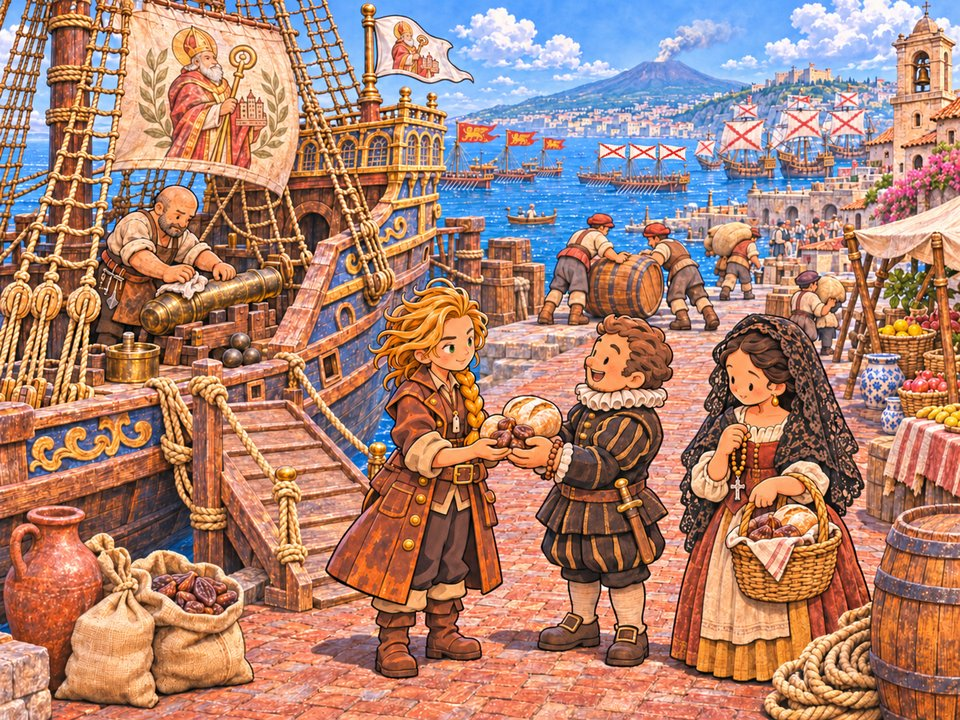

## 1. 코르푸의 지팡이

1570년 봄, 마리나는 베네치아에서 빌린 갤리 두 척을 이끌고 코르푸와 자다르 사이를 오가며 군량과 소금을 실어 날랐다. 그렇게 물길 위에서 석 달을 보내고 7월이 되자, 코르푸 항구는 찌는 듯한 더위와 땀 냄새로 가득했다.

코르푸 성채 안 돌방은 창문을 열어 두어도 바람 한 점 들지 않았다. 이달 초 키프로스 섬 남쪽 해안에 오스만 대군이 상륙했다는 소식이 빠른 배 편으로 막 닿은 참이었다. 항구 바깥에는 베네치아 함대의 깃발을 단 배들이 어지럽게 닻을 내리고 있었다. 항구 술집과 부두마다 열병을 앓는 수병들이 그늘을 찾아 누워 있다는 이야기가 들려왔다.

긴 탁자 끝에 일흔 중반의 노인이 앉아 있었다. 코르푸를 맡은 감독관 세바스티아노 베니에르였다. 흰 수염이 가슴까지 내려왔지만 두 눈은 매섭게 빛났고, 한 손에는 손잡이가 닳은 나무 지팡이를 쥐고 있었다. 총사령관 지롤라모 차네가 달마티아의 자다르를 거쳐 크레타의 칸디아로 본진을 옮기는 동안, 코르푸와 이오니아해의 보급을 틀어쥔 사람이 바로 이 노인이었다.

마리나는 선실에서 가져온 커다란 지중해 해도를 탁자 위에 폈다. 붉은 밀랍을 입힌 놋쇠 못들이 베네치아와 자다르, 울친, 코르푸, 크레타의 칸디아, 그리고 키프로스의 니코시아와 파마구스타에 꽂혀 있었다.

베니에르가 지팡이 끝으로 해도 위의 키프로스를 툭 쳤다.

"함대 본진은 칸디아로 모이고 있네. 그대의 배 세 척은 코르푸와 칸디아 사이를 오가는 보급선을 호위하게. 오스만 약탈선들이 벌써 이오니아해에 들어왔다더군. 돛을 두 번 접을 틈도 없을 걸세."

"보급선의 물건과 선단을 함께 지키라는 뜻이군요." 마리나가 못 꽂힌 바다를 짚었다. "호위 도중 보급선이 적에게 쫓기면 내 배는 어느 쪽을 먼저 쫓아야 합니까."

"짐을 싣고 있는 배가 먼저지. 병사들이 굶으면 성채도 못 버티네."

베니에르가 지팡이를 들어 해도를 한 번 더 내리쳤다. 마른 나무 소리가 돌방에 크게 울렸다.

"용병은 삯만큼 싸운다지. 그대는 얼마짜리인가."

마리나는 눈을 피하지 않고 노인의 눈을 마주 보았다.

"계약서에 적힌 만큼입니다. 한 줄도 덜하지 않고."

베니에르가 짧게 코를 울렸다. 노인은 더 묻지 않고 창밖 항구를 가리켰다. 붉은 사자 깃발들이 뜨거운 바람에 힘없이 늘어져 있었다.

돌방을 나온 마리나는 성채 돌계단 아래에서 로브로와 함께 항구 바깥 물길을 살피다가, 코르푸 외항을 향해 출항하는 베네치아 갤리들의 돛대를 바라보았다. 노를 저어 나가는 배들 위로 붉은 사자 깃발이 뜨거운 바람에 펄럭였다.

## 2. 군항의 화약과 첫 투자

성채를 나온 마리나는 부두 북쪽 끝에 자리한 베네치아 군수 창고로 발걸음을 옮겼다. 창고 돌벽 앞에서는 인부들이 검은 유황 자루와 초석 통을 저울에 달아 내리고 있었다. 매캐한 유황 가루 냄새가 코끝을 찔러 선원들이 연신 소매로 입을 가렸다. 창고 처마 밑에는 젖은 모래를 담은 양동이들이 줄지어 놓여 있었고, 불씨를 쥔 일꾼은 문턱 안으로 들어가지 못하게 막아선 병사들이 창을 쥐고 서 있었다.

마라가 장부를 옆구리에 낀 채 창고 앞 그늘에서 마리나를 기다리고 있었다. 마라의 발치에는 스베티 블라호의 선창에서 내린 시칠리아산 유황 쉰 포대가 쌓여 있었다. 코르푸로 내려오는 길에 브린디시에서 사들여 뱃바닥에 얹어 온 물건이었다. 포대 솔기 사이로 노란 가루가 땀에 젖은 돌바닥 위에 얇게 흩날렸다.

"화약 값이 보름 새 두 곱으로 뛰었어요." 마라가 장부 모퉁이를 짚으며 낮게 말했다. "군수 서기가 포대마다 은화를 쳐 주겠다고 하는데, 당장 은화로 받기보다 항구 상인회 증서를 함께 받아 두는 편이 낫겠어요."

"상인회 증서라니." 마리나가 햇볕에 달궈진 창고 돌벽에 손을 짚었다.

"코르푸 상인회에서 군항 수리창과 보급 창고에 밑천을 대는 증서예요. 이 증서가 있으면 우리 배 세 척이 들어와 돛을 깁고 못을 박을 때 목수들이 다른 상선을 미루고 먼저 망치를 든답니다."

마리나는 창고 안쪽 나무 탁자 앞에 앉아 있는 코르푸 상인회 서기와 군수관을 바라보았다. 자코모 그리마니에게 보낼 여름 어음 기일이 코앞은 아니었다. 당장 손에 쥐는 은화도 아쉬웠으나, 세 척의 배를 몰고 이 바다에서 여름과 가을을 나려면 코르푸 부두에 발을 붙여 둘 필요가 있었다.

"유황 값의 반은 은화로 받아 선원 삯에 보태고, 나머지는 상인회 증서에 넣으시오."

마라가 고개를 끄덕이고는 탁자 앞으로 걸어갔다. 군수관이 유황 포대 하나를 칼로 째서 손가락으로 노란 가루를 찍어 혀끝으로 맛을 보더니 흡족한 듯 고개를 끄덕였다. 묵직한 은화 주머니와 함께 붉은 사자 문양이 찍힌 상인회 증서 한 장이 마라의 손에 건네졌다. 증서 아래쪽에는 코르푸 부두의 정박 우선권을 인정한다는 글귀가 적혀 있었다.

"라구사 상회 이름이 코르푸 상인회 장부에 올라갔어요." 마라가 증서를 들어 보이며 말했다. "이제 이 항구에서는 세관원들도 짐칸 덮개를 함부로 들추지 않을 겁니다."

그날 오후, 부두 옆 조선소 목수들이 스베티 블라호의 뱃전에 올라 갈라진 난간 판자를 떼어 내고 새 참나무 판자를 덧대었다. 평소 같으면 줄을 서서 사흘은 기다려야 할 일감이었으나, 증서를 보인 지 반나절 만에 망치 소리가 울리기 시작했다. 로브로가 톱밥을 털어 내며 목수들에게 찬 물통을 건넸다.

토마 벤드라민은 창고 앞에서 받아 온 새 화약통을 손수 두드려 보며 습기가 차지 않았는지 살폈다. 토마의 거친 왼손이 검은 나무통 테두리를 천천히 훑었다. 토마는 통 마개를 살짝 열어 굵은 화약 알갱이를 손바닥에 덜어 보았다가 다시 넣었다.

"마른 화약이오. 불을 붙이면 소리부터 다를 것이오. 코르푸 창고 놈들이 이번에는 속이지 않았군."

마라는 선실로 돌아와 상인회 증서를 가죽 장부 안쪽 주머니에 접어 넣은 뒤, 해도의 코르푸 못에 붉은 밀랍을 한 번 더 덧입히고 베니에르 감독관이 내린 호위 지침을 장부에 옮겨 적었다. 주판알이 부딪치는 소리가 조용한 선실 안에 짧게 울렸다. 바깥 부두에서는 베네치아 갤리들이 출항 준비를 하느라 북을 울리기 시작했다.

## 3. 이오니아해의 척후

7월 중순, 이오니아해의 수평선은 낮 동안 아지랑이처럼 일렁였다.

마리나의 선단은 곡식과 소금 절인 고기를 실은 베네치아 수송선 한 척을 가운데 두고 케팔로니아 섬 서쪽 물길을 내려가고 있었다. 라 콜롬바가 앞장서서 물길을 살폈고, 산타 엘레나가 오른쪽 옆구리를, 스베티 블라호가 뒤쪽을 지켰다. 햇볕이 갑판 널빤지를 뜨겁게 달궈 선원들이 젖은 삼베 수건을 머리에 두르고 돛줄을 당겼다. 수송선의 선창에는 코르푸에서 싣고 온 밀가루 포대 백 개와 소금 절인 돼지고기 통이 가득 차 있었다.

정오가 지나며 남동쪽 곶 너머에서 검은 점 두 개가 떠올랐다. 돛을 접고 긴 노를 저어 빠르게 물을 가르는 오스만 척후선들이었다. 낮고 날렵한 선체는 바닷물 위로 얇은 칼날처럼 미끄러져 왔다. 뱃머리마다 작은 회전포가 반짝였고, 갑판 위에서는 붉은 두건을 두른 병사들이 창을 쥐고 움직이는 모습이 보였다.

"척후선이다! 본진이 멀지 않았을지도 모른다!"

갑판장 로브로가 뱃머리 밧줄을 당기며 소리쳤다. 마리나는 돛대 위의 파수꾼을 올려다보고는 수송선 쪽을 향해 팔을 휘둘렀다. 수송선 선장이 갑판 위로 뛰어나와 깃발을 흔들며 답했다.

"수송선은 케팔로니아 만 안쪽으로 붙여라! 라 콜롬바, 산타 엘레나, 두 척이 나란히 서서 앞길을 막아라."

마리나의 두 갤리가 노 젓는 박자를 높여 흰 거품을 일으키며 앞으로 나아갔다. 노잡이들의 거친 숨소리가 북소리에 맞춰 한 박자로 울렸다. 스베티 블라호는 바람을 안고 방향을 틀어 뱃머리의 청동 포를 적선 쪽으로 겨누었다. 토마가 왼손으로 화승 불씨를 가리며 대기했으나, 마리나가 손을 들어 멈추게 했다. 오스만 척후선들은 수송선을 노리고 파고들려다 날랜 베네치아 갤리 두 척이 양쪽에서 길을 좁혀 오자 뱃머리를 멈칫거렸다.

척후선 선미에서 화승총 몇 발이 불을 뿜었으나, 거리가 멀어 납탄은 바닷물에 힘없이 떨어졌다. 뒤따르던 다른 척후선이 바람 위쪽으로 돌아 라 콜롬바의 옆구리를 찌르려 하자, 라 콜롬바가 노를 반대로 저어 순식간에 선수를 돌리며 앞을 가로막았다. 산타 엘레나까지 노를 세게 저어 적선의 퇴로를 끊으려 하자, 두 척후선은 포성 한 번 울리기도 전에 선수를 돌려 이타카 쪽 곶 그늘 속으로 빠르게 달아났다. 싸움을 걸기보다 베네치아 보급선의 규모와 항로를 살피러 나온 배들이었다.

"쫓지 마시오." 마리나가 땀에 젖은 이마를 손등으로 훔치며 일렀다. "미끼일지 모르오. 수송선을 먼저 항구 안으로 넣어야 하오. 본진이 곶 뒤에 숨어 있으면 이 배 셋으로는 감당 못 하오."

로브로가 선원들을 다독여 돛줄을 다시 조였다. 바람이 잦아든 바다 위로 젖은 삼 밧줄 삐걱거리는 소리가 길게 울렸다. 수송선은 해 질 녘이 되어서야 케팔로니아의 좁은 만 안으로 무사히 들어갔다. 성채 아래 부두에 닻을 내린 뒤에도 선원들은 뱃전 난간을 떠나지 않고 어두워지는 동쪽 수평선을 오래 바라보았다. 마라는 선실 등잔 아래서 수송선 호위 확인서에 서명을 받고는, 배에서 쓴 군량과 부러진 돛대 줄 값을 장부에 적었다. 바깥 바다에서는 밤바람이 일기 시작했다.

## 4. 첫 포성과 안툰

이오니아해의 7월 말 바다는 눈이 부시게 희었다.

곡식 포대를 가득 실은 베네치아 수송선 두 척을 앞세우고 마리나의 선단 세 척이 남쪽으로 내려가고 있었다. 스베티 블라호가 뒤에서 버티고, 라 콜롬바와 산타 엘레나가 양옆을 지켰다. 돛을 가득 채운 여름 바람이 배들을 앞으로 밀었다.

정오가 지날 무렵, 동쪽 수평선 너머에서 돛대가 낮고 좁은 배 네 척이 모습을 드러냈다. 노를 저어 빠르게 물을 가르는 오스만 약탈선들이었다. 뱃머리에 쇠 부리를 달고 수송선의 뱃구리를 노리며 거리를 좁혀 왔다.

"적이오!" 망대의 파수꾼이 소리쳤다.

마리나는 목에 걸린 호루라기를 만지려다 손을 멈추고, 뱃전 난간을 꽉 잡았다.

"라 콜롬바, 오른쪽으로 돌아 뱃머리를 막아라! 토마, 포문을 열어!"

토마 벤드라민이 왼손으로 화승을 쥐고 청동 포에 불을 댔다.

천둥 같은 포성이 바다를 울렸다. 화약 연기가 매캐하게 갑판을 덮었다. 첫 발은 빗나가 물기둥만 높게 솟았지만, 두 번째 포탄이 앞선 약탈선의 노 한쪽을 부러뜨렸다. 약탈선 갑판에서도 화승총 몇 발이 불을 뿜으며 라 콜롬바의 돛줄을 끊었다. 하지만 곧바로 산타 엘레나에서도 포가 연달아 울렸다. 약탈선 하나가 뱃머리를 돌려 달아나려다 돛대가 부러지며 물에 기울었다. 싸움은 해가 한 뼘도 움직이기 전에 끝났다. 남은 약탈선 셋은 연기를 뚫고 동쪽으로 꽁무니를 뺐다. 수송선 두 척은 상처 하나 입지 않고 남쪽 물길로 빠져나갔다.

갑판 위에는 부서진 노 조각과 피 묻은 밧줄이 널려 있었다. 라 콜롬바 쪽에서 선원 둘과 노잡이 둘, 모두 넷이 적의 총탄에 맞아 숨을 거두었다.

마리나는 뱃전 난간에서 손을 떼려다 멈췄다. 두 손이 제 마음대로 되지 않고 잘게 떨리고 있었다. 주먹을 말아 쥐어도 떨림이 멎지 않았다.

물에서 건져 올린 오스만 배의 포로 셋이 갑판에 꿇려 앉았다. 젖은 옷을 떨며 고개를 숙인 노잡이 하나가 갑자기 익숙한 말로 중얼거렸다.

"성 블라호시여……."

라구사 말이었다. 마리나가 다가가 그 사내의 어깨를 잡았다.

"라구사 사람인가?"

사내가 고개를 들어 스베티 블라호의 뱃머리와 마리나의 얼굴을 번갈아 보았다.

"차브타트 사람 페타르요. 세 해 전에 잡혀 노를 저었소. 선장님, 얼마 전에 에게해에서 라구사 선장이 모는 갤리를 봤소. 붉은 머리에 콧수염이 긴 사내였는데, 울루치 알리 제독의 함대에 속해 있었소. 이름은 니콜라라고 들었소."

마리나는 잡았던 어깨에서 손을 놓았다. 뜨거운 여름 햇살 아래에서도 손끝이 식어 갔다.

수송선 두 척을 뱃길에 올려 보낸 뒤 코르푸로 돌아온 밤, 스베티 블라호 갑판 위에서 토마 벤드라민은 뱃머리 청동 포신을 기름 헝겊으로 닦아 내더니, 포신 옆면에 분필로 「안툰」이라고 적었다. 낮에 라 콜롬바 뱃머리에서 돛줄을 당기다 먼저 간 선원의 이름이었다. 토마는 쉰 목소리로 짧게 중얼거렸다.

"나는 포마다 죽은 동료 이름을 붙이오. 그래야 불을 붙일 때마다 손을 덜 떨고, 한 발을 쏘아도 허투루 쏘지 않소."

## 5. 울친으로 가는 곡식 배

8월 초, 마리나의 선단은 코르푸를 떠나 아드리아해 북쪽으로 뱃머리를 돌렸다. 달마티아 연안의 작은 베네치아 항구 울친으로 보리와 절인 생선을 실어 나르는 길이었다.

라구사보다 남쪽이면서도 코르푸보다는 훨씬 북쪽에 자리한 울친은 돌성벽 아래 좁은 만이 깊게 패인 항구였다. 항구 어귀에 들어서자 성벽 위에서 망을 보던 베네치아 파수꾼들이 붉은 사자 깃발을 흔들며 성문을 열었다. 부두 돌바닥에는 곡식을 기다리던 아낙들과 노인들이 일찌감치 나와 서 있었다. 아이들은 뱃머리가 닿기도 전에 밧줄을 잡으려 물가로 몰려들었다.

"코르푸에서 내려온 배요?"

울친의 항구 관리가 사다리를 오르며 마리나에게 물었다. 관리의 눈 밑이 검게 패여 있었고, 겉옷 소매 끝이 해어져 있었다.

"보리 이백 포대와 화약 열 통을 실어 왔소. 뱃바닥에 소금 절인 정어리 통도 스무 개 얹었으니 군사들 몫으로 쓰시오."

"감사하오. 남쪽 바다에 오스만 배들이 몰려 있다는 소문이 돈 뒤로 상선들이 통 들르지 않아 성안 곡식 창고가 반쯤 비었소. 자다르에서 내려오는 배도 바람을 잘못 만나면 며칠씩 늦기 일쑤요."

선원들이 포대를 내려 성안 창고로 옮기는 동안, 마리나는 울친 성벽 위를 걸어 남쪽 바다를 내려다보았다. 맑은 날이면 멀리 알바니아 연안의 능선이 아련하게 보이는 곳이었다. 성벽 모퉁이에서는 베네치아 병사 몇이 낡은 석궁과 창을 손질하고 있었다. 수비대라고는 백 명 남짓에 지나지 않았다. 돌담 밑에서는 아낙들이 돌절구에 마른 콩을 빻으며 이따금 바다 쪽을 힐끔거렸다.

"오스만 함대가 이쪽까지 올라올 것 같소?" 마리나가 곁에 선 관리에게 물었다.

관리는 대답 대신 성벽 아래 바닷가를 가리켰다. 썰물 때 드러난 갯바위 사이로 작은 어선 두 척이 밧줄에 묶인 채 흔들리고 있었다.

"키프로스 쪽에서 싸움이 길어지면 올해는 넘어갈지 모르지요. 하지만 내년 여름까지 이 성벽을 지킬 수 있을지는 베네치아 본국에 달렸소. 우리 같은 작은 항구는 그저 버티는 것밖에 할 일이 없소. 어제만 해도 바르 쪽에서 온 어부가 남쪽 먼바다에 초승달 깃발 단 배가 지나가는 걸 보았다고 합디다."

마리나는 성벽 아래 돌길을 따라 부두로 내려왔다. 로브로가 마지막 보리 포대를 수레에 실어 보내며 땀을 훔치고 있었다. 부두 앞 작은 우물가에서는 선원들이 물통에 물을 채우며 울친 사람들과 짧은 안부를 주고받았다. 라구사와 말이 비슷해 서로 알아듣기 쉬웠다.

해가 기울기 전, 마리나는 짐을 다 부린 스베티 블라호로 돌아왔다. 관리가 건넨 보급 수령증에는 붉은 밀랍 인장 대신 닳은 먹 도장이 찍혀 있었다. 마라는 선실 탁자 위에 펼쳐진 해도에서 울친 자리에 꽂힌 붉은 못을 한 번 쓸어내렸다. 못 머리의 붉은 밀랍은 아직 단단했으나, 손끝에 묻어나는 먼지가 눅눅했다.

"여기서 라구사까지는 반나절 길인데, 들르지 않고 바로 남쪽으로 내려갈 건가요?" 마라가 물었다.

"들르면 원로원 눈이 많소. 겨울에나 기별을 보내지. 로브로에게 닻을 올리라고 하시오." 마리나가 선실 문을 밀며 갑판으로 올라갔다. 성벽 위 베네치아 파수꾼이 붉은 사자 깃발을 한 번 흔들어 배웅했다.

## 6. 사에티아의 돛

울친에서 짐을 부린 마리나의 선단은 다시 남쪽으로 내려와 코르푸에 닻을 내렸다. 라 콜롬바와 산타 엘레나의 부러진 노를 갈고, 마라가 코르푸에 머물던 자코모 그리마니의 대리인에게 늦여름 어음 이자를 치르기 위해서였다. 마라는 금화 자루를 내밀며 확인서를 받아 허리춤에 찔러 넣었다.

코르푸 조선소 바깥쪽 물길에는 베네치아에서 막 내려보낸 갓 역청을 칠한 날렵한 배 한 척이 닻을 내리고 있었다. 길이는 일반 갤리의 절반 남짓이었으나 선체가 유난히 좁고 날카로웠으며, 돛대 둘에 세모꼴 라틴 돛을 높게 단 사에티아였다. 정찰과 빠른 전령, 그리고 약탈선 추격에 쓰는 배였다.

부두에는 마테오 모로가 나와 마리나를 맞았다. 모로의 검은 외투 소매에 목수들의 톱밥이 묻어 있었다.

"이오니아해에서 오스만 약탈선 넷을 물리치고 수송선을 지켰다는 보고가 베니에르 감독관에게 올라갔소. 코르푸 상인회에서도 그대 상회를 믿고 보증을 섰더군."

모로는 손에 들고 있던 가죽 두루마리를 마리나에게 내밀었다. 사에티아 한 척의 시운전과 임시 운용을 맡긴다는 위임장이었다.

"속력이 빠른 배가 하나 더 필요할 것이오. 선원 스무 명만 태우면 바람을 거슬러서도 갤리보다 먼저 빠질 수 있소. 아르세날레 목수들이 깎아 둔 새 배이니 먼저 물에 띄워 보시오. 배 이름을 붙이는 건 선장 마음대로 하시오."

마리나는 갑판장 로브로와 토마 벤드라민을 데리고 사에티아의 갑판에 올랐다. 갓 깎은 전나무와 송진 냄새가 진하게 풍겼다. 마리나는 손바닥으로 뱃전 안쪽 늑골의 매끈한 나무결을 천천히 쓸어 보았다. 묵직한 카락 스베티 블라호와는 전혀 다른 가벼움이었다. 뱃머리 안쪽의 마른 참나무 판자에서는 아직 대팻밥 가루가 떨어지고 있었다.

"작지만 뱃머리가 날카롭소." 로브로가 돛줄을 당겨 보며 웃었다. "바람만 조금 받으면 에게해 섬 사이를 고기처럼 빠져나가겠소. 큰 갤리들이 굼뜨게 선회하는 동안 먼저 가서 물길을 볼 수 있겠소."

"뱃바닥이 얇으니 암초만 조심하면 되오." 마리나가 돛대 밑동을 두드려 보며 대답했다.

토마는 뱃머리 난간에 얹힌 작은 청동 회전포를 흔들어 보았다. 쇠 받침대가 삐걱거리는 소리를 내자 토마가 허리띠에서 기름병을 꺼내 이음매에 두 방울 떨어뜨렸다.

"큰 성벽을 부수는 포는 아니어도, 척후선 노를 부러뜨리기에는 알맞소. 쇠 결도 단단하고. 이 배에는 화약 두 통만 실어도 닷새는 거뜬하오."

그날 오후, 마리나는 코르푸 만 바깥 바다로 사에티아를 몰고 나가 보았다. 돛을 반만 펼쳤는데도 배가 물 위를 미끄러지듯 내달렸다. 배 꼬리에 남은 하얀 물거품이 금세 사라졌다.

부두로 돌아와 밧줄을 매는 참에, 검은 외투 자락에 소금 가루를 묻힌 늙은 사내, 바르톨로 마르코니가 좁은 부두를 걸어와 사에티아의 뱃전을 내려다보았다. 늘 둥근 안경 너머로 짐칸부터 가늠하는 상선장이었다.

"날렵하기는 한데 짐 실을 배는 아니군, 마리나 선장." 바르톨로가 수염을 쓸며 웃었다. "그래도 코르푸에서 소금 배가 적에게 쫓길 때면 이 작은 배가 큰 카락 열 척 몫을 할 것이오. 다음 달 달마티아 항로에서 만나면 뱃머리를 나란히 세워 봅시다."

마리나는 선원 스무 명을 뽑아 새 배에 옮겨 태우고, 선단 가장 앞줄에 세웠다. 마라는 선단 명부 끝에 새 배의 이름 「산 조르조」와 선원 스무 명의 몫을 적어 넣었다. 한 줄이 늘어나자 장부의 무게가 한층 더 묵직해졌다.

## 7. 첫 번째 전선 장부

8월 중순, 코르푸 항구는 여름 내내 몰려든 배들로 북적였다.

부두 앞 선술집 그늘에서 뱃사람들이 주고받는 소문은 하루가 다르게 불어났다. 마리나가 선원들에게 줄 소금 절인 고기를 챙겨 선실로 돌아오는 길에, 부두 맞은편에 정박한 날렵한 베네치아 갤리 한 척을 지나쳤다. 뱃고물에 금칠을 한 배 위에서 검은 망토를 걸친 젊은 선장이 서기에게 짐 목록을 넘기고 있었다. 갑판 위의 선원들이 모두 붉은 사자 문장이 박힌 새 조끼를 맞춰 입고 있었다. 선장이 고개를 들어 마리나 쪽을 힐끗 보더니, 턱짓으로 제 배의 금칠한 뱃고물을 가리키며 씩 웃어 보였다.

선술집 문 앞을 지키던 늙은 키잡이가 그쪽을 보며 혀를 찼다.

"저자가 미켈레 콘타리니요. 베네치아 명문가 출신인데, 이번 여름 달마티아 연안에서 혼자 약탈선 세 척을 잡았다고 항구마다 소문이 자자하더군. 본국 원로원에서도 저 친구 배에는 삯을 하루도 늦추지 않는다는 말이 있소."

마리나는 대꾸하지 않고 발걸음을 옮겼다. 부두 안쪽에서는 나폴리에서 온 상선 선원들이 에스파냐 왕의 깃발을 단 라구사 갈레온 이야기를 꺼내고 있었다. 서지중해에서 바르바리 해적을 쫓았다는 야코 소르고의 이름도 그 틈에 섞여 들렸다. 반대편 밧줄 가게 앞에서는 이스탄불에서 건너온 그리스인 상인이 물건을 내리며, 동쪽 에게해에서는 울루치 알리 함대의 라구사 선장 니콜라가 군량선을 한 척도 잃지 않고 로도스까지 댔다고 속삭였다. 저마다 다른 깃발 아래서 같은 여름을 건너고 있었다.

저녁이 되자 스베티 블라호의 선실은 조용해졌다. 호롱불 아래 펼쳐진 해도에는 베네치아, 자다르, 울친, 코르푸, 칸디아, 그리고 키프로스의 니코시아와 파마구스타에 붉은 밀랍 못이 꽂혀 있었다. 사에티아까지 더해진 네 척의 배가 코르푸 만 안쪽에 나란히 닻을 내리고 있었다.

마라는 선실 구석의 작은 상자에서 자코모 그리마니의 어음 사본을 꺼내어 여름 동안 치른 이자 확인서와 나란히 놓았다. 두 장의 종이 사이로 은화 주머니에서 꺼낸 잔돈 몇 닢이 굴렀다.

"코르푸 상인회 증서를 쥔 덕에 수리비는 절반으로 줄었어요. 하지만 사에티아 선원 스무 명의 삯이 새로 붙었으니, 가을에는 칸디아 쪽으로 화약이나 곡식을 두어 번은 더 날라야 셈이 맞아요."

마리나가 해도 위의 칸디아 못을 손가락으로 짚었다.

"베니에르 감독관이 본진과 발을 맞추라고 했으니, 이달 안으로 칸디아로 내려가야 하오. 로브로에게 사에티아 돛줄을 다시 점검하라고 일렀소."

"토마는요?"

"새 배의 회전포에 쓸 화약을 따로 떼어 두더구려. 밤새 바닷바람에 눅눅해지지 않게 촛농을 바른 통에 넣겠다고 했소."

마라는 잉크병을 열어 여름의 마지막 줄을 적었다.

「여섯 달, 배 넷, 죽은 이 넷. 아직은 붉은 못만 남았다.」

마리나가 선실 창밖을 내다보았다. 항구 바깥 먼 바다 위로 가을을 앞둔 짙은 구름이 낮게 깔리고 있었다. 바람이 바뀌는 냄새가 선실 안까지 스며들었다. 멀리 성채 망루에서 야경을 알리는 종이 울렸다. 로브로가 갑판 위에서 닻줄을 고쳐 묶는 발걸음 소리가 선실 천장을 울렸다.

---

## 다른 깃발 아래에서 ― 초승달

*(1부에서 마리나가 가운데 봉인을 집었다면, 이야기는 이 길로 흐른다.)*

### 이스탄불 병기창

1570년 5월, 이스탄불 금각만.

해협에서 불어오는 습한 바람에 갓 깎은 소나무 송진 냄새와 가마솥에서 끓는 검은 역청 냄새가 뒤섞여 부두를 채웠다. 갈라타 언덕 아래 길게 늘어선 병기창 아치마다 쇠망치 두드리는 소리가 귀가 먹먹할 만큼 울려 퍼졌다. 물가에는 늑골만 세운 갤리 수십 척이 차례를 기다리며 떠 있었고, 닻을 내린 상선들에서는 흑해에서 실어 온 통나무와 삼베 묶음이 끝없이 내려지고 있었다.

"늦지 않았구나, 마리나."

돌계단 위에서 붉은 기가 도는 머리에 라구사식 둥근 모자를 눌러쓴 사내가 걸어 내려왔다. 니콜라 라스티치였다. 오스만식 긴 겉옷 자락이 바람에 펄럭였다. 니콜라는 마리나의 어깨를 한 번 두드리더니, 무의식중에 터키 말로 짧은 농담을 던졌다가 피식 웃으며 라구사 말로 고쳐 말했다.

"갈라타 우리 집안 상관 창고에 빈자리를 비워 두었다. 우리 어머니께서도 네 배가 금각만에 닿았다고 들으시면 한시름 놓으실 거다."

니콜라의 뒤에는 호리호리한 몸집에 흰 두건을 단정히 두른 사내가 서 있었다. 니콜라가 턱짓으로 그를 가리켰다.

"내 배에서 오래 닻을 내리던 항해사 하산이다. 남부 이탈리아 칼라브리아 바닷가 출신인데, 로도스부터 키프로스까지 얕은 모래턱과 암초를 손바닥 보듯 꿰고 있다. 당분간 스베티 블라호의 뱃머리에 세워 두어라."

하산이 놋쇠 나침반을 손에 쥔 채 말없이 고개를 숙였다. 스베티 블라호 갑판 쪽을 돌아보던 니콜라의 시선이 뱃머리 청동 포 곁에 멈추었다. 기름 먹인 헝겊으로 포신을 닦고 있던 대머리 사내가 왼손으로 포구를 짚고 서 있었다.

"저 사람은 베네치아 아르세날레 포수장 아니냐." 니콜라가 목소리를 낮추었다.

"토마 벤드라민이다." 마리나가 대답했다. "올봄 그리마니에게 이자를 치르러 간 길에 들른 베네치아 포 시험장에서 포신이 터져 벌금을 물고 쫓겨날 뻔한 걸 내가 값을 치르고 데려왔다."

니콜라가 다가서자 토마는 헝겊을 쥔 손을 멈추지 않은 채 쉰 목소리로 한마디만 던졌다.

"포는 깃발을 모르오. 화약과 쇠만 알 뿐이오."

베네치아 사람이 술탄의 깃발 아래 선 배에서 포신을 닦으며 내뱉은 그 말에 니콜라는 더 묻지 않고 고개만 끄덕였다.

사흘 뒤, 마리나는 라구사에서 싣고 온 질긴 삼베 백 뭉치와 에게해 섬들에서 사 모은 소나무 판자, 검은 화약통을 갈라타 병기창 부두에 부렸다. 햇볕이 달아오른 창고 마당에서 수송 감독관의 서기가 자루마다 꼬챙이를 찔러 보다가 마리나의 계약서를 확인하고는 고개를 끄덕였다. 마라가 그 자리에서 은화 자루를 받아 들고 주판알을 튕겨 그리마니 어음의 두 달 치 이자 몫을 따로 떼어 묶었다. "로도스 앞바다로 보낼 군량과 화약이 아직 산더미처럼 남았소." 서기가 장부를 덮으며 말했다.

부두 세관에서는 달라진 공기가 먼저 느껴졌다. 예전 같으면 짐칸 덮개를 들추고 자루마다 꼬챙이를 찔러 보던 세관원들이, 스베티 블라호가 닻을 내리자 덮개를 열어 보지도 않고 통행 패찰에 도장을 찍었다. 부두 어귀에서 술탄의 수송 감독관이 마리나를 향해 큰 소리로 불렀다.

"마리나 레이스, 병기창 동쪽 부두로 배를 대시오."

사람들이 마리나를 레이스라 부르기 시작한 날이었다. 오후가 되자 병기창 안쪽 물길에서 갓 기름칠을 마친 날렵한 갤리 두 척이 노를 저어 나와 스베티 블라호 양옆에 나란히 닻을 내렸다. 키프로스 원정길에 호위로 붙여 주는 배들이었다. 마라는 새 배 두 척의 노잡이 명부를 받아 들며 장부의 빈 칸을 한 장 더 넘겼다.

### 로도스 앞 첫 포성

7월, 로도스 앞바다는 저녁이 되어도 열기가 식지 않았다.

스베티 블라호와 호위 갤리 두 척은 키프로스 상륙군에게 보낼 보리 포대와 화약통을 싣고 로도스 동쪽 물길을 빠져나가고 있었다. 이스탄불 병기창에서 실어 온 무거운 화약통 탓에 스베티 블라호의 흘수선이 한 뼘쯤 더 잠겨 있었다. 뱃머리에서 놋쇠 나침반을 쥔 하산이 암초가 얕은 곶을 짚어 주며 항로를 잡았다.

해 질 녘 회색 안개가 수면 위로 낮게 깔릴 무렵이었다. 안개를 뚫고 붉은 바탕에 흰 십자 깃발을 매단 날랜 갤리 두 척이 스베티 블라호 뒤쪽을 덮쳐 왔다. 몰타 기사단의 배들이었다. 바람이 잦아든 틈을 타 노를 세게 저어 순식간에 뱃구리 가까이 파고들었다.

"적이오!" 망대 파수꾼의 외침이 떨어지자마자 화살과 총탄이 빗발처럼 갑판 위로 쏟아졌다. 돛대에 박힌 화살 깃이 부르르 떨렸다.

"토마, 오른쪽 포문! 로브로, 선창 덮개를 눌러라!" 마리나가 뱃전 난간을 잡으며 외쳤다.

스베티 블라호의 뱃머리를 지키며 돛줄을 당기던 젊은 선원 마테와 노잡이 하나가 어깨 아래를 맞고 갑판 널빤지 위로 쓰러졌다. 검붉은 피가 밧줄 위로 번졌다. 로브로가 급히 달려가 마테를 안아 일으켰으나 숨이 이미 멎어 가고 있었다. 마테는 라구사 밖 어촌에서 올라온 스물두 살 수병이었다.

토마 벤드라민이 왼손의 남은 세 손가락으로 포신을 짚고 화승에 불을 붙였다. 천둥 같은 포성이 안개를 갈랐다. 첫 발이 앞선 몰타 갤리의 뱃머리를 스쳤고, 호위 갤리 두 척이 양옆에서 노를 저어 적선의 측면을 몰아붙였다. 두 번째 포탄이 적선의 노 몇 개를 한꺼번에 부러뜨리자 기사단 배들은 짙어지는 어둠 속으로 뱃머리를 돌려 물러났다. 화약 연기가 갑판 위를 매캐하게 덮었다.

싸움은 잠깐이었으나 갑판 위에는 화약 연기와 피비린내가 오래 남았다. 마테를 포함한 선원 둘은 다음 날 아침 낡은 돛베에 싸여 푸른 물속으로 내려졌다. 하산은 뱃머리에 서서 두 손을 모아 짧은 기도를 올렸고, 로브로는 마테가 쓰던 밧줄 칼을 씻어 선창 기둥에 걸어 두었다.

로도스 보급 창고에 보리를 내려놓은 날 밤, 토마는 뱃머리 청동 포의 옆면에 분필로 「마테」라는 이름을 투박하게 적었다. 쉰 목소리가 밤바다 위로 낮게 가라앉았다.

"이 녀석 이름을 기억해 두시오. 포신을 닦을 때마다 손끝에 닿게. 깃발은 바뀌어도 죽은 놈 이름은 남아야 하지 않겠소."

마리나는 대답 대신 마테가 쓰던 낡은 모직 모자를 집어 갑판 난간에 얹어 두었다가 바닷바람이 불자 선실로 들고 내려왔다.

### 카라뮈르셀의 돛

8월 중순, 마리나의 선단은 다시 로도스와 에게해 섬들 사이를 오가며 목재와 말린 고기를 실어 날랐다.

마라는 부두 창고에 쌓아 둔 삼베와 송진 값을 정산하고, 그리마니 은행 어음의 여름 이자분을 떼어 라구사 인편에 부쳤다.

보급선 호위를 마친 다음 날, 마리나는 마르마라해 남쪽 조선소에서 지어 로도스로 내려보낸 작은 화물선 한 척을 로도스 앞바다에서 시운전해 보기로 했다. 카라뮈르셀이라 부르는 배였다. 뱃머리가 뾰족하고 돛이 높아 에게해의 변덕스러운 바람 속에서도 짐을 싣고 빠르게 내달릴 수 있었다.

마리나는 하산과 로브로를 데리고 카라뮈르셀의 갑판에 올라 뱃전을 밟아 보았다. 갓 바른 역청 냄새와 소나무 송진 냄새가 진했다. 마리나가 손바닥으로 뱃전 난간을 쓸어 보자, 나무결이 매끈하게 손끝에 닿았다.

"밑창이 좁아 물살을 잘 가르오." 하산이 키를 잡아 보며 말했다. "큰 카락이 못 들어가는 얕은 만에도 거뜬히 닿겠소. 에게해 섬들 사이에서 보급선을 날래게 움직이기에 알맞소."

"선원 스무 명이면 충분하겠소." 로브로가 돛줄을 당겨 보며 고개를 끄덕였다. "노를 몇 개만 얹으면 바람이 죽은 날에도 빠져나갈 수 있겠소."

부두로 돌아와 닻줄을 감을 때, 검은 양털 모자를 깊게 눌러쓴 사내, 케림 아가가 노잡이 명부를 손에 쥔 채 마리나의 배 옆을 지나갔다. 목소리를 높이는 법 없이 손짓만으로 노꾼들을 줄 세우는 사람이었다.

"뱃머리가 뾰족하니 에게해 섬 사이 역풍에도 잘 빠지겠소, 마리나 레이스." 케림이 나직이 일렀다. "내일 새벽부터 남풍이 바뀐다니 닻줄을 단단히 매 두시오."

마리나는 그날 밤 카라뮈르셀을 선단에 들이기로 정하고 선원 스무 명을 나누어 배정했다. 해가 기울 무렵 로도스 항구 술집에서는 울루치 알리 제독의 함대가 키프로스 바다로 합류한다는 소문과 함께, 에스파냐 쪽에서 야코라는 라구사 선장이 갈레온을 몰고 있다는 말이 들려왔다. 또 다른 오스만 갤리 선장 유수프 데미르가 북아프리카 물길에서 상선을 나포했다는 이야기도 뱃사람들 사이를 돌았다.

"유수프 데미르는 바르바리 해안에서 잔뼈가 굵은 사내요." 하산이 부두 돌계단에 걸터앉아 놋쇠 나침반을 닦으며 말했다. "약탈선 몇 척을 몰고 다니며 공을 세워 술탄의 함대에 합류했소. 마리나 레이스, 그자 배와 마주치면 길을 먼저 양보하지 마시오. 같은 깃발 아래 있어도 남의 짐을 훑어보는 눈이 매섭소."

마리나는 대답 대신 로도스 성벽 너머로 지는 붉은 해를 바라보았다. 그날 밤 스베티 블라호의 선실에는 등잔불이 늦게까지 꺼지지 않았다.

마라는 선실 촛불 아래서 장부를 펼치고 여름의 마지막 줄을 적었다.

「여섯 달, 배 넷, 죽은 이 둘. 동쪽 바다에는 아직 금색 못이 늘고 있다.」

---

## 다른 깃발 아래에서 ― 왕관 방패

*(1부에서 마리나가 오른쪽 봉인을 집었다면, 이야기는 이 길로 흐른다.)*

### 나폴리의 묵주

1570년 여름, 나폴리.

화산재를 섞어 구운 붉은 벽돌 부두 위로 뜨거운 낮 햇볕이 쏟아졌다. 항구 안쪽 바다에는 흰 바탕에 붉은 톱니 십자를 그린 에스파냐 갈레온들이 성벽처럼 높게 솟아 닻을 내리고 있었다. 부두 돌바닥에서는 소금 절인 고기 통을 굴리는 소리와 나폴리 짐꾼들의 거친 노랫소리가 끊이지 않았다. 뱃머리 포대 옆에서는 올봄 그리마니 이자를 치르러 베네치아에 들렀다가 데려온 토마 벤드라민이 기름 헝겊으로 청동 포를 닦고 있었다.

"잘 왔다, 마리나."

사다리를 내려오는 마리나를 맞은 것은 흰 주름 깃을 세운 야코 소르고였다. 야코의 곁에는 검은 레이스 베일을 어깨에 두른 젊은 여인이 나무 바구니를 두 손으로 안은 채 수줍게 고개를 숙이고 서 있었다. 야코의 약혼녀 키아라였다. 부두 앞 작은 성당에서 정오 종소리가 울리는 동안 세 사람은 돌기둥 그늘 아래 잠시 멈춰 섰다.

"내년 봄 부활절이 지나면 성당에서 혼인을 올리기로 했다." 야코가 키아라의 바구니에서 마른 무화과와 흰 빵을 꺼내 마리나의 손에 쥐여 주며 말했다. "그때까지 나폴리와 메시나를 오가며 배 한 척 살 밑천을 모아야지."

키아라는 말없이 고개만 끄덕이고는 작은 은 십자가가 달린 나무 묵주를 야코의 손목에 한 번 감아 주었다. 야코의 얼굴에 잠시 소년 시절의 웃음이 스쳤다가 이내 바닷바람 속으로 흩어졌다. 갑판 위에서 사다리를 챙기던 로브로가 야코의 약혼녀를 향해 모자를 벗어 보이자, 키아라는 수줍게 옷자락을 여미고 돌아섰다.

부두 안쪽 선술집 앞에서 나폴리 부왕의 서기가 마리나를 기다리고 있었다. 서기는 라구사 카락의 튼튼한 선창을 보더니 곧장 시칠리아 군량 수송 계약서를 내밀었다. 곁에 서 있던 야코가 서기의 두루마리를 힐끗 보더니 마리나의 팔꿈치를 툭 쳤다.

"메시나와 시라쿠사 쪽 곡식 값이 날마다 오르고 있다. 나폴리 군항 창고가 비어 있으니 첫 짐만 잘 대어도 그리마니 이자는 거뜬히 막을 거다."

"마라가 선창 무게를 재고 있어. 내일 새벽 물때에 맞춰 닻을 올린다."

마리나는 야코와 짧은 인사를 나눈 뒤 선실로 돌아와 마라에게 계약서를 건넸다. 나폴리 부두 종탑에서 낮 기도가 끝났음을 알리는 종소리가 돌벽을 타고 맑게 울려 퍼지며 항구 위를 덮었다.

### 시라쿠사의 밀

이튿날부터 마리나의 스베티 블라호는 나폴리와 메시나를 잇는 곡물 호위 길에 나섰다. 동쪽 키프로스의 전쟁 소식이 들려오자 나폴리 군항 창고마다 곡식과 화약, 참나무 목재를 비축하느라 은화 주머니가 바쁘게 풀렸다. 마리나는 시라쿠사 부두에서 사 들인 단단한 밀 백 포대와 칼라브리아 산맥에서 베어 온 굵은 참나무 판자를 선창에 가득 실은 뒤, 해 질 녘 나폴리 군항 창고 앞에 배를 대었다.

부두 돌바닥 위로 말린 짚과 젖은 마대 냄새가 진하게 풍겼고, 창고 앞 저울추를 달아 올리는 쇠 사슬이 삐걱거렸다.

"잠깐, 그 아래쪽 자루는 내려놓지 마세요." 마라가 장부를 든 채 짐꾼 앞을 막아섰다. "뱃바닥 물기가 스며 솔기가 젖었잖아요. 마른 자루부터 저울에 올려야 값을 깎이지 않아요."

군항 재무관 앞에서 웃돈을 얹은 셈서를 내밀자, 재무관이 마라의 손끝에 묻은 밀가루를 보며 혀를 찼다.

"라구사 상회 회계는 에스파냐 서기보다도 셈이 깐깐하구려." 재무관이 묵직한 은화 자루를 탁자 위에 내려놓으며 말했다. "젖은 자루 다섯 개는 값을 빼지 않겠소. 대신 다음 항해에는 참나무 대들보 스무 개를 더 얹어 오시오."

그 돈으로 마라는 그리마니의 여름 이자를 제때 막고, 선원 삯 석 달 치를 미리 떼어 놓을 수 있었다.

부두의 풍경도 조금씩 달라졌다. 예전 같으면 상선마다 올라와 짐칸을 뒤지던 나폴리 세관원들이 이제는 스베티 블라호의 뱃머리만 보고도 장부에 손을 대지 않았다. 그날 저녁, 부두 돌계단 위에서 흰 주름 깃을 세운 야코가 나폴리 부두 지휘관과 함께 걸어 내려왔다.

"마리나 카피탄! 동쪽 부두에 새 배 둘을 대어 두었소." 지휘관이 갑판 아래에서 소리쳤다.

사람들이 마리나를 카피탄이라 부르기 시작한 날이었다. 물길 저편에서 갓 돛을 단 날랜 갤리 두 척이 노를 저어 나와 스베티 블라호의 양옆에 자리를 잡았다. 뱃머리에 검은 왕관 방패 깃발을 매단 두 갤리의 선원들이 사다리를 건너와 마리나 앞에 줄을 섰다. 선단은 세 척으로 불어났고, 마라는 두 배의 선원 몫을 적느라 새 양피지 한 장을 더 꺼내야 했다.

"배가 셋이 되었으니 이제 나폴리 부두에서 네 이름을 모르는 사공이 없겠구나." 야코가 새 갤리의 뱃전을 손바닥으로 두드리며 웃었다. "키아라도 부두 뒤편 성당 종탑에서 네 배의 돛대가 들어오는 걸 보았다고 하더군."

"돛대만 늘어난 게 아니라 먹을 입도 두 배로 늘었어." 마리나가 로브로 쪽을 가리키며 대답했다.

"나폴리 항구의 관세가 빠지니, 다음 달부터는 이문도 한결 나아질 거예요." 마라가 장부 끈을 매며 중얼거렸다. 토마는 새로 온 갤리 두 척의 뱃머리 포를 하나씩 두드려 보며 화약통을 옮겨 실었다. 로브로는 새 갤리의 돛줄을 당겨 보더니 노잡이들에게 물통 자리를 배정해 주었다. 햇볕이 기울어지는 부두 위로 젖은 삼 밧줄 냄새와 참나무 톱밥 냄새가 길게 깔렸다.

### 자브라의 돛

8월 들어 티레니아해 남쪽 물길에 바르바리 약탈선들이 출몰하기 시작했다. 칼라브리아에서 나폴리로 올라오던 밀 수송선 두 척이 해 질 녘에 습격을 받아 돛이 찢긴 채 간신히 항구로 도망쳐 들어온 뒤였다. 나폴리 부왕령은 항구 어귀를 지키던 마리나의 선단에 약탈선 소탕을 맡겼다.

마리나는 선단 세 척을 이끌고 곧장 닻을 올렸다. 이틀 밤낮을 남쪽으로 쫓은 끝에 시칠리아 북동쪽 바다에서 노를 저어 달아나는 약탈선 두 척의 꼬리를 잡았다. 붉은 노을 아래 검붉은 파도가 뱃전을 때렸다.

"양옆으로 갈라져 바람을 막아라!" 마리나가 외쳤다. "배가 빠르니 뱃구리를 내주지 마라!"

날렵한 나폴리의 두 갤리가 바닷물을 가르며 적선의 앞길을 막아섰고, 토마 벤드라민이 뱃머리 포에 불을 댔다. 연달아 터진 포탄이 앞선 약탈선의 뱃전 난간을 부수며 물기둥을 세웠다. 부서진 나무 파편이 갑판 위로 튀자, 두 적선은 노를 거꾸로 저어 남쪽 바다로 달아났다. 부서진 나무 파편을 뒤로하고, 마리나는 메시나를 거쳐 나폴리 부두로 돌아왔다.

사흘 뒤, 나폴리 부왕령 조선소에서 갓 내놓은 자브라 한 척이 부두 앞 물길에 떴다. 뱃머리가 높고 돛대가 둘인 날렵한 에스파냐식 호위선이었다. 마리나는 로브로와 함께 새 배의 갑판에 올라 갓 깎은 전나무 난간을 쓸어 보며 나폴리 만 바깥으로 나갔다. 파도를 가르는 배의 허리가 단단하고 방향 전환이 빨랐다. 마리나는 자브라에 선원 스무 명을 옮겨 태워 선단 네 번째 배로 삼았다.

부두로 돌아왔을 때, 챙이 넓은 펠트 모자를 깊게 눌러쓴 사내, 가스파르 데 소토가 자브라의 돛대 아래 서서 뱃전을 유심히 살피고 있었다.

"바람이 바뀌는 기색이 빠르오." 가스파르가 짧게 말하고는 모자를 고쳐 썼다. "시칠리아 남쪽 해협을 지날 때면 큰 갈레온보다 작은 배가 먼저 바람을 읽어야 하오."

나폴리 부두 술집에서는 페드로 살라스라는 젊은 에스파냐 선장이 서지중해에서 해적을 쫓았다는 소문과 함께, 오스만 쪽에서 라구사 선장 니콜라가 곡물선을 몰고 다닌다는 풍문이 오갔다. 야코는 부두 끝에서 새 밧줄을 고르다가 마리나를 향해 모자를 들어 보였다.

"살라스라는 작자는 나폴리 귀족 집안 출신이라 부왕령의 총애를 받는다더군." 야코가 밧줄을 어깨에 걸치며 낮게 말했다. "어깨에 힘이 들어가긴 했어도 싸움 하나는 물러서지 않는 모양이야. 우리도 메시나로 내려가기 전에 화약을 넉넉히 채워 두어야겠다."

"토마에게 일러 뒀어. 시라쿠사 밀을 한 번 더 실어 나른 뒤에 뱃바닥을 손보려 한다."

야코는 고개를 끄덕이고 손목에 감긴 키아라의 나무 묵주를 한 번 만졌다. 부두 뒤편 성당에서 저녁 종이 울리자, 갈매기 떼가 붉은 벽돌 지붕 위로 낮게 날아올랐다.

선실로 돌아온 마리나는 등잔불을 켰다. 마라는 촛불 아래서 장부를 펼치고 여름의 마지막 줄을 적었다.

「여섯 달, 배 넷, 잃은 짐 없음. 서쪽 바다는 아직 포연보다 셈이 바쁘다.」
