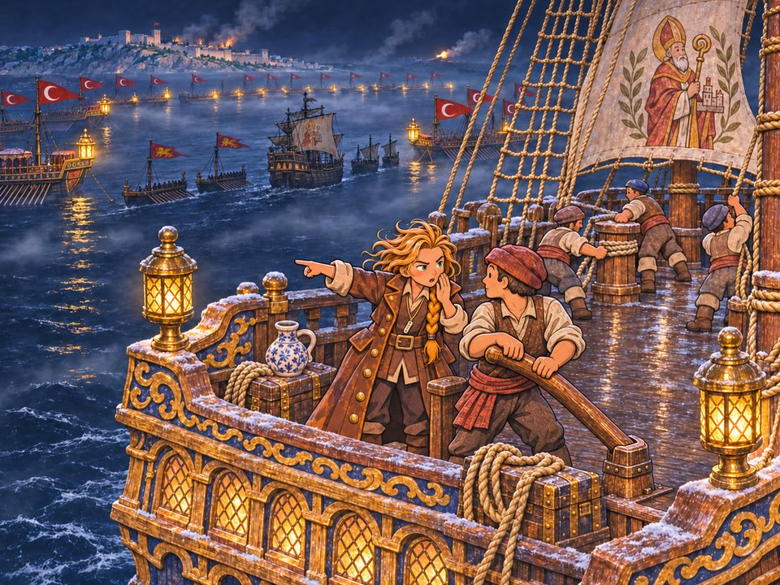
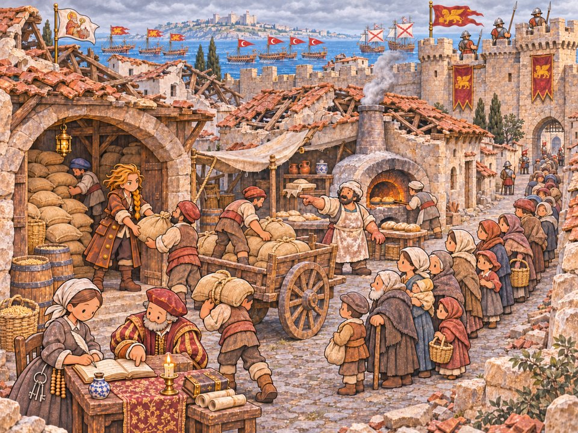

## 1. 칸디아의 겨울

1571년 1월, 크레타의 칸디아.

겨울비가 돌부두의 젖은 판석을 두드렸다. 항구 안쪽에 닻을 내린 배들의 돛대가 회색 하늘 아래서 나란히 흔들렸다. 소금기 머금은 바람이 춥게 불어와 갑판 위의 밧줄을 팽팽히 울렸다.

스베티 블라호의 선실 탁자 위로 지중해 해도가 펼쳐져 있었다. 해도의 동쪽 끝, 키프로스 섬 자리에는 못 두 개가 나란히 꽂혀 있었다. 서쪽의 니코시아 못 머리에는 지난가을 마라가 새로 입힌 금색 밀랍이 굳어 있었고, 동쪽 바닷가 파마구스타 자리에는 붉은 못 하나만 남아 있었다. 베네치아, 코르푸, 칸디아의 붉은 못들에서 가장 멀리 떨어진 외톨이였다.

탁자 맞은편에 선 세바스티아노 베니에르는 지팡이를 짚은 채 해도의 동쪽 끝을 내려다보았다. 지난 12월에 베네치아 해군의 총사령관 자리에 오른 노인이었다. 코르푸에서 보던 때보다 어깨가 조금 더 굽었으나, 짚은 지팡이 끝에는 여전히 힘이 실려 있었다.

"마르코 퀴리니가 갤리 몇 척을 이끌고 파마구스타로 들어간다." 베니에르의 목소리가 낮고 거칠게 울렸다. "니코시아가 무너진 뒤로 포위가 넉 달째네. 그대의 카락이 곡식을 싣고 뒤를 따르게."

"오스만 함대가 키프로스 앞바다를 에워싸고 있을 겁니다." 마리나가 붉은 못 하나 남은 섬을 손가락으로 짚었다. "화물선 한 척으로 봉쇄를 뚫기는 무리입니다."

"퀴리니의 갤리들이 앞길을 열 걸세." 베니에르가 지팡이로 파마구스타의 붉은 못 옆을 한 번 톡 쳤다. 탁자 곁에 선 부관이 사천 포대 곡식과 화약통 목록이 적힌 지령서를 내밀었다.

마리나는 품속에서 낡은 계약서 사본을 만졌다. 지난가을부터 두 달 치 삯이 밀려 있었다. 배를 놀리면 빚만 불어났다.

"라 콜롬바와 산타 엘레나는 어떡합니까."

"함께 데려가게. 날랜 갤리가 하나라도 더 있어야지."

베니에르가 지팡이를 들어 젖은 망토를 여미고 선실을 나갔다. 문이 닫히자 선실 안에는 등잔불 심지 타는 냄새만 남았다.

다음 날 아침부터 칸디아 부두는 짐을 싣는 소리로 분주했다. 인부들이 밀가루와 보리 포대를 어깨에 메고 사다리를 오르내렸다. 스베티 블라호의 깊은 선창 안으로 곡식 포대가 차곡차곡 쌓였고, 그 아래쪽 화약고에는 검은 화약통이 굵은 밧줄로 묶였다. 갑판장 로브로가 선창 입구에 서서 포대 수를 세며 젖은 천을 덮었다.

뱃머리 쪽에서는 토마 벤드라민이 포신을 닦고 있었다. 토마는 기름 먹인 헝겊으로 뱃머리 포신을 문지르다가, 손바닥으로 포신 옆면을 두 번 두드렸다.

"안툰 녀석도 겨울 바다는 처음이지." 토마가 곁에 선 마리나에게 쉰 목소리로 말했다. "지난여름 그 친구가 뱃머리 돛줄을 당기다 간 뒤로 내가 포에 먼저 간 동료의 이름을 붙여 왔소. 그래야 불을 붙일 때마다 손을 덜 떨고, 한 발을 쏘아도 허투루 쏘지 않소."

마리나는 대꾸하지 않고 화약고 쪽으로 눈을 돌렸다. 인부 둘이 마지막 화약통을 선창 아래로 내리고 있었다.

## 2. 밤바다의 등불

키프로스 앞바다는 달이 없었다. 검은 물결 위로 밤안개가 낮게 깔려 돛대 꼭대기마저 흐릿했다.

마리나의 선단 세 척은 퀴리니가 이끄는 베네치아 갤리들의 뒤를 바짝 따랐다. 뱃머리 등불도 끄고, 노에 기름을 발라 물소리마저 죽였다. 스베티 블라호는 짐을 가득 실어 배가 무겁게 가라앉아 있었고, 양옆의 라 콜롬바와 산타 엘레나가 뱃머리를 맞추어 바람을 갈랐다.

자정이 지날 무렵, 앞쪽 어둠 속에서 노란 점들이 하나둘 떠올랐다. 파마구스타 항구 앞을 가로막고 닻을 내린 오스만 봉쇄 함대의 선미 등불이었다. 등불들은 검은 수면 위에서 느리게 흔들리며 바다를 반으로 가르고 있었다.

"왼쪽으로 붙어라." 마리나가 키잡이에게 속삭이듯 일렀다. "퀴리니 선단의 꼬리를 놓치지 마라."

선두의 베네치아 갤리들이 속력을 높여 등불 두 개 사이의 넓은 틈으로 미끄러져 들어갔다. 곧 어둠 속에서 고함 소리가 터져 나왔다. 쇠사슬이 풀리는 소리와 북소리가 밤바다를 흔들었다. 붉은 불꽃이 번쩍이더니 묵직한 포성이 뱃전을 때렸다.

봉쇄선 안쪽의 오스만 갤리 두 척이 노를 저어 스베티 블라호의 오른쪽 옆구리로 다가왔다. 화승에 불을 붙이는 작은 붉은 점들이 어둠 속에 줄을 이었다.

"토마, 오른쪽!" 마리나가 외쳤다.

산타 엘레나가 먼저 불을 뿜었다. 포탄이 어둠을 가르고 오스만 갤리의 뱃머리 근처에 떨어져 물기둥을 세웠다. 곧이어 스베티 블라호의 뱃고물에서도 포가 울렸다. 맞은편 오스만 배에서 쏜 돌 포탄 하나가 허공을 가르며 날아와 스베티 블라호의 뱃전 난간을 들이받았다.

우지끈, 참나무 판자가 부서지는 소리가 났다. 나무 파편이 갑판 위로 튀어 마리나의 발치에 떨어졌다. 다행히 흘수선 위쪽이라 물이 새지는 않았다.

오스만 갤리들이 방향을 틀어 추격하려 했으나, 퀴리니의 뒤쪽 갤리 두 척이 불을 뿜으며 길을 막았다. 마리나의 배들은 연기를 등지고 항구 어귀를 향해 필사적으로 나아갔다. 등불과 고함 소리가 뱃고물 뒤편으로 조금씩 멀어졌다.

새벽녘이 되어서야 바다 위의 안개가 옅어졌다. 잿빛 하늘 아래, 깎아지른 듯한 성벽이 물 위로 모습을 드러냈다. 두꺼운 석회암 성벽 위로 붉은 사자 깃발이 찢긴 채 펄럭이고 있었다.

## 3. 성벽과 화덕

파마구스타 성안은 타 버린 나무와 젖은 석회 냄새가 배어 있었다.

길가 돌집들의 지붕은 포탄에 맞아 반쯤 날아가 있었고, 부서진 기둥 사이로 사람들이 웅크리고 앉아 있었다. 부두에서 성안 광장으로 이어지는 골목길에는 흙을 채운 가마니와 돌무더기가 방책처럼 쌓여 있었다.

성벽 위를 걷던 사내가 발걸음을 멈추고 마리나를 맞았다. 마르칸토니오 브라가딘이었다. 진붉은 사령관 망토는 먼지를 뒤집어써서 빛이 바랬고, 턱수염에는 하얀 석회 가루가 묻어 있었다.

"무사히 닿았군, 선장." 브라가딘이 마리나의 손을 한 번 쥐었다가 놓았다. "퀴리니 선단이 들이닥쳐 준 덕분에 숨통이 트였소."

브라가딘은 말을 길게 잇지 않고 성벽 안쪽 통로를 따라 앞장섰다. 마리나가 그 뒤를 따랐다. 성벽 돌틈마다 굵은 쇠 못과 밧줄이 박혀 있었고, 포탄이 긁고 지나간 자리에 하얀 돌가루가 수북했다. 브라가딘은 걸음을 옮기면서 손바닥으로 패인 성벽 돌을 천천히 짚었다.

"저쪽 보루 앞에 저들이 참호를 파고 있소. 봄이 오면 굴을 파고 들어올 거요. 그 전에 안쪽 벽을 한 겹 더 쌓아야 하오."

성벽 아래쪽 골목으로 내려서자 굽은 길모퉁이에 사람들이 길게 줄을 서 있었다. 노인과 아이, 머리에 검은 수건을 두른 아낙들이 벽에 기대어 말없이 차례를 기다렸다. 낡은 돌 화덕 굴뚝에서는 마른 올리브나무 타는 매캐한 연기가 가늘게 피어올랐다.

줄 맨 앞쪽에서 빵을 받아 든 사내의 손이 말라 있었다. 둥글고 납작한 보리빵 하나를 품에 안은 채 사내는 고개도 들지 않고 골목 안으로 사라졌다. 줄에 선 사람들의 눈은 깊게 파여 있었고, 누구도 큰 소리로 떠들지 않았다.

브라가딘이 화덕 앞의 좁은 마당을 바라보며 낮게 말했다.

"성은 돌로 버티는 게 아니오. 빵으로 버티지."

마리나는 빵 굽는 집 문설주에 기대어 선 병사들을 보았다. 창을 쥔 손등이 헐어 있었고, 갑옷 끈은 낡은 삼베로 기워져 있었다. 화덕 안에서는 장작 타는 소리가 탁탁 튀었다.

## 4. 맡긴 곡식

오후 늦게 성안 작은 광장 옆 창고에서 곡식 값을 정하는 자리가 열렸다.

긴 나무 탁자 한쪽에는 베네치아 서기가 깃펜을 들고 앉았고, 맞은편에는 밀가루가 묻은 앞치마를 두른 그리스인 사내가 서 있었다. 사내의 두 손은 뜨거운 화덕 앞에서 일한 탓에 마디가 굵고 붉었다.

"빵집 주인 니코스, 보리 한 포대에 은화 두 닢이오." 베네치아 서기가 장부를 두드리며 말했다. "봉쇄를 뚫고 온 짐이니 운임까지 치러야 하오."

니코스가 탁자 위로 거친 손을 내밀며 고개를 저었다.

"은화가 어디 있소. 지난가을부터 쇠붙이 대신 구리 동전을 찍어 돌리는 판에, 두 닢을 내라면 성안 아낙들이 반지를 빼서 내놓으란 말이오?"

"군량 값을 안 받으면 다음 배가 안 오오." 서기가 눈을 찌푸렸다.

"오면 고맙지. 하지만 베네치아 총독 나리들이 성안 사람들을 위해 싼 값에 빵을 내준 적이 있었소? 세금 걷을 때는 라틴 교회 사제들 앞세워 들이닥치더니, 이제 와서 술탄 군대와 싸우라고 곡식 값을 부르오." 니코스의 목소리가 낮게 깔렸다. "우리에겐 베네치아 총독도, 술탄도 다 남이오. 깃발이 바뀌어도 빵 값은 우리가 냅니다."

방 안의 공기가 무겁게 가라앉았다. 베네치아 서기가 마리나를 돌아보았다. 선주인 마리나가 값을 내리지 않으면 서기도 어쩔 도리가 없었다.

마리나는 창고 구석에 쌓인 스베티 블라호의 포대들을 보았다. 사천 포대 가운데 상회 몫으로 따로 떼어 둔 백 포대가 벽 쪽에 놓여 있었다. 그 백 포대를 팔아 은화를 챙기면 밀린 노잡이 삯의 반은 갚을 수 있었다. 하지만 창고 문밖 골목에서는 아까 보았던 빵 줄이 아직도 줄어들지 않은 채 이어져 있었다.

"내 배에서 내린 곡식 가운데 백 포대는 값을 받지 않겠소." 마리나가 말했다. "화덕으로 바로 옮기시오."

니코스가 마리나의 얼굴을 한참 쳐다보더니 짧게 고개를 끄덕였다.

"라구사 배 선장이구먼. 고맙다는 말은 하지 않겠소. 대신 오늘 밤 굽는 빵은 닷새 치를 더 낼 수 있을 거요."

창고 밖 부두에서 짐 셈을 마치고 들어온 마라가 탁자 모퉁이에서 두 사람의 말을 들었다. 마라는 아무 말 없이 허리춤에서 가죽 장부를 꺼내 펼쳤다. 베네치아 서기가 적는 공문서 옆에서 마라의 깃펜이 종이 위를 움직였다.

「보리 백 포대. 잃은 것 아님. 파마구스타 빵집 주인 니코스에게 맡긴 것.」

마리나는 그 글줄을 흘끗 보고는 창고 문을 밀고 밖으로 나섰다. 앞치마를 털어 낸 니코스가 일꾼들을 불러 보리 포대를 수레에 싣고 있었다.

## 5. 붉은 봉인과 화약 밀송

파마구스타에서 보낸 닷새 동안, 마리나의 선원들은 낮에는 부두에서 곡식을 나르고 밤에는 성벽 보수 작업에 쓸 통나무를 굴렸다.

마지막 날 밤 자정이 지났을 때, 성안 공병대 장교 하나가 어두운 부두 돌계단을 내려와 마리나를 찾았다. 장교의 소매 끝에는 석회 가루와 검은 화약 그을음이 묻어 있었고, 숨소리가 거칠었다.

"동쪽 보루 화약고가 바닥났소. 배에 남은 여분 화약통이라도 급히 성안으로 들여보내 주시오."

오스만 포위군 망루에서 횃불이 흔들리는 밤이라 수레를 끌고 성문을 지날 수는 없었다. 마리나는 로브로와 선원 여섯을 불러 모았다.

"화약통 열 개와 납탄 상자를 젖은 돛베로 두 겹씩 감싸라." 마리나가 낮은 목소리로 일렀다. "돌바닥에 쇠 띠가 부딪쳐 불꽃이라도 튀면 그대로 끝장이다."

바닷바람이 잦아든 틈을 타, 로브로와 선원들은 소리를 죽인 채 화약통을 부두 돌길 위로 천천히 굴려 성벽 아래 좁은 샛문까지 옮겼다. 성벽 위 망루에서 횃불 그림자가 스칠 때마다 사내들은 돌담 그늘에 납작 엎드려 숨을 죽였다. 젖은 돌바닥이 무릎을 찔렀으나 누구도 기침 소리 하나 내지 않았다. 샛문 안쪽에서 기다리던 공병들이 화약통을 하나씩 받아 안으로 끌어들이고 나서야, 로브로는 소매로 이마의 식은땀을 훔쳤다.

"이걸로 성벽 포대들이 보름은 더 버틸 것이오." 공병 장교가 마리나의 손을 꽉 쥐며 속삭였다. "남은 몫은 브라가딘 사령관께서 잊지 않고 장부에 올리실 거요."

그 새벽, 파마구스타 항구 앞에는 옅은 안개가 끼어 있었다. 젖은 돛대 끝에서 바닷물이 뚝뚝 떨어졌고, 멀리 오스만 진영 쪽에서는 새벽 기도를 알리는 소리가 바람에 실려 희미하게 건너왔다.

퀴리니의 갤리들이 먼저 닻을 올렸다. 밤사이에 오스만 봉쇄선 바깥쪽으로 안개가 짙게 깔려 빠져나가기 좋은 날이었다. 스베티 블라호의 갑판에서는 로브로가 마지막 닻줄을 감아올리고 있었다. 짐을 다 부린 카락은 물 위로 한 뼘쯤 가벼워져 있었다.

부두 돌계단 끝에서 브라가딘이 마리나를 기다리고 있었다. 수비대장은 손에 작은 양피지 편지 한 통을 쥐고 있었다. 접힌 종이 끝에는 붉은 밀랍으로 찍은 인장이 선명했다.

"베네치아에 있는 아내에게 보내는 편지오." 브라가딘이 편지를 내밀었다. "함대 본진을 거쳐 베네치아로 닿거든 전해 주시오."

마리나는 두 손으로 편지를 받아 허리의 가죽 서류 주머니 안쪽에 깊숙이 넣었다. 계약서 사본과 그리마니의 어음 사본 옆자리였다.

"겨울바람이 잦아들고 봄이 오면 다시 보급선을 몰고 돌아오겠소." 마리나가 말했다. "그때는 곡식을 더 싣고 오리다."

브라가딘은 무겁게 고개를 끄덕였다.

"기다리겠소. 퀴리니가 뚫은 물길을 잊지 마시오."

마리나가 사다리를 밟고 갑판 위로 올라서자 뱃고물에서 출항을 알리는 북이 낮게 울렸다. 배가 부두에서 떨어져 나가며 물결을 갈랐다.

스베티 블라호가 방파제 끝을 돌아 항구 밖으로 나아가는 동안, 마리나는 뱃고물 난간을 잡고 뒤를 돌아보았다. 부두 돌계단 끝에 선 브라가딘의 붉은 망토가 새벽 안개 속으로 조금씩 잦아들었다.

## 6. 노를 놓다

1571년 봄, 코르푸 항구.

따뜻한 봄바람이 불어왔지만 항구 안쪽의 물은 탁하고 무거웠다. 겨울 내내 파마구스타를 다녀온 뒤로 선단에는 두 달째 베네치아의 삯이 내려오지 않았다. 총사령관 베니에르는 에스파냐와 교황령 사절들을 기다리며 함대를 묶어 두고 있었고, 보급 창고의 은화 궤짝은 바닥을 드러냈다. 부두에서 밧줄을 묶던 로브로마저 "선장, 뱃사람들 입에도 풀칠은 해야지 않소" 하고 낮게 한숨을 내쉬었다.

점심 무렵, 라 콜롬바의 갑판 위에서 노를 잡던 사내들이 일제히 움직임을 멈추었다. 긴 참나무 노들이 노걸이 위에 가로로 내려앉았다. 아무도 소리치거나 쇠붙이를 들지 않았다. 다만 모두 갑판 나무판자 위에 걸터앉아 뱃머리 쪽을 바라보며 팔짱을 꼈다. 한 사내가 낡은 가죽 신발 바닥을 두드리며 한숨을 쉬었다.

"두 달이 넘었소, 선장." 노잡이들 가운데 나이 든 어부 하나가 입을 열었다. "아내가 집에서 굶고 있소. 빈손으로 노를 저을 수는 없지."

산타 엘레나 쪽에서도 노 젓는 소리가 멎었다. 두 갤리의 노잡이들이 똑같이 노를 놓은 채 조용히 버텼다.

마리나는 사다리를 건너 라 콜롬바의 갑판으로 내려왔다. 마라가 장부를 품에 안고 그 뒤를 따랐다. 갑판 위에는 침묵만 무겁게 깔려 있었다. 마리나가 마라를 돌아보자 마라가 고개를 저으며 작은 가죽 주머니 하나를 내밀었다.

"총사령관 쪽 서기는 다음 달에나 은화가 온대요. 지금 상회 궤짝에 남은 건 지난겨울 소금 팔아 둔 마지막 은화뿐이에요."

"그걸 다 푸시오."

"그것까지 내주면 스베티 블라호 수리비도, 다음 달 밀가루 값도 남지 않아요. 선장님 몫까지 털면 정말 빈털터리예요."

"삯을 못 주는 선장은 선장이 아니오." 마리나가 주머니를 받아 들며 말했다. "내 몫의 은을 먼저 세어 주시오."

마라가 입술을 꾹 다물고 가죽 주머니 끈을 풀었다. 탁자 대신 갑판 위 나무 상자 위에 낡은 라구사 은화들과 베네치아 은화들이 쏟아졌다.

마리나는 명부를 들고 노잡이들의 이름을 하나씩 불렀다. 사내들이 차례로 앞으로 나와 두 손으로 은화를 받아 쥐었다. 은화 무게를 가늠해 본 늙은 어부가 조용히 고개를 숙였다.

"이걸로 집안에 보리 몇 말은 보내겠소."

그때 스베티 블라호 쪽에서 묵직한 가죽 보따리를 어깨에 멘 로브로가 사다리 쪽으로 걸어 내려왔다. 보따리에는 낡은 겉옷과 밧줄 칼이 들어 있었다. 로브로는 부두로 내려가려다 발길을 멈추고, 라 콜롬바 갑판 위에서 제 몫의 은화를 마지막 한 닢까지 나누어 주는 마리나의 손을 바라보았다.

마라가 빈 가죽 주머니를 탈탈 털어 마지막 노잡이의 손에 은화 두 닢을 얹어 주었다. 주머니가 텅 비어 축 늘어졌다.

로브로가 부두 쪽을 한 번 보더니, 어깨에 멨던 가죽 보따리를 다시 스베티 블라호의 갑판 위로 던져 올렸다. 묵직한 보따리가 나무판자에 둔탁하게 떨어졌다. 로브로는 소매를 걷어붙이고 뱃전 밧줄을 다시 쥐었다.

## 7. 호위 선장의 배

4월 말, 코르푸 항구 세관 앞 부두에는 훈풍이 불기 시작했다.

노잡이 삯 소동이 가라앉은 지 열흘 만에, 베네치아 본국에서 은화 수송선이 코르푸에 닿았다. 베니에르 총사령관의 부관이 밀린 삯과 함께 파마구스타 겨울 보급의 공을 치하하는 문서 한 통을 스베티 블라호로 가져왔다. 부관이 갑판 사다리를 오르자 부두 앞 선술집에서 지켜보던 사공들이 모자를 들어 보였고, 마라는 은화 궤짝 자물쇠를 열며 안도의 한숨을 내쉬었다.

그날부터 항구의 공기가 달라졌다. 부두 세관원들은 스베티 블라호가 닻을 내리자 짐칸 덮개를 열어 보지도 않고 길을 터 주었고, 함대 장교들은 마리나의 이름을 부를 때마다 「호위 선장」이라 부르기 시작했다. 부관은 베네치아 항구마다 관세를 면해 주는 나무 패찰을 탁자에 올려놓으며, 코르푸 조선소 남쪽 부두에 새로 진수한 배 한 척을 보러 가자고 일렀다.

조선소 물길 위에는 갓 역청을 입힌 베네치아식 중형 갤리 한 척이 닻을 내리고 있었다. 라 콜롬바보다 선체가 반 뼘 더 넓고 뱃머리에 청동 포 세 문을 나란히 얹을 수 있게 다듬은 호위 갤리였다. 돛대 꼭대기에는 아직 깃발이 걸려 있지 않았고, 뱃전 아래에서는 물결이 갓 칠한 역청 냄새를 싣고 돌벽을 때렸다.

"파마구스타 봉쇄선을 뚫고 돌아온 선장은 그대 선단이 앞장섰소." 부관이 양피지 임명장을 마리나의 손에 건네며 말했다. "베니에르 총사령관께서 정식으로 호위 선장 직위를 내리셨소. 이 배의 용골을 살펴보고 선단에 들이시오."

"노잡이들은 자유민으로 따로 뽑아 태워도 되겠소?" 마리나가 물었다.

"임명장에 선원 모집 몫까지 들어 있소. 두 달 치 군량도 코르푸 창고에서 내줄 거요."

마리나는 갑판으로 올라가 뱃전 안쪽 늑골의 매끈한 참나무 판자를 손으로 쓸어 보았다. 갓 깎은 나무의 서늘한 감촉과 송진 냄새가 손바닥에 묻어났다. 토마 벤드라민이 뱃머리 포대에 올라 포신을 흔들어 보며 고개를 끄덕였다.

"포가 세 문이나 들어가니 뱃머리가 묵직하오. 뱃고물 쪽에도 밧줄을 두 겹은 더 감아야 반동을 버틸 거요."

로브로는 새 밧줄 타래를 만져 보며 입가에 짧은 미소를 띠었다.

"노걸이 간격이 넓어서 늙은 어부들도 숨이 덜 찰 겁니다. 사흘이면 노잡이 명부를 다 채우겠소."

그날 오후, 마리나는 코르푸 만 바깥으로 새 배를 몰고 나가 바람을 받아 보았다. 돛을 반만 펼쳤는데도 배가 물살을 가르며 부드럽게 돌아나갔다. 부두로 돌아와 밧줄을 매는데, 코를 찡그리며 손끝에 묻은 역청을 닦아 내던 사내, 로렌초 파스콸리가 곁에 다가와 새 갤리의 뱃전을 눈으로 훑었다. 한쪽 귀에 작은 은 귀고리를 단 연안 초계장이었다.

"뱃머리가 한 뼘 넓어졌는데도 선회가 빠르구려, 마리나 선장." 로렌초가 웃으며 말했다. "다음 달 이오니아해 역풍이 불 때면 이 배가 곶을 돌아나가는 데 제몫을 톡톡히 할 거요."

선실로 돌아온 마라는 탁자 위에 나무 패찰과 임명장을 나란히 놓고, 장부 여백에 그 봄의 마지막 셈을 적었다.

「열네 달, 배 다섯, 남은 은화는 적으나 코르푸의 빗장이 풀렸다.」

선실 바깥에서는 새 갤리의 돛대에 붉은 사자 깃발이 올라가는 소리가 바람에 섞여 들려왔다.

---

## 다른 깃발 아래에서 ― 초승달

*(1부에서 마리나가 가운데 봉인을 집었다면, 이야기는 이 길로 흐른다.)*

### 성 밖의 화덕

늦가을에서 겨울로 접어들며 파마구스타 성 밖 오스만 포위 진영에도 찬비가 내렸다. 마리나와 니콜라의 선단은 마지막 화약과 밀 포대를 싣고 보급 부두로 들어갔다. 성벽 너머에서는 간헐적으로 대포 소리가 울렸으나, 흙과 돌을 쌓아 올린 포위 진영 안쪽은 바닷바람보다 더 스산했다. 흙먼지와 진흙을 뒤집어쓴 병사들이 배급소 천막 앞을 서성이다 빈손으로 돌아서는 모습이 진영 어귀마다 눈에 띄었다.

짐을 다 부린 오후, 마리나는 니콜라와 함께 진영 바깥쪽 돌담 아래 낡은 화덕을 찾아갔다. 굴뚝에서는 마른 올리브나무 타는 매캐한 연기가 가늘게 피어올랐다. 화덕 앞에서 밀가루 묻은 앞치마를 두른 채 불씨를 뒤적이던 그리스인 사내가 두 사람을 올려다보았다. 두 눈이 깊게 파이고 손등에 화상 자국이 남은 중년 사내였다.

"여보시오, 어제부터 화덕에 넣을 보리 한 줌이 없소." 사내가 거친 손등으로 이마의 땀을 훔치며 말했다. "파마구스타 성안에 내 사촌이 빵을 굽고 있는데, 거기도 굶기는 성 밖이나 매한가지일 게요."

니콜라가 말없이 마리나를 돌아보았다. 마리나는 부두 창고 구석에 상회 몫으로 따로 떼어 두었던 흰 밀가루 스무 포대를 떠올렸다. 진영 상인들에게 내놓으면 금화 몇십 닢을 거뜬히 받을 물건이었고, 겨울 삯을 메우려던 마라의 셈에도 들어 있던 몫이었다.

"내 배에서 내린 밀가루 가운데 스무 포대는 값을 받지 않겠소." 마리나가 말했다. "오늘 밤부터 화덕 불을 다시 지피시오."

사내가 한참 동안 마리나의 얼굴을 쳐다보더니 말없이 고개를 끄덕이고는 낡은 손수레를 끌어 왔다. 뒤따라온 로브로와 선원들이 밀가루 포대를 수레에 옮겨 싣는 동안, 니콜라는 화덕 옆 돌담에 기대어 서서 터키 말로 병사 몇에게 빵 나오는 시간을 일러 주었다. 마리나가 수레 바퀴에 낀 진흙을 발끝으로 털어 내며 물었다.

"성안에 있다는 그 사촌 이름이 무엇이오?"

"니코스라 부르오. 초가을에 성문이 닫히기 전에 아직 빵을 굽는다는 말만 들었소." 사내가 밀가루 포대 끝을 묶으며 대답했다. "성안 화덕도 겨울이 가기 전에 다 식을 텐데, 그 사람이 아직도 살아 있는지 모르겠소."

그날 밤, 선실로 돌아온 마라는 촛불 아래 가죽 장부를 펼치고 먹물이 마르기를 기다리며 조용히 한 줄을 적어 넣었다.

「밀가루 스무 포대. 잃은 것 아님. 파마구스타 성 밖 화덕에 맡긴 것.」

### 구랍의 돛

1571년 봄, 이스탄불 금각만.

겨울을 넘긴 갈라타 병기창 앞 바다는 봄 출정을 앞둔 오스만 갤리들로 가득 찼다. 부두 돌바닥에는 흑해에서 내려온 참나무 통나무와 삼베 뭉치가 산처럼 쌓여 있었고, 솥에서 끓는 검은 역청 냄새가 아침 안개와 뒤섞여 코를 찔렀다. 마리나의 선단은 흑해 카파에서 실어 온 통나무와 소나무 기름을 병기창에 부리고, 선창 밑을 긁어내며 여름 원정을 준비하고 있었다.

하산과 함께 병기창 동쪽 부두로 걸어간 마리나는 물 위에 갓 띄워진 거대한 수송선 한 척을 올려다보았다. 돛대 셋에 뱃전을 높게 올린 오스만식 큰 화물선, 구랍이었다. 카락보다 바닥이 넓어 무거운 공성포와 말린 양고기 통을 수백 개씩 실을 수 있었다.

"술탄의 함대가 올여름 서쪽으로 길게 나갈 거란 말이 돕니다." 하산이 놋쇠 나침반을 손에 쥔 채 말했다. "큰 짐을 실을 배가 필요해 병기창에서 우리 선단에 이 구랍의 시운전을 맡긴 모양이오. 수송 감독관이 마리나 레이스 몫으로 이미 패찰을 찍어 두었소."

"뱃바닥이 넓으니 파마구스타나 에게해 얕은 항구에도 들어갈 수 있겠소."

마리나는 로브로와 함께 구랍의 갑판에 올라 굵은 돛줄을 당겨 보았다. 갓 깎은 전나무 판자에서 송진 냄새가 진하게 올라왔다. 배의 허리가 묵직하고 파도를 받는 힘이 단단했다. 토마 벤드라민은 뱃고물 포대에 올라 쇠 고리를 두드려 보더니 "화약통 스무 개는 거뜬히 싣겠소" 하고 턱을 끄덕였다.

부두 아래에서는 굵은 팔짱을 낀 사내 하나가 구랍의 높은 뱃전을 올려다보고 있었다. 뺨에 굵은 칼자국이 남은 술레이만 자파르였다. 술레이만이 허리춤의 짧은 칼자루를 두드리며 쉰 목소리로 한마디를 던졌다.

"뱃전이 높아서 적의 작은 갤리가 달라붙기는 어렵겠군, 마리나 레이스." 술레이만이 웃으며 말했다. "그래도 뱃전이 맞붙으면 뱃머리 포만 믿지 말고 갈고리 줄을 쥔 수병들을 앞세우시오."

"배가 무거운 만큼 방향을 돌리는 데 시간이 걸리오." 마리나가 뱃전 난간을 짚으며 대답했다. "좁은 해협에 들어갈 때는 자네처럼 날랜 갤리가 앞뒤를 받쳐 주어야지."

그 곁에서 지켜보던 니콜라가 웃으며 "배가 커졌다고 하산의 나침반까지 무거워지는 건 아닐 테니 걱정 마라" 하고 농담을 던졌다. 조금 떨어진 정박지에서는 유수프 데미르의 갤리옷이 먼저 출항 닻을 올리며 뱃고물에서 북을 두드리고 있었다. 마라는 선실로 돌아와 새로 받은 오스만 항구 관세 면제 패찰을 장부 갈피에 끼웠다. 이제 금각만에서 로도스까지 세관의 빗장이 모두 풀려 있었다.

### 올리브 잎 편지

구랍 시운전을 마치고 갈라타 부두로 돌아온 저녁, 라구사 상선 편으로 작은 편지 한 통이 스베티 블라호의 선실에 닿았다. 젖은 삼 밧줄과 소금 냄새가 밴 봉투였다.

니콜라의 어머니 안나가 보낸 편지였다. 마리나는 부두 돌계단에 걸터앉아 짐을 내리는 뱃사람들의 틈에서 니콜라를 불렀다. 니콜라는 오스만식 긴 겉옷 소매를 걷어 올린 채 다가와 편지 봉투를 받아 들었다. 갈라타 언덕 위 모스크에서 저녁 기도를 알리는 소리가 바람을 타고 내려왔고, 부두 앞 생선 화덕에서는 고등어 굽는 연기가 피어올랐다.

니콜라는 돌계단에 걸터앉아 밀랍 봉인을 떼고 천천히 종이를 펼쳤다. 편지에는 길지 않은 안부만 적혀 있었다. 라구사의 겨울이 무사히 지났다는 말과, 성 블라호 성당에 초를 세 개씩 켜 두고 있다는 이야기, 그리고 골목길 올리브나무에 새순이 돋았다는 짧은 문장이었다. 글씨 끝에는 촛농 자국이 작게 남아 있었다.

"야코도 나폴리에서 혼인을 미루고 배를 몬다더구나." 니콜라가 편지를 접어 겉옷 안주머니에 넣으며 중얼거렸다. "바다가 잠잠해지기 전에는 셋이 다시 성벽 위에 모이기 어렵겠어."

"어머님께는 여름이 지나기 전에 답장을 보내자." 마리나가 금각만의 어두워지는 물결을 보며 말했다. "라구사 상선이 다음 주에 다시 올라간다더군. 말린 무화과라도 한 꾸러미 얹어 보내지. 내가 상회 몫으로 받아 둔 올리브 기름 병도 하나 보탤게."

"갈라타 상관에 들러 어머니 드릴 모직물 한 필도 따로 떼어 놓아야겠다." 니콜라가 둥근 모자를 고쳐 쓰며 일어섰다. "자네 올케 마라에게도 안부 전해 줘. 장부 보느라 고생이 많으실 텐데."

"어머님 편지에는 우리 배가 붉은 사자와 맞서 싸우는 걸 걱정하는 말은 없었나." 마리나가 조심스레 물었다.

니콜라는 돌계단을 밟고 일어서며 고개를 저었다. "아들이 살아서 밥을 먹고 있는지만 물으시더군. 어머님은 원래 그런 분이야."

"어머님께서 보내신 건빵 부스러기라도 봉투 안에 안 들었나 보지." 마리나가 웃으며 물었다.

니콜라가 옅게 웃더니 봉투 끝을 다시 들여다보았다. "마른 올리브 잎 하나를 접어 넣으셨더군. 집 앞 마당 나무에서 꺾으신 모양이야."

두 사람은 부두 돌길을 따라 갈라타 상관 쪽으로 나란히 걸어 올라갔다. 저 멀리 갈라타 탑 꼭대기에 저녁 붉은 노을이 걸려 있었고, 선실로 돌아온 마라는 그 봄의 마지막 장부 줄을 적었다.

「열네 달, 배 다섯, 파마구스타 성 밖의 불은 아직 꺼지지 않았다.」

---

## 다른 깃발 아래에서 ― 왕관 방패

*(1부에서 마리나가 오른쪽 봉인을 집었다면, 이야기는 이 길로 흐른다.)*

### 메시나의 열병

1571년 봄, 마리나의 배들은 시칠리아 메시나 해협에 닻을 내리고 끝없이 기다렸다.

파마구스타가 겨울을 넘겼다는 소식이 바다를 건너왔으나, 동맹 함대는 좀처럼 모이지 않았다. 메시나 항구의 한낮 더위는 날이 갈수록 솥뚜껑을 덮은 듯 뜨거워졌고, 해가 질 무렵이면 바람 한 점 없는 부두 그늘마다 열병을 앓는 수병들이 젖은 천을 이마에 얹은 채 누워 있었다. 부두 앞 우물가에서는 물통을 채우려는 사공들이 줄을 서서 다투는 소리가 하루 종일 그치지 않았다. 갑판 솔기의 역청이 햇볕에 물러져 신발 바닥에 달라붙었다.

오후 늦게 스베티 블라호의 갑판으로 올라온 야코는 흰 주름 깃을 풀어 손에 든 채 난간에 기대었다. 목덜미까지 땀으로 젖어 있었고, 눈 밑에는 잠을 설친 검은 그늘이 내려앉아 있었다.

"혼인을 또 미뤘다." 야코가 씁쓸하게 웃으며 바다를 보았다. "키아라가 나폴리에 남아 기다리겠다고 하더구나. 동맹 함대가 내려올 때까지는 배에서 내릴 수가 없다. 약혼 반지만 끼워 두고 나온 게 마음에 걸려."

"혼인은 전쟁이 끝나고 해도 늦지 않아." 마리나가 물통을 건네며 대답했다. "지금은 살아남아 돌아가는 게 먼저지. 나폴리 부두에 키아라가 기다리고 있으니 네가 더 조심해야 해."

"내가 타던 갈레온의 선장 영감도 어제부터 열로 자리에 눕기 시작했어." 야코가 이마의 땀을 훔치며 말을 이었다. "가을까지 배를 몰 사람이 나밖에 없어. 뱃사람들이 열병에 쓰러져 노잡이 채우기도 빠듯한 형편이야."

"우리 배 선원들도 반은 더위에 지쳐 있어." 마리나가 뱃머리 그늘 쪽을 가리켰다. "토마 영감만 하루 종일 젖은 헝겊을 들고 포신 옆을 떠나지 않아."

"그 영감은 쇠붙이 녹스는 걸 더운 것보다 더 싫어하지." 야코가 씁쓸하게 웃었다. "메시나 부두 우물물도 바닥이 났는지 어제부터 소금기 섞인 짠물이 올라오기 시작했어. 내일 아침에는 나폴리에서 물통 실은 배가 온다니 기다려 볼 수밖에."

야코는 물 한 모금을 삼키고는 말없이 제 갈레온 쪽을 바라보았다. 손목에 감긴 키아라의 작은 나무 묵주가 햇볕 아래 땀에 젖어 어둡게 빛났다. 메시나 항구 안쪽에서는 에스파냐 보병들이 부두 돌계단에 걸터앉아 쇠 투구를 닦는 소리가 간간이 들려왔다. 항구 술집 앞 그늘에는 나폴리에서 온 사공들이 삼삼오오 모여 앉아 함대가 언제 다 모일지 수군거렸다. 야코는 땀에 젖은 이마를 손등으로 훔치고 사다리를 내려가 제 갈레온의 그늘 속으로 천천히 걸음을 옮겼다.

### 큰 갈레온의 돛

기다림이 길어지던 4월 중순, 시칠리아 남쪽 바다에서 트리폴리로 향하던 바르바리 군량 수송선 두 척이 에스파냐 초계망에 걸려들었다. 마리나의 선단은 나폴리 함대의 돌격 선장 페드로 살라스의 갤리와 엇갈리며 남쪽 물길로 내려가 수송선의 앞길을 막았다.

"살라스의 갤리가 너무 성급히 들어가는군!" 갑판 위에서 로브로가 외쳤다. "저렇게 뱃머리를 내밀면 적선 포구에 옆구리를 맞소!"

마리나가 스베티 블라호와 두 갤리로 바람 위쪽을 틀어막는 사이, 토마 벤드라민이 뱃머리 포 「비코」로 돛대를 부러뜨려 수송선 한 척을 나포했다. 남은 한 척은 노를 거꾸로 저어 남쪽 바다로 꽁무니를 뺐다. 나폴리 군항으로 끌고 돌아온 수송선 창고 안에는 화약통과 올리브 기름 항아리가 가득 차 있었다. 페드로 살라스는 부두에 닿자마자 제 배의 찢긴 돛을 꿰매느라 마리나를 보고도 퉁명스럽게 고개만 돌렸다.

4월 말, 나폴리 부왕령 조선소는 마리나에게 서지중해와 대서양 물길을 넘나들 수 있는 큰 용선 한 척의 시운전을 맡겼다. 카락보다 뱃전이 훨씬 높고 대포를 두 층으로 얹는 에스파냐식 갈레온이었다. 마리나는 갑판장 로브로와 함께 갓 역청을 바른 새 배의 뱃전을 밟아 보았다. 두꺼운 참나무 갑판 아래로 묵직한 포문들이 줄지어 열려 있었고, 뱃고물에는 붉은 톱니 십자가 선명하게 그려져 있었다.

"이런 배를 몰면 거친 파도에도 끄떡없겠소." 로브로가 굵은 돛줄을 만져 보며 말했다. "다만 작은 항구 얕은 만에는 못 들어가니 메시나 해협 같은 깊은 물길에 알맞소."

부두 돌계단 위에서 굵은 장부책을 팔에 낀 사내, 프란시스코 모랄레스가 새 배의 흘수선을 눈으로 가늠했다. 닳은 가죽 소매에 잉크 자국이 배어 있는 상선장이었다.

"짐칸 바닥에 무거운 화약통과 포탄을 먼저 깔아야 파도 속에서 중심을 잡소, 마리나 카피탄." 프란시스코가 손가락으로 선창 깊이를 짚으며 말했다. "윗갑판에 무게가 쏠리면 역풍을 만났을 때 키가 말을 안 듣소."

"배를 띄우기 전에 짐 무게부터 맞추라는 뜻이오." 마리나가 고개를 끄덕였다.

토마는 포문 사이를 걸어 다니며 쇠 대포의 굵기를 손바닥으로 재어 보았다. "화약통 스무 개는 거뜬히 싣겠소. 포문 덮개 이음새도 단단해서 거친 파도에도 바닷물이 덜 들이치겠군." 토마가 왼손으로 포가 나사를 두드리며 고개를 끄덕였다. 곁에 서 있던 로브로가 굵은 돛줄 매듭을 다시 점검하는 동안, 마리나는 이 큰 갈레온을 선단 다섯 번째 배로 들이기로 마음먹었다. 마라는 선실 탁자 위 명부 끝에 새 배의 선원 몫을 적어 넣었다.

### 박하 잎과 식초

메시나로 돌아온 늦봄, 항구 안에 번진 열병이 스베티 블라호의 선원 몇 명에게도 옮겨붙었다.

부두 그늘에 썩은 물이 고이며 역한 바람이 돈 탓이었다. 밤이 되자 갑판 위 천막 아래에 눕힌 젊은 노잡이 셋이 몸을 떨며 헛소리를 내뱉었다. 마라는 좁은 선실 안에서 식초와 마른 약초 값을 장부 귀퉁이에 빼곡히 적으며 선원들의 물통을 챙겼다. 갑판 위 천막 그늘에서는 로브로가 열에 들뜬 젊은 노잡이의 이마에 젖은 삼베 수건을 얹어 주고 있었다.

"물과 박하 잎을 끓여 식힌 거예요." 마라가 사기 그릇을 건네며 말했다. "다행히 선창에 실어 둔 맑은 물이 남아 있어 사흘만 앓으면 열이 내릴 거예요. 부두 우물물은 당분간 길어 오지 말라고 이르세요."

"아낙이 집에서 기다리는데 여기서 쓰러지면 안 되지." 로브로가 젊은 선원의 어깨를 부축해 물을 먹이며 중얼거렸다. "어제 부두 약초상에게 은화 세 닢을 더 주고 박하를 구해 왔으니 억지로라도 삼키시오. 열이 내리면 고향 라구사로 보낼 편지부터 써 주리다."

그때, 야코가 마른 짚으로 엮은 레몬 바구니를 팔에 끼고 갑판 사다리를 올라왔다.

"나폴리에서 내려온 상선에서 구해 왔다." 야코가 바구니를 마라 앞에 내려놓으며 말했다. "신 물에 꿀을 타서 먹이면 목 마른 게 조금 가라앉을 거다. 우리 배에도 열병 환자가 넷이나 누웠어."

"고맙소, 야코 선장." 마라가 레몬 하나를 집어 들며 고개를 숙였다. "마침 신 것이 모자라던 참이었어요."

토마 벤드라민은 뱃머리 포대 옆에 앉아 화약통에 습기가 차지 않도록 젖은 천을 걷어 내며 선원들을 지켜보았다. 왼손의 남은 세 손가락으로 물수건을 짜 주던 토마가 낮게 혀를 찼다. 마리나는 선실 탁자 위 해도의 니코시아 못 머리가 지난가을부터 이미 금색 밀랍으로 굳어 있는 것을 잠시 내려다보았다. 바닷바람이 조금씩 살아나며 돛대가 삐걱거렸다.

"메시나에 오래 묶여 있으면 배도 사람도 다 상하오." 마리나가 갑판으로 올라오며 말했다. "내일 새벽부터는 바람을 쐬러 해협 밖으로라도 한 바퀴 돌아야겠소. 로브로, 열이 내린 선원들은 그늘에 앉혀 두고 새벽 썰물에 닻줄을 풀 준비를 하시오."

"알겠소, 선장님. 맑은 물통부터 갑판에 더 얹어 두겠소." 로브로가 대답하며 밧줄을 고쳐 잡았다.

마라는 그날 밤 장부 여백에 식초와 박하 잎 값을 적은 뒤, 그 봄의 마지막 줄을 채웠다.

「열네 달, 배 다섯, 열병 속에서도 선원 하나 잃지 않고 봄을 넘겼다.」
