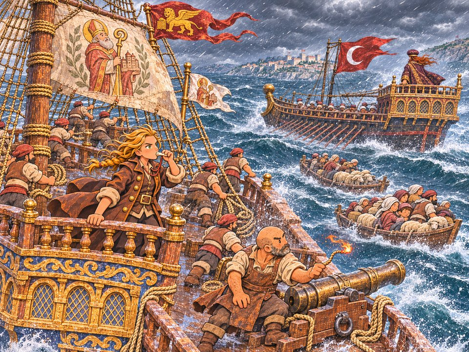
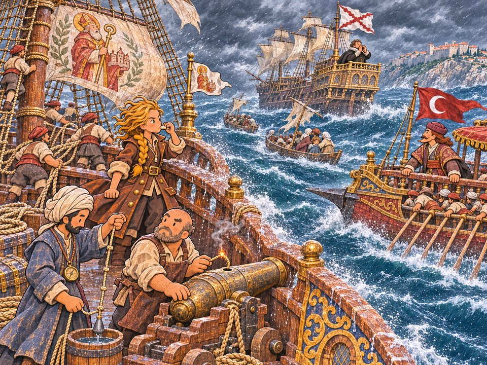

## 1. 메시나의 편지

1571년 5월 말, 코르푸 성채 앞 부두는 오랜만에 깃발 소리로 떠들썩했다.

로마에서 신성 동맹이 맺어졌다는 소식을 실은 빠른 배가 항구로 들어온 참이었다. 교황령과 베네치아, 그리고 에스파냐가 한 함대를 꾸려 오스만에 맞선다는 조약이었다. 부두 술집마다 수병들이 몰려나와 술잔을 부딪쳤고, 총사령관 베니에르의 기함 돛대에는 큰 사자 깃발이 새로 올라갔다. 성채 돌벽 아래에서는 서기들이 함대 출정 명부를 펼쳐 들고 각 배의 선장과 갑판장을 불러 모으느라 목소리를 높였다.

그날 오후, 베니에르의 부관이 스베티 블라호로 찾아왔다. 사다리를 밟고 갑판 위로 올라온 부관은 땀에 젖은 모자를 벗어 들며 마리나에게 두꺼운 출정 지령서 한 통을 내밀었다. 붉은 사자 인장이 찍힌 종이 끝에서 송진 냄새가 풍겼다.

"가을 출정이 정해지면 선단에는 갤리 두 척을 더 맡길 것이오." 부관이 뱃머리 포대 쪽을 한 번 둘러보며 말했다. "여름 동안 코르푸와 달마티아 물길을 막아 서는 일이 급하니, 돛과 노부터 미리 손보아 두시오. 베니에르 총사령관께서도 라구사 배의 뱃머리를 믿고 계시오."

"알겠소. 로브로에게 조선소 목수를 부르라 이르겠소." 마리나가 지령서를 받아 들며 대답했다. "뱃전 이음새에 역청부터 다시 먹이고 노걸이를 손보아 두리다."

선실 문턱에 기대어 서 있던 마라는 부관이 남긴 출정 지령서를 장부 틈에 끼우며 주판알을 두 번 튕겼다. 좁은 선실 안에는 젖은 양피지와 잉크 냄새가 고여 있었고, 창밖에서는 부두 짐꾼들이 화약통을 굴리는 소리가 둔탁하게 울렸다. 바깥 바다에서는 갈매기 떼가 사자 깃발 주위를 맴돌며 울었다.

그 소식을 전한 사절선의 짐 속에서 마리나 앞으로 온 편지 한 통이 나왔다. 나폴리에서 보낸 것이었다. 겉봉에 적힌 반듯한 필체는 야코 소르고의 것이었다. 젖은 삼 밧줄과 소금 냄새가 밴 봉투 귀퉁이에 검은 밀랍 인장이 반쯤 부서진 채 붙어 있었다. 마리나는 탁자 위 등잔불을 조금 더 당겨 놓고 손톱으로 밀랍 가장자리를 조심스레 떼어 냈다.

마리나는 선실 창가 빛 아래서 밀랍 봉인을 떼고 편지를 펼쳤다.

「마리나에게. 나폴리 부두에 들어온 지 두 달이 되었다. 내가 타던 라구사 갈레온의 선장이 열병으로 눕는 바람에, 이제 내가 키를 잡았다. 에스파냐 함대가 메시나로 모이고 있으니 여름이 지나기 전에 우리도 그쪽으로 간다.」

야코의 글씨는 곧고 굵었다. 편지 뒷면에는 혼인을 미루고 배를 지키고 있다는 짧은 안부가 적혀 있었고, 맨 끝 줄 아래에는 아무 글씨 없이 잉크로 작게 그린 그림이 하나 붙어 있었다.

손가락 길이의 깎은 뼈 호루라기였다.

마리나는 편지 끝의 호루라기 그림을 엄지손가락으로 한 번 쓸었다. 종이 위 잉크가 마른 지 오래되어 손끝에 아무것도 묻어나지 않았다. 그 순간 갑판 위에서 로브로가 닻줄을 고쳐 묶으며 선원들에게 물을 나누어 주는 소리가 들려왔고, 토마 벤드라민이 청동 포 「안툰」의 포구를 닦는 헝겊 소리가 뒤따랐다. 마리나는 편지를 네 번 접어 허리의 가죽 서류 주머니, 브라가딘의 편지 옆에 나란히 찔러 넣었다.

## 2. 보라 바람 속에서

여름이 깊어지며 아드리아해의 물빛이 거칠어졌다.

8월 들어 오스만 함대가 이오니아해를 넘어 북쪽으로 올라왔다는 급보가 코르푸에 닿았다. 울루치 알리가 이끄는 날랜 갤리들이 코르푸 바깥 섬들을 휩쓸고, 달마티아의 흐바르와 코르출라까지 들이닥쳤다는 소식이었다.

마리나의 선단은 달마티아 남쪽, 라구사 아래 바다에서 울친과 바르 방면의 피난민 배 두 척을 앞세워 북쪽으로 올라가고 있었다. 피난민 배의 갑판 위에는 가재도구와 양 떼, 젖먹이를 안은 아낙들이 빈틈없이 들어차 있었다.

정오가 지나면서 북동쪽 산맥 너머에서 매서운 돌풍이 쏟아져 내렸다. 달마티아 바다의 여름을 뒤집어놓는 북동풍, 보라 바람이었다. 하늘이 순식간에 납빛으로 변하더니 흰 물보라가 갑판을 때렸다. 바람 소리가 귓전을 찢을 듯이 울부짖어 바로 옆 사람의 말소리도 들리지 않았다.

"돛을 반만 접어라! 피난민 배가 뒤집힌다!" 마리나가 뱃전에 매달려 외쳤다.

그때 물보라 너머 회색 안개 속에서 뾰족한 뱃머리 하나가 솟아올랐다.

날렵하고 검은 선체에 붉은 초승달 깃발을 매단 오스만 갤리였다. 보라 바람에 밀려 본진에서 떨어진 모양이었다. 오스만 갤리는 피난민 배의 뒤쪽을 가로질러 화살 한 대가 닿을 만한 거리까지 순식간에 다가왔다.

"포 준비!"

스베티 블라호 뱃머리의 청동 포 「안툰」 곁에서 토마 벤드라민이 화승에 불을 붙였다. 붉은 불씨가 거센 바람 속에서 사납게 타올랐다. 토마가 왼손으로 포신을 짚고 불붙인 심지를 도화선 가까이 대려는 순간이었다.

오스만 갤리의 높은 뱃고물 난간 위에 누군가 서 있는 것이 보였다. 긴 겉옷 자락이 보라 바람에 사납게 펄럭였고, 머리에는 라구사식 둥근 모자를 눌러쓰고 있었다. 화살 거리라 물보라 사이로 얼굴이 또렷이 보이지는 않았으나, 모자 아래로 붉은 기가 도는 긴 머리카락이 바람에 날렸다.

마리나는 숨을 멈추고 목에 걸린 뼈 호루라기를 잡아당겼다.

차가운 뼈를 입술에 물고 힘껏 불었다.

길게 한 번. 짧게 한 번. 다시 길게 한 번.

보라 바람의 굉음을 뚫고 날카로운 호루라기 소리가 물 위를 갈랐다.

토마가 화승 심지를 허공에 멈춘 채 고개를 돌렸다.

한 박자 늦게, 물보라가 몰아치는 저쪽 오스만 갤리의 뱃고물에서 똑같은 소리가 돌아왔다.

길게 한 번, 짧게 한 번, 길게 한 번.

어느 배에서도 포문이 열리지 않았다. 두 배는 흰 물거품을 일으키며 서로의 옆구리를 스치듯 비스듬히 엇갈렸다. 피난민 배 두 척이 그 틈을 타고 북쪽 라구사 쪽 만으로 빠져나갔다.

오스만 갤리는 뱃머리를 돌려 안개 속으로 멀어져 갔다. 갑판 위 토마 벤드라민은 불붙인 심지를 든 채 아무것도 묻지 않고, 손등으로 물보라만 훔쳐냈다.

## 3. 안나의 문턱 앞

보라 바람이 잦아든 다음 날 아침, 마리나는 피난민 배 두 척을 라구사 방파제 안쪽 부두까지 안전하게 데려다주었다.

성문 앞 돌부두에는 아드리아해 남쪽에서 올라온 소문에 불안에 떠는 시민들이 몰려나와 있었다. 라구사 공화국은 중립국이었으나, 바로 아래 바다까지 오스만 함대가 올라와 울친과 바르를 쳤다는 소식이 퍼지면서 성벽 위 병사들의 창끝도 날이 서 있었다. 부두 위에서는 피난민들이 끌고 나온 양 떼가 울부짖었고, 아낙들은 젖은 보따리를 안고 성당 쪽으로 걸음을 재촉했다.

마리나는 갑판장 로브로에게 선창의 식수 통을 채우라 일러 두고, 혼자서 조용히 성벽 안쪽의 좁은 돌계단 골목으로 걸음을 옮겼다. 라스티치 집 앞의 작은 올리브나무는 여름 햇볕 아래 짙은 그늘을 드리우고 있었다. 골목 돌벽 틈에서 마른 이끼 냄새와 생선 굽는 연기가 흘러나왔다.

문을 두드리자 검은 수건을 두른 안나가 문틈으로 얼굴을 내밀었다.

"마리나, 네가 이 난리 통에 어쩐 일이냐."

"피난민 배를 데려다주고 잠깐 들렀습니다, 어머님." 마리나는 햇볕에 탄 손으로 겉옷 깃을 여몄다.

안나는 마리나를 부엌 탁자 앞으로 불러 찬 물그릇을 내어 주었다. 안나의 손등에는 밀가루 반죽을 빚던 하얀 가루가 아직 남아 있었다. 안나는 마리나의 어깨 너머로 닫힌 나무 문 쪽을 한 번 살피더니 낮은 목소리로 물었다.

"남쪽 바다에 오스만 갤리들이 올라왔다더구나. 어제 부두로 들어온 어부들이 울친 성벽 너머로 불길이 솟는 걸 보았다고 하더라. 니콜라가 그 함대에 섞여 있지는 않더냐. 살아서 배를 몰고는 있느냐."

마리나의 머릿속에 어제 보라 바람 속에서 마주쳤던 붉은 기 도는 머리카락과 뼈 호루라기 소리가 스쳤다. 뱃고물 난간 위에서 화약 냄새를 등지고 서 있던 친구의 모습이었다. 마리나는 물그릇을 내려놓고 입술을 한 번 축인 뒤 짧게 고개를 끄덕였다.

"살아 있습니다. 아드리아해 물길에서 무탈하다는 기별만 들었습니다. 몸 성히 지낸다고 하더군요."

"어느 바다에 있든 제 배를 타고 돌아오기만 하면 된다." 안나가 탁자 모퉁이를 짚으며 한숨을 내쉬었다. "야코는 나폴리에 있다더니 소식이 있느냐."

"지난봄에 편지가 왔습니다. 혼인을 미루고 큰 함대와 함께 동쪽으로 내려올 채비를 한다고 했습니다."

마리나는 그 이상 말하지 않았다. 아들이 고향 코앞까지 오스만 깃발을 달고 올라와 피난민 배 뒤를 쫓았다는 말은 차마 입에 올릴 수 없었다.

안나는 한참 마리나의 얼굴을 들여다보다가, 길고 주름진 손으로 마리나의 손등을 한 번 토닥였다.

"그래, 살아만 있으면 됐다. 너도 조심하거라. 성 블라호 성당의 초 세 개가 아직도 다 타지 않고 남아 있단다."

안나는 부엌 선반에서 마른 무화과를 싼 작은 삼베 보자기를 꺼내 마리나의 손에 쥐여 주었다. 손바닥에 닿는 보자기가 따뜻했다. "배 안에서 입이 심심할 때 뱃사람들과 나누어 먹어라."

마리나는 인사를 남기고 돌계단을 내려왔다. 성벽 위에서는 라구사의 흰 깃발이 바람 없이 늘어져 있었다. 부두로 돌아오자 로브로가 식수 통을 다 채우고 출항 닻줄을 고쳐 매고 있었다.

## 4. 서쪽으로 돌린 뱃머리

8월 중순, 코르푸 항구에는 다시 비가 내렸다.

항구에 들어선 베네치아 전령선이 아드리아해 남쪽 소식을 실어 왔다. 오스만 함대가 달마티아 연안을 훑고 내려가며 베네치아령 항구 셋을 차례로 점령했다는 전갈이었다. 울친, 바르, 부드바. 마리나의 고향 라구사 바로 아래쪽 바다였다. 8월 초에 끝내 키프로스의 파마구스타마저 성문이 열렸다는 소식이 뒤이어 닿았다.

부두 사다리 아래에는 코르푸 성채에서 내려온 베네치아 연락 장교가 젖은 망토를 털어 내며 서 있었다. 비에 젖은 종이 뭉치를 든 장교의 얼굴이 납빛으로 굳어 있었다.

"울친 성벽이 무너질 때 수비대장도 포로로 잡혔다 하오." 장교가 쉰 목소리로 말했다. "파마구스타의 브라가딘 사령관 소식은 아직 닿지 않았으나, 성문이 열렸다는 소문만은 돌고 있소."

스베티 블라호의 선실은 습하고 어두웠다. 탁자 위 해도 앞에 마라가 앉아 작은 쇠 칼을 들었다. 선실 창문으로 들이치는 빗바람에 등잔불 심지가 위태롭게 흔들렸다.

마라는 울친, 바르, 부드바 자리에 꽂혀 있던 놋쇠 못 셋을 차례로 가리켰다. 칼날 끝으로 못 머리에서 붉은 밀랍을 긁어내자 붉은 가루가 해도 위로 흩어졌다. 마라는 작은 촛불에 금색 밀랍 막대를 녹여 세 못의 머리 위에 한 방울씩 떨어뜨렸다. 뜨거운 송진과 밀랍 냄새가 선실 안에 짙게 퍼졌다.

"파마구스타 쪽은요?" 마리나가 탁자 모퉁이를 짚으며 물었다.

"성이 끝내 버티지 못했다는 소문이 돕니다." 마라가 동쪽 끝을 보았다. "겨울에 구원 선단이 빠져나온 뒤로 배가 한 척도 닿지 못했대요. 성안 화덕의 니코스도, 우리가 맡겨 둔 곡식 사천 포대도 이제 어찌 되었는지 알 길이 없어요."

마라는 파마구스타 자리에 외롭게 꽂혀 있던 마지막 붉은 못을 손끝으로 한 번 만져 보았다. 아직 소문뿐이니 붉은 밀랍은 그대로 두기로 했다. 마라는 장부를 펼쳐 여름의 마지막 줄을 채웠다.

그때 선실 문이 열리며 전령 하나가 젖은 양피지 명령서를 내밀었다. 베니에르 총사령관 사령부에서 내려온 것이었다. 신성 동맹의 모든 배는 즉시 시칠리아의 메시나 항구로 모이라는 명이었다.

"베네치아 본국에서 오는 보급선들이 석호에서 내려오고 있소." 전령이 젖은 모자를 쓰며 덧붙였다. "서쪽으로 뱃머리를 돌리기 전에 북쪽 병기창에 들러 노와 화약을 채워 가라고 하셨소."

마리나가 명령서를 받아 들자, 갑판 위에서 사다리를 챙기던 로브로가 선실 문 앞으로 다가와 물었다. "선장님, 메시나까지 가려면 물통과 건빵부터 새로 실어야겠소. 코르푸 창고에서 보리를 더 내어 준답니까."

"베네치아 병기창에 들러 노부터 갈고 내려갈 것이오." 마리나가 대답했다. "토마에게도 화약통 덮개를 두 겹으로 감아 두라고 이르시오."

마리나는 명령서를 품에 넣고 갑판으로 올라갔다. 뱃머리 포대 옆에서는 토마 벤드라민이 「안툰」의 화문을 기름 헝겊으로 닦으며 젖은 빗물을 훔쳐 내고 있었다. 로브로가 빗속에서 선원들을 불러 모아 젖은 돛을 올릴 채비를 하는 사이, 코르푸 성채 종탑에서 저녁 종이 길게 울렸다. 항구 바깥 물결 위로 젖은 안개가 낮게 깔렸다.

## 5. 북쪽 바다의 용선

8월 하순, 마리나는 메시나로 닻을 올리기 전 라 콜롬바와 산타 엘레나의 파손된 노를 바꾸고 화약을 보충하기 위해 베네치아 석호로 뱃머리를 돌렸다.

아르세날레 바깥쪽 물길에는 지중해의 갤리들과 전혀 다른 생김새의 묵직한 상선 한 척이 닻을 내리고 있었다. 뱃머리와 뱃고물이 둥글고 높게 솟아오르고, 세 개의 돛대에 사각 돛을 높게 단 북쪽 바다의 큰 배, 홀크였다. 플랑드르에서 소금과 목재를 싣고 지중해까지 내려왔다가 베네치아 공화국이 전시 수송선으로 세를 낸 용선이었다. 배 옆구리에는 북해 파도를 견딘 두꺼운 참나무 덧판이 박혀 있었다.

서기 마테오 모로가 부두에 서서 마리나를 맞았다. 모로의 손에는 북쪽 선주에게서 넘겨받은 용선 계약서 두루마리가 들려 있었다.

"동맹 함대가 메시나로 모이면, 수천 명 병사들이 먹을 건빵과 화약을 한꺼번에 실어 나를 배가 필요하오. 호위 선장에게 이 북쪽 바다의 용선을 맡기라는 베니에르 총사령관의 지시요. 메시나까지 건빵 삼천 포대와 화약통 백 개를 싣고 내려가야 하오."

"키잡이와 선원들은 따로 구해야 합니까." 마리나가 물었다.

"플랑드르 사공 몇이 남겠다고 했으니, 나머지 선원만 베네치아 부두에서 채우시오. 삯은 메시나에 닿는 대로 치르기로 했소."

마리나가 홀크의 사다리를 오르려 할 때, 붉은 수염이 가슴까지 내려온 덩치 큰 북해 사내가 굵은 양털 외투를 걸친 채 부두 나무 통 위에서 일어섰다. 플랑드르 정기선을 타고 지중해까지 내려온 용선장 에드워드 핀치였다.

"지중해 바람은 얕고 변덕스러워서 이 배 키를 처음 잡으면 손목이 뻐근할 거요, 마리나 선장." 에드워드가 굵은 손으로 수염을 쓸며 웃었다. "그래도 참나무 뼈대가 두꺼워 큰 파도 속에서도 배가 가라앉지는 않소. 메시나까지 무사히 몰고 가시오."

"선창에 건빵 삼천 포대를 실으면 배가 얼마나 가라앉소?" 마리나가 물었다.

"흘수선 아래 손바닥 한 뼘만 더 잠길 뿐이오. 화약통을 바닥에 먼저 깔고 건빵을 올리면 흔들림이 없을 거요." 에드워드가 굵은 밧줄을 두드려 보이며 대답했다.

마리나는 로브로와 함께 홀크의 갑판에 올라 굵은 참나무 난간을 쓸어 보았다. 햇볕에 달궈진 지중해의 소나무 배들과는 나무결부터 묵직하게 달랐다. 선창 안쪽에서는 북쪽 나라의 젖은 소나무와 정어리 기름 냄새가 은은하게 풍겼다.

"바람만 받으면 파도가 아무리 높아도 흔들리지 않겠소." 로브로가 굵은 돛줄을 당겨 보며 감탄했다. "대신 바람이 죽으면 카락보다 더 무거우니 갤리들이 앞뒤를 잘 붙들어야 할 거요. 닻을 내릴 때도 밧줄을 두 개는 물려야겠소."

토마 벤드라민은 뱃고물 포대에 올라 묵직한 철포 몇 문을 두드려 보더니 만족한 듯 고개를 끄덕였다.

"쇠 포신이 거칠긴 해도 화약만 넉넉히 넣으면 묵직하게 날아가겠소. 뱃전이 높으니 적이 갈고리를 걸고 기어오르기도 쉽지 않겠구려."

그날 저녁 선창에 건빵 포대가 채워지면서, 스베티 블라호와 사에티아, 갤리 셋에 홀크까지 합쳐 선단은 모두 여섯 척이 되었다. 마라는 장부 끝 칸에 새 배의 선원 몫을 적어 넣었다.

## 6. 다시 놓인 세 봉인

1571년 9월 초, 메시나로 내려가는 길목인 라구사 방파제 밖 정박지.

이른 아침, 선실 창밖으로 붉은 사자 깃발이 걸린 베네치아 관선 한 척이 스베티 블라호 곁에 닻을 내렸다. 1년 반 전 계약서에 적혔던 열여덟 달의 약정이 끝나고, 다시 깃발을 고르는 날이었다. 성벽 안에서는 맺지 말라는 공화국의 법을 지켜, 마리나는 방파제 바깥 물 위에서 대리인들을 맞았다. 성벽 너머 종탑에서 울리는 아침 종소리가 잔잔한 바다 위로 번졌다.

점심이 지나기 전에 세 나라의 대리인들이 작은 거룻배를 타고 차례로 선실 탁자 앞에 다녀갔다.

긴 참나무 탁자 위에는 열여덟 달 전과 똑같이 세 통의 계약서가 나란히 놓였다. 왼쪽에는 붉은 밀랍에 날개 달린 사자가 찍힌 베네치아의 종이, 가운데에는 금가루로 술탄의 서명을 새긴 오스만의 종이, 오른쪽에는 검은 밀랍의 왕관 방패가 찍힌 에스파냐의 종이였다.

마라는 탁자 맞은편에 앉아 주판알을 손끝으로 누른 채 말없이 마리나의 손을 바라보았다. 마리나는 품에서 아직 베네치아의 아내에게 전하지 못한 브라가딘의 붉은 밀랍 편지와, 야코가 보낸 뼈 호루라기 그림이 그려진 편지를 만져 보았다.

"파마구스타가 무너졌다는 소문이 도니 브라가딘 사령관의 생사도 알 길이 없어요." 마라가 조용히 입을 열었다. "그리마니 어음 이자는 코르푸와 자다르 상인회 증서 덕에 한숨 돌렸으나, 원금은 아직 반도 갚지 못했어요. 지금 베네치아를 떠나면 두 항구에 넣어 둔 증서와 상회 몫이 모두 끊깁니다. 게다가 북쪽 용선 홀크의 삯도 메시나에서 받아야 해요."

"알고 있소." 마리나가 탁자 모서리를 짚었다.

마리나는 탁자 가운데의 금가루 서명을 보았다. 그것을 집으면 지난 보라 바람 속에서 스쳤던 니콜라 곁으로 간다. 오른쪽의 검은 왕관 방패를 집으면 메시나로 내려가는 야코 곁으로 간다. 하지만 마리나의 손안에는 아직 전하지 못한 브라가딘의 붉은 밀랍 편지가 남아 있었고, 파마구스타 성벽 아래서 건넨 곡식의 기억이 선명했다.

선실 문 밖에서 로브로가 고개를 내밀어 물었다. "선장님, 베네치아 관선 사공들이 사다리를 기다리고 있소. 어느 쪽에 깃발을 올리랍니까."

"붉은 사자 깃발을 그대로 두시오." 마리나가 대답했다.

마리나의 오른손이 다시 왼쪽의 붉은 사자 봉인을 집었다.

깃펜을 들어 계약서 아래에 이름을 적자, 마라가 주판알을 한 번에 쓸어내리고는 새 양피지 한 장을 꺼내어 둘째 계약의 첫 줄을 그었다. 그리고 첫 계약의 장부를 닫는 마지막 한 줄을 덧붙였다.

「열여덟 달, 배 여섯, 빚은 남았으나 깃발은 바꾸지 않았다.」

"로브로에게 닻을 올리라고 하시오." 마리나가 서명한 사본을 접어 품에 넣으며 말했다. "서쪽 메시나로 간다. 홀크가 뒤처지지 않게 갤리들이 양옆을 맞추어 줘야 할 것이오."

저녁 무렵 먹구름이 몰려오며 빗소리가 갑판을 때렸고, 닻줄 감는 소리가 빗소리를 뚫고 울리기 시작했다. 성벽 너머 어두워지는 하늘 위로 붉은 사자 깃발이 바람을 맞으며 팽팽하게 섰다. 밤바다 위로 뱃고물 등불이 하나둘 켜졌다.

---

## 다른 깃발 아래에서 ― 초승달

*(1부에서 마리나가 가운데 봉인을 집었다면, 이야기는 이 길로 흐른다.)*

### 울친의 붉은 연기

1571년 8월, 울루치 알리가 이끄는 오스만 함대가 이오니아해를 넘어 북쪽으로 올라왔다.

울친과 바르, 부드바가 차례로 함락될 때마다 선실 해도의 놋쇠 못 세 개에서 붉은 밀랍이 긁혀 나가고 금색 밀랍이 덧입혀졌다. 아드리아해 남쪽 물길이 순식간에 오스만 함대의 손아귀로 넘어갔다. 울친 부두 돌바닥에는 베네치아 수비대가 버리고 간 창과 빈 화약통이 굴러다녔고, 성벽 위 붉은 사자 깃발이 내려간 자리에 초승달 깃발이 걸렸다. 며칠 뒤에는 동쪽 키프로스의 파마구스타마저 성문이 열렸다는 소문이 빠른 배 편으로 닿았다. 마라는 해도 동쪽 끝에 남아 있던 마지막 붉은 못을 손끝으로 짚어 보고는 아직 소문뿐이라 밀랍을 긁지 않은 채 두었다.

울친 부두 바깥쪽 물길에서 식수를 싣던 오후, 니콜라가 작은 거룻배를 타고 스베티 블라호로 건너왔다. 부두 너머 돌집 지붕 위로 아직 마르지 않은 검은 연기가 가늘게 피어오르고 있었다.

"고향 바로 코앞까지 올라왔다." 니콜라가 젖은 소매를 털며 낮게 말했다. "울루치 알리 제독이 이제 흐바르와 코르출라 섬 쪽으로 뱃머리를 돌릴 거라더군. 라구사 원로원에서도 사절을 보내 성벽 안으로는 들지 말아 달라고 청을 넣었어."

"성벽 안에는 어머님도 계시고 마라의 상회 창고도 있지." 마리나가 선실 난간을 짚으며 대답했다. "성채 포대 아래로는 배를 대지 않는 게 낫겠어."

달마티아 연안을 따라 북상하던 마리나의 선단은 아드리아해 남쪽 물결 너머로 고향 라구사의 높은 성벽 윤곽을 마주했다. 니콜라는 뱃머리에 서서 흰 성벽 쪽을 한참 바라보다가 입술을 굳게 다물었다. 어머님 안나 라스티치가 아직 그 성벽 안 돌집에 살고 있었다. 로브리예나츠 성채 위의 깃발은 바람 없이 잠잠했다.

마리나는 갑판 위에서 나침반을 보던 하산에게 물길을 낮추어 잡으라 일렀다. 성벽을 바라보는 니콜라의 뒷모습에는 갈라타 부두에서 농담을 던지던 여유가 전혀 남아 있지 않았다. 뱃머리 아래에서는 토마가 젖은 헝겊으로 청동 포 「마테」의 포구를 감싸며 바람에 날리는 물보라를 피하고 있었다.

"성벽 안에는 어머님이 계시니 돛을 멀리 돌아서 가자." 마리나가 니콜라 곁으로 다가가 낮게 말했다. "어머님께서 항구 방파제 너머로 우리 배의 돛대라도 보실 수 있게 흰 성 블라호 깃발만 높이 달아 두자."

니콜라는 대답 대신 고개만 끄덕이고 둥근 모자를 깊숙이 눌러썼다. 멀리 방파제 돌벽 위에서 파도가 부서지는 소리가 낮게 울렸고, 갈매기 몇 마리가 흰 성벽 위로 날아올랐다.

### 파도 위의 호루라기

정오가 지나면서 북동쪽 산맥 너머에서 매서운 돌풍이 쏟아져 내렸다. 달마티아 바다의 여름을 단숨에 뒤집어놓는 보라 바람이었다. 하늘이 순식간에 납빛으로 가라앉고 흰 물보라가 갑판을 때렸다. 귓전을 찢는 듯한 바람 소리 때문에 바로 옆 사람의 말소리도 들리지 않았고, 돛줄이 팽팽하게 당겨지며 굵은 신음을 냈다.

"돛을 반만 접어라! 암초 쪽으로 밀린다!"

마리나가 뱃전 난간에 매달려 외쳤다. 뱃머리에서 다림줄을 쥐고 있던 하산이 손짓으로 얕은 여울 쪽을 가리켰다. 그때 회색 물보라 너머에서 돛을 반쯤 찢긴 채 거친 파도에 흔들리는 작은 피난민 배 두 척과, 그 앞을 막아서듯 버티고 선 육중한 에스파냐 갈레온 한 척이 모습을 드러냈다.

뱃머리에 쇠 부리를 세운 니콜라의 갤리와 스베티 블라호가 거리를 좁히자, 뱃머리 청동 포 「마테」 곁에 엎드려 있던 토마 벤드라민이 화승 심지에 불을 붙였다. 붉은 불씨가 거센 바람 속에서 사납게 타올랐다. 토마가 왼손으로 포신을 짚고 불붙인 심지를 도화선 위로 가져가려던 찰나였다.

갈레온의 높은 뱃고물 난간 위에 검은 망토와 흰 주름 깃을 세운 사내 하나가 모습을 드러냈다. 물보라에 가려 얼굴은 또렷하지 않았으나, 사내가 두 손을 입가로 모으는 것이 보였다.

보라 바람의 굉음을 뚫고 맑고 날카로운 호루라기 소리가 물 위를 갈랐다.

길게 한 번. 짧게 한 번. 다시 길게 한 번.

토마가 화승 심지를 도화선 코앞에 멈춘 채 고개를 들어 마리나를 보았다. 로브로와 하산, 갑판 위의 선원들도 숨을 죽이고 마리나의 손끝만 바라보았다. 마리나는 목에 걸린 차가운 뼈 호루라기를 잡아당겨 입술에 물었다. 열다섯 해 전 성벽 위에서 맹세하던 날의 소금 냄새가 입술에 닿았다.

한 박자 늦게, 스베티 블라호 뱃머리에서 똑같은 소리가 바람 속으로 돌아갔다.

길게 한 번. 짧게 한 번. 다시 길게 한 번.

토마는 아무것도 묻지 않고 불붙인 심지를 뒤로 물렸다. 니콜라의 갤리도 노를 멈춘 채 옆으로 비켜 섰다. 두 배는 포문을 열지 않고 흰 물거품을 일으키며 비스듬히 엇갈렸고, 피난민 배 두 척이 그 틈을 타고 라구사 만 안쪽 잔잔한 물길로 빠져나갔다. 갑판 위에서는 아무도 그 호루라기 소리가 누구의 것인지 묻지 않았다. 니콜라는 배가 멀어질 때까지 뱃고물 난간을 잡은 채 뒤돌아보지 않았다.

### 둘째 계약의 탁자

8월 말, 아드리아해에서 물러난 오스만 함대가 이오니아해의 코르푸 바깥을 거쳐 남쪽으로 내려갈 무렵, 마리나의 선단은 라구사 방파제 바깥 물 위에서 닻을 내렸다. 방파제 돌벽 위로는 늦여름 햇살이 기울고 있었고, 성벽 안쪽 종탑에서 저녁 기도를 알리는 종소리가 잔잔한 물결 위로 번졌다.

첫 계약한 열여덟 달을 마치고 다시 봉인을 고르는 탁자 앞이었다. 붉은 사자, 금가루 서명, 검은 왕관 방패가 나란히 놓였다. 마라는 탁자 맞은편에 앉아 주판알을 손끝으로 누른 채 말없이 마리나의 손을 바라보았다. 아드리아해의 파도 속에서 야코의 갈레온과 스치며 보냈던 호루라기 소리가 아직 귓가에 남아 있었으나, 마라의 장부에는 갈라타와 아테네 창고에 넣어 둔 목재와 기름 몫이 촘촘하게 적혀 있었다. 지금 깃발을 바꾸면 그동안 쌓아 둔 관세 면제 패찰과 아테네 상회 창고의 몫이 모두 끊길 판이었다.

니콜라가 작은 거룻배를 타고 스베티 블라호에 올라 마리나를 보았다. 니콜라의 겉옷 자락에서는 소금기와 젖은 양모 냄새가 났다.

"유수프 데미르도 이미 에게해 본진으로 합류했다." 니콜라가 탁자 위의 금가루 서명을 턱짓으로 가리키며 말했다. "신성 동맹이 메시나에서 큰 함대를 모으고 있다니 가을에는 한판 크게 부딪칠 거다. 같이 내려가자. 네 배가 빠지면 본진 화약 수송선들이 버티기 어렵다."

"구랍과 카라뮈르셀까지 선단이 다섯 척으로 불었어. 마라도 아테네 창고 셈을 이어 가야 한다고 하더군." 마리나가 탁자 위의 금가루 서명을 손끝으로 짚었다. "하산도 이미 남쪽 해협의 물길을 짚고 있어. 지금 깃발을 바꾸면 갈라타 부두에 쌓아 둔 목재 몫까지 다 버려야 해."

"남쪽 바람이 차가워지기 전에 레판토로 내려가야 해. 어머님께는 내가 라구사 배 편에 안부를 따로 전하마." 니콜라가 탁자 모퉁이의 붉은 포도주 잔을 들어 마리나와 부딪쳤다. "우리가 같은 깃발 아래에 서 있는 동안에는 서로 등 뒤를 걱정할 일이 없지."

마리나는 망설이지 않고 가운데의 금가루 서명 위에 손을 얹어 계약서에 서명했다. 마라가 모래를 뿌려 잉크를 말린 뒤, 주판알을 한 번에 쓸어내리고 첫 계약의 마지막 줄을 적었다.

「열여덟 달, 배 다섯, 죽은 이 둘. 쏘지 않은 배 한 척.」

선실 밖 갑판에서는 토마가 청동 포 「마테」의 포구를 다시 닦고, 로브로가 출항 닻줄을 감아올리는 소리가 들려왔다. 하산은 뱃머리에 서서 이오니아해로 내려가는 물결을 살폈다.

---

## 다른 깃발 아래에서 ― 왕관 방패

*(1부에서 마리나가 오른쪽 봉인을 집었다면, 이야기는 이 길로 흐른다.)*

### 야코의 갈레온

1571년 8월 초, 메시나에 모이기 시작한 신성 동맹의 선발대가 동쪽으로 닻을 올릴 무렵이었다. 부두 안쪽 물 위에는 에스파냐와 베네치아, 교황령의 깃발을 단 배들이 숲처럼 돛대를 세우고 있었다. 항구 돌바닥에서는 소금에 절인 고기 통을 굴리는 소리와 쇠 갑옷을 두드리는 망치 소리가 쉴 새 없이 이어졌다.

야코가 타고 있던 라구사 갈레온의 늙은 선장이 끝내 여름 열병을 이기지 못하고 눕자, 나폴리 함대 지휘관은 망설이지 않고 야코에게 그 배의 키를 맡겼다. 갈레온 선장이 된 야코는 흰 주름 깃을 단정히 세우고, 키아라가 손목에 감아 준 나무 묵주를 한 번 쓸어내린 뒤 뱃고물 위에 섰다. 부두 위에서는 나폴리에서 온 보병들이 화승총과 창을 실은 수레를 밀며 배마다 짐을 올리느라 발 디딜 틈이 없었다.

"큰 함대가 꾸려졌으니 이제 동쪽 바다로 내려갈 차례다." 야코가 스베티 블라호의 마리나를 향해 모자를 들어 보이며 말했다. "코르푸 어귀에서 오스만 배들이 아드리아해로 올라온다는 소문이 돌고 있다더군. 우리 갈레온과 네 선단이 앞장을 서서 물길을 열어야 한다."

"아드리아해라면 고향 라구사 앞바다까지 올라갔을 수도 있겠구나." 마리나가 갑판 난간을 짚으며 대답했다. "로브로에게 일러 물통과 화약을 넉넉히 채워 두마."

"내가 탄 갈레온에 나폴리 보병 백 명이 새로 올랐다." 야코가 갑판 아래쪽을 가리키며 덧붙였다. "다들 더위에 지쳐서 물통부터 찾더구나. 메시나를 떠나기 전에 시라쿠사 건빵 상자를 스무 개는 더 실어야겠어."

"마라한테 말해서 우리 배 남는 건빵 열 상자는 넘겨주마."

"대신 내 갈레온에 남는 쇠못 통하고 역청 두 통을 네 배에 보내 주마." 야코가 갑판 난간을 두드리며 웃었다. "어제 부두 목수들이 뱃전을 손보다가 남긴 것이야. 올가을 동쪽 바다는 파도가 거칠 테니 뱃전 틈새부터 잘 막아 두어야 한다. 선창 바닥에 물이 스며들면 화약통부터 젖는다."

그날 밤, 파마구스타 성문이 열렸다는 소문이 메시나에 닿았다. 마라는 선실 탁자 위 해도의 마지막 붉은 못을 손끝으로 짚어 보고는, 아직 소문뿐이라 밀랍은 그대로 둔 채 장부를 닫았다. 이제 동맹 함대가 동쪽으로 내려가 큰 싸움을 치르는 일만 남았다. 토마 벤드라민은 뱃머리 청동 포 「비코」의 포구 안쪽을 닦으며 먼 바다를 바라보았다. 뱃전 아래에서는 야코의 갈레온이 닻줄을 감아올리며 출항 채비를 마치는 소리가 들려왔고, 부두 끝 종탑에서 저녁 종이 울렸다.

### 오트란토의 호루라기

선장이 된 야코의 갈레온과 마리나의 선단은 코르푸로 건너가는 길, 코르푸 북쪽 오트란토 해협 어귀에서 울친과 바르 방면에서 남쪽으로 내려온 피난민 배 두 척을 만났다. 배 위에는 젖은 보따리와 아이를 안은 아낙들이 빈틈없이 웅크리고 있었다. 야코가 갈레온 뱃고물에서 깃발 신호를 보내며 피난민 배들의 뒤쪽을 지켰다.

정오를 지나며 북동쪽에서 쏟아져 내린 거친 돌풍이 바다를 뒤집어놓았다. 하늘이 순식간에 어두워지고 흰 물보라가 갑판을 때렸다. 바람 소리가 귓전을 찢을 듯이 울부짖어 돛줄을 잡은 선원들의 고함조차 들리지 않았다. 그때 회색 물보라를 뚫고 뾰족한 뱃머리 하나가 솟아올랐다. 날렵하고 검은 선체에 붉은 초승달 깃발을 매단 오스만 갤리였다. 오스만 갤리는 피난민 배의 뒤쪽을 노리며 화살 한 대가 닿을 만한 거리까지 순식간에 다가왔다.

"포 준비!"

뱃머리에서 토마 벤드라민이 「비코」의 화승에 불을 붙였다. 붉은 불씨가 거센 바람 속에서도 사납게 타올랐다. 토마가 왼손으로 포신을 짚고 불붙인 심지를 도화선 가까이 대려는 찰나였다. 마리나의 눈에 오스만 갤리의 뱃고물 난간이 들어왔다. 긴 겉옷 자락이 사납게 펄럭이는 가운데, 라구사식 둥근 모자 아래로 붉은 기가 도는 긴 머리카락이 바람에 날리고 있었다. 뱃머리의 둥근 나무 장식도 눈에 익었다.

마리나는 목에 걸린 차가운 뼈 호루라기를 잡아당겨 입술에 물었다.

길게 한 번. 짧게 한 번. 다시 길게 한 번.

북동쪽 돌풍의 굉음을 뚫고 날카로운 소리가 물 위를 갈랐다. 토마가 심지를 허공에 멈춘 채 고개를 돌렸다. 갑판 위 로브로와 선원들도 아무 말 없이 마리나와 저쪽 배를 번갈아 보았다.

한 박자 늦게, 물보라가 몰아치는 저쪽 오스만 갤리의 뱃고물에서 똑같은 소리가 돌아왔다.

길게 한 번. 짧게 한 번. 길게 한 번.

마리나의 입술에 닿아 있던 차가운 뼈 호루라기가 비로소 잦아들었다. 두 배의 뱃머리가 물결을 가르며 팽팽하게 대치하던 틈이 그 소리 하나로 스르르 풀렸다.

어느 배에서도 포문이 열리지 않았다. 두 배는 흰 물거품을 일으키며 비스듬히 엇갈렸고, 피난민 배 두 척이 그 틈을 타고 남쪽 잔잔한 만으로 빠져나갔다. 바람에 날리던 오스만 갤리 뱃고물의 붉은 기 도는 머리카락이 물보라 속으로 멀어졌다. 갑판 위 토마 벤드라민은 불붙인 심지를 든 채 아무것도 묻지 않고 손등으로 물보라만 훔쳐냈다.

잠시 뒤, 갈레온의 뱃머리를 돌려 가까이 붙인 야코가 젖은 겉옷을 털어 내며 이쪽을 바라보았다. 바람 소리 때문에 말은 건너오지 않았으나, 야코의 손끝이 목에 건 십자가를 짚고 있었다. 마리나는 호루라기를 다시 겉옷 안으로 집어넣었다. 돌풍이 서서히 잦아들며 잿빛 구름 사이로 늦여름 햇살이 가늘게 비쳐 내렸다. 아무도 그날의 호루라기 소리를 입에 올리지 않았다.

### 둘째 계약의 탁자

8월 하순, 메시나로 돌아가기 전 라구사 방파제 바깥 정박지에서 둘째 계약의 탁자가 열렸다. 성벽 안에서는 맺지 말라는 공화국의 법을 지켜, 배들은 방파제 바깥 잔잔한 물 위에서 닻을 내리고 대리인들을 맞았다.

선실 탁자 위에는 붉은 사자와 금가루 서명, 검은 왕관 방패 봉인이 나란히 놓였다. 마라는 지난 열여덟 달 동안 나폴리 부왕령 창고에서 받아 온 은화와 시라쿠사 밀 장부를 탁자 한쪽에 펼쳐 두었다. 지금 깃발을 바꾸면 나폴리 부두의 관세 면제와 새로 시운전한 큰 용선 몫을 모두 내려놓아야 했다. 빚 어음 이자를 막아 온 창고의 몫도 끊길 판이었다.

야코가 갈레온의 거룻배를 타고 건너와 탁자 맞은편에 서서 마리나를 보았다. 야코의 손목에 감긴 나무 묵주가 등잔불 아래서 조용히 흔들렸다.

"페드로 살라스도 이미 메시나 부두에 배를 댔다." 야코가 낮은 목소리로 말했다. "이번 가을에 동맹 함대가 내려가면 큰 싸움이 벌어질 거다. 나폴리 부두에 키아라가 기다리고 있으니, 나는 이 싸움을 끝내고 돌아가야 해. 네가 옆에 있어 주면 내 갈레온도 든든하겠다."

"오트란토 어귀에서 니콜라의 배를 보았지." 마리나가 탁자 가운데 금가루 서명을 한 번 내려다보며 말했다. "그 녀석도 남쪽 바다로 내려가고 있을 게다. 우리가 다시 바다에서 마주칠 날이 멀지 않았어."

"그래도 우리가 고른 배의 길은 여기서 이어진다. 한 계약만 더 같이 가자." 야코가 검은 밀랍 봉인 위를 손가락으로 두드렸다. "우리가 코르푸와 메시나 사이를 지키면 라구사 상선들도 마음 놓고 오갈 수 있지 않겠느냐."

"계약 기간은 지난번처럼 열여덟 달이 되겠지." 마리나가 탁자 맞은편의 마라를 보며 말했다. "마라, 나폴리 창고의 어음 셈은 어떻게 되오."

"왕관 방패에 남으면 나폴리 관세 면제 패찰이 그대로 살아 있으니, 큰 용선 삯을 감당하는 데는 이쪽이 나아요." 마라가 주판을 짚으며 대답했다.

마리나는 탁자 오른쪽의 검은 왕관 방패 봉인을 집어 깃펜으로 이름을 적었다. 마라가 나폴리 창고의 어음 장부를 정리하며 모래를 뿌려 잉크를 말리고, 첫 계약의 마지막 줄을 채웠다.

「열여덟 달, 배 다섯, 죽은 이 하나. 쏘지 않은 배 한 척.」

갑판 위에서는 로브로가 닻줄을 감아올리며 남쪽 메시나 본진으로 향할 돛을 펼쳤다. 토마 벤드라민은 뱃머리 청동 포 「비코」에 씌워 두었던 기름 천을 걷어 내며 출항을 준비했다. 선실 창밖으로는 라구사 방파제 너머의 등대가 어스름 속에서 불을 밝히고 있었다.
