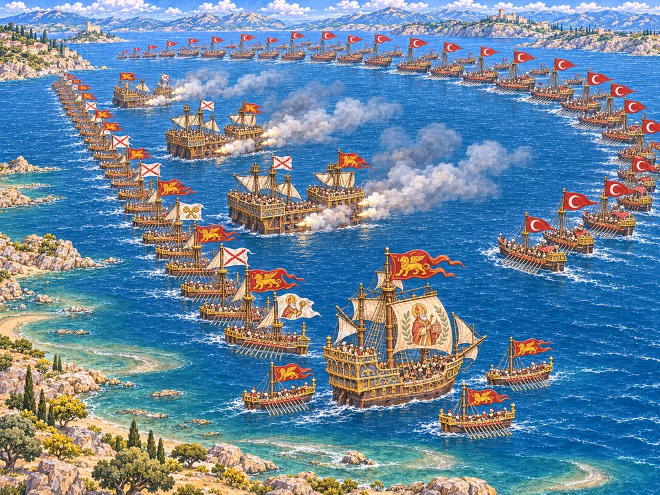
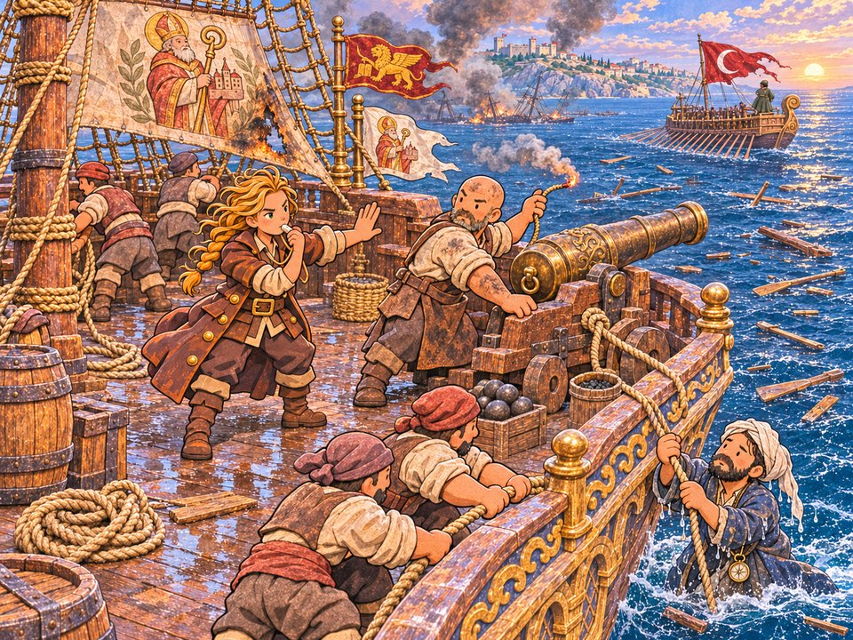
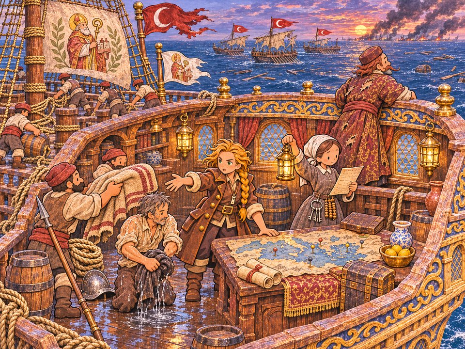
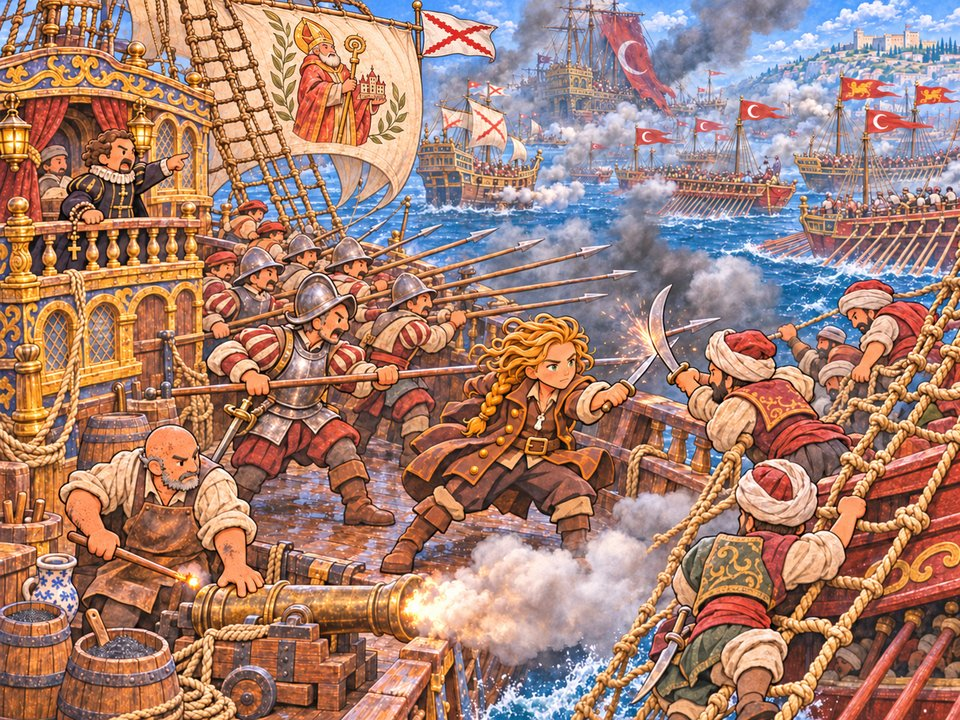

## 1. 메시나

1571년 9월, 시칠리아의 메시나.

항구 안쪽 바다에 돛대들이 숲처럼 빽빽하게 솟아 있었다. 날개 달린 붉은 사자 깃발, 검은 왕관 방패와 붉은 톱니 십자를 그린 에스파냐 깃발, 교황의 열쇠 깃발이 한 바람에 섞여 펄럭였다. 세 나라에서 모인 배가 이백 척을 넘었다. 부두 돌바닥에는 쇠 갑옷과 나무 통이 부딪치는 소리, 세 나라 말이 뒤섞여 쉴 새 없이 울렸다.

마리나의 선단도 며칠 전 라구사를 떠나 이곳 좁은 해협 안쪽에 닻을 내렸다. 스베티 블라호의 뱃전에 서서 항구를 둘러보면, 물길 건너편에 에스파냐와 나폴리의 큰 함선들이 줄지어 서 있었다.

점심 무렵, 부두 앞 넓은 돌광장에서 함대 사열이 열렸다. 갑판장과 선장들이 돌계단 아래 줄지어 선 가운데, 은빛 흉갑을 두르고 붉은 망토를 걸친 젊은 사내가 기함 사다리에서 내려왔다. 스물넷의 동맹 총사령관 돈 후안이었다. 키가 크고 걸음이 빨랐다. 젊은 사령관은 각국 지휘관들의 인사를 받으며 돌광장을 한 바퀴 돌고는, 뒤따르는 장교들에게 짧은 말만 남긴 채 다시 기함 쪽으로 발길을 돌렸다. 마리나는 인파 뒤편에서 그 뒷모습만 멀리 보았다.

사열이 끝나고 사람들이 흩어질 무렵, 부두 돌기둥 옆에서 익숙한 목소리가 들렸다.

"마리나."

에스파냐식 검은 겉옷에 흰 주름 깃을 세운 야코가 서 있었다. 지난봄 편지대로 라구사 갈레온의 선장이 되어 나폴리 함대를 따라온 참이었다. 야코의 갈레온은 부두 서쪽 방파제 끝에 매여 있었다. 두 사람은 굳이 손을 잡거나 오래 마주 서지 않았다. 항구에는 구경하는 수병들이 많았다.

"이번에는 같은 편이네." 야코가 턱짓으로 동맹 깃발들을 가리켰다.

"이번에는." 마리나가 짧게 대꾸했다.

야코는 말없이 고개를 한 번 끄덕이고는 제 배가 있는 서쪽 부두로 걸어갔다.

오후가 되자 마리나는 함대 지휘관들이 모인 기함 선실에 불려 갔다. 베네치아 갤리들에 전투 병력이 모자라 에스파냐 보병을 나누어 태우기로 했다는 전갈이었다. 그 자리에서 지휘관들은 마리나를 「갤리 함장」이라 부르며, 메시나 조선소에서 수리를 마친 갤리 두 척을 더 맡겼다. 지난봄 코르푸에서 붙여 주었던 호위 갤리는 코르푸 수비대로 돌려보내고, 북쪽 용선 홀크는 뒤쪽 군량 보급대로 떼어 둔 뒤, 산 조르조와 라 팔마를 전열에 세우니 스베티 블라호와 라 콜롬바, 산타 엘레나에 두 척을 보태 전열에 서는 배는 다섯 척이 되었다.

마리나는 값을 덜어 주는 패찰을 받아 들고, 선창에 실어 온 화약통과 삼베, 참나무 판자를 베네치아 보급 창고에 웃돈을 받고 넘겼다. 마라가 그 금화로 닷새 치 군량과 포탄 값을 치르고도 장부 끝이 남는 것을 확인하며 주판알을 내렸다.

해가 기울 무렵, 쇠 갑옷 부딪치는 소리를 내며 군인 서른 명이 스베티 블라호 앞 부두에 줄을 섰다. 맨 앞에 선 사내는 마흔이 넘어 보이는 에스파냐 하사였다. 희끗한 짧은 머리를 하고 긴 창을 짚고 있었다.

"디에고 오르티스요." 사내가 굵고 투박한 목소리로 제 이름을 댔다. "베네치아 배에 오르라는 명을 받고 병사 서른을 데려왔소."

마리나는 디에고 일행을 선실 앞 갑판으로 불러 세웠다. 마라가 탁자 위에서 새로 쓴 계약서와 삯 명부를 들고 나왔다. 마라는 잉크병과 깃펜을 내밀며 디에고의 이름 아래 빈칸을 가리켰다.

"여기에 이름을 적으세요." 마라가 말했다.

디에고는 깃펜을 받아 들지 않고 투박한 손으로 제 턱을 한 번 문질렀다. 병사들이 뒤에서 조용히 숨을 죽였다.

"나는 글을 모르오." 디에고가 낮게 말했다. "칼과 창 쓰는 법만 배웠소."

마라는 아무 내색 없이 깃펜을 내려놓고, 먹물이 밴 작은 헝겊 뭉치를 끌어당겼다.

"그럼 오른손 엄지를 여기에 대세요."

디에고는 망설이지 않고 엄지손가락을 먹물에 꾹 눌렀다가 양피지 위 빈칸에 힘주어 찍었다. 종이 위에 둥글고 시커먼 손도장이 남았다. 디에고는 손가락에 묻은 먹물을 겉옷 자락에 쓱 닦아 내고는 창을 고쳐 쥐었다.

"배를 나누어 타오. 산 조르조와 라 팔마에 열 명씩, 스베티 블라호에 열 명이 타시오." 마리나가 말했다.

"명대로 하겠소."

디에고가 뒤돌아 병사들을 향해 짧은 에스파냐 말 구령을 내렸다. 쇠 투구들이 일제히 움직이며 사다리 위로 올라가기 시작했다.

## 2. 고메니차

9월 말, 그리스 서쪽 해안 고메니차.

메시나를 떠난 동맹 함대는 이오니아해를 건너 고메니차 만의 잔잔한 물길에 닻을 내렸다. 오스만 함대가 코린토스 만 안쪽에 머물러 있다는 소식이 닿은 뒤였다. 항구 안쪽은 수백 척의 돛대로 빈틈이 없었지만, 배와 배 사이의 공기는 팽팽하게 얼어붙어 있었다.

어제 낮, 크레타 출신 선장이 이끄는 베네치아 갤리에서 소란이 일어났다는 소문이 아침부터 배마다 퍼졌다. 배에 나누어 탄 에스파냐 병사들과 크레타 선원들이 물과 자리를 두고 다투다 피를 흘렸고, 총사령관 베니에르가 돈 후안과 말 한마디 섞지 않은 채 소동을 일으킨 에스파냐 장교를 군법으로 처형했다는 이야기였다.

정오가 지나자 마리나에게 전령선이 닿았다. 베네치아 함대 부사령관 아고스티노 바르바리고가 마리나를 부른다는 명이었다. 작은 거룻배를 타고 바르바리고의 기함에 오르자, 선실 안에는 쉰 중반의 부사령관이 턱을 괸 채 앉아 있었고, 곁에 선 부관이 돈 후안 공자가 베니에르 총사령관을 보지 않겠다며 노여워하고 있다는 사정을 낮게 일러 주었다.

"큰일이 났네, 부니치 선장." 바르바리고가 두 손을 모으며 말했다. "함대가 싸우기도 전에 두 동강이 날 판이오."

"나를 부르신 까닭은 무엇입니까."

"그대는 라구사 사람이니 양쪽 말을 다 알아듣지 않소. 두 기함 사이를 오가며 내 뜻을 전해 주오."

마리나는 고개를 숙여 명을 받았다.

그날 오후 내내 마리나는 뱃사공 둘이 젓는 작은 거룻배를 타고 고메니차 만을 가로질렀다. 베네치아 기함에서 바르바리고의 뜻을 받아 적고, 다시 에스파냐 기함인 레알 호로 건너가 당직 장교에게 말을 전했다. 바다는 잔잔했으나, 두 기함 갑판 위에는 쇠 갑옷을 입은 병사들이 팽팽하게 맞서듯 서 있었다.

마리나는 양쪽에서 쏟아지는 거친 말들을 그대로 옮기지 않았다. 베네치아 쪽 장교가 "남의 배에서 행패를 부린 놈을 법대로 다스렸을 뿐"이라고 언성을 높이면, 마리나는 레알 호에 가서 "베니에르 사령관께서는 규율을 세우려 했을 뿐 동맹을 해칠 뜻은 없으셨소"라고 한마디를 덜어 전했다. 에스파냐 쪽에서 "노인의 고집 때문에 우리가 모욕을 당했다"고 이를 갈면, 마리나는 돌아와 "저쪽에서는 사전에 의논이 없었던 점을 서운해합니다"라고 모서리를 깎아 옮겼다.

해 질 녘, 마리나가 마지막으로 베네치아 기함에 돌아와 레알 호 쪽이 내일 아침 회의를 열기로 했다는 답을 전하자, 바르바리고는 그제야 길게 숨을 내쉬었다. 그는 탁자 위 주석 잔을 매만지며 마리나를 올려다보았다.

"동맹은 같은 적이 있다는 뜻이지, 같은 마음이라는 뜻이 아닐세."

마리나는 대답하지 않고 허리춤의 뼈 호루라기를 한 번 눌렀다. 사다리 아래에서는 작은 거룻배가 뱃전에 부딪치며 삐걱거렸다.

## 3. 나무 조각들

10월 초, 고메니차를 떠난 함대는 남쪽으로 내려가며 마지막 함대 회의를 열었다.

바르바리고의 기함 선실 큰 탁자 위에는 마리나의 것보다 세 곱은 더 큰 지중해 해도가 펼쳐져 있었다. 베네치아 지휘관들과 함대 포수장들이 탁자 둘레에 빽빽하게 둘러섰다. 마리나는 선단 다섯 척의 선장 자격으로 토마 벤드라민을 데리고 문 쪽 구석에 섰다.

탁자 위 해도에는 밀랍 못 대신 손가락 마디만 한 나무 조각들이 여러 줄로 놓여 있었다. 바르바리고가 긴 막대기로 전열 맨 앞줄에 놓인 크고 네모난 나무 조각 여섯 개를 가리켰다.

"큰 갤리스 여섯 척을 세 전열 앞에 두 척씩 세울 거요." 바르바리고가 말했다. "저것들이 먼저 포문을 열어 적의 뱃머리를 부술 거요."

마리나 옆에 선 에스파냐 연락 장교가 고개를 갸웃하며 귓속말을 걸어왔다. 마리나가 대답하려 하자 토마 벤드라민이 턱수염을 쓸며 낮은 목소리로 끼어들었다.

"저 큰 갤리스라는 배는 보통 갤리보다 몸집이 두 배는 크오. 뱃전이 성벽처럼 높아서 적이 기어오르기 어렵고, 뱃머리와 양옆, 뱃고물까지 사방에 무거운 청동 포를 얹었지. 노는 무겁고 굼뜨지만, 전열 앞에 세워 두면 물 위에 떠 있는 요새나 다름없소."

바르바리고가 막대기를 옮겨 좌익 맨 끝, 그리스 본토 해안선과 맞닿은 자리에 작은 나무 조각들을 밀어 넣었다.

"부니치 선장, 그대의 선단 다섯 척은 내가 맡은 좌익의 맨 끝, 뭍 쪽으로 붙으시오. 스베티 블라호는 내 기함 뒤에서 탄약과 물자를 대고, 라 콜롬바와 산타 엘레나, 산 조르조, 라 팔마는 해안선을 막으시오."

토마가 탁자 모퉁이로 한 걸음 다가서며 해안선 부근을 짚었다.

"좌익 맨 앞에는 모래톱과 얕은 여울이 많습니다. 저쪽 큰 갤리스들의 포는 사거리가 길어 화살 두 바탕 거리 밖에서도 배를 쪼갤 수 있습니다. 하지만 오스만 배들은 바닥이 얕고 가벼워서, 포탄이 닿지 않는 바닷가 얕은 물길로 파고들려 할 겁니다."

선실 안의 장교들이 일제히 해도의 뭍 쪽 가장자리를 내려다보았다. 바르바리고가 막대기 끝으로 얕은 물길을 가리키며 말했다.

"가장 걱정되는 곳이 거기요. 아드리아와 이오니아의 바위틈을 누비던 라구사 뱃사람들에게 그 자리를 맡기는 까닭이 거기 있소."

바르바리고는 막대기를 탁자 위에 내려놓았다. 촛불 아래 놓인 나무 조각들이 배의 흔들림에 맞추어 미세하게 달그락거렸다.

## 4. 부러진 지팡이

케팔로니아 앞바다에 닻을 내린 밤, 칸디아에서 온 쾌속선 한 척이 어둠을 뚫고 함대 본진에 들어왔다.

다음 날 아침, 베니에르 총사령관의 기함 갑판 위로 각 배의 지휘관들이 불려 모였다. 마리나는 갑판 난간 한쪽에 서서 마른 입술을 축였다. 쾌속선에서 내린 전령이 베니에르 앞에 무릎을 꿇고 젖은 양피지를 바쳤다. 노인은 봉인을 뜯어 몇 줄을 읽더니 그 자리에서 얼굴빛이 창백하게 굳었다.

"성은 8월 초에 항복했고, 브라가딘은 약속과 달리 죽임을 당했다."

노인이 소리 내어 읽은 것은 그 한 줄뿐이었다. 갑판 위가 물 끼얹은 듯 조용해졌다.

베니에르는 편지를 쥔 손이 부들부들 떨리자 종이를 바닥에 떨어뜨렸다. 노인은 늘 짚고 다니던 닳은 나무 지팡이를 무릎에 대고 두 손으로 꺾었다. 마른 나무가 부러지는 소리가 날카롭게 갑판을 울렸다. 두 동강이 난 지팡이가 갑판 판자 위로 굴러떨어졌다. 누구도 그 조각을 주울 엄두를 내지 못했다.

마리나는 제 허리의 가죽 주머니를 내려다보았다. 그 안쪽에는 지난겨울 파마구스타 부두에서 브라가딘이 건네주었던 붉은 밀랍 편지가 그대로 들어 있었다. 베네치아에 있는 아내에게 전해 달라던 그 편지였다.

스베티 블라호로 돌아온 마리나는 선실 문을 닫고 마라에게 소식을 전했다.

마라는 한마디도 묻지 않고 탁자 위 해도를 펼쳤다. 동쪽 끝 키프로스 섬, 홀로 붉은 빛을 띠고 있던 파마구스타 자리의 못을 뽑지도 않은 채, 마라는 작은 쇠 칼을 들어 못 머리의 붉은 밀랍을 긁어냈다. 바스러진 붉은 가루가 양피지 위로 떨어졌다. 마라는 촛불에 금색 밀랍 막대를 녹여 못 머리 위에 천천히 덮었다. 키프로스 섬의 두 못이 이제 모두 금색으로 굳었다.

그날 밤, 바다는 기분 나쁠 만큼 잔잔했다. 이틀 뒤면 파트라스만 입구로 들어간다는 소문이 돌자 선단 전체에 무거운 침묵이 내렸다.

갑판 한쪽에서는 디에고 오르티스가 투구를 벗어 무릎 위에 놓고 굵은 나무 묵주를 손가락으로 굴렸다. 디에고의 입술이 낮은 소리로 에스파냐 말 기도를 읊조렸다. 맞은편 포대 옆에서는 토마 벤드라민이 왼손의 남은 세 손가락으로 포신을 짚은 채 눈을 감았다. 토마는 베네치아의 성인 마르코와 지난해 여름 먼저 간 선원들의 이름을 낮게 불렀다.

바로 옆에 닻을 내린 에스파냐 갤리 쪽에서 쇠사슬 풀리는 소리가 쩌렁쩌렁 울려 퍼졌다. 에스파냐 지휘관이 싸움에서 이기면 죄수 노잡이들에게 자유를 주겠다고 약속하며 사슬을 풀어 무기를 나누어 주는 소리였다.

스베티 블라호와 나란히 선 라 콜롬바의 노걸이에서도 노잡이들이 고개를 내밀어 옆 배를 구경했다. 마리나의 배에 탄 노잡이들은 처음부터 발목에 사슬이 없었다. 그중 나이 든 달마티아 어부 하나가 뱃전으로 올라온 마리나를 보며 조용히 물었다.

"저쪽 배들은 이기면 사슬을 풀어 준다더군요. 우리는 싸움이 끝나면 뭘 받습니까."

마리나는 어부의 거친 손을 한 번 보고는 갑판 널빤지를 내려다보았다.

"삯. 그리고 내가 먼저 배에서 내리지 않는다는 약속."

어부는 묵묵히 고개를 끄덕이고는 제 자리로 돌아가 참나무 노를 닦기 시작했다.

## 5. 10월 7일 아침

1571년 10월 7일 아침, 파트라스만 입구.

안개는 없었으나 동쪽 산맥 너머에서 불어오는 맞바람이 차가웠다. 동맹 함대는 이른 아침부터 바위섬들을 돌아 넓은 만 안쪽으로 들어서며 길게 한 줄로 늘어섰다. 마리나의 선단 다섯 척은 바르바리고가 이끄는 좌익의 가장 왼쪽, 뭍에서 화살 두 바탕 거리밖에 떨어지지 않은 끝자리에 자리 잡았다. 스베티 블라호는 좌익 기함 뒤쪽 물길에서 돛을 반쯤 접고 버텼고, 라 콜롬바와 산타 엘레나, 산 조르조, 라 팔마가 뱃머리를 나란히 맞추었다.

낮이 가까워지자 동쪽 수평선이 검게 물들기 시작했다. 오스만 함대의 수백 척 돛과 노가 일제히 물결을 가르며 밀려오고 있었다. 붉은 깃발과 초승달 깃발이 바람을 타고 앞으로 쏠렸다. 처음에는 바람이 오스만 쪽에서 불어오고 있었으므로, 동맹 함대의 뱃머리마다 팽팽한 긴장이 감돌았다.

"전진! 전열 앞의 큰 갤리스들이 나간다!"

바르바리고의 기함에서 나팔 소리가 길게 울렸다. 세 전열 앞줄에 둘씩 세워 두었던 거대한 큰 갤리스 여섯 척이 노를 저어 오스만 진형 코앞으로 미끄러져 나갔다.

정오 무렵, 묵직한 천둥소리가 바다를 찢었다.

큰 갤리스들이 양옆과 뱃머리에서 한꺼번에 불을 뿜었다. 굵은 쇠 포탄과 쇠 조각들이 바람을 가르고 오스만 함대의 앞줄로 쏟아졌다. 뱃머리가 부서지고 부러진 노들이 물 위로 솟구쳤다. 매캐하고 시커먼 화약 연기가 물 위를 낮게 덮었다.

오스만 함대의 양 날개가 큰 갤리스들을 피해 옆으로 벌어지더니, 북소리를 울리며 거칠게 돌진해 왔다. 수백 척의 배에서 쏘아 대는 화살과 총탄이 소나기처럼 쏟아졌다.

바로 그때, 아침 내내 오스만 쪽에서 불어오던 바람이 한낮을 넘기며 방향을 틀었다. 서쪽 바깥 바다에서 육지 쪽으로 바람이 밀려들기 시작했다.

"바람이 바뀌었다!" 토마 벤드라민이 포대 위에서 고함을 질렀다.

동맹 함대가 쏘아 올린 짙은 화약 연기가 서풍을 타고 순식간에 오스만 함대 쪽으로 몰려갔다. 앞이 보이지 않는 매캐한 연기 구름 속에서 오스만 궁수들과 사수들의 함성이 흩어졌다.

마리나의 배 앞쪽에서도 오스만 갤리들의 뾰족한 뱃머리가 회색 연기를 뚫고 모습을 드러내기 시작했다. 토마가 불붙인 화승 심지를 청동 포 「안툰」의 도화선 위로 가져갔다.

## 6. 얕은 물가의 싸움

오스만 우익의 배들이 뭍과 동맹 좌익 사이의 좁고 얕은 물길로 파고들었다. 뱃바닥이 낮은 오스만 갤리들은 모래톱을 스치듯 지나며 바르바리고의 옆구리를 찌르려 들었다.

"뭍 쪽으로 더 붙여라! 적에게 바닷가 길을 내주면 안 된다!"

마리나가 깃발을 들어 흔들며 라 콜롬바와 산타 엘레나 쪽으로 외쳤다. 그때 바로 옆 물길에 떠 있던 바르바리고의 기함에서 고함 소리가 터졌다. 뱃고물에 선 바르바리고가 연기와 포성 속에서 제 목소리가 아군에게 묻히지 않게 하려고, 얼굴을 가리던 쇠 투구 가리개를 손으로 들어 올렸다.

오스만 배 쪽에서 날아온 화살 한 대가 바람을 가르더니, 투구 가리개를 올린 바르바리고의 눈을 정면으로 꿰뚫었다. 그가 비명도 지르지 못한 채 뒤로 쓰러지는 것을 마리나는 기함 바로 뒤 스베티 블라호의 뱃머리에서 그대로 보았다. 지휘관의 깃발이 순간 흔들리며 기울었다.

"물러서지 마라! 끝자리를 막아라!"

마리나는 목이 찢어져라 외치며 깃발 신호로 라 콜롬바와 산타 엘레나를 뭍 쪽 바위 옆으로 바짝 붙였다. 물길 끝을 막아서자 오스만 갤리 두 척이 방향을 틀어 라 팔마와 스베티 블라호의 뱃전을 들이받았다.

우지끈, 참나무 판자가 쪼개지며 갈고리가 날아와 뱃전에 걸렸다. 토마의 포가 지근거리에서 불을 뿜어 적선 한 척의 뱃머리를 날려 보냈지만, 불화살 하나가 스베티 블라호의 높은 주돛을 맞혔다.

"돛에 불이 붙었다! 물을 길어 부어라!"

로브로가 젖은 돛베를 끌어당기며 소리쳤지만, 성 블라호가 그려진 주돛 아래쪽에서 검은 연기와 함께 붉은 불길이 치솟았다.

그 틈을 타 다른 오스만 갤리에서 적병들이 갈고리 줄을 타고 스베티 블라호의 갑판 위로 쏟아져 넘어왔다.

"창을 세워라!"

디에고 오르티스가 앞장서서 긴 창을 내밀었다. 디에고와 병사 열이 어깨를 맞대고 쇠 방패 벽을 세워 건너오는 적을 밀어냈다. 좁은 갑판 위에서 창과 굽은 칼이 부딪치며 쇠 불꽃이 튀었다.

오스만 병사 하나가 창 숲을 뚫고 코앞으로 달려들자, 마리나는 생전 처음으로 허리의 짧은 검을 뽑아 사내의 어깨 아래를 내리쳐 쓰러뜨렸다.

옆쪽 바위 틈새에서는 라 팔마가 오스만 갤리 두 척에 양쪽 옆구리를 들이받혀 물이 차오르고 있었다. 뱃머리가 서서히 가라앉는 와중에도 갑판 위 에스파냐 병사들과 선원들은 닻줄을 끊고 바르바리고의 기함 쪽으로 필사적으로 헤엄치거나 작은 배로 옮겨 탔다. 디에고의 병사 둘이 창을 든 채 물속으로 빠졌다.

한낮의 해가 기울기 시작할 무렵, 뭍 쪽 끝자리를 노리던 오스만 우익의 기세가 꺾였다. 얕은 물길에 좌초하거나 포탄에 부서진 배들이 연기를 뿜으며 해안가 모래톱 위로 밀려 올라갔다.

## 7. 내려간 깃발

좌익의 뭍 쪽 끝에서 버티는 동안, 한가운데와 우익의 바다는 온통 짙은 화약 연기와 돛대 부러지는 소리로 뒤덮여 아무것도 분간할 수 없었다.

불타던 스베티 블라호의 주돛은 로브로와 수병들이 바닷물을 길어 부은 덕분에 절반만 탄 채 불길이 잡혔다. 찢어지고 그을린 주돛 위로 붉은 사자 깃발과 라구사의 흰 성 블라호 깃발이 잿가루를 날리며 매달려 있었다.

마리나가 칼을 쥔 채 거친 숨을 몰아쉬며 한가운데 바다 쪽을 바라보았을 때였다.

검은 연기 기둥이 바람에 잠시 옆으로 갈라진 틈 사이로, 동맹 함대 기함과 맞붙어 있던 거대한 오스만 기함의 돛대 꼭대기가 눈에 들어왔다. 그 돛대 위에서 펄럭이던 커다랗고 붉은 총사령관 깃발이 갑자기 뚝 끊어지듯 아래로 미끄러져 내려왔다. 잠시 뒤, 그 깃발 자리에 긴 장대 끝에 매달린 무언가가 올라갔다가 이내 연기 속으로 가려졌다.

곧이어 바다 한가운데에서 거대한 함성이 터져 나왔다.

함성은 물결을 타듯 한가운데에서 좌익으로, 다시 우익으로 번져 나갔다. 싸우던 노잡이들이 노를 멈추고 고개를 들었고, 갑판 위 병사들이 피 묻은 창을 하늘로 치켜들며 소리쳤다.

마리나는 그 순간 무슨 일이 벌어졌는지 알지 못했다. 돛대 꼭대기에서 큰 깃발이 내려갔다는 것만 보았을 뿐이었다. 오스만 총사령관 알리 파샤가 자신의 기함 술타나 갑판 위에서 총탄을 맞고 숨을 거두었다는 소식은, 해가 진 뒤에야 건너온 연락 장교의 입을 통해 한 줄로 전해 들었다.

## 8. 쏘지 마라, 하산

오후 늦게, 오스만 함대의 전열이 완전히 무너지며 남은 배들이 동쪽과 남쪽 열린 바다로 흩어지기 시작했다.

라 콜롬바와 산타 엘레나는 반쯤 부서진 노를 저어 좌익 바깥쪽 물길로 빠져나왔다. 물 위에는 부서진 나무 판자와 돛대 조각, 빈 물통들이 어지럽게 떠다녔다.

그때, 흰 연기를 뚫고 열린 바다 쪽으로 빠르게 노를 저어 달아나는 오스만 갤리 한 척이 마리나의 시야에 들어왔다. 붉은 초승달 깃발은 반쯤 찢겨 있었으나, 선체는 멀쩡했고 노 젓는 박자가 흐트러지지 않았다.

배가 스베티 블라호의 포 사거리 안쪽을 비스듬히 스쳐 지나갈 때였다. 마리나는 달아나는 그 배의 뱃머리 아래를 보았다. 오스만식 날카로운 쇠 부리 위쪽, 뱃머리 난간에 나무를 깎아 세운 둥글고 투박한 문양이 박혀 있었다. 라구사 조선소에서만 쓰는 옛식 뱃머리 장식이었다.

"적의 잔당이다!"

뱃머리에 서 있던 토마 벤드라민이 화승 심지를 불어 불씨를 살렸다. 토마는 왼손으로 청동 포 「안툰」의 포신을 돌려 달아나는 갤리의 옆구리를 정확히 겨누었다. 한 발이면 돛대를 부러뜨려 주저앉힐 거리였다.

마리나는 목에 걸린 차가운 뼈 호루라기를 잡아당겨 입술에 물었다.

길게 한 번. 짧게 한 번. 다시 길게 한 번.

포성과 고함이 잦아든 바다 위로 날카로운 호루라기 소리가 길게 뻗어 나갔다. 토마 벤드라민이 포신 위에서 심지를 멈춘 채 마리나를 돌아보았다.

배 뒤편 뱃고물 난간에는 초록빛 긴 겉옷을 입은 사내 하나가 서 있었으나, 역광에 가려 얼굴도 머리 색깔도 분간되지 않았다. 잠시 숨 막히는 침묵이 흘렀다. 이번에는 저쪽 배에서 아무런 호루라기 소리도 돌아오지 않았다.

"쏘지 마라." 마리나가 말했다.

토마는 말없이 심지를 뒤로 뺐다. 달아나는 갤리는 속력을 늦추지 않고 열린 바다의 연무 속으로 점점이 멀어져 갔다. 그 배의 뱃고물에 서 있던 사내가 니콜라인지 아닌지는 끝까지 알 수 없었다.

해가 기울 무렵, 마리나의 선단은 불타 가라앉는 오스만 갤리 한 척 곁에 배를 대고 물에 빠진 사람들을 건져 올렸다. 밧줄을 던져 갑판 위로 끌어올린 사람들 가운데는 쇠사슬을 찬 노잡이들도 있었고, 물에 젖어 파랗게 질린 오스만 선원들도 섞여 있었다.

마지막으로 밧줄을 잡고 갑판에 기어 올라온 사내는 호리호리한 몸집에 검은 수염을 기르고 있었으며, 머리에는 풀려 내린 흰 두건을 감고 있었다. 사내는 갑판 판자 위에 엎드려 바닷물을 토해 내더니, 곁에 선 마리나의 장화를 올려다보며 떨리는 목소리로 중얼거렸다.

"물…… 물 좀 주시오."

남부 이탈리아 바닷가에서 쓰는 칼라브리아 말이었다. 나폴리와 시칠리아 항구를 수없이 드나들었던 마리나는 그 말을 단번에 알아들었다. 로브로가 물통을 내밀자 사내는 두 손으로 받아 급히 목을 축였다.

"이름이 무엇이오." 마리나가 칼라브리아 말로 물었다.

"하산." 사내가 젖은 흰 두건을 쓸어 넘기며 대답했다. "저 배의 항해사였소."

마리나는 더 묻지 않고 로브로에게 마른 담요를 가져오라고 손짓했다.

어둠이 내릴 즈음, 바다 건너편에서 연락선이 다가와 소식을 전했다. 오스만 좌익을 이끌던 울루치 알리가 싸움의 틈을 타 몰타 기사단 기함의 깃발을 빼앗아 매달고, 남은 배 수십 척을 이끌어 열린 바다로 빠져나갔다는 이야기였다.

## 9. 얻은 항구 없음

밤바다는 피 냄새와 젖은 숯 냄새로 무거웠다.

사방에서 불타는 배들이 꺼져 가는 불빛을 물 위에 비추었다. 승전 소식이 함대 전체에 퍼졌지만, 마리나의 배 위에서는 아무도 큰 소리로 환호하지 않았다. 낮 동안 오스만 배들에서 풀려난 기독교인 노잡이 만여 명이 작은 배들을 나누어 타고 동맹 함대 쪽으로 모여들면서, 바다 위는 밤새도록 웅성거렸다.

갑판 난간 너머, 바로 옆에 닻을 내린 에스파냐 갤리에서는 다친 병사들을 뒤쪽 배로 옮기는 손길이 바빴다. 횃불 아래 들것에 실려 가는 젊은 에스파냐 병사 하나가 보였다. 열병에 들뜬 듯 얼굴이 붉었고, 붕대로 감은 왼손이 힘없이 축 늘어져 있었다. 마리나는 잠시 그 들것이 사다리를 건너는 것을 지켜보았다.

어둠 속에서 배 한 척이 천천히 스베티 블라호 옆을 스쳐 지나갔다. 나폴리 함대 소속의 라구사 갈레온이었다. 뱃고물 난간에 선 작은 그림자 하나가 마리나를 알아보았는지, 말없이 오른손을 들어 한 번 흔들고는 밤안개 속으로 지나갔다. 야코는 살아 있었다.

선실로 내려온 마리나는 탁자 앞 의자에 주저앉았다. 등잔불 아래 펼쳐진 지중해 해도가 눈앞에 있었다.

마라는 탁자 맞은편에 앉아 해도를 물끄러미 내려다보고 있었다. 케팔로니아 앞바다에서 파마구스타의 붉은 밀랍을 긁어내고 금색을 입힌 뒤로, 해도 위에는 바꿀 만한 못이 하나도 없었다. 아드리아의 세 항구도, 키프로스의 두 항구도 모두 금색 밀랍 그대로였다.

이튿날 아침, 뒤쪽 물길에서 군량과 화약을 지키던 북쪽 용선 홀크가 부서진 갤리들을 돕기 위해 닻을 끌고 가까이 다가왔다. 마리나는 로브로와 함께 용선의 높은 갑판에 올라 밧줄과 돛대를 점검하고, 부상당한 선원들을 넓은 선창 그늘로 옮겨 실었다. 묵직한 참나무 선체는 밤새 거친 물결을 버티고도 상처 하나 입지 않은 채 뱃길을 지켰다.

그때, 굵은 팔뚝에 톱밥이 묻은 사내 하나가 작은 목수 배를 몰고 다가와 스베티 블라호의 깨진 뱃전을 손가락으로 짚었다. 몸에서 송진과 역청 냄새가 진하게 풍기는 바스티안 모로였다.

"오른쪽 뱃전 판자가 두 치쯤 갈라졌구려, 마리나 선장." 바스티안이 수염을 쓸며 말했다. "코르푸로 돌아가는 길에 바람이 거세질 테니 내 목수들이 쐐기부터 박아 드리리다."

그날 밤, 선실 등잔불 아래서 마라는 작은 쇠 칼을 들어 올리려다 그대로 탁자 위에 내려놓았다. 그리고 곁에 둔 가죽 장부를 펼쳐 10월 7일의 빈 줄을 채웠다. 깃펜 끝이 종이를 스치는 소리가 고요한 선실 안에 낮게 울렸다.

「하루, 배 한 척과 마흔한 사람. 얻은 항구 없음.」

라 팔마와 함께 가라앉은 이들과 다른 배에서 죽은 이들을 합친 수였다.

마리나는 품속에서 붉은 밀랍으로 봉인된 브라가딘의 편지를 꺼냈다. 귀퉁이가 닳은 편지 끝의 붉은 밀랍을 엄지손가락으로 한 번 문지르고는, 다시 안쪽으로 깊숙이 밀어 넣었다. 선실 바깥 갑판에서는 토마 벤드라민이 밤새 식은 포신을 헝겊으로 닦는 소리가 들려왔다.

---

## 다른 깃발 아래에서 ― 초승달

*(1부에서 마리나가 가운데 봉인을 집었다면, 이야기는 이 길로 흐른다.)*

### 파마구스타의 끝

1571년 9월, 아드리아해의 보라 바람을 등지고 남쪽으로 내려온 마리나의 선단은 모돈 앞바다를 지나 코린토스 만 안쪽 레판토로 들어섰다.

항구 안쪽 물길은 이미 오스만 배들의 돛대로 빈틈이 없었다. 그날 저녁, 키프로스에서 날아온 빠른 연락선 한 척이 파마구스타의 끝을 실어 왔다. 성은 8월 초에 항복했고, 수비대장 브라가딘은 약속과 달리 죽임을 당했다는 한 줄의 전갈이었다. 항구 술집과 부두마다 그 소문이 퍼졌으나, 마리나의 배 위에서는 누구도 큰 소리로 말을 옮기지 않았다.

스베티 블라호의 좁은 선실 안에는 젖은 소금 냄새와 등잔불 기름 냄새만 고여 있었다. 마라는 아무 말 없이 탁자 위에 해도를 펼쳤다. 동쪽 끝 파마구스타 자리에 꽂혀 있던 놋쇠 못 머리에서 붉은 밀랍이 작은 쇠 칼 끝에서 바스러져 떨어졌다. 마라가 촛불에 금색 밀랍 막대를 녹여 못 머리 위에 두툼하게 입혔다. 이제 키프로스 섬의 두 못이 모두 금색으로 굳었다. 마리나는 성 밖 돌 화덕에서 밀가루 스무 포대를 나누던 니코스의 사촌을 떠올렸으나, 누구에게도 그 이름을 꺼내지 않았다.

"성안의 니코스도 빵을 구웠을 텐데요." 마라가 쇠 칼을 내려놓으며 낮게 말했다.

마리나는 대답 대신 탁자 모퉁이의 빈 물통을 한 번 밀어 자리를 맞추었다.

레판토 항구 안쪽 보급 부두에서는 새벽부터 짐 내리는 소리가 요란했다. 서쪽 시칠리아의 메시나에 기독교 동맹 함대가 모이고 있다는 소문이 돌면서, 오스만 군항마다 돛베와 역청, 납탄 값이 달마다 치솟고 있었다. 마리나는 모돈과 에우보이아에서 실어 온 질긴 삼베 돛감과 역청 통, 납 덩이를 보급 창고에 부렸다. 창고 감독관 앞에서 마라가 주판알을 튕기며 값을 셈했다. 밀린 두 달 치 노잡이 삯을 치르고도 남는 금화로 라구사 상회의 원금 일부까지 갚을 수 있는 장사였다.

그 뒤 보름 남짓 에게해와 모돈에서 보급을 실어 나르며 10월 초에 접어든 어느 날 오후, 기함 선실에서 마지막 함대 회의가 열렸다. 부두 어귀에서 보급 장부를 맞추던 마리나를 위해, 긴 나무 탁자 한쪽 끝에 빈자리가 마련되었다. 좌익을 맡은 울루치 알리의 부관이 마리나를 향해 고개를 끄덕이며 불렀다.

"마리나 수석 레이스, 좌익 바깥쪽 배 둘을 더 맡아 주시오."

사람들이 마리나를 수석 레이스라 부르기 시작한 자리였다. 해가 기울 무렵, 병기창에서 갓 나온 갤리 두 척이 노를 저어와 스베티 블라호 선단 뒤에 줄을 섰다. 카라뮈르셀을 후방 보급선으로 돌리고 두 갤리를 받아 전열은 다섯 척이 되었다. 뱃머리에서는 니콜라가 붙여 준 칼라브리아 출신 항해사 하산이 놋쇠 나침반을 손에 쥔 채 좁은 해협의 물살을 짚어 내고 있었다. 포대 옆에서는 베네치아 아르세날레 출신 토마 벤드라민이 기름 먹인 헝겊으로 청동 포 「마테」의 포신을 닦고 또 닦았다. 베네치아의 사자 깃발을 향해 포문을 열어야 하는 밤이 코앞에 와 있었다. 토마는 아무 말도 하지 않고 왼손으로 포신을 한 번 쓸어내릴 뿐이었다.

그날 밤, 니콜라가 작은 거룻배를 타고 스베티 블라호로 건너왔다. 니콜라는 갑판 난간에 기대어 서서 어두운 만 입구 쪽을 바라보며 말했다.

"울루치 알리 제독께서는 우리가 좌익 바깥을 돌며 적의 측면을 치길 원하신다. 내일모레면 바다로 나간다. 베네치아 배도, 나폴리 배도 모두 나올 거다."

니콜라의 목소리는 낮고 단단했으나, 어둠 속에서 모자 끈을 매만지는 손끝만은 잠깐 멈추었다. 마리나는 겉옷 안쪽의 차가운 뼈 호루라기를 한 번 눌렀다.

### 울루치 알리의 좌익

1571년 10월 7일, 파트라스만 입구.

아침 바람은 차가웠으나 안개는 없었다. 마리나와 니콜라의 배 다섯 척은 울루치 알리가 이끄는 오스만 좌익의 바깥쪽 날개에 자리를 잡았다. 수백 척의 돛대와 노가 만 입구를 가득 메운 가운데, 맞은편 동맹 함대의 붉은 사자와 검은 왕관 방패 깃발이 아침 햇살을 받아 선명하게 떠올랐다.

정오 무렵, 동맹 함대 전열 앞에 세워진 거대한 베네치아 큰 갤리스 여섯 척이 불을 뿜기 시작했다. 천둥 같은 포성과 함께 짙은 화약 연기가 물 위를 낮게 덮었다. 굵은 쇠 포탄이 바람을 가르고 떨어지며 오스만 전열의 노를 부러뜨렸다. 낮이 기울면서 아침 내내 오스만 쪽에서 불어오던 순풍이 방향을 틀어 서풍으로 바뀌었다. 연기가 오스만 함대의 얼굴을 정면으로 가려 앞을 분간하기 어려워졌다.

"틈이 벌어졌다! 오른쪽으로 돈다!"

니콜라의 배에서 나팔 소리가 길게 울렸다. 동맹 우익과 본진 사이가 거친 물살에 밀려 벌어진 틈을 울루치 알리의 기함이 번개처럼 파고들었다. 마리나의 선단도 노를 저어 그 뒤를 따랐다. 짙은 연기를 뚫고 돌진한 오스만 좌익의 갤리들이 몰타 기사단의 기함을 에워쌌다. 갑판 위에서 짧은 칼과 창이 부딪치는 소리가 연달아 들리더니, 곧이어 몰타 기함의 높은 돛대에서 붉은 바탕에 흰 십자가가 그려진 깃발이 꺾여 내려왔다.

그러나 한가운데 바다 쪽에서는 딴판인 일이 벌어지고 있었다. 연기가 바람에 갈라진 틈 사이로, 오스만 총사령관 알리 파샤의 거대한 붉은 기함 깃발이 뚝 끊어지듯 아래로 미끄러져 내렸다. 함대 전체의 함성이 일순간 흔들리며 잦아들었다.

"열린 바다로 빠진다! 대열을 모아라!" 니콜라가 뱃고물에서 터키 말로 고함을 지르다가, 스베티 블라호 쪽을 향해 라구사 말로 소리쳤다. "마리나, 남쪽 물길이다!"

울루치 알리가 빼앗은 몰타 기함의 깃발을 매달고 남은 배들을 모아 포위망을 뚫고 나올 때였다. 짙은 회색 연기 속에서 붉은 톱니 십자와 라구사의 흰 성 블라호 깃발을 함께 단 갈레온 한 척이 스베티 블라호의 포 사거리 안쪽으로 비스듬히 스쳐 지나갔다.

뱃머리에서 토마 벤드라민이 「마테」의 화승 심지를 불어 불씨를 살렸다. 한 발이면 저 갈레온의 옆구리를 쪼갤 거리였다. 토마가 왼손으로 포신을 돌려 겨누던 바로 그 순간, 갈레온의 높은 뱃고물 난간에 흰 주름 깃을 세운 작은 그림자가 보였다.

물보라와 포성을 뚫고 맑고 날카로운 호루라기 소리가 날아왔다.

길게 한 번. 짧게 한 번. 다시 길게 한 번.

토마의 손이 도화선 위에서 굳었다. 갑판 위 로브로와 하산도 밧줄을 잡은 채 숨을 죽였다. 마리나는 목에 걸린 차가운 뼈 호루라기를 잡아당겨 입술에 물고, 한 박자 늦게 똑같은 소리를 돌려보냈다.

길게 한 번. 짧게 한 번. 다시 길게 한 번.

"쏘지 마라." 마리나가 말했다.

토마는 말없이 심지를 뒤로 뺐다. 불붙인 심지 끝에서 흰 연기만 가늘게 피어올랐다. 갈레온은 연기를 등지고 본진 쪽으로 멀어졌고, 마리나와 니콜라의 배들은 남쪽 열린 바다로 빠져나왔다.

### 돌아온 배 서른

해가 기울고 어둠이 내린 뒤, 파트라스만을 빠져나온 오스만 배들은 연기가 가시자마자 찢긴 돛을 추슬렀다. 본진의 배들은 대부분 만 안쪽에 남았고, 울루치 알리를 따라 무사히 돌아나온 배는 서른 척 남짓이었다. 마리나의 선단 역시 따라붙었던 갤리 한 척과 선원 스물여덟 명을 잃고 네 척만 남았다.

바다 위는 온통 부서진 배에서 흘러나온 나무 판자와 빈 물통, 찢긴 돛베 조각으로 어지러웠다. 스베티 블라호의 뱃머리에서 파도를 살피던 로브로가 부서진 노를 붙잡고 떠 있는 사내 하나를 발견해 밧줄을 던졌다. 선원 둘이 달라붙어 젖은 사내를 갑판 위로 끌어올렸다.

사내는 희끗한 짧은 머리에 다리가 피로 젖은 에스파냐 보병 하사였다. 낡은 쇠 흉갑은 이미 물속에 벗어 버린 뒤였고, 입술이 파랗게 질려 있었다. 마라가 등잔불을 들고 나와 선원 명부를 내밀며 이름을 물었다.

"디에고 오르티스요." 사내가 굵고 투박한 목소리로 말했다. "메시나에서 베네치아 갤리에 올랐다가 배가 가라앉았소. 물속에서 널빤지를 잡지 못했으면 벌써 가라앉았을 거요."

"몸값을 낼 곳은 있소?" 로브로가 물통을 건네며 물었다.

디에고는 물을 한 모금 삼키고는 고개를 저었다. 마라가 깃펜을 내밀며 명부의 빈칸을 가리키자, 디에고는 투박한 손으로 제 턱을 문질렀다.

"나는 글을 모르오. 칼과 창 쓰는 법만 배웠소."

마라는 아무 내색 없이 먹물이 밴 작은 헝겊 뭉치를 끌어당겼다.

"그럼 오른손 엄지를 여기에 대세요."

디에고는 망설이지 않고 엄지손가락을 먹물에 꾹 눌렀다가 양피지 위에 힘주어 찍었다. 종이 위에 둥글고 시커먼 손도장이 남았다.

"에스파냐 복무 기한은 이미 작년에 찼고, 본국에 몸값을 치러 줄 친척도 없소." 디에고가 젖은 겉옷 자락을 비틀어 짜며 낮게 말했다. 마리나는 그를 오스만의 포로 명부에 올리지 않았다. 라구사 선장의 배에 오른 자유민 갑판원으로 이름을 달아 주면, 쇠사슬을 차지 않고도 목숨을 부지할 수 있었다. 마리나는 그 사내에게 마른 담요를 내주라고 로브로에게 손짓했다.

선실 밖 난간에 기대어 있던 니콜라는 찢긴 겉옷을 털어 내며 어두운 서쪽 바다를 바라보았다. 니콜라의 긴 콧수염에도 짠 물기가 말라붙어 있었다. 니콜라가 터키 말로 낮게 한숨을 내쉬더니 라구사 말로 중얼거렸다.

"야코는 살았을 거다. 그 녀석 배는 튼튼하니까. 아까 본 갈레온의 키 잡는 솜씨가 여전하더군."

"네 배도 부서진 데가 적지 않다." 마리나가 니콜라의 찢어진 소매를 보며 말했다. "모돈까지 돌아갈 돛은 남았느냐."

"어떻게든 꿰매서 가야지." 니콜라가 젖은 둥근 모자를 벗어 물기를 털어 냈다. "이스탄불로 올라가려면 아직도 바람을 서너 번은 더 갈아타야 한다. 그래도 오늘 살아남은 게 어디냐."

마리나는 대답하지 않고 선실로 내려왔다. 뱃머리 쪽에서는 토마가 밤새 식은 「마테」의 포신을 기름 헝겊으로 닦는 소리가 들려왔다. 아군이었을 베네치아의 갤리들과 엇갈린 날 밤, 토마의 손놀림은 평소보다 느리고 무거웠다. "스물여덟 사람이 물에 남았소." 곁에 서 있던 하산이 놋쇠 나침반을 겉옷 안으로 넣으며 낮게 중얼거렸다. "모돈으로 돌아가면 노잡이부터 다시 구해야 할 거요."

자정이 지날 무렵, 둥근 터번에 주판을 허리에 찬 사내, 자이드 살리흐가 맑은 물통과 마른 대추야자를 실은 거룻배를 몰고 살아남은 배들 곁으로 다가왔다. 알렉산드리아에서 올라온 큰 메카선이 만 어귀에 닻을 내린 뒤 먼저 보내온 물통이었다. 자이드가 물통을 건네며 나직이 말했다.

"배가 부서졌어도 장부는 살아남아야 하오, 마리나 레이스. 모돈 부두에 닿으면 돛베와 목재 값을 먼저 맞춰 드리리다."

선실 안, 촛불 아래 가죽 장부를 펼친 마라가 10월 7일의 빈 줄을 채웠다. 깃펜 끝이 종이를 긁는 소리가 조용히 울렸다. 등잔불이 흔들릴 때마다 탁자 위 해도의 금색 못들이 어둡게 반짝였다. 창밖 어둠 속에서는 찢긴 돛을 꿰매는 선원들의 바늘질 소리와 낮은 헛기침 소리가 들려왔다. 마라는 모래 통을 기울여 잉크를 말린 뒤, 가죽 장부의 끈을 단단히 동여매었다. 스베티 블라호의 뱃머리가 밤물결을 가르며 모돈을 향해 천천히 방향을 틀었다.

「하루, 배 이백 척. 돌아온 배 서른.」

---

## 다른 깃발 아래에서 ― 왕관 방패

*(1부에서 마리나가 오른쪽 봉인을 집었다면, 이야기는 이 길로 흐른다.)*

### 메시나의 사열과 예비대

1571년 9월, 시칠리아 메시나.

좁은 해협 안쪽 바다에 세 나라에서 모인 배 이백여 척의 돛대가 숲처럼 솟아 있었다. 붉은 사자와 검은 왕관 방패, 교황의 열쇠 깃발이 한 바람에 섞여 펄럭이는 가운데, 부두 앞 돌광장에서 스물넷의 동맹 총사령관 돈 후안이 함대를 사열했다. 은빛 흉갑에 붉은 망토를 걸친 젊은 사령관은 각국 지휘관들의 인사를 받으며 빠른 걸음으로 돌광장을 한 바퀴 돈 뒤, 짧은 지시만 남기고 기함으로 돌아갔다. 마리나는 인파 뒤편에서 야코와 나란히 서서 그 뒷모습을 보았다. 부두 돌바닥에는 쇠 갑옷과 화약통이 부딪치는 소리가 끊이지 않았다.

사열이 끝나고 난 뒤, 마리나는 나폴리에서 싣고 온 단단한 밀가루와 참나무 판자, 검은 화약통을 메시나 군항 창고에 부렸다. 이백 척이 넘는 대함대가 한꺼번에 닻을 내리면서 메시나의 곡물과 화약 값은 평소보다 절반 이상 뛰어올라 있었다. 시칠리아 내륙에서 올라오는 수레만으로는 도저히 군량을 댈 수 없는 탓이었다. 마라가 군항 재무관 앞에서 웃돈을 얹은 셈서를 맞추자, 재무관은 묵직한 금화 자루를 내주며 조선소 나무 패찰 하나를 덧붙여 주었다. 보급 창고와 조선소에서 수리비를 깎아 주는 패찰이었다. 마라는 그 금화를 세어 두 달 치 군량과 화약 값을 미리 떼어 놓았다.

그날 저녁 기함 선실의 함대 회의 탁자에도 마리나의 자리가 놓였다. 큰 해도 위에는 나무 조각들이 전열을 따라 줄지어 놓여 있었다. 나폴리 함대 지휘관이 탁자 끝을 가리키며 말했다.

"마리나 카피탄 데 마르, 본진 뒤쪽 예비대에 갤리 두 척을 더 붙여 드리겠소."

사람들이 마리나를 카피탄 데 마르라 부르기 시작한 밤이었다. 이튿날 아침, 조선소에서 수리를 마친 날랜 갤리 두 척이 스베티 블라호 옆으로 와서 닻을 내렸다. 뱃머리에는 검은 왕관 방패 깃발이 나부꼈다. 자브라와 큰 용선을 외곽 척후와 후방 보급으로 돌리고 두 갤리를 받아 전열은 다섯 척이 되었다. 마라는 새 갤리 두 척의 삯과 군량 셈을 맞추느라 밤늦도록 주판알을 놓지 못했다.

해가 기울 무렵, 쇠 갑옷 부딪치는 소리를 내며 에스파냐 보병 서른 명이 부두에 줄을 섰다. 맨 앞에 선 마흔 넘은 하사 디에고 오르티스는 굵은 창을 짚고 선실 앞 갑판에 올랐다. 마라가 명부를 내밀며 이름을 적으라 하자 디에고는 글을 모른다며 투박한 손으로 제 턱을 문질렀다. 먹물이 밴 작은 헝겊 뭉치를 끌어당겨 오른손 엄지를 꾹 눌러 찍은 뒤, 디에고는 병사들을 스베티 블라호와 갤리 두 척에 나누어 태웠다.

야코 소르고도 부두 서쪽 끝에서 라구사 갈레온을 이끌고 와 마리나의 배 옆에 닻을 내렸다. 야코는 갑판 위에서 흰 주름 깃을 바로 세우며 말했다.

"이번 싸움만 끝나면 나폴리로 돌아가 키아라와 혼인식을 올릴 수 있을 거다. 동맹 함대가 이백 척이 넘으니 해가 지기 전에 결판이 날 테지."

"바다는 돛대 숫자로만 싸우는 게 아니다." 마리나가 야코의 어깨를 한 번 두드렸다. "물이 깊고 바람이 바뀌면 큰 배도 쉽게 돌아서지 못해."

야코는 말없이 고개를 끄덕이고는 제 갈레온으로 건너갔다. 부두 끝에서는 나폴리 보병들이 창과 화승총을 실은 수레를 밀며 마지막 짐을 싣고 있었다. 뱃머리 포대 옆에서는 토마 벤드라민이 「비코」의 포신을 기름 헝겊으로 문지르며 탄환 상자를 하나씩 점검하고 있었다. 마리나와 야코의 배는 돈 후안의 본진 바로 뒤, 예비대 자리에 나란히 섰다.

### 본진 뒤의 뚫린 자리

1571년 10월 7일, 파트라스만 입구.

본진과 우익이 맞부딪쳐 검은 화약 연기가 하늘을 덮은 한낮이었다. 아침 내내 동쪽에서 불어오던 바람이 서풍으로 바뀌면서 연기가 오스만 함대 쪽으로 쏠렸다. 마리나와 야코는 본진 바로 뒤 예비대의 뱃머리에서 한가운데 싸움을 가장 가까이 보았다. 부서진 노 조각과 피 묻은 돛베가 물결 위로 떠다니며 배 밑창을 때렸다.

돈 후안의 기함 레알 호와 맞붙은 거대한 오스만 기함 위에서, 펄럭이던 총사령관 알리 파샤의 붉은 깃발이 불과 화살 몇 바탕 거리 앞에서 뚝 끊어지듯 아래로 미끄러져 내렸다. 곧이어 장대 끝에 무언가가 매달려 올라갔다가 연기 속으로 가려졌고, 바다 한가운데에서 거대한 함성이 터져 나왔다.

그러나 바로 그 틈을 타, 오스만 좌익을 이끌던 울루치 알리의 배들이 본진과 우익 사이의 빈 물길로 파고들었다. 돈 후안의 기함에서 예비대 출격 나팔이 길게 울렸다.

"노를 저어라! 뚫린 자리를 막아라!"

야코의 갈레온과 마리나의 선단 다섯 척이 일제히 물살을 가르며 빈 틈으로 돌진했다. 갈고리 줄을 타고 스베티 블라호 갑판으로 기어오르는 적병들을 디에고 오르티스와 에스파냐 병사들이 긴 창 벽을 세워 밀어냈다. 좁은 갑판 위에서 창과 굽은 칼이 부딪치며 쇠 불꽃이 튀었다. 마리나 역시 허리의 짧은 검을 뽑아 뱃전을 넘는 병사 하나를 막아냈다. 뱃머리에서는 토마 벤드라민이 청동 포 「비코」에 불을 대어 다가오는 오스만 갤리의 뱃머리를 날려 보냈다. 포탄이 터질 때마다 나무 파편과 바닷물이 갑판 위로 쏟아졌다. 옆쪽 야코의 갈레온 뱃머리에서도 불길이 치솟았으나 선원들이 바닷물을 길어 부으며 버텼다. 양쪽 뱃전이 부딪치는 굉음 속에서 야코가 검은 겉옷과 흰 주름 깃을 휘날리며 아군 배에 길을 터 주는 모습이 연기 사이로 언뜻 비쳤다.

해가 기울며 싸움이 기운 뒤, 불타 가라앉는 오스만 갤리 곁에서 물에 빠진 사람들을 건져 올리던 중이었다. 밧줄을 잡고 갑판 위로 기어 올라온 호리호리한 사내가 바닷물을 토해 내더니 칼라브리아 말로 물을 찾았다. 오스만 배의 항해사였던 하산이었다. 로브로가 물통을 건네고 마리나가 마른 담요를 덮어 주는 사이, 저녁 어스름 속으로 빠르게 노를 저어 달아나는 오스만 갤리 한 척이 스베티 블라호의 포 사거리 안쪽으로 스쳐 지나갔다.

뱃머리 아래 박힌 둥글고 투박한 라구사식 나무 장식이 어른거렸다. 토마 벤드라민이 「비코」의 화승 심지를 들어 올렸으나, 마리나는 목에 걸린 차가운 뼈 호루라기를 입술에 물었다.

길게 한 번. 짧게 한 번. 다시 길게 한 번.

포성이 잦아든 바다 위로 날카로운 소리가 길게 뻗어 나갔다. 토마가 심지를 멈춘 채 마리나를 돌아보았다. 저쪽 배의 뱃고물에는 긴 겉옷을 입은 그림자 하나가 서 있었으나, 역광에 가려 얼굴은 보이지 않았고 호루라기 소리도 돌아오지 않았다.

"쏘지 마라." 마리나가 말했다. 토마는 말없이 심지를 뒤로 뺐다. 달아나는 갤리는 연무 속으로 점점이 멀어져 갔다. 그 배의 뱃고물에 서 있던 사내가 누구인지는 끝까지 분간되지 않았으나, 갑판 위 어느 누구도 토마에게 왜 쏘지 않았느냐고 묻지 않았다. 로브로가 젖은 돛베를 끌어당겨 갑판의 피를 닦아 내기 시작했다.

### 얻은 항구 없음

밤바다는 피 냄새와 젖은 숯 냄새로 무거웠다. 사방에서 불타는 배들이 꺼져 가는 불빛을 물 위에 비추었다.

승전의 함성이 물결을 타고 퍼졌으나, 마리나의 선단 역시 갤리 한 척과 서른다섯 사람을 잃어 네 척만 남았다. 사방에서 오스만 배의 노를 놓은 기독교인 노잡이 만여 명이 작은 배를 타고 본진으로 모여들며 밤새도록 웅성거렸다. 갑판 한쪽에서는 로브로가 부러진 돛줄을 걷어 내며 죽은 선원들의 짐 보따리를 한데 모았다. 그 옆에는 방금 물에서 건져 올린 하산이 젖은 흰 두건을 짠 채 조용히 앉아 바닷바람을 피하고 있었다. 마리나가 다가가 이름과 고향을 묻자, 하산은 칼라브리아 작은 어촌에서 루카라는 이름으로 자랐노라고 낮게 대답했다.

"칼라브리아 바닷가라면 메시나 해협 물길도 잘 알겠군." 마리나가 물통을 밀어 주며 말했다.

"열두 살 전부터 뱃일을 했소." 하산이 목에 걸린 놋쇠 나침반을 손끝으로 굴리며 대답했다. "얕은 여울과 모래턱은 눈을 감고도 짚어 내오. 부서진 배에서 살려 주셨으니 이제 이 배의 물길을 잡겠소."

자정이 가까울 무렵, 핏자국이 묻은 흰 주름 깃을 풀어 손에 든 야코가 작은 거룻배를 타고 스베티 블라호 갑판으로 건너왔다. 야코의 갈레온도 뱃전이 군데군데 부서져 있었다. 야코는 갑판 한쪽에서 굵은 나무 묵주를 굴리며 죽은 병사들의 이름을 낮게 외우는 디에고를 잠시 내려다보다가 마리나 곁에 섰다. 사방에서 노를 저어 오가는 거룻배들의 횃불이 밤바다 위에 붉은 점을 찍고 있었다.

"이겼는데도, 바다 위에 남은 건 부서진 노와 연기뿐이구나." 야코가 씁쓸하게 중얼거렸다. "내일이면 다시 메시나로 돌아가야 한다. 쇠사슬을 푼 노잡이들이 배마다 가득해서 뭍에 내릴 때까지 잠도 못 잘 판이야. 키아라에게 보낼 편지 한 장 쓸 겨를도 없겠구나."

"살아남았으니 그것으로 셈은 맞춘 거지." 마리나가 낮게 대답했다. "아까 지나간 배를 보았느냐."

야코는 어두운 동쪽 수평선을 잠시 바라보다가 고개만 한 번 끄덕이고는 제 배로 돌아갔다. 선미 갑판에서 사공들이 횃불을 들고 다친 병사들을 나르는 소리가 밤안개 속으로 낮게 번져 나갔다. 뱃머리 쪽에서는 토마가 밤새 식은 「비코」의 포신을 기름 헝겊으로 문지르는 소리가 들려왔다. 디에고 역시 다친 팔에 붕대를 감은 채 창을 고쳐 쥐고 갑판 난간을 지켰다. 하산은 뱃머리에 쭈그리고 앉아 밤바다의 물결 방향을 손가락으로 가늠하고 있었다. 그때 옆에 닻을 내린 카라벨랑에서 말수가 적고 구릿빛 피부가 단단한 사내, 디오고 알메이다가 건너와 젖은 나침반을 들어 보이며 메시나로 돌아가는 서풍의 결을 말없이 손짓으로 짚어 주었다.

선실로 내려온 마라는 촛불 아래 가죽 장부의 10월 7일 칸을 채웠다. 탁자 위 해도에는 아드리아와 키프로스의 금색 못 네 개와, 아직 붉은 빛이 남아 있던 파마구스타 자리의 못이 꽂혀 있었다. 마라는 작은 쇠 칼을 들어 파마구스타 못 머리의 붉은 밀랍을 긁어내고 금색 밀랍을 녹여 덮었다. 깃펜 끝이 종이를 긁는 소리가 조용히 울렸다. 등잔불 심지가 타닥거리며 작은 불꽃을 튀겼다. 마라는 마른 모래를 뿌려 잉크를 말린 뒤, 가죽 장부를 천천히 덮어 끈을 매었다. 어둠 속 선실 창밖으로 밤바다의 잔물결이 선체를 가볍게 두드렸다. 마리나는 탁자 모퉁이에 놓인 젖은 겉옷을 들어 소금기를 털어 내고는, 다시 갑판 위로 올라갈 채비를 했다.

「하루, 이긴 싸움 하나. 얻은 항구 없음.」
