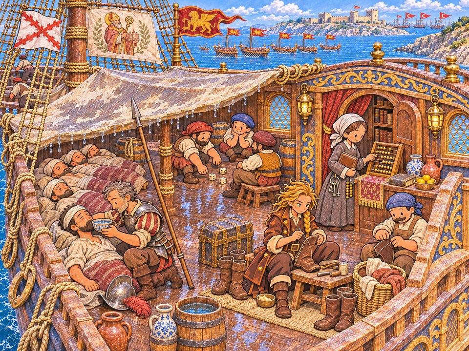

## 1. 모돈 앞바다

1572년 여름, 함대는 펠로폰네소스 서쪽 모돈 앞바다에 닻을 내렸다.

동맹 함대는 다시 백 척이 넘는 배를 이끌고 남쪽으로 내려왔다. 하지만 선두의 베네치아 기함에 탄 총사령관은 세바스티아노 베니에르가 아니었다. 고메니차의 불화를 달래려 원로원이 일선에서 물러나게 한 뒤, 새 총사령관이 함대를 맡고 있었다. 마리나는 깃발이 바뀐 기함 갑판 위에서 새 사령관의 얼굴을 먼발치에서 보았다.

바다 건너 모돈과 나바리노의 돌 요새 아래에는 오스만 함대가 진을 치고 있었다. 레판토에서 몰타 기함의 깃발을 빼앗아 돌아간 뒤, 술탄에게서 검이라는 뜻의 클르치라는 새 이름을 얻어 대제독 자리에 오른 울루치 알리였다. 그는 요새의 굵은 청동 포대 아래에서 한 발짝도 바깥 바다로 나오지 않았다. 마리나가 눈을 가늘게 뜨고 바라보면, 곶 너머 물가 위로 빽빽하게 솟은 오스만 배들의 돛대 끝만 아지랑이 너머로 가물가물 보일 뿐이었다. 가끔 아침 바람이 바뀔 때면 저쪽 선창에서 북소리가 희미하게 건너왔으나, 어느 배도 닻을 풀지 않았다.

며칠에 한 번씩 기함에서 함대 회의가 열렸으나, 선실 탁자 위에 펼쳐진 해도 앞에서는 누구도 말을 길게 잇지 않았다. 해도 위 못의 색깔은 지난가을과 똑같았다. 레판토와 모돈 앞바다를 지킨 뒤로 기함의 장수들은 마리나를 「분함대장」이라 부르며 탁자 안쪽 자리를 내주고 큰 배 한 척 몫의 예우를 해 주었으나, 정작 함대는 싸움 대신 달마다 삯만 내려보냈고, 병사들은 뜨거운 햇볕 아래 갑판 위에서 가죽 장화를 기우거나 주사위를 던지며 하루를 보냈다. 물통 바닥이 드러날 때마다 물 긷는 배가 뭍의 우물까지 오갔으나, 길어 온 물에서도 눅눅한 나무 냄새가 가시지 않았다.

회의가 끝난 어느 날 오후, 기함 사다리를 내려오는 마리나 곁으로 베네치아 선봉 장교 하나가 따라 나와 모자를 벗었다.

"분함대장, 지난봄 아르세날레에서 시험 항해하던 큰 갤리스를 이번 달 안으로 코르푸에서 내려보내기로 했소." 장교가 땀에 젖은 이마를 훔치며 말했다. "오스만 배들이 나바리노 요새 아래서 꼼짝을 않으니, 큰 배를 앞세워 곶 바깥 물길을 두드려 보라는 사령관의 뜻이오."

"바다에 바람이 죽어 있는데 큰 배만 내보내면 요새 포대의 표적이 될 뿐이오." 마리나가 요새 쪽 아지랑이를 바라보며 대답했다. "그래도 배가 닿으면 토마와 로브로를 보내 포문부터 살피겠소."

"에스파냐 배들이 나폴리에서 언제 다 내려올지 기약이 없으니 우리끼리라도 진을 유지해야 하지 않겠소." 장교가 한숨을 쉬며 기함으로 돌아갔다.

스베티 블라호로 건너온 마리나는 뱃머리에 서 있던 토마 벤드라민과 하산에게 다음 날 새벽 곶 바깥쪽 수심을 다시 재어 두라고 일렀다. 갑판 위에서는 로브로가 뜨거운 햇볕에 갈라진 물통 테두리에 젖은 삼베를 감고 있었다. 이튿날 새벽, 코르푸에서 내려온 큰 갤리스 베네치안갤리스가 스베티 블라호 옆에 닻을 내렸다. 마리나는 로브로와 함께 사다리를 올라 묵직한 참나무 갑판을 밟아 보았다. 뱃전 양옆에 늘어선 청동 포문에서 기름 냄새가 풍겼다.

"이 큰 배를 끌고 나바리노 앞바다까지 나가려면 노잡이들 식수 통부터 두 배로 실어야겠소." 로브로가 굵은 돛줄을 만져 보며 말했다.

## 2. 디에고의 물그릇

스베티 블라호 선실에서는 마라가 등잔불 아래 주판알을 튕기는 소리가 날마다 길어졌다. 선실 안에는 눅눅한 땀 냄새와 곰팡이 핀 마른 빵 냄새가 배어 있었다.

"일곱 달째 출항은 없고 수리비만 불어나요." 마라가 장부 끝 줄을 짚으며 말했다. "이번 달 군량과 화약 셈을 합치면 금화 육백 닢이 넘어요. 밀린 삯까지 치면 팔백 닢 가까이 됩니다."

마리나는 아무 대꾸 없이 갑판 위로 올라왔다. 바람 한 점 없는 늦여름 오후, 나무 판자 위가 화덕처럼 뜨거웠다. 갑판 솔기를 메운 역청이 햇볕에 물러져 발바닥에 진득하게 달라붙었다.

선미 쪽 그늘에 깔아 둔 젖은 돛베 위로 에스파냐 병사들이 여럿 누워 있었다. 레판토에서 함께 싸웠던 디에고의 병사 절반이 여름 끝자락에 돌기 시작한 열병으로 쓰러진 참이었다. 누운 사내들의 입술이 바싹 말라 갈라져 있었고, 젖은 천을 이마에 얹어도 금세 더운 김이 올랐다.

디에고 오르티스가 나무 물통에서 물그릇을 가득 떠 들고 무릎을 꿇었다. 투구도 벗은 채 땀에 젖은 희끗한 머리를 숙이고, 디에고는 열병에 들뜬 병사의 고개를 한 팔로 받쳐 입술에 물그릇을 대 주었다. 병사가 물을 반도 삼키지 못하고 기침을 토하자, 미지근한 물이 디에고의 투박한 손등 위로 흘러내렸다. 디에고는 젖은 손등을 겉옷 자락에 닦고 다음 병사 쪽으로 무릎을 옮겼다.

## 3. 우스코크의 밤

8월 말, 모돈 앞바다의 지루한 대치가 이어지던 무렵, 북쪽 아드리아해에서 급보가 날아들었다.

달마티아 북부 해안의 바위섬 사이에 숨어 살던 우스코크 해적선들이, 베네치아 함대의 주력이 남쪽으로 내려간 틈을 타 아드리아 해협을 오가는 보급선들을 덮치고 있다는 전갈이었다. 분함대장 마리나에게 사에티아와 날랜 갤리 두 척을 이끌고 올라가 뱃길을 정리하고 오라는 사령부의 명령이 떨어졌다.

9월 초, 아드리아해 중부의 바위섬들 사이는 달빛조차 구름에 가려 먹물을 풀어 놓은 듯 어두웠다. 마리나는 선미와 뱃머리의 등불을 모두 끄고 사에티아를 앞세워 좁은 해협을 거슬러 올라갔다. 좌우로 솟은 바위 벼랑에서 부서지는 파도 소리가 뱃머리까지 들릴 만큼 물길이 좁았고, 바닷바람이 벼랑 틈을 스치며 휘파람 같은 소리를 냈다. 갑판 위에서는 로브로가 밧줄을 잡은 채 숨을 죽였고, 하산은 뱃머리에 엎드려 암초에 부딪치는 물거품의 하얀 선을 눈으로 더듬었다.

"물밑 바위가 뱃전 바로 두 길 옆에 있소." 하산이 나직이 속삭였다. "돛을 더 낮추어야 바람에 밀리지 않소."

자정이 지날 무렵, 앞쪽 바위 그늘에서 노를 젓는 둔탁한 물소리가 들려왔다. 돛을 접고 검은 천을 두른 우스코크의 작은 쾌속선 세 척이 베네치아 소금 배 한 척의 뒤를 바짝 쫓고 있었다. 소금 배 갑판 위에서는 사공들이 횃불을 치켜들고 도와 달라고 소리치는 소리가 바람에 찢겨 날아왔다.

"라 콜롬바는 왼쪽 여울을 막고, 산타 엘레나는 바위섬 뒤를 돌아라!" 마리나가 낮게 소리쳤다.

뱃머리 회전포 곁에 엎드려 있던 토마 벤드라민이 화승 심지를 입으로 후 불어 불씨를 살렸다. 어둠 속에서 붉은 불씨가 반짝이며 토마의 거친 턱수염과 구부린 어깨를 비추었다. 토마가 심지를 도화선에 대자 날카로운 포성이 좁은 해협 바위벽에 부딪쳐 몇 겹으로 울렸다. 불꽃에 드러난 우스코크 배들의 갑판 위에는 양털 외투를 걸친 사내들이 쇠 갈고리를 쥔 채 웅성거리고 있었다.

라 콜롬바가 앞길을 가로막자, 해적선 두 척은 재빨리 노를 거꾸로 저어 얕은 바위틈으로 빠져나갔다. 뒤처진 한 척이 방향을 틀다 바위에 뱃전을 긁히며 물이 새기 시작하자, 해적들은 배를 버리고 바위 위로 기어올라 어둠 속으로 흩어졌다. 토마는 식어 가는 포신을 젖은 헝겊으로 닦으며 "어두운 해협에서는 불씨 하나가 대포 열 문 몫을 하오" 하고 중얼거렸다.

"화살 맞은 선원은 없소?" 마리나가 소금 배 갑판으로 건너가며 물었다.

소금 배 선장이 찢어진 돛줄을 붙잡고 떨리는 목소리로 대답했다. "돛줄 두 개만 끊겼을 뿐 사람은 다 살았소. 좁은 해협에서 등불도 없이 어떻게 저놈들을 찾아냈소?"

"밤에는 바위 부딪치는 물소리만 들어도 배가 숨은 자리가 들리오." 로브로가 소금 배 난간에 밧줄을 걸며 웃었다. 마리나는 무사히 지켜 낸 소금 배를 자다르 입구까지 호위한 뒤, 다시 남쪽 모돈 앞바다로 내려왔다. 좁은 해협을 빠져나오는 내내 바위 벼랑 위에서 짖는 산짐승 소리가 어둠을 타고 건너왔고, 마리나는 뱃머리에 서서 바뀐 바람 냄새를 맡았다.

## 4. 맡은 항구의 구호

9월 하순, 모돈 앞바다로 돌아온 마리나를 기다린 것은 케팔로니아에서 온 다급한 전갈이었다.

모돈과 나바리노의 대치가 길어지면서, 동맹 함대의 뒤쪽 보급선을 노리는 오스만 정찰선들이 케팔로니아 앞바다까지 올라와 항구 어귀를 막아섰다는 소식이었다. 성안의 수비대와 어부들이 곡식과 물자가 끊겨 닷새째 배급을 줄이고 있다는 편지였다.

"내가 맡은 항구다. 굶길 수는 없지." 마리나는 사령부에 보고를 올린 뒤 스베티 블라호의 선창에 밀가루 삼백 포대와 화약통을 실었다. 마라는 창고 문이 닫히기 직전까지 소금과 말린 대구 상자를 더 얹느라 주판알을 쉬지 못했다. "수비대 병사들 몫의 낡은 군화도 스무 켤레 실어 두었어요." 마라가 장부를 덮으며 덧붙였다.

밤안개가 낮게 깔린 밤, 마리나의 선단은 펠로폰네소스 해안을 벗어나 북쪽으로 내달렸다. 케팔로니아의 좁은 만 어귀에 닿자, 어둠 속에서 오스만 초계선 두 척이 횃불을 들고 물길을 가로막고 있는 것이 보였다. 적선들의 돛 그림자가 안개 속에서 거대하게 흔들렸다.

"토마, 뱃머리 포를 준비하시오. 하산은 왼쪽 암초 사이 물길을 짚어 주고."

하산이 놋쇠 나침반을 손바닥에 올리고 바닷바람을 가늠하더니, 초계선들이 깊이 들어오지 못하는 얕은 여울 쪽으로 키를 돌렸다. 스베티 블라호의 뱃전이 바위 곁을 아슬아슬하게 스치며 만 안쪽으로 미끄러져 들어갔다. 뒤늦게 불빛을 보고 쫓아온 오스만 초계선들이 총탄을 쏘아 댔으나, 성벽 위에서 기다리던 수비대 포대가 불을 뿜자 곧장 뱃머리를 돌려 물러났다.

새벽녘, 돌부두에 닻을 내리자 항구 관리와 상인들이 몰려나와 밧줄을 잡았다. 가장 먼저 굵은 밧줄을 두 손으로 낚아채 말뚝에 감은 이는 이 항구의 늙은 등대지기 마테오였다. 소금기에 절어 하얗게 튼 얼굴에 눈가 주름이 깊게 패인 노인이 거친 숨을 몰아쉬며 마리나를 올려다보았다.

"사흘만 늦었어도 성안 화덕 불이 다 꺼질 뻔했소, 선장님." 노인이 밧줄을 묶은 손으로 이마의 땀을 훔치며 말했다. "라구사 배가 어둠을 뚫고 들어올 줄은 저쪽 배들도 꿈에도 몰랐을 거요. 며칠 전부터는 어선들도 만 어귀 바위 밖으로 나가지 못해 굶주리는 집이 늘고 있었소."

"수비대 화약통부터 먼저 내리시오." 마리나가 사다리를 내려오며 대답했다. "이 밀가루 포대는 시장 화덕으로 바로 옮겨야 성안 사람들이 오늘 저녁을 굶지 않소. 항구 관리에게 장부를 가져오라 하시오."

"선장님 배가 오기 전에는 어부들도 그물을 못 던졌소." 마테오가 젖은 수염을 쓸며 웃었다. "이제 등대 불을 다시 밝혀도 되겠구려."

"등대 기름통은 창고에 채워 두었소?" 마리나가 물었다.

"어제 마지막 기름까지 다 썼소. 배에서 내린 올리브 기름 두 병만 주시면 오늘 밤부터 불이 꺼지지 않을 거요."

마라는 밀가루 포대가 창고로 옮겨지는 것을 세며 성벽 수비대 삯을 치렀다. 부두 돌바닥에는 오랜만에 구운 보리빵 냄새가 퍼졌다. 창고 앞 우물가에서 물을 긷던 아낙들이 스베티 블라호 쪽을 향해 고개를 숙였고, 로브로는 등대지기에게 기름 병 두 개를 건네주었다.

## 5. 가을 바람과 경쟁자들

10월 초, 동맹 함대는 나바리노의 오스만 요새와 함대를 마주 본 채 마지막 포위 공격을 시도했으나, 며칠 만에 보급 부족과 거친 가을 날씨 탓에 소득 없이 물러나고 말았다. 며칠 뒤부터는 하늘이 낮게 내려앉더니 차가운 가을비가 뱃전을 때리기 시작했다.

모돈 앞바다의 물결이 차가워지자 뱃사람들 사이에는 곧 철수 명령이 떨어질 것이라는 말이 돌기 시작했다. 그날 오후, 스베티 블라호의 갑판 위에서 하산은 뱃머리 난간에 기대어 서서 돛대 끝의 붉은 사자 깃발을 오래 올려다보았다.

"바람이 바뀌었소." 하산이 나침반 뚜껑을 닫으며 말했다. "서쪽에서 불어오던 늦여름 바람이 멎고 북동쪽 찬 바람이 내려오기 시작했소. 이 바다는 이제 큰 갤리들이 머물 곳이 못 되오. 며칠 안에 파도가 높아지면 닻줄이 버티지 못할 거요."

"그쪽 요새 아래 배들도 움직일 기색이 없소?" 마리나가 물었다.

"클르치 알리의 배들은 겨울이 오기 전에 다르다넬스로 올라갈 채비를 하는 눈치요. 어제부터 부두에 짐배들이 줄을 섰소."

선실 밖 부두에서는 다른 함대에서 건너온 선원들이 술잔을 나누며 소문을 옮기고 있었다. 베네치아 본진 쪽에서는 미켈레 콘타리니가 나바리노 정찰에서 포탄을 맞고도 배를 건져 돌아와 총사령관의 칭찬을 받았다는 소식이 들렸다. 요새 너머 오스만 함대 쪽에서는 라구사 선장 니콜라가 에게해에서 모돈으로 들어오는 마지막 군량선을 무사히 대어 놓았다는 풍문이 뱃사람들의 입을 타고 넘어왔다.

나폴리 함대 쪽에서 건너온 연락 병사는 야코 소르고의 소식을 전했다. 야코는 이번 여름에도 모돈 앞바다에서 열병으로 병사 여럿을 잃고, 나폴리로 돌아갈 날짜만 손꼽아 기다리며 혼인을 또 한 해 넘겼다고 했다.

그날 저녁, 코르푸에서 남하하던 제노바 출신의 자유 상선장 카밀라 벨라의 프리깃이 보급 선단 곁에 잠시 닻을 내렸다. 검은 양털 망토를 두르고 갑판으로 건너온 카밀라는 마라에게 알렉산드리아와 나폴리의 밀 시세를 귀띔해 주었다.

"겨울이 오면 세 나라 모두 곡식 값이 뛸 거요, 마리나 선장." 카밀라가 차가운 바람에 흩어진 머리칼을 넘기며 말했다. "라구사로 돌아가시거든 어음 이자부터 챙기시오. 바다가 조용해지면 상인들 셈이 제일 먼저 빨라지오."

"베네치아와 오스만 사이에 강화 이야기가 돈다는 소문도 있던데, 사실이오?" 마리나가 물었다.

"항구 술집마다 그런 말이 돌기는 하나, 아직 칙서가 오간 건 없소." 카밀라가 웃으며 대답했다. "다만 겨울이 깊어지면 큰 배들은 다 묶일 테니, 소금과 곡식 실어 나를 준비나 해 두시오. 베네치아 상인들이 먼저 셈판을 덮고 나면 바다가 조용해질 거요."

"그쪽 프리깃은 곧장 나폴리로 올라가시오?" 마리나가 물었다.

"시라쿠사만 들렀다가 나폴리로 갈 참이오. 올겨울에는 라구사 부두에서 다시 봅시다." 카밀라가 모자를 들어 인사하고 제 프리깃의 사다리로 돌아갔다.

마리나는 갑판에 선 채 요새 너머 오스만 함대의 돛대 끝을 바라보았다. 아지랑이 너머로 보이던 그 돛대들이 가을 안개 속에 흐릿하게 잠겨 가고 있었다.

## 6. 닻을 올리며

10월 말, 마침내 동맹 함대 기함에서 겨울 귀항을 알리는 나팔 소리가 길게 울렸다.

에스파냐와 교황령 함대는 시칠리아와 나폴리로, 베네치아 함대는 코르푸와 아드리아해로 돌아가기로 결정된 뒤였다. 반년 넘게 모돈과 나바리노 앞바다를 지켰으나, 오스만의 새 함대는 요새 아래서 끝내 나오지 않았고 동맹 함대는 닳아 버린 닻줄과 열병 환자들만 가득 실은 채 물러나게 되었다. 기함의 돛이 올라가자 백여 척의 배들이 일제히 닻을 감기 시작했다.

11월 초, 코르푸를 거쳐 라구사 쪽으로 뱃머리를 돌린 스베티 블라호의 선실에는 서늘한 겨울바람이 스며들었다. 로브로는 낡아 해어진 돛줄을 걷어 내며 선원들에게 닻을 올리라고 소리쳤다. 갑판 위에서는 디에고 오르티스가 열병에서 겨우 회복한 병사들의 짐 보따리를 묶어 주며 투구를 닦고 있었다.

"결국 큰 싸움 한 번 못 해 보고 여름을 다 보냈구려." 토마 벤드라민이 「안툰」의 포구에 기름 먹인 마개를 꽂으며 중얼거렸다. "화약만 실컷 싣고 다니다가 바람만 쐬고 돌아가는 셈이오."

"그래도 배 한 척 잃지 않고 선원들을 데리고 돌아가는 게 어디요." 마리나가 뱃전 난간을 짚으며 대답했다. "올겨울에는 라구사에 들러 그리마니 어음부터 손봐야 하오. 겨울 동안 노잡이 삯도 미리 떼어 놓아야 봄에 다시 출항할 수 있소."

"선장님, 코르푸에 두고 온 케팔로니아 세관 확인서도 함께 챙겨 두었어요." 마라가 선실 문턱에 서서 말했다. "라구사로 올라가는 길에 부두 창고에 맡겨 둔 소금 자루도 실어야 하니, 닻을 너무 일찍 올리지는 마세요."

"로브로에게 일러 자루 열 개만 뱃바닥에 싣고 바로 뜨자고 하시오." 마리나가 답했다. "겨울비가 쏟아지기 전에 아드리아해 안쪽으로 들어가야지. 늦으면 보라 바람에 갇혀 코르푸에서 발이 묶이오."

"알겠어요, 선장님." 마라가 장부를 품에 안으며 말했다. "이번 겨울 라구사에 닿으면 안나 어머님 댁에도 인사를 드리러 가야겠어요. 니콜라 도련님 소식을 기다리고 계실 테니. 마침 어제 사 공판에서 받아 둔 흰 양모 스카프도 보따리에 넣어 두었어요."

"그래야지. 성벽 안 돌집 앞을 그냥 지나칠 수는 없소." 마리나가 나직이 대답했다. "아무 소식도 못 들은 척하는 건 어머님께 도리가 아니지."

하산은 뱃머리에 서서 북쪽 아드리아해로 올라가는 겨울 해류를 짚어 냈다. 선실 탁자 위, 마라는 등잔불 아래서 가죽 장부를 펼쳤다. 1570년 3월부터 서른세 달째 이어 온 셈의 끝 칸이었다. 젖은 종이 끝을 손가락으로 누른 마라가 모래 통을 옆에 두고 깃펜을 들었다. 선실 천창 위로 빗방울이 떨어지는 소리가 들렸다.

「서른세 달, 배 다섯, 싸움 없는 대치 끝에 겨울 바람이 불었다.」

마라가 장부의 끈을 묶자, 뱃전 아래에서 차가운 겨울 파도가 스베티 블라호의 옆구리를 두드렸다. 돛대 끝의 붉은 사자 깃발이 찬 바람을 맞으며 북쪽을 향해 팽팽하게 섰다. 로브로가 외치는 구령 소리가 빗소리에 섞여 갑판 위로 퍼졌고, 디에고의 병사들이 창을 세우며 출항을 도왔다. 겨울 바다가 열리고 있었다.

---

## 다른 깃발 아래에서 ― 초승달

*(1부에서 마리나가 가운데 봉인을 집었다면, 이야기는 이 길로 흐른다.)*

### 요새 아래의 긴 여름

1572년 여름과 가을, 펠로폰네소스 서쪽 모돈.

겨울 한 철 만에 다시 지은 오스만 함대 이백쉰 척이 모돈과 나바리노의 돌 요새 아래에 진을 쳤다. 레판토에서 몰타 기함의 깃발을 빼앗아 돌아간 뒤 술탄에게서 검이라는 뜻의 클르치라는 새 이름을 얻은 울루치 알리 대제독이 함대를 이끌고 있었다. 그는 요새의 굵은 청동 포대 아래에서 한 발짝도 바깥 바다로 나오지 않았다. 새로 모은 노잡이와 사공들이 아직 물길에 익지 않았음을 알았기 때문이다.

바다 건너 아지랑이 너머로는 백 척이 넘는 기독교 동맹 함대의 돛대가 가물가물 보였다. 바람 없는 뜨거운 오후마다 마리나의 배 다섯 척은 요새 아래 얕은 만을 오가며 군량과 식수를 날랐다. 갑판 솔기를 메운 역청이 햇볕에 물러져 발바닥에 진득하게 달라붙을 만큼 무더운 날이 이어졌다. 마라는 선실 탁자 위 해도를 짚으며 이번 달 군량과 화약 셈이 벌써 금화 육백 닢을 넘겼다고 한숨을 쉬었다.

선미 쪽 그늘에서는 지난가을 레판토의 파도 속에서 건져 올린 에스파냐 병사 디에고 오르티스가 숫돌에 창끝을 갈고 있었다. 디에고의 다친 다리에는 아직도 붉은 흉터가 남아 있었다.

"저쪽 배들에도 내가 알던 병사들이 타고 있을 거요." 디에고가 뭍 건너 수평선을 바라보며 투박하게 말했다. "그래도 물속에서 밧줄을 던져 준 배를 배신할 수는 없지. 밥과 삯을 주는 선장이 내 선장이오."

로브로가 물통에서 바가지로 물을 떠 디에고에게 건넸다. 뱃머리 쪽에서는 항해사 하산이 놋쇠 나침반을 손바닥에 올린 채 곶 너머 물살의 빠르기를 재고 있었다. 하산의 흰 두건 아래 이마가 햇볕에 검게 그을려 있었다. 그 곁에 선 니콜라가 터키 말로 물통을 치는 소리를 흉내 내더니 마리나를 돌아보았다.

"저쪽 동맹 함대도 물이 모자라 뭍까지 거룻배를 대고 있더구나. 야코의 갈레온도 저 돛대 숲 어딘가에 매여 있겠지. 이대로 가을 바람이 불면 싸움 없이 물러날 게 뻔하다."

"야코도 이번 여름 내내 물통만 비우고 있을 거다." 마리나가 아지랑이 너머 수평선을 가늘게 뜨고 바라보며 대답했다.

밤이 되면 요새 성벽 위에서 횃불이 타올랐고, 가끔 정찰선 몇 척이 곶 바깥으로 나가 서로 포탄 몇 발만 주고받다가 돌아오곤 했다. 바람이 바뀔 때마다 저쪽 선창에서 북소리가 희미하게 건너왔으나, 어느 함대도 먼저 닻을 풀지 않았다.

### 트리폴리의 고기 통

8월 말, 모돈 앞바다의 대치가 길어지던 한낮, 에게해 남쪽 물길에서 몰래 빠져나온 몰타 기사단 사략선 두 척이 트리폴리에서 올라오는 오스만 보급선의 꼬리를 물고 늘어졌다. 짙은 여름 아지랑이 너머에서 찢긴 돛을 단 보급선이 위태롭게 흔들리는 모습이 망대 파수꾼의 눈에 잡혔다.

클르치 알리의 전령이 달려와 마리나 카푸단에게 물길을 열라고 명했다. 마리나는 곧장 스베티 블라호와 호위 갤리 두 척의 닻을 올려 곶 바깥으로 나갔다. 뒤쪽에서는 니콜라의 갤리도 닻줄을 끊고 노를 저어 따라붙었다. 붉은 바탕에 흰 십자 깃발을 단 사략선들이 보급선의 뱃구리를 향해 갈고리를 던지려던 찰나였다. 보급선 갑판 위에서는 노잡이들이 노를 놓은 채 뱃전 뒤로 몸을 숨기고 있었다.

"토마! 「마테」의 화승을 당겨라!" 마리나가 외쳤다. "디에고는 뱃머리에 창병을 세우고!"

토마 벤드라민이 왼손의 남은 세 손가락으로 포신을 짚고 불을 댔다. 천둥 같은 폭음이 맑은 여름 바다를 울렸다. 포탄이 앞선 사략선의 돛대 횡목을 부러뜨리자 돛이 갑판 위로 쏟아졌다. 호위 갤리들이 양옆에서 노를 저어 거리를 좁히자, 니콜라의 갤리에서도 포문이 열리며 적선의 퇴로를 막아섰다. 두 사략선은 닻줄을 끊어 버리고 남쪽 깊은 바다로 급히 달아났다.

무사히 구해 낸 트리폴리 보급선에서는 바르바리 해안에서 실어 온 소금에 절인 양고기 통과 올리브 기름이 가득했다. 보급선 선장이 사다리를 건너와 땀에 젖은 모자를 벗으며 고개를 숙였다.

"마리나 카푸단, 갈고리가 뱃전을 물기 직전이었소. 이 고기 통이 아니었으면 요새 아래 병사들이 이번 주부터 굶을 뻔했소."

"배 안 식수 통은 아직 남았소?" 마리나가 보급선 갑판을 살피며 물었다. "나머지 돛줄도 끊어진 데가 있으면 우리 배에서 여분을 내주리다."

니콜라가 젖은 수염을 쓸며 다가와 "아까 기사단 배가 쏜 총알에 보급선 뒷돛대가 살짝 긁혔더구나" 하고 일러 주었다. 마리나는 보급선 사공들에게 맑은 식수 통을 넘겨준 뒤, 모돈 요새 아래까지 안전히 데려다주었다. 함대 지휘부로부터 두둑한 호위 삯을 받아 나온 마라는 선원들에게 밀린 몫을 한 닢씩 나누어 주었다. 요새 성벽 아래에서는 병사들이 고기 통을 수레에 실어 나르며 북을 두드렸고, 토마는 「마테」의 포신을 기름 헝겊으로 닦으며 다음 출항을 준비했다. 노을이 바다 위로 길게 깔렸으며, 디에고는 갑판에 앉아 숫돌에 창끝을 갈며 다음 싸움을 대비했다. 마라는 장부를 덮었다.

### 알렉산드리아의 후추

10월 중순, 나바리노 요새를 노리던 동맹 함대가 가을 날씨와 식수 부족을 이기지 못하고 서쪽으로 닻을 올렸다. 모돈 성벽 위에서는 오스만 수비대 병사들이 일제히 창을 흔들며 함성을 질렀다.

바다가 비자 오스만 함대 역시 겨울을 나기 위해 이스탄불로 돌아갈 채비를 서둘렀다. 마리나의 선단은 귀항하기 전 알렉산드리아에 들러 후추와 목화, 그리고 마른 밀 포대를 선창 가득 사들였다. 아테네 창고에 넣어 둔 보증 증서 덕분에 알렉산드리아 세관에서도 짐칸 덮개를 열지 않고 통행 패찰에 도장을 찍어 주었다. 부두 돌바닥에는 강어귀에서 올라온 향신료 자루와 대추야자 바구니가 끝없이 쌓여 있었고, 상인들의 흥정 소리가 저녁까지 끊이지 않았다.

알렉산드리아 부두 창고 앞에서는 백발이 성성한 노인, 무스타파 카심이 거대한 보선의 키를 살피고 있었다. 무스타파는 굵은 나무 키를 손바닥으로 쓰다듬으며 마리나에게 인사를 건넸다. 그 곁에는 둥근 터번에 주판을 쥔 자이드 살리흐가 후추 자루를 저울에 달아 올리고 있었다.

"이곳 향신료와 목화는 겨울을 넘겨 이스탄불 부두에 내리면 값이 두 곱으로 뛰오, 마리나 카푸단." 무스타파가 나지막이 일렀다. "남쪽 바람이 멎기 전에 서둘러 뱃머리를 돌리시오. 보선 밑창에 물이 차기 전에 돛을 올려야 하오."

"무스타파 선장 말대로 목화 포대 위에 역청 천을 한 겹 더 덮어 두시오." 자이드가 주판을 내려놓으며 거들었다. "습기가 차면 이스탄불 상인들이 값을 깎소."

"유수프 데미르 선장의 갤리옷들은 바르바리 해안으로 먼저 빠졌답니다." 하산이 부두에서 나침반을 닦으며 말했다. "이제 겨울 바람이 거세지기 전에 라구사와 갈라타로 올라갈 뱃길을 잡아야 하오."

부두 돌계단에서 물통을 싣던 니콜라가 다가와 "우리 배도 후추 열 자루는 얹었으니 같이 갈라타로 올라가자. 어머님께 드릴 대추야자도 한 꾸러미 샀다" 하고 웃었다. 마라는 선실 촛불 아래서 가죽 장부를 펼치고, 알렉산드리아에서 실은 후추와 목화 값을 셈한 뒤 가을의 마지막 장부 줄을 적었다. 부두 어귀에서는 돛을 올리는 선원들의 노랫소리가 맑은 가을 하늘로 퍼졌고, 로브로가 마지막 닻줄을 감아올렸다. 뱃전 아래 물결이 부서지며 하얀 거품이 일었고, 하산은 뱃머리에 서서 바람을 살피며 키잡이에게 손짓을 보냈다. 겨울이 오기 전에 다르다넬스를 넘어야 했다.

「서른세 달, 배 다섯, 요새 아래서 배 하나 잃지 않고 가을을 넘겼다.」

---

## 다른 깃발 아래에서 ― 왕관 방패

*(1부에서 마리나가 오른쪽 봉인을 집었다면, 이야기는 이 길로 흐른다.)*

### 닳아 가는 닻줄

1572년 여름과 가을, 펠로폰네소스 서쪽 모돈 앞바다.

모돈과 나바리노 돌 요새 아래에는 새로 지은 오스만 함대 이백쉰 척이 빽빽하게 돛대를 세운 채 한 발짝도 밖으로 나오지 않았다. 동맹 함대는 뜨거운 햇볕 아래서 물통 바닥만 비워 갔다. 바람 한 점 없는 늦여름 오후, 나무 판자 위가 화덕처럼 달아올라 갑판 솔기를 메운 역청이 발바닥에 달라붙었다.

물 긷는 배가 뭍의 우물까지 오갈 때마다 길어 온 물에서 눅눅한 나무 냄새가 가시지 않았다. 스베티 블라호 선미 그늘에 깔아 둔 젖은 돛베 위로는 늦여름 열병에 쓰러진 에스파냐 병사들이 줄지어 누웠다. 누운 사내들의 입술이 바싹 말라 갈라져 있었고, 젖은 천을 이마에 얹어도 금세 더운 김이 올랐다. 디에고 오르티스가 투구를 벗고 땀에 젖은 희끗한 머리를 숙인 채, 병사의 고개를 한 팔로 받쳐 입술에 물그릇을 대 주었다.

선실 안에서는 항해사 하산이 놋쇠 나침반을 닦으며 바람이 바뀌기만을 기다리고 있었고, 갑판 난간에 기대어 선 야코는 손목의 작은 나무 묵주를 만지며 나직이 한숨을 쉬었다.

"혼인이 또 한 해를 넘겼다. 키아라는 나폴리에서 내 이름만 부르며 기다리고 있는데, 이 바다에는 바람 한 점 불지 않는구나. 나폴리 부두를 떠날 때 올가을에는 꼭 돌아온다고 약조를 했는데."

마리나는 대답 대신 역청이 녹아내리는 뜨거운 갑판 판자 위를 걸어 뱃머리 토마 벤드라민 곁으로 갔다. 토마는 기름 먹인 헝겊으로 청동 포 「비코」의 포신을 말없이 문지르고 있었다. 선실 안에서는 마라가 지난봄부터 열병 약초와 식초에 든 금화 액수를 세며 장부 귀퉁이를 채우고 있었다.

### 우물가의 총성

9월 중순, 뭍의 우물로 물을 길으러 가던 동맹 함대의 거룻배 몇 척이 곶 뒤에서 튀어나온 알제 약탈선 두 척의 습격을 받았다. 식수 통을 가득 실어 배 밑창이 가라앉은 거룻배들은 노를 빠르게 젓지 못한 채 해안 바위 쪽으로 밀리고 있었다. 사공 하나가 바닷물에 빠져 밧줄을 붙잡고 허우적거리는 모습이 뱃머리에서도 보였다.

마리나의 선단은 곧장 닻을 올려 물 긷는 배와 해안 사이의 물길을 막아섰다. 페드로 살라스의 나폴리 갤리 한 척과 야코의 갈레온도 뒤늦게 노를 저어 합류했다. 마리나는 거룻배들이 본진 쪽으로 물러나게 한 뒤, 스베티 블라호의 뱃머리를 돌려 약탈선의 퇴로를 끊었다.

"토마! 앞선 배의 노를 부러뜨려라!" 마리나가 외쳤다. "물통 실은 거룻배들이 다 빠져나갈 때까지 틈을 주지 마라!"

「비코」의 포탄이 불을 뿜으며 약탈선의 옆구리를 스쳤다. 나무 파편이 튀어 오르며 노 젓는 박자가 무너졌다. 디에고의 병사들이 뱃전에 기대어 화승총을 일제히 쏘아 대자, 적선들은 갈고리를 던져 보지도 못한 채 연기를 뚫고 남쪽 바다로 꽁무니를 뺐다. 페드로 살라스가 뱃고물에서 칼을 들어 보이며 지나갔으나, 마리나는 대꾸 없이 거룻배들의 밧줄부터 챙겼다.

야코가 작은 거룻배를 타고 스베티 블라호 갑판으로 건너와 물에 빠졌던 사공에게 마른 담요를 덮어 주었다. 사공은 떨리는 손으로 담요를 여미며 고맙다는 말을 되풀이했다.

"살라스가 또 앞뒤 안 가리고 들이받으려 들더구나." 야코가 땀을 훔치며 말했다. "네 배가 길목을 안 막았으면 물통이 다 바닷물에 빠질 뻔했다. 저 친구는 나폴리 부왕령 서기 앞에서도 제가 제일 먼저 적선을 쫓았다고 떠들고 다닐 거다."

"공은 살라스가 가져가도 되지만, 물통은 우리 배들이 마셔야지." 마리나가 웃으며 대답했다. "로브로에게 일러 깨진 물통 둘은 새것으로 바꾸어 실어 주마."

무사히 물통을 채워 돌아온 사공들이 스베티 블라호 갑판을 향해 모자를 벗어 감사 인사를 올렸다. 마라는 그날 밤 물 긷는 배 호위 몫으로 받은 은화를 세어 열병 약초 값에 보탰다. 부두 끝에서는 디에고의 병사들이 약탈선이 버리고 간 나무 판자를 끌어 올려 땔감으로 쪼개고 있었다. 야코는 제 갈레온으로 돌아가기 전, 스베티 블라호의 뱃머리 포대 곁에 남은 화약통을 하나 더 내려놓고 갔다. 파도가 뱃전을 가볍게 때렸고, 토마가 포구에 기름 천을 덮으며 고개를 끄덕였다. 뱃고물 등불이 밤바다 위로 하나둘 켜졌다.

### 낡은 닻줄을 감으며

10월 말, 나바리노 요새 포위전이 소득 없이 끝나고 동맹 함대의 가을 철수가 결정되었다. 맑은 물이 마르고 열병 환자가 늘어나면서 더는 요새 앞에 버틸 도리가 없었던 것이다. 사방의 함선에서 닻줄 감는 쇠 사슬 소리가 연달아 울렸다.

반년 넘게 뜨거운 햇볕 아래 묶여 있던 배들은 닻줄이 낡고 뱃바닥에 해초가 두껍게 붙어 있었다. 갑판 위에서는 토마 벤드라민이 소금기에 녹슨 「비코」의 포구 안쪽을 솔로 닦아 내며 겨울 항해를 준비했고, 뱃전에서는 로브로가 해어진 돛베를 굵은 바늘로 기웠다. 하산은 선실 탁자 위 해도를 펼쳐 놓고 찬 북동풍을 피해 시칠리아와 라구사로 올라갈 물길을 짚어 내고 있었다.

"뱃바닥이 무거워졌으니 코르푸 바깥쪽 물길로 넓게 돌아가야겠소." 하산이 나침반을 손가락으로 굴리며 말했다. "아드리아해로 올라가면 바람이 더 매서울 테니 돛줄부터 새로 매어야 할 거요. 특히 스베티 블라호 선미 키 이음새가 헐거워졌소."

"라구사 부두에 닿자마자 조선소 목수들을 불러 손봐야겠군." 마리나가 대답했다. "토마, 포대 밑 쐐기도 헐겁지 않은지 다시 박아 두시오."

선실 문으로 들어온 야코가 손목의 나무 묵주를 만지며 탁자 모퉁이에 기대어 섰다.

"나는 나폴리로 올라갔다가 겨울에 라구사로 갈 생각이다." 야코가 낮게 말했다. "키아라에게 이번에는 정말 얼굴을 비춰야지. 두 해째 부두에서 기다리게 했으니. 너도 라구사에 닿으면 어머니 안나 댁에 내 안부 좀 전해 다오."

"메시나에 들러 열병 환자들을 내려놓고 곧장 라구사로 올라가자." 마리나가 해도 위 라구사 못을 손끝으로 짚으며 대답했다. "야코 네 갈레온도 뱃바닥에 따개비가 많이 붙었을 텐데, 나폴리 조선소에 들러 긁어내고 올라와라."

"그러지. 키아라한테도 네 배가 옆에 있어 무사했다고 전하마. 봄에 다시 만날 때는 나폴리 부두에서 술잔을 나누자꾸나." 야코가 자리에서 일어서며 묵주를 한 번 쓸었다.

선실 밖에서는 야코의 갈레온이 먼저 닻을 올리는 북소리가 들렸다. 마라는 가죽 장부를 펼쳐 가을의 마지막 줄을 적었다. 호롱불 아래 잉크 마르는 소리가 조용했고, 갑판 위에서는 로브로가 선원들을 불러 모아 마지막 닻줄을 감아올렸다. 부두의 불빛들이 물결 위로 길게 흔들리며 배의 뒤를 배웅했고, 마리나는 뱃머리에 서서 먼 바다의 깊은 어둠을 바라보았다. 겨울 바람이 찼다.

「서른세 달, 배 다섯, 싸움 없는 대치 끝에 닳은 닻줄만 안고 돌아간다.」
