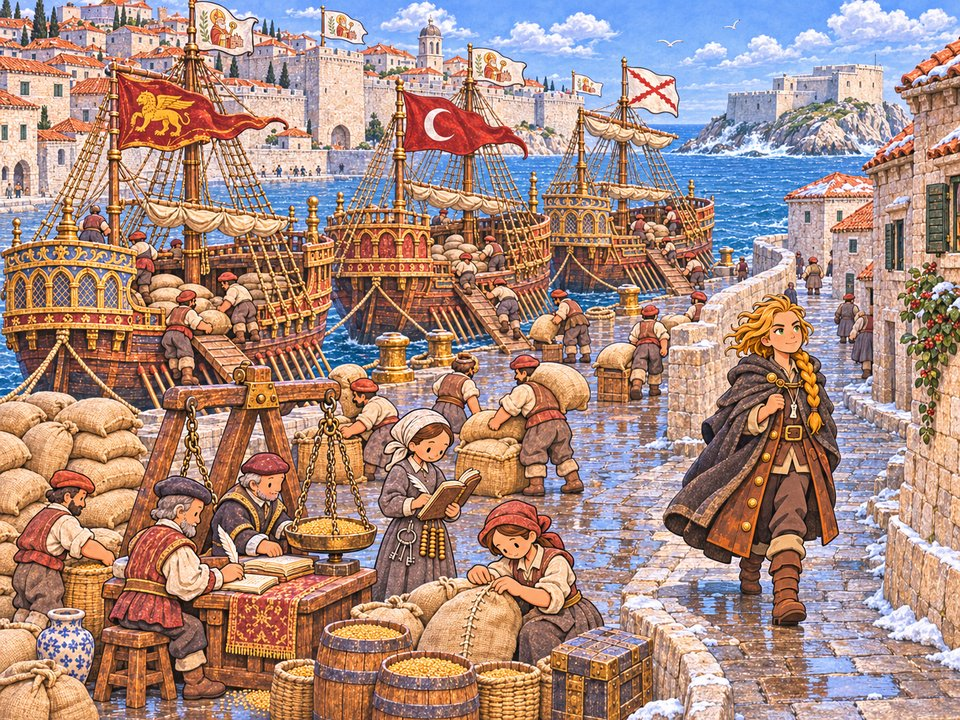
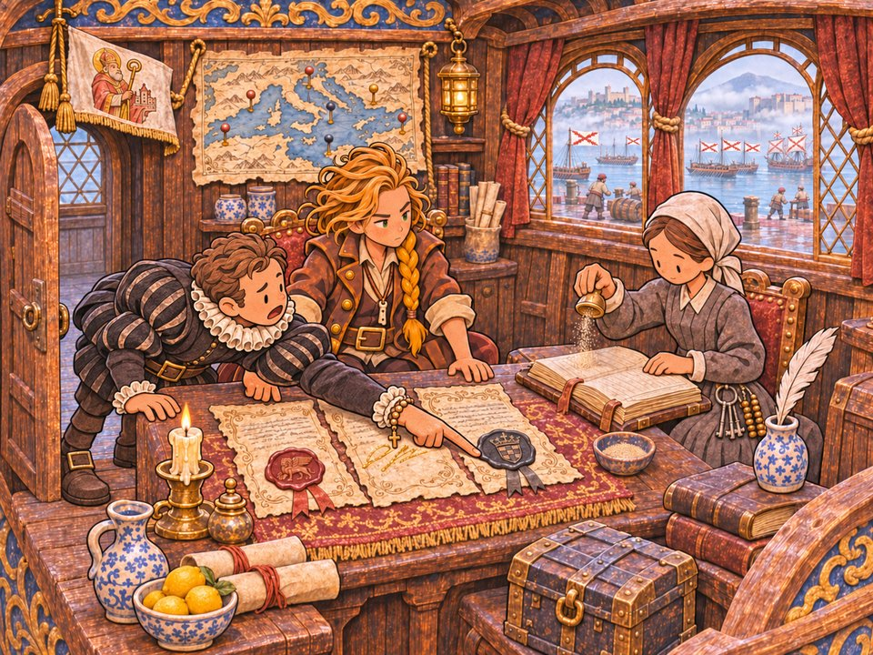

## 1. 라구사의 겨울

1572년 겨울, 마리나의 선단은 잠시 닻을 올려 고향 라구사로 돌아왔다.

부두 안쪽에는 차가운 겨울비가 멎은 뒤 맑은 햇살이 내렸다. 북쪽 산에서 내려오는 찬 바람이 성벽 모서리를 스치며 휘파람 소리를 냈다. 항구 방파제를 따라 배들이 길게 줄을 지어 닻을 내리고 있었다. 베네치아로 갈 밀을 싣는 배 옆에 이스탄불로 떠날 오스만 깃발의 상선이 매여 있었고, 그 너머에는 나폴리 부왕령으로 향할 갈레온이 뱃머리를 맞대고 있었다. 세 나라에 팔 곡식 자루가 부두 돌바닥에 산처럼 쌓여 있었고, 세관 저울 앞에서는 라구사 서기들이 쉼 없이 먹물을 찍어 대며 부피를 적었다. 짐꾼들이 땀을 식히며 들이켜는 독한 포도주 냄새와 마른 밀짚 냄새가 부두 공기에 섞여 있었다.

마라는 부두 끝에서 굵은 삼베 자루의 실밥을 살피며 고개를 흔들었다.

"우리 나라는 편을 안 드는 게 아니에요. 셋 모두에게 값을 치르는 거지."

마리나는 대답 대신 곡식 자루 곁을 지나 성안 골목으로 발길을 돌렸다. 라스티치 집안의 낡은 돌집 문 앞에 서자, 문간 틈으로 젖은 돌 냄새가 배어 나왔다. 문을 두드리자 머리에 검은 수건을 두른 여인이 문지방 너머에서 마리나를 알아보았다. 니콜라의 어머니, 안나 라스티치였다.

"마리나." 안나가 쉰 목소리로 불렀다. 문설주를 짚은 손가락 마디가 마르고 굵었다. "바다에서 내 아들을 보았느냐. 니콜라가 살아는 있더냐."

마리나는 모자를 벗어 가슴에 대고 잠시 생각하다가, 제가 본 것만 그대로 입에 올렸다.

"작년 여름 아드리아해에서 호루라기 소리가 세 번 돌아왔습니다. 배는 쏘지 않고 엇갈렸습니다. 그리고 가을 싸움 끝에 라구사식 뱃머리 장식을 단 배 한 척이 달아나는 것을 보았습니다. 호루라기를 불었으나 그쪽에서는 답이 없었습니다. 지금 살아 있는지는 알지 못합니다."

안나는 더 묻지 않았다. 눈시울을 붉히지도 않은 채, 고개만 한 번 천천히 끄덕이고는 문 안쪽으로 물러섰다. 문이 닫히기 전, 어두운 부엌 쪽에서 희미한 촛불 빛이 새어 나왔다.

집으로 돌아가는 길에 마리나는 항구 서쪽 바위 위에 선 로브리예나츠 성채 아래를 지났다. 해가 기울며 성채 돌벽에 붉은 그림자가 길게 드리웠다. 마리나는 걸음을 멈추고 성채 정문 위 돌에 새겨진 글을 한참 올려다보았다. 열여섯 해 전, 야코가 떠듬떠듬 읽고 니콜라가 조공을 물었던 그 돌판이었다. 바닷바람에 글자 모서리가 조금 더 닳아 있었다. 성채 아래 바위틈에서는 겨울 파도가 하얗게 부서지며 돌계단 끝을 적셨다. 마리나는 외투 깃을 여미고 성채 아래 좁은 돌계단을 내려왔다.

부두로 내려오니 인부들이 마지막 곡식 자루를 어깨에 메고 사다리를 오르고 있었다. 사다리 발판마다 마른 짚 부스러기와 곡식 먼지가 날렸고, 자루에서 떨어진 밀알 몇 개가 젖은 돌바닥 위에 흩어졌다.

## 2. 겨울 곡물선 호위

1573년 1월과 2월, 아드리아해의 겨울바다는 좀처럼 맑은 날이 없었다.

라구사에서 베네치아와 코르푸로 보낼 밀 포대를 실은 상선 세 척이 출항을 기다리고 있었으나, 오트란토 해협 어귀에서 오스만과 바르바리의 겨울 약탈선들이 상선을 노린다는 소문 탓에 선주들이 닻을 올리지 못하고 있었다. 부두 앞 선술집에서는 출항을 미루던 선원들이 모닥불 주위에 모여 앉아 겨울 바람이 잦아들기만 기다렸다.

출항 전날 저녁, 라구사 조선소 출신의 늙은 목수 겸 갤리 선장 스테판 코바치가 톱과 대패를 든 채 스베티 블라호 옆으로 다가왔다. 흰 수염에 톱밥이 묻어 있던 스테판은 배의 선미 키 이음새를 손가락으로 두드려 보았다.

"겨울 파도를 타려면 키 이음새에 역청을 한 겹 더 발라야 하오, 마리나 선장." 스테판이 굵은 목소리로 말했다. "내 플란더스 갤리도 노잡이들이 추위에 손을 덜 떨도록 노걸이에 기름을 먹여 두었소. 오트란토 어귀에서 바람이 거세지면 내 배도 뒤쪽 꼬리를 잡아 드리리다."

"고맙소, 스테판 영감." 마리나가 뱃전 난간을 짚으며 대답했다. "상선 선주들이 바람을 겁내고 있으니, 내일 새벽 썰물에 맞춰 영감 배가 앞뒤를 잡아 주면 큰 힘이 되겠소."

"늙은 목수 손이라도 빌려야지. 밀 포대가 젖으면 코르푸 창고에서 값을 안 쳐 주니까." 스테판이 웃으며 제 배로 건너갔다.

마리나의 선단은 스베티 블라호와 갤리 둘, 그리고 사에티아를 이끌고 겨울 곡물 선단의 앞뒤를 맡았다. 출항 이튿날 밤, 달마티아 남쪽 바다에서 매서운 북서풍과 함께 찬 비가 쏟아지기 시작했다. 젖은 돛베가 무겁게 늘어지며 돛대가 삐걱거렸고, 갑판 위 밧줄마다 바닷물이 얼어붙어 미끄러웠다. 뒤따르던 상선 하나가 바람에 밀려 대열에서 반 마장쯤 뒤처지자 갑판 위가 순식간에 소란스러워졌다.

"로브로, 돛줄을 두 번씩 감아 매라!" 마리나가 비바람을 뚫고 외쳤다. "상선 한 척이라도 대열에서 떨어지면 밤사이에 표류한다!"

로브로가 젖은 양털 외투를 여민 채 선원들을 독려하며 돛줄을 조였다. 뱃머리에서는 하산이 놋쇠 나침반 불빛을 가죽으로 가린 채 바람의 방향을 재고 있었다.

새벽녘이 가까워질 무렵, 오트란토 어귀 안개 속에서 낮은 그림자 두 개가 곡물선 뒤쪽으로 미끄러져 들어왔다. 겨울 폭풍을 틈타 낙오선을 노리던 약탈선들이었다. 토마 벤드라민이 젖지 않게 가죽 천으로 덮어 두었던 청동 포 「안툰」의 덮개를 걷어 내고 화승에 불을 댔다. 왼손의 남은 세 손가락으로 젖은 불씨를 감싸 살리는 손길이 흔들림 없었다.

묵직한 포성이 빗소리를 뚫고 울렸다. 첫 발은 적선의 뱃머리 앞 물기둥을 세웠고, 라 콜롬바가 노를 저어 적선의 옆구리로 파고들자 약탈선들은 곧장 안개 속으로 방향을 틀어 물러났다. 스테판의 플란더스 갤리도 뒤쪽에서 횃불을 치켜들며 상선 대열이 흩어지지 않게 붙들었다.

사흘 뒤, 곡물 선단 세 척은 밀 포대 한 자루도 적시지 않은 채 코르푸 방파제 안쪽으로 무사히 들어섰다. 항구 창고 서기가 묵직한 은화 자루를 내어 주었고, 마라는 젖은 손으로 확인서에 도장을 찍으며 겨울 선원 몫을 맞추었다.

## 3. 석 줄의 통보

1573년 3월, 코르푸.

겨울을 넘기고 다시 코르푸 항구에 닻을 내린 지 보름째 되는 날이었다. 베네치아에서 온 빠른 사절선 한 척이 돛을 내리자마자 항구 사령부 앞 부두로 사람들이 몰려들었다. 부두 끝 종탑에서 바람에 흔들리는 쇠 종이 낮게 한 번 울렸다.

오후가 되자 베네치아 함대 서기가 손에 양피지 통보문 한 장을 들고 스베티 블라호의 사다리를 올라왔다. 서기의 검은 망토 끝이 젖은 사다리 발판에 스쳤다. 선단 갑판 위에 마리나와 마라, 토마와 디에고, 로브로가 모여 섰다. 서기는 마리나를 보지도 않고 종이를 펼쳐 소리 내어 읽었다.

통보문은 석 줄이 전부였다.

3월 7일, 베네치아 공화국은 오스만 술탄과 강화를 맺었다. 공화국은 키프로스를 내주고 배상금으로 금화 삼십만 두카트를 내기로 했다. 이에 따라 전시 용선 계약은 오늘로 끝나니, 선단은 베네치아의 깃발을 내리고 해산하라.

서기가 종이를 말아 쥐는 동안 아무도 입을 열지 않았다. 바닷바람이 돛대 끝의 붉은 사자 깃발을 세차게 흔들었다. 곁에 서 있던 마라가 입술을 달싹이며 손가락을 꺾더니, 낮은 목소리로 한 마디만 뱉었다.

"라구사 조공 스물네 해 치예요."

서기가 부두로 돌아가려 몸을 돌리자, 갑판 뒤에 서 있던 디에고 오르티스가 한 걸음 앞으로 나섰다.

"우리는 뭐가 됩니까." 디에고의 목소리가 거칠게 울렸다.

서기가 걸음을 멈추고 허리의 장부에서 다른 명단을 한 장 꺼내 들었다. 나폴리와 시칠리아로 돌아갈 에스파냐 보병들의 소환 명단이었다. 서기가 명단을 읽자, 갑판에 남아 있던 병사들이 하나둘 짐을 챙겨 사다리 쪽으로 움직였다. 그 가운데에는 지난여름 모돈 앞바다에서 열병을 앓고 살아남아 아직 얼굴빛이 누렇게 뜬 젊은 병사들도 섞여 있었다.

"디에고 오르티스 하사." 서기가 종이 끝을 짚었다. "그대는 지난가을에 복무 기한이 찼더군. 소환 명단에 이름이 없소."

갑판 위에서 에스파냐 병사들이 쇠 투구와 가죽 배낭을 챙겨 들고 차례로 사다리를 내려갔다. 함께 열병을 앓고 살아남은 병사들이 디에고 쪽을 한 번씩 돌아보고는 부두로 걸어 나갔다. 부두 돌바닥 위로 쇠 징 박힌 장화 소리가 멀어지다가 항구 어귀에서 끊겼다. 디에고는 사다리 가까이 가지 않고 긴 창을 쥔 채 갑판 한가운데 우두커니 서 있었다. 바람이 불자 통보문을 쥔 마리나의 손끝에서 종이 모서리가 바스락거렸다.

## 4. 두 개의 못

그달 말, 선단은 마지막 삯을 정산받으러 베네치아로 올라갔다.

베네치아 병기창 옆 정산소에서 낡은 어음과 밀린 정산서를 맞추는 데 사흘이 걸렸다. 정산소 탁자 앞에는 붉은 깃발을 내리고 집으로 돌아가려는 각지 선장들의 말소리가 웅성거렸다. 셈을 마친 마리나는 혼자 산 마르코 뒤편 조용한 운하 가의 돌집을 찾아갔다. 총사령관 자리에서 물러난 세바스티아노 베니에르의 집이었다.

서재 안은 창을 닫아 두어 어둡고 서늘했다. 식은 벽난로 앞 낡은 가죽 의자에 일흔 중반을 넘긴 베니에르가 앉아 있었다. 두 손으로 짚은 나무 지팡이는 재작년 가을 케팔로니아 앞바다에서 부러뜨렸던 닳은 것이 아니라, 옹이 하나 없는 매끈한 새것이었다. 노인의 얼굴에는 화난 기색도, 서운한 빛도 없었다. 다만 어깨가 예전보다 조금 더 굽어 보일 뿐이었다.

마리나는 품속에서 작은 천 보자기를 꺼내 탁자 위에 풀었다. 그 안에서 놋쇠 못 두 개가 굴러나왔다. 선실 해도에서 뽑아 온 키프로스의 두 성, 니코시아와 파마구스타의 못이었다. 못 머리에는 마라가 입혔던 금색 밀랍이 그대로 굳어 있었다. 촛불이 없는 어두운 서재 안에서도 노란 밀랍 빛깔만은 어스름 속에 희미하게 드러났다.

베니에르는 탁자 위로 굴러온 금색 못 둘을 한참 내려다보았다. 그리고 새 지팡이 끝으로 바닥 돌을 한 번 가볍게 짚었다.

"공화국은 장부로 싸우네." 노인이 낮은 목소리로 말했다. "그대가 처음부터 알던 것 아닌가."

마리나는 고개를 숙여 인사를 대신했다.

"마지막 삯은 어김없이 받았습니다."

베니에르는 못을 도로 집어 마리나 쪽으로 밀어 주었다.

"들고 가게. 내 탁자 위에 둘 물건이 아닐세."

마리나는 금색 밀랍이 굳은 못 두 개를 천에 다시 싸서 주머니에 넣었다. 노인이 두 손으로 지팡이 손잡이를 고쳐 쥐었다. 서재 창문 밖 운하에서 노 젓는 물소리가 천천히 지나갔다.

## 5. 상자 속의 못

베네치아 부두에 매인 스베티 블라호의 선실.

마리나는 주머니에서 천 보자기를 꺼내 해도 탁자 위에 놓았다. 마라가 그 못 둘을 받아 들더니, 아무 말 없이 작은 나무 상자 뚜껑을 열었다. 상자 바닥에는 낡은 놋쇠 조각과 녹슨 펜촉들이 들어 있었다. 마라가 금색 밀랍이 굳은 못 두 개를 상자 안으로 떨어뜨리자, 짤그랑 하고 가벼운 쇠 소리가 났다. 마라가 상자 뚜껑을 닫고 빗장을 걸었다. 키프로스 섬 자리가 빈 해도는 물결이 흔들릴 때마다 탁자 위에서 종이 끝만 가볍게 들썩였다.

선실 문 밖 갑판에는 선단 사람들이 모여 있었다. 베네치아에서 빌려온 갤리들은 병기창으로 돌려보낼 참이었고, 아르세날레 서기에게 케팔로니아 항구 열쇠 꾸러미도 함께 돌려주었다. 라 콜롬바와 산타 엘레나, 산 조르조에 타고 있던 노잡이들과 수병들이 짐 보따리를 꾸려 부두로 내려가는 모습이 보였다. 이제 계약이 끝났으니, 라구사의 카락 스베티 블라호에 남아 마리나를 따를지, 아니면 여기서 삯을 챙겨 제 집으로 갈지 물어야 했다.

"베네치아의 깃발은 내렸소." 마리나가 선원들을 둘러보며 말했다. "남을 사람은 남고, 떠날 사람은 떠나도 좋소. 누구도 붙잡지 않겠소."

갑판장 로브로가 먼저 굵은 팔짱을 풀며 한 걸음 나섰다. 로브로의 손등에는 굵은 밧줄에 쓸린 굳은살이 단단하게 박여 있었다.

"내가 갈 곳이 어디 있겠소. 선장님 곁에 남겠소."

그 곁에 서 있던 하산이 놋쇠 나침반을 겉옷 안으로 집어넣으며 고개를 끄덕였다.

"베네치아에 내릴 땅은 없소. 배가 가는 데까지 따라가겠소."

디에고는 이미 소환 명단에서 빠져 갈 곳이 없었다. 그는 말없이 창을 고쳐 잡은 채 스베티 블라호 뱃전 쪽으로 자리를 옮겼다.

사람들의 시선이 뱃머리 포대 쪽으로 향했다. 베네치아 사람인 토마 벤드라민은 부두 건너편 아르세날레의 높은 벽돌 담장을 한참 바라보고 있었다. 제 손으로 포를 붓던 곳이었다. 담장 너머에서는 쇠망치 두드리는 소리가 바람을 타고 건너왔다. 토마는 한참 동안 아무 말 없이 기름 헝겊으로 청동 포 「안툰」의 포신을 닦고 또 닦았다.

이윽고 토마가 헝겊을 쥔 왼손을 멈추고 마리나를 돌아보았다.

"포는 깃발을 모른다고 했지요."

토마는 헝겊을 접어 포대 옆 나무 상자 위에 내려놓았다.

## 6. 선실 탁자 위의 세 봉인

사흘 뒤 저녁, 베네치아 부두에 닻을 내린 스베티 블라호의 선실.

낮 동안 서로 다른 사람들이 조용히 사다리를 올라왔다 내려갔다. 먼저 베네치아 해군 서기가 찾아왔고, 해 질 녘에는 하산이 부두 끝 창고에서 만난 오스만 상인의 전갈을 들고 돌아왔다. 어둠이 내린 뒤에는 에스파냐 연락 장교가 검은 망토를 두른 채 작은 편지 꾸러미를 내밀고 갔다.

선실 탁자 위, 해도 가장자리에 세 나라의 계약서가 나란히 놓였다. 세 해 전 봄, 라구사의 상회 탁자에 놓였던 것과 같은 차례였다.

맨 왼쪽에는 붉은 밀랍의 날개 달린 사자 인장이 찍힌 베네치아의 종이가 있었다. 전쟁이 끝났으니 평시 아드리아해 호위 선단을 맡으라는 제안이었으나, 삯은 전쟁 때의 절반에도 미치지 못했다. 게다가 마리나가 끌고 있던 갤리들은 이미 병기창으로 넘어간 뒤라 스베티 블라호 한 척으로는 남는 것이 없었다.

가운데에는 금가루를 뿌린 술탄의 서명이 찍힌 종이가 놓였다. 하산이 전한 바에 따르면, 오스만의 대제독 클르치 알리가 라구사 선장에게 에게해와 이스탄불을 오가는 곡물 선단을 맡기려 한다는 뜻이었다. 종이에서는 옅은 장미 기름 냄새가 묻어났다.

맨 오른쪽에는 검은 밀랍의 왕관 방패 인장이 찍힌 에스파냐의 계약서가 있었다. 돈 후안이 올가을 북아프리카 튀니스로 원정을 떠날 참이니, 선단을 이끌고 합류하라는 문서였다. 계약서 종이는 빳빳하고 두꺼웠으며, 검은 밀랍 끝에는 왕실 서기의 날인이 깊게 파여 있었다.

에스파냐 계약서 위에는 작게 접힌 편지 한 통이 더 얹혀 있었다. 나폴리 함대에 남아 있는 야코 소르고가 보낸 것이었다. 마리나가 편지를 펼치자 짧은 글 한 줄이 눈에 들어왔다.

「한 철만 같이 가자.」

마리나는 편지 끝을 손가락으로 누른 채 탁자 위 세 봉인을 차례로 바라보았다. 목에 걸린 뼈 호루라기가 숨을 쉴 때마다 가슴팍에서 묵직하게 닿았다. 등잔불 심지가 한 번 흔들리며 붉은 밀랍과 금가루, 검은 밀랍 위로 어두운 그림자를 길게 드리웠다. 바깥 부두에서는 밤 순찰을 도는 야경꾼의 나무 딱따기 소리가 멀어져 갔다.

## 7. 한 철

다음 날 아침, 부두 물안개가 채 걷히기 전이었다. 항구 바깥 운하에서 새벽 생선을 실은 거룻배들이 조용히 미끄러져 나갔다.

스베티 블라호 선실 창가에 앉은 마리나는 탁자 위의 세 봉인을 다시 보았다.

붉은 밀랍을 집어 베네치아의 평시 아드리아해 호위 선단을 맡을 수도 있었다. 삯은 전쟁 때의 절반이라도 큰 싸움이 없고, 베네치아에서 쌓아 온 자리도 이어갈 수 있었다. 금가루 서명을 집으면 오스만 항구들을 오가는 곡물 선단이었다. 하지만 마리나의 손끝은 오른쪽 검은 밀랍에 머물렀다. 나폴리와 튀니스로 내려가면 앞선 자리의 셈은 끊기더라도, 첫 삯부터 다시 맞추며 야코 곁에 설 수 있었다.

마리나는 붉은 밀랍과 금가루가 찍힌 두 계약서를 말아서 봉인에 손대지 않은 채 탁자 한쪽으로 밀어 두었다. 그리고 에스파냐의 계약서를 끌어당겼다.

마리나는 깃펜 끝에 검은 잉크를 찍었다. 계약 기간을 적는 빈칸에는 기한이 비어 있었다. 마리나는 깃펜을 눌러 종이 위에 제 손으로 또렷이 적어 넣었다.

「한 철」

그리고 그 아래 제 이름을 서명했다.

창밖에서는 로브로가 갑판 사다리를 거두고 출항 채비를 서두르는 소리가 들려왔다. 마리나는 계약서를 접어 허리의 가죽 서류 주머니 안쪽에 밀어 넣었다. 안에서는 낡은 베네치아 계약서 사본과 야코의 편지가 종이끼리 부딪치며 바스락거렸다.

탁자 맞은편에 앉아 있던 마라는 조용히 가죽 장부를 펼쳤다. 1571년 11월 베네치아로 올라온 날부터 올해 4월 오늘까지, 열여덟 달 동안 배들을 먹이고 고치며 내보낸 돈이 빼곡히 적힌 장부였다. 그 사이 선단에 든 금화를 모두 더한 숫자가 맨 아래 칸에 굵게 적혀 있었다.

마라가 깃펜을 들어 열여덟 달의 끝 줄을 채웠다. 깃펜이 종이를 긁는 소리가 조용한 선실 안에 번졌다.

「서른여덟 달, 둘째 계약 금화 일만 이천. 돌려준 항구 하나. 잃은 깃발 하나.」

마라는 잉크가 마르기를 기다리지 않고 모래를 뿌려 털어 낸 뒤, 장부 끈을 단단히 묶었다. 선실 바깥 갑판에서는 닻줄이 도르래에 감기며 삐걱거리는 소리가 길게 울렸다. 배 밑바닥을 때리는 물소리가 조금씩 빨라졌다.

*(만약 마리나가 이 자리에서 붉은 사자에 남았다면 이야기는 10부 끝 「사자로 남았다면」으로 이어지고, 처음부터 초승달을 들어 9부 끝까지 왔다면 「초승달이었다면」으로 이어진다.)*

---

## 다른 깃발 아래에서 ― 초승달

*(1부에서 마리나가 가운데 봉인을 집었다면, 이야기는 이 길로 흐른다.)*

### 성벽 아래의 등불

1572년 겨울, 마리나의 선단은 잠시 닻을 올려 고향 라구사로 돌아왔다.

차가운 겨울비가 멎은 뒤 맑은 햇살이 내린 부두에는 베네치아와 오스만, 나폴리로 갈 곡식 자루가 나란히 저울에 올랐다. 짐꾼들의 땀 냄새와 독한 포도주 냄새가 부두 돌바닥에 섞였다. 마라는 부두 끝에서 굵은 삼베 자루의 실밥을 살피며 고개를 흔들었다. "우리 나라는 편을 안 드는 게 아니에요. 셋 모두에게 값을 치르는 거지."

마리나는 니콜라와 함께 성안 골목으로 걸어 들어가 라스티치 집안의 낡은 돌집 문을 두드렸다. 문간 틈으로 젖은 돌 냄새가 배어 나왔다. 머리에 검은 수건을 두른 안나 라스티치가 문지방 너머에서 두 자식을 보듯 마리나와 니콜라를 맞았다.

"두 아이가 다 살아서 문턱을 넘었구나." 안나의 마르고 굵은 손가락이 문설주를 짚었다. "바다에서 야코는 보았느냐. 그 아이도 살아서 편지를 보냈는지 모르겠구나."

"재작년 가을 큰 싸움에서도 갈레온 키를 잡고 버텼습니다." 마리나가 모자를 벗어 가슴에 대고 대답했다.

안나는 부엌에서 따뜻한 보리빵 한 덩이를 꺼내 두 사람의 손에 쥐여 주었다. 저녁 어스름이 내릴 무렵, 성채 아래 돌계단을 내려온 마리나는 로브리예나츠 성채 정문 위 돌글씨를 한참 올려다보고 부두로 돌아왔다. 바닷바람에 글자 모서리가 조금 더 닳아 있었다.

### 강화 소식과 겨울 군량선 호위

1573년 1월과 2월, 마리나의 선단은 다르다넬스 해협과 에게해 북쪽 물길을 오가며 겨울 폭풍 속에서 이스탄불 병기창으로 향하는 군량 선단을 호위했다. 거친 눈비가 갑판을 때리는 가운데에서도 하산이 좁은 해협의 암초를 피해 항로를 잡았고, 토마 벤드라민은 젖지 않게 덮어 둔 「마테」를 지키며 뱃머리에 섰다.

한 번은 레스보스 섬 서쪽 바위 모퉁이에서 거센 역풍을 만나, 보리 포대를 실은 구랍 한 척이 암초 쪽으로 떠밀릴 뻔했다. 갑판 위에서는 로브로가 젖은 밧줄을 허리에 감고 노잡이들을 독려했고, 디에고 오르티스는 절뚝거리는 다리를 버티며 창고 문짝을 붙들어 짐이 쏟아지지 않게 막았다. 하산이 나침반을 손바닥에 올려 물살의 방향을 짚어 준 덕분에 선단은 배 한 척 잃지 않고 해협 안쪽 잔잔한 물길로 들어설 수 있었다.

그해 3월, 이스탄불 부두에 뜻밖의 소식이 날아들었다. 갈라타 언덕 아래 선창에서 밧줄을 감고 있던 선원들 사이로 베네치아가 오스만과 단독 강화를 맺고 키프로스를 넘기기로 했다는 전갈이 번진 것이었다. 부두 어귀 망루의 북소리가 잦아들자, 마라가 선실 탁자 위로 손가락을 꺾으며 계산을 맞춰 보았다.

"배상금만 금화 삼십만 두카트에 이른대요. 라구사 조공 스물네 해 치예요." 마라가 장부 끝을 누르며 낮게 중얼거렸다. "키프로스를 내주고라도 바닷길을 열겠다는 셈이겠지요."

그날 저녁, 갈라타 부두 앞 선술집에 들른 니콜라가 젖은 모자를 털어 내며 마리나의 앞자리에 앉았다. 탁자 위 양초 불빛 아래 붉은 기 도는 머리에 흰 눈발이 녹아 물방울이 맺혀 있었다.

"결국 베네치아가 먼저 손을 들었구나." 니콜라가 쉰 목소리로 말했다. "이제 동쪽 에게해는 한동안 조용해질 거다. 대신 에스파냐와 클르치 알리 대제독이 서쪽 바다를 두고 다시 마주 서겠지."

"남쪽 바다로 갈 거라면 야코가 있는 나폴리 함대와 부딪칠 텐데." 마리나가 잔을 내려놓으며 물었다.

"그래서 올봄 다시 놓일 봉인 앞에서는 마음을 단단히 먹어야 한다." 니콜라가 낮게 대답했다.

부두 안쪽 선술집마다 뱃사람들이 모여 앉아 이제 바다가 조용해질 것인지, 아니면 서쪽 에스파냐만 남아 다시 싸움이 붙을 것인지 술잔을 기울이며 설왕설래했다. 토마 벤드라민은 뱃머리 포대 옆에 기대어 서서, 고향 베네치아가 전쟁에서 빠졌다는 소식을 듣고도 아무 말 없이 젖은 포신만 헝겊으로 닦았다. 갑판 뒤편에서는 디에고 오르티스가 말없이 낡은 창자루를 손바닥으로 쓸고 있었다.

### 디에고의 하선

그해 봄, 스베티 블라호 선실 탁자 위에 다시 세 통의 계약서가 놓였다. 클르치 알리가 맡기려는 에게해 곡물 선단의 금가루 서명, 평시 아드리아해 호위를 청하는 붉은 사자, 그리고 돈 후안의 튀니스 원정을 앞둔 검은 왕관 방패였다. 호롱불 아래 나란히 놓인 세 봉인이 세 해 전 봄 라구사 상회 탁자를 그대로 옮겨 놓은 듯했다.

니콜라가 선실 문턱에 기대어 서서 탁자 위의 금가루 서명을 턱짓으로 가리켰다.

"나는 에게해로 나간다. 너도 남을 거면 기한을 다시 적어야지. 저쪽 왕관 방패를 집으면 이제 우리 배는 정말 남이 된다. 어머님 얼굴을 봐서라도 잘 생각하거라."

마리나는 세 봉인을 오래 내려다보며 목에 걸린 뼈 호루라기를 손바닥 안에 꽉 쥐었다. 등잔불 심지가 흔들리며 세 봉인 위로 어두운 그림자를 길게 드리웠다. 탁자 맞은편에 앉은 마라가 지난 열여덟 달의 셈을 마치고 가죽 장부 끝에 한 줄을 채웠다. 모래 통을 기울여 잉크를 말리는 손길이 조용했다. 선실 밖 갑판에서는 로브로가 출항 닻줄을 살피는 소리가 들렸다. 하산은 뱃머리에 서서 에게해로 나가는 바람의 결을 가늠하고 있었다. 부두 어귀에서 울려오는 군항 북소리가 잦아드는 가운데, 선실 안에는 묵직한 침묵만 남았다. 그때 문간에 서 있던 디에고 오르티스가 묵직한 창을 내려놓고 한 걸음 앞으로 나섰다.

"선장님, 레판토 물속에서 건져 주신 은혜는 잊지 않겠소." 디에고가 투박한 손으로 제 턱을 문지르며 낮게 말했다. "하지만 이젠 베네치아가 빠졌으니 다음 싸움은 에스파냐와 부딪치게 될 거요. 내 나라 깃발과 마주 서는 바다까지는 따라갈 수 없소. 여기서 나폴리로 가는 상선을 타고 내리는 게 옳겠소."

마리나는 말없이 고개를 끄덕여 주었다. 디에고가 갑판 사다리를 내려가 부두 쪽으로 걸어간 뒤, 마리나는 탁자 위의 금가루 서명이 찍힌 양피지를 끌어당겨 깃펜을 들었다. 이제 다시 에게해의 곡물 길로 나설 차례였다.

「서른여덟 달, 둘째 계약 금화 일만, 빚을 덜다. 남은 배 다섯.」

---

## 다른 깃발 아래에서 ― 왕관 방패

*(1부에서 마리나가 오른쪽 봉인을 집었다면, 이야기는 이 길로 흐른다.)*

### 안나의 올리브 잎

1572년 겨울, 마리나와 야코의 배는 잠시 닻을 올려 고향 라구사로 돌아왔다.

세 나라로 갈 곡식 자루가 나란히 저울에 오른 부두를 지나, 두 사람은 성안 골목에 있는 라스티치 집안의 돌집 문 앞에 멈춰 섰다. 겨울비가 멎은 뒤 돌담 틈마다 차가운 물기가 스며 나와 있었다. 부두에서 불어오는 찬 바람이 두 사람의 망토 끝을 흔들었다. 마리나가 쇠 고리를 두드리자 머리에 검은 수건을 두른 안나 라스티치가 문지방 너머로 고개를 내밀었다.

"마리나, 그리고 야코구나." 안나의 마르고 굵은 손가락이 문설주를 짚었다. "바다에서 니콜라를 보았느냐. 그 아이가 살아는 있더냐."

야코가 검은 모자를 벗어 가슴에 대고 한 걸음 물러서자, 마리나가 제가 본 것만 입에 올렸다.

"작년 여름 아드리아해에서 호루라기 소리가 세 번 돌아왔습니다. 그리고 가을 싸움 끝에 라구사식 뱃머리를 단 배가 빠져나가는 것을 보았습니다."

안나는 눈시울을 붉히지 않은 채 조용히 고개만 한 번 끄덕이고 문을 닫았다. 문이 닫히기 전, 어두운 부엌 쪽에서 희미한 촛불 빛이 새어 나왔다. 돌아오는 길에 마리나와 야코는 로브리예나츠 성채 문 위 돌글씨를 올려다보았다. "자유는 팔지 않는다." 야코가 작게 중얼거렸다. 성채 아래 바위틈에서는 겨울 파도가 하얗게 부서지며 돌계단 끝을 적셨다. 야코는 성채 난간에 손을 얹었다가 차가운 돌 감촉에 곧 손을 떼었다. 어릴 적 셋이 함께 젖은 등 위로 소금기를 말리던 돌난간이었다.

### 사자 깃발이 사라진 바다

1573년 3월, 메시나 항구에서 봄 출정을 기다리던 에스파냐 함대에 비보가 날아들었다. 베네치아가 오스만과 단독 강화를 맺고 키프로스를 내주었으며, 배상금으로 금화 삼십만 두카트를 치르기로 했다는 소식이었다. 항구 사령부 종탑에서 쇠 종이 낮게 한 번 울리자 부두 술집과 갑판 위가 순식간에 술렁였다.

나폴리 기함에서 건너온 연락 장교가 갑판 난간을 두드리며 헛웃음을 쳤다.

"동맹은 같은 적이 있다는 뜻이지, 같은 마음이라는 뜻이 아니오. 베네치아 상인들은 저들 장부만 맞으면 그만인 법이오. 이제 남쪽 바다는 우리 에스파냐 배들만으로 지켜야 하오."

마라는 선실 문턱에서 그 말을 듣고 가죽 장부를 품에 꽉 안았다. "라구사 조공 스물네 해 치를 한꺼번에 내고도 남쪽 바다는 여전히 시끄럽겠군요."

베네치아 배들이 붉은 사자 깃발을 내리고 북쪽으로 흩어진 뒤, 돈 후안은 메시나에 머물던 에스파냐 함대를 나폴리로 돌렸다. 올가을 북아프리카 튀니스로 떠날 원정을 준비하라는 명이었다. 항구 바깥 물결이 봄바람을 받아 검푸르게 일렁였다. 마리나는 로브로에게 닻을 올리라 손짓했다. 뱃머리에서는 디에고의 병사들이 쇠 갑옷을 챙겨 메고 사다리를 올랐다. 야코 역시 제 갈레온의 돛을 올리며 마리나의 배 뒤를 바짝 따랐다. 나폴리로 올라가는 내내, 붉은 사자 깃발이 사라진 빈 바다 위로 봄비가 차갑게 내렸다. 젖은 돛베 위로 빗물이 줄줄 흘러내렸고, 갑판 난간에 기대어 선 야코는 말없이 동쪽 수평선만 바라보았다. 이제 남쪽 바다는 에스파냐와 오스만 두 깃발만 마주 서게 되었다. 나폴리 부두에 닿기 전까지 아무도 선실 탁자 위의 해도를 다시 펴지 않았다.

### 야코의 「한 철」

1573년 봄, 나폴리 부두에 닻을 내린 스베티 블라호 선실.

아침 안개가 붉은 벽돌 부두 위로 낮게 깔린 가운데, 선실 탁자 위에 다시 세 통의 계약서가 나란히 놓였다. 베네치아의 평시 아드리아해 호위, 오스만의 에게해 곡물 선단, 그리고 돈 후안이 이끄는 튀니스 원정의 검은 왕관 방패였다. 부두 밖 나폴리 만의 잔잔한 물결 위로 새벽 생선을 실은 거룻배들이 조용히 미끄러져 나갔다. 안개 너머로 성당의 새벽 종소리가 은은하게 퍼져 왔다.

붉은 사자를 집으면 베네치아의 평시 아드리아해 호위를 맡아 큰 싸움 없이 지내게 되겠지만, 삯은 전쟁 때의 절반에도 미치지 못할 터였다. 오스만의 금가루 서명을 집으면 야코의 나폴리 함대와 맞서야 했다. 검은 왕관 방패를 집으면 다시 거친 바다로 내려가야 했으나, 나폴리에서 쌓아 온 셈과 배 몫을 그대로 이어 갈 수 있었다. 마리나는 세 봉인을 차례로 바라보며 손가락으로 탁자 모서리를 짚었다.

문간에 서 있던 야코가 탁자 위의 검은 밀랍 봉인을 내려다보며 말했다.

"나폴리에 닿자마자 키아라를 보고 왔다. 눈 밑이 퀭해져서도 내 소매만 붙잡더구나. 튀니스만 다녀오면 정말 배에서 내릴 작정이다. 한 철만 같이 가자, 마리나. 네 배가 옆에 있으면 나도 맘을 놓겠다."

"한 철이라 했지만, 바다 일이 제 날짜에 끝난 적이 있었느냐." 마리나가 야코를 올려다보며 물었다.

"그래도 이번에는 다를 거다. 돈 후안 공자께서 직접 이끄시는 원정이니 겨울이 오기 전에 돌아올 수 있어. 나폴리 부두에서 혼인 잔치 술잔을 함께 들자꾸나."

야코의 말에 마리나는 말없이 고개를 끄덕였다. 붉은 밀랍과 금가루가 찍힌 두 계약서를 말아서 봉인에 손대지 않은 채 탁자 한쪽으로 밀어 두었다. 그리고 검은 왕관 방패 계약서를 끌어당겨 기한 칸에 「한 철」이라 적고 이름을 서명했다. 잉크가 마르기를 기다려 모래를 뿌렸다가 털어 내고, 사본을 접어 품속에 깊숙이 넣었다. 창밖 부두에서는 로브로가 출항 닻줄을 당기는 소리가 길게 울렸고, 갑판 위 디에고는 창끝을 고쳐 쥐며 병사들을 불렀다.

맞은편에 앉아 있던 마라가 지난 열여덟 달 동안 배들을 먹이고 고치며 쓴 셈을 마친 뒤, 모래를 뿌려 잉크를 말리며 가죽 장부 끝에 한 줄을 채웠다. 선실 바깥 갑판에서는 닻줄이 도르래에 감기며 삐걱거리는 소리가 길게 울렸다. 배 밑바닥을 때리는 물소리가 조금씩 빨라졌다. 토마 벤드라민은 뱃머리 청동 포 「비코」의 포신을 기름 헝겊으로 한 번 더 문질렀고, 하산은 나침반 뚜껑을 닫으며 남쪽 하늘을 올려다보았다. 마리나가 품속을 손으로 짚자, 새 계약서와 낡은 어음 사본이 안에서 바스락거렸다. 방파제 끝을 돌아 나온 스베티 블라호가 나폴리의 붉은 벽돌 등대를 뒤로하고 남쪽 바다로 뱃머리를 돌렸다. 갑판 위에서는 로브로가 선원들을 불러 모아 돛줄을 당겼고, 야코의 갈레온도 물살을 가르며 그 뒤를 따랐다.

「서른여덟 달, 둘째 계약 금화 구천. 잃은 동맹 하나.」

이 겨울의 다른 항로에서 돌아온 선장의 이야기는 [외전 「신호등의 매듭」](/novel/threeflags/lantern/)에서 이어집니다.
