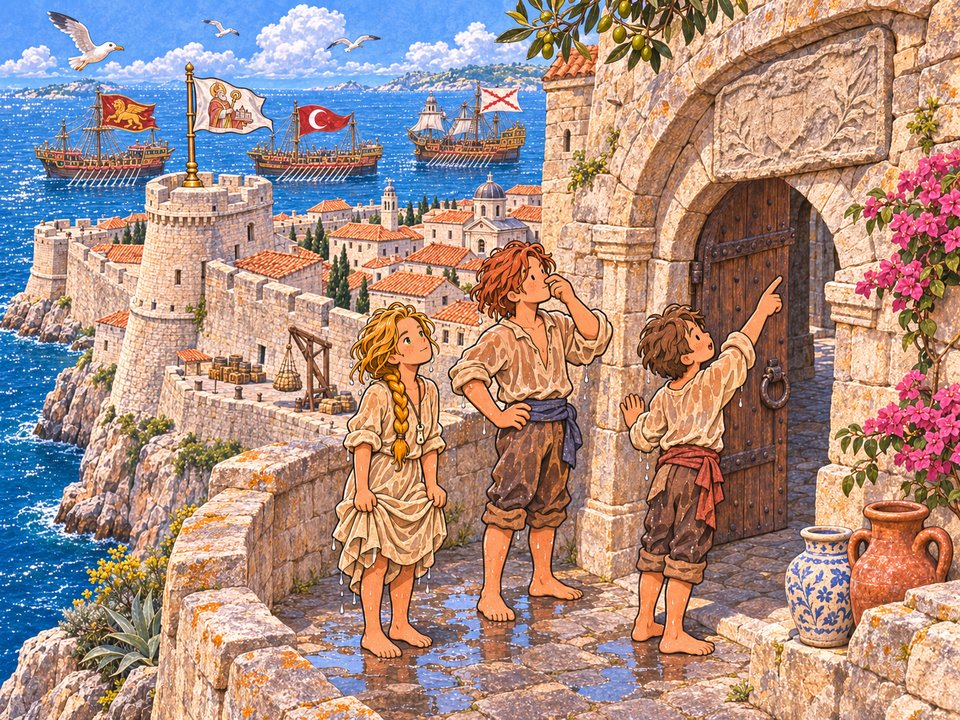

## 1. 성채의 글

1556년 여름, 라구사.

바위 아래 바닷물은 햇볕을 받아 비늘처럼 번득였다. 짠 물기가 눈꺼풀에 말라붙어 눈을 뜰 때마다 따가웠다.

마리나는 미끄러운 돌을 짚고 뭍으로 기어올라 젖은 머리채를 비틀어 짰다. 뒤따라 올라온 니콜라가 젖은 붉은 머리를 털어 내며 물방울을 뿌렸다. 야코는 바위 틈에 걸어 둔 셔츠를 집어 들며 숨을 몰아쉬었다. 마리나가 열일곱, 니콜라가 한 살 위, 야코가 한 살 아래였다. 같은 부두에서 자란 소녀 하나와 소년 둘이었다.

셋은 물기가 마르기도 전에 로브리예나츠 성채로 이어지는 돌계단을 뛰어올랐다. 성채는 항구 서쪽 바위 절벽 위에 솟아 있었다. 닳은 석회암 돌에서는 한낮의 열기가 화덕처럼 뿜어져 나왔고, 발바닥에 거친 돌가루가 묻었다. 성벽 위로 갈매기 몇 마리가 낮게 날며 울었다.

정문 앞 그늘에 서자 야코가 고개를 젖혀 문 위를 올려다보았다. 이맛돌에 굵은 글씨가 깊이 파여 있었다. 야코는 젖은 손가락으로 허공을 짚어 가며 글자를 하나씩 더듬었다.

"자유는…… 세상의 금을 다 주어도…… 팔지 않는다."

야코가 더듬거리며 끝까지 읽었다. 마리나는 돌에 새겨진 글줄을 가만히 올려다보았다.

니콜라가 콧등을 긁으며 물었다.

"그럼 조공은 뭐야?"

야코가 입을 다물었다. 마리나도 대답하지 못했다. 셋은 해마다 봄이면 원로원의 사절이 금을 실은 궤짝을 끌고 이스탄불로 떠나는 모습을 보며 자랐다.

바닷바람이 성채 모퉁이를 돌아 불어왔다. 세 아이의 젖은 등 위로 소금기가 하얗게 말라 가고 있었다.

## 2. 세 깃발과 호루라기

성벽 가장 높은 곳에 올라서자 라구사 항구가 한눈에 내려다보였다.

방파제 안쪽 잔잔한 물 위에 큰 배 세 척이 나란히 닻을 내리고 있었다. 맨 왼쪽 배의 돛대에는 붉은 바탕에 날개 달린 사자 깃발이 바람을 맞았다. 가운데 배에는 붉은 천에 흰 초승달이 그려진 깃발이 걸려 있었다. 오른쪽 큰 범선에는 흰 바탕에 붉은 톱니 십자가 깃발이 나부꼈다.

니콜라가 손가락을 뻗어 가운데 오스만 갤리를 가리켰다.

"나는 저 배를 탄다. 우리 집안 상관도 이스탄불에 있고, 나도 터키 말을 배웠어."

야코가 곧장 오른쪽 에스파냐 갈레온을 가리켰다.

"나는 저쪽이다. 크고 단단하잖아. 나폴리까지 한 번에 갈 수 있겠지."

두 아이가 마리나를 돌아보았다. 마리나는 방파제 안쪽의 세 배를 번갈아 보았다. 어느 배도 선뜻 손가락을 들어 가리키지 못했다. 그저 허리춤에 찔러 둔 작은 물건을 꺼내 들었다. 아버지의 배 상자에서 몰래 가져온, 손가락 길이의 깎은 뼈 호루라기였다.

마리나가 호루라기를 입술에 대고 세 번 불었다. 길게 한 번, 짧게 한 번, 다시 길게 한 번. 날카로운 소리가 성벽 아래 파도 소리를 뚫고 흩어졌다.

니콜라가 호루라기를 받아 쥐며 말했다.

"우리가 커서 어느 깃발을 달든, 이 소리가 나면 잊지 말자."

"누가 어느 깃발 아래 있든, 라구사 배는 라구사 배를 쏘지 않는다."

야코가 주먹을 내밀었다. 니콜라가 그 주먹을 맞부딪쳤다. 마리나도 손을 뻗어 둘의 주먹 위에 얹었다.

세 아이가 호루라기를 돌려 불었다. 길게, 짧게, 길게. 마리나는 마지막으로 호루라기를 건네받아 가죽 끈을 목에 걸었다. 난간의 돌이 손바닥에 뜨거웠다. 항구에는 세 나라의 깃발이 여전히 나란히 펄럭이고 있었다.
