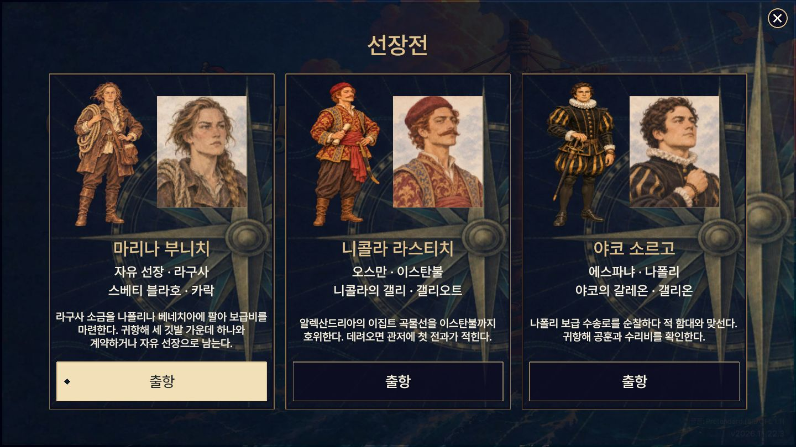

시작 화면에서 **선장전**을 열고 세 선장 중 한 명의 카드에서 **출항**을 누르세요. 1569년 3월 1일, 선택한 선장의 항구에서 시작합니다. 각자의 첫 항차가 끝나면 그 선장으로 교역하거나 세력의 임무를 맡으며 계속 항해합니다. 마리나의 13부 이야기 「세 깃발의 바다」를 따라가려면 시작 화면의 **새로 시작**을 고르세요.

| 선장 | 출발 항구와 소속 | 기함 | 첫 항차 |
| --- | --- | --- | --- |
| 마리나 부니치 | 라구사 · 자유 선장 | 스베티 블라호 · 카락 | 소금 장사와 첫 계약 |
| 니콜라 라스티치 | 이스탄불 · 오스만 | 니콜라의 갤리 · 갤리오트 | 곡물선 호위 |
| 야코 소르고 | 나폴리 · 에스파냐 | 야코의 갈레온 · 갤리온 | 메시나 해협 순찰 |

## 마리나로 시작했다면

1. 금화 1,200으로 시작합니다. **라구사 교역소**에서 소금을 **20짐 이상** 사고 물과 식량을 준비하세요.
2. **나폴리 또는 베네치아 교역소**에 소금 20짐을 실은 채 들어가면 상인과 흥정합니다. 거래액은 결과에 따라 금화 450 또는 650입니다.
3. **라구사 항구관리소**로 돌아오면 베네치아·오스만·에스파냐의 계약을 고를 수 있습니다. 자유 선장으로 남아 장사를 더 해도 됩니다. 나중에 계약하려면 원하는 세력이 지배하는 항구의 관저에서 **종군 계약**을 고르세요.

## 니콜라로 시작했다면

1. **이스탄불 항구관리소**에서 명령을 받은 뒤 **알렉산드리아 항구관리소**로 가서 곡물선과 합류하세요.
2. **로도스 앞바다**에서 기사단 갤리를 만납니다. 배치 화면에서 아군 전투함을 적과 곡물선 사이에 놓으세요. 호위에 실패해 헤어지면 **알렉산드리아 항구관리소**로 돌아가 다시 합류할 수 있습니다.
3. 곡물선을 지켰다면 **이스탄불 항구관리소**에 보고하세요. 첫 항차 보상은 금화 600과 공훈 150입니다.

## 야코로 시작했다면

1. **나폴리 항구관리소**에서 순찰 명령을 받고 메시나 해협 어귀로 향하세요. 목표는 해협 앞바다의 바르바리 약탈선입니다.
2. 전투가 끝나면 **나폴리 항구관리소**로 돌아가 보고하세요. 약탈선을 놓친 경우에도 귀항 보고로 이어집니다. 금화 500과 공훈 150을 받고, 상한 배는 조선소에서 수리할 수 있습니다.

## 공훈 3,000을 쌓고 부함대 보내기

소속 세력이 지배하는 항구의 **관저 → 세력 임무**를 여세요. 갈 곳, 기한, 받을 공훈을 확인하고 맡습니다. 일반 정찰은 지정 항구 앞바다에서 확인한 뒤 아군 항구에 돌아와야 보고가 끝납니다. 다음 작위에 필요한 수치는 누적 공훈이며, 청구에 쓸 수 있는 잔액은 집무실에 따로 표시됩니다.

| 누적 공훈 | 할 수 있는 일 |
| ---: | --- |
| 1,000 | 위임 선장 등급에 오릅니다. 관저의 **알현 — 작위를 받는다**에서 수여 내용을 봅니다. |
| 3,000 | 함장 등급이 되어 부함대 한 자리가 열립니다. 순찰·호송·습격 가운데 가능한 명령을 고릅니다. |
| 7,000 | 전대장 등급부터 두 번째 부함대와 봉쇄 명령이 열립니다. |

**관저 → 집무실 → 명령 함대 보내기**에서 **배 → 명령 → 구역 → 맡길 항해사** 순서로 고르세요. 기함 외에 선장이 지정되지 않은 배 한 척과, 주인공 외에 아직 파견되지 않은 항해사가 필요합니다. 배가 부족하면 조선소에서 사거나 전투에서 나포하세요. 습격은 적이 장악한 항로가 있어야 구역을 고를 수 있습니다. 파견 뒤에는 집무실에서 전적을 보고 명령을 바꾸거나 배를 불러들일 수 있습니다.

## 항구 쟁탈전과 소유권 확인

우리 세력이 공격하거나 방어할 항구가 생기면 관저에 **결전 — 항구 이름**이 뜹니다. **항구 쟁탈전**을 고르면 공격 측은 바깥 바다에서, 방어 측은 포구 쪽에서 배치합니다. 결전이 없는 날에는 관저에 적힌 **다음 판도 정산일**을 확인하세요. 부함대를 보내 둔 상태에서도 소집된 결전에 직접 참가할 수 있습니다.

전투 직후에는 **선장 메뉴 → 세력 → 항구 점령과 항해일지**에서 승패를 읽으세요. **다음 판도 정산** 때 공격 측이 이겼으면 항구가 공격 세력으로 넘어가고, 방어 측이 이겼으면 기존 세력이 지킵니다. 정산 후 전쟁 해도에서 해당 항구의 깃발을 확인하면 됩니다.

[해전 배치와 포격](/systems/naval/) · [세력 임무별 보수](/systems/orders/) · [작위와 공훈](/systems/factions/)
