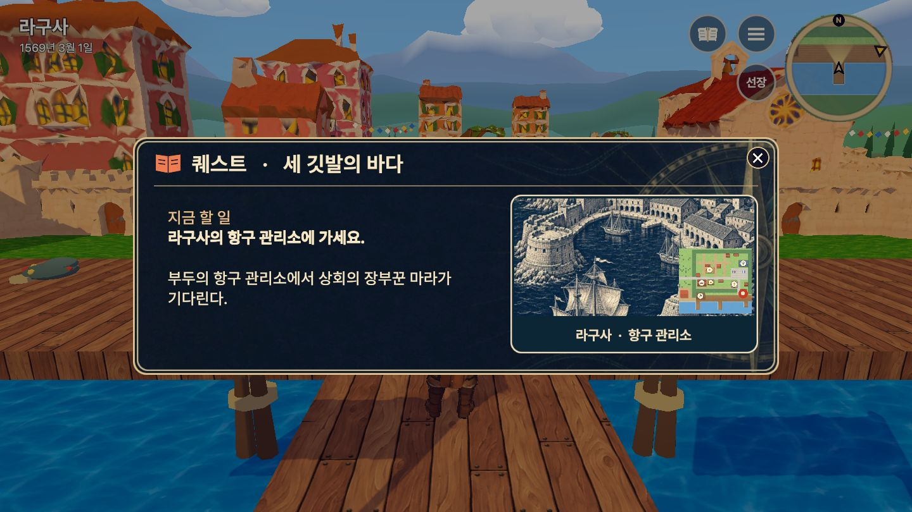

Grand Voyage는 **걷기가 기본**입니다. 마을과 건물 안에서는 걸어 다니고, 빨리 가고 싶을 때만 달립니다. 바다에서는 같은 단추가 **돛 활짝**이 되어 배를 빨리 몰게 합니다.

## 키보드와 패드

| 하는 일 | 키보드 | 패드 |
| --- | --- | --- |
| 이동 | 방향키 또는 WASD | 왼쪽 막대 |
| 시점 돌리기 | 마우스 끌기 | 오른쪽 막대 |
| 달리기 · 돛 활짝 | Shift를 누르는 동안 | X를 누르는 동안 |
| 달리기 켜 두기 | R (한 번 더 누르면 꺼짐) | — |
| 말 걸기 · 다음 · 출항 · 입항 | Space · Enter · E | A |
| 시점 바꾸기 | C | Y |
| 수첩 | Tab · N | — |
| 지도 | M (작은 지도를 눌러도 열림) | Select |
| 메뉴 · 닫기 | Esc | B |

마을·건물·바다에 처음 들어가면 화면 아래에 짧은 조작 안내가 잠깐 떴다가 사라집니다. 다시 보려면 **Esc → 설정 → 조작**을 여세요.

## 터치 (휴대폰·태블릿)

- **왼쪽 아래 조이스틱**: 왼쪽 아래 아무 곳이나 누르면 그 자리에 조이스틱이 잡힙니다. 마을과 건물에서는 끝까지 밀어도 걷습니다. 바다에서는 끝까지 밀면 돛을 활짝 폅니다.
- **오른쪽 아래 큰 단추**: 그때 할 수 있는 일로 바뀝니다. 「말 걸기」, 「출항」, 「입항」, 「자동 항해」, 「상륙」 가운데 하나가 뜨고, 할 일이 없으면 옅어집니다.
- **큰 단추 둘레의 작은 단추**: 마을에서는 「달리기」·「시점」·「지도」·「수첩」입니다. 「달리기」는 누를 때마다 켜고 끄며, 켜져 있으면 금빛 테가 둘립니다. 바다에서는 「달리기」 자리가 「돛 활짝」으로 바뀝니다.
- **시점**: 등 뒤 시점에서 빈 곳을 한 손가락으로 끌면 시점이 돌고, 두 손가락을 오므리거나 벌리면 당기거나 멀어집니다.

**설정 → 조작**에서 화면 조작을 켜고 끄거나(자동으로 두면 터치할 때 켜지고 키보드를 쓰면 꺼집니다), 조이스틱·단추를 감추거나, 단추 크기와 왼손잡이 배치를 고를 수 있습니다.

## 시점과 지도

- **C** 또는 「시점」 단추로 등 뒤에서 보는 시점과 위에서 내려다보는 시점을 바꿉니다. 건물 안은 정해진 시점 하나로 봅니다.
- 오른쪽 위의 둥근 **작은 지도**는 북쪽이 위로 고정되어 있습니다. **M**을 누르거나 작은 지도를 누르면 큰 지도가 열립니다.

바다를 위에서 볼 때 빈 수면을 끌면 배 주변의 다른 곳을 살펴볼 수 있습니다. **내 배로**를 누르면 다시 기함을 따라갑니다. 세계 해도의 청록색 범위와 항구 위치는 [세계 해도](/atlas/world-map/)에서 확인하세요.

## 항구와 건물 드나들기

- 건물은 **문으로 걸어 들어가면** 안으로 들어가고, 문으로 걸어 나오면 나옵니다. 따로 누를 단추는 없습니다.
- 건물 안의 주인에게 다가가 말을 걸면 그 시설의 메뉴가 열립니다.
- 배에 오르는 동작은 따로 없습니다. 부두 끝에서 **출항**(Space 또는 큰 단추)을 누르면 출항 점검 판이 뜨고, 거기서 출항합니다. 자세한 것은 [첫 출항 준비](/start/first-voyage/)를 보세요.
- 아는 항구 가까이에서 **입항**을 누르세요. 마을항이면 부두에 내리고, 오슬로 같은 보급항이면 보급·고용·수리 메뉴가 열립니다. [전체 항구 도감](/atlas/ports/)

## 배 몰기

- **← →**로 키를 돌리고 **↑**로 나아갑니다. **Shift**(또는 「돛 활짝」)로 돛을 활짝 펴면 빨라집니다.
- **바람**을 읽어야 합니다. 뒤에서 부는 바람과 옆바람에는 빠르고, 맞바람으로는 거의 나아가지 못하니 비스듬히 올라가세요. 화면의 풍향 화살표, 돛대 끝 깃발, 물 위의 바람결로 바람을 볼 수 있습니다.
- **해류**도 빠르기에 영향을 줍니다. 큰 지도에 해류 화살표가 보입니다.
- **자동 항해**: 큰 지도에서 항구 이름을 누르면 그 항구로 알아서 갑니다. 물이나 식량이 모자랄 것 같으면 가는 길의 보급항에 들르게 할 수 있습니다.
- **상륙**: 항구가 아닌 해안 가까이에서 「상륙」을 누르면 물 긷기, 사냥과 채집, 둘러보기 가운데 하나를 골라 하루를 보냅니다.

## 다음 목적지와 선장 메뉴

화면 위 **퀘스트**를 누르면 지금 할 일과 다음 항구·건물·필요한 짐을 볼 수 있습니다. 수첩의 **목적지와 퀘스트 보기**로도 같은 화면을 엽니다. 세력 임무나 조합 의뢰를 맡았다면 목록에서 해당 일을 골라 목적지와 남은 기한을 확인하세요.

**선장 메뉴**의 **정보**에서는 교역 장부와 항구별 시세를, **함대**에서는 기함과 동행함의 제원을 봅니다. 바다에서 **항해**를 열면 목표로 항로를 잡거나 항해 배속을 1배·2배·4배로 바꿀 수 있습니다. **세력**에서는 공훈과 항구 점령 기록을 봅니다.

## 메뉴와 저장

- **Esc**로 메뉴를 열어 설정, 저장 칸, 시작 화면으로 돌아가기를 고릅니다.
- 게임은 이야기가 한 단계 넘어갈 때, 건물에서 나올 때, 항구에 들고 날 때 같은 때에 **자동으로 저장**합니다. 항해 중에도 저장할 수 있습니다. 이야기 장면·흥정·전투 도중에는 저장할 수 없습니다.
- 자동 저장 칸 하나와 직접 저장하는 칸 셋이 있습니다. 웹에서는 저장이 그 브라우저 안에 남으니, 같은 브라우저로 이어 하세요.
