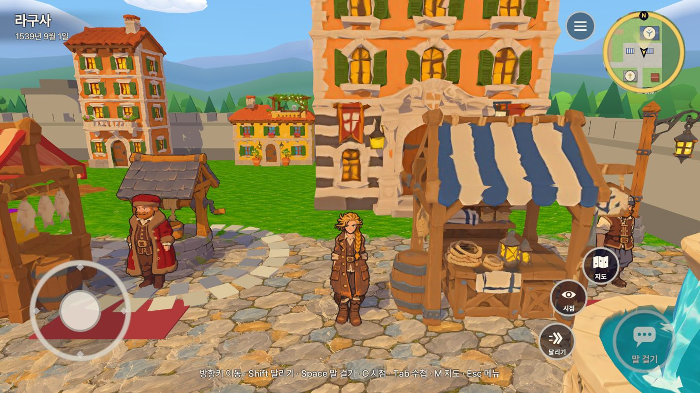

마리나는 배 한 척과 상회의 빚을 물려받았습니다. 라구사 항구관리소에서 마라를 만나면 첫 일거리가 생깁니다. 교역소에서 소금 스무 가마니를 산 뒤 나폴리나 베네치아로 가져가 보세요. 거래가 끝나면 마리나가 번 돈으로 다음 항해의 삯과 식량을 댑니다.

아래는 시작 화면에서 **새로 시작**을 골라 진행하는 마리나의 13부 본편입니다. 인물을 골라 첫 항차를 떠나려면 [선장전 시작하기](/start/captains/)를 보세요.

## 이야기와 자유 행동

대화가 끝났을 때 다음 항구와 건물을 확인하세요. 같은 항구라도 부두 도착, 건물 안에서 말 걸기, 특정 물건을 실은 상태는 다른 조건입니다. 다음 목표가 바뀌지 않으면 수첩을 펴고 **장소·필요한 짐·기한**을 다시 읽으세요. 물건 수가 조건인 일은 필요한 수량을 팔아 버리면 그 자리에서 이어지지 않습니다.

## 어느 깃발을 달까

첫 계약은 베네치아·오스만·에스파냐에서 오는 명령과 기항지를 가릅니다. 5부와 9부 끝에는 장부를 결산하고 다음 계약을 고릅니다. 이번 계약의 삯, 빚, 선원과의 약속을 함께 살피세요. 갈림길 앞에서 직접 저장하면 다른 계약도 이어 볼 수 있습니다.

중반에는 전열에 서고, 항구를 맡고, 피난민과 병자를 어디까지 태울지 결정합니다. 구한 사람이 늘면 다음 항구까지 먹일 식량도 늘어납니다. 마지막에는 그동안 지켜 온 약속에 따라 고를 수 있는 길이 달라집니다. 엔딩 뒤에도 같은 선장으로 항해와 세력 활동을 계속합니다.

[세력과 작위](/systems/factions/) · [이야기 장면의 규칙](/systems/story-voyages/) · [막힌 곳 찾기](/systems/help/)
