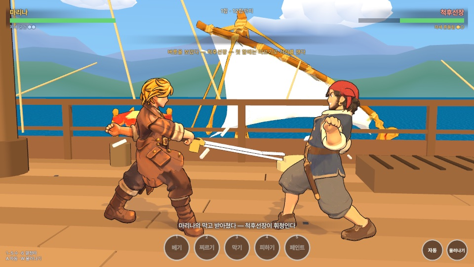

전투 연습에서 상대와 나설 사람을 고른 뒤 **조짐 → 내 수 → 맞부딪친 결과** 순서로 보세요. 조짐에 두 수가 함께 뜨면 둘 중 하나를 예상한 것입니다. 직감과 알고 있는 버릇에 따라 읽기가 달라집니다. 매번 맞는 예고라고 믿고 같은 수를 반복하면 상대에게도 읽힙니다.

| 상대에게서 읽은 수 | 시도할 대응 | 대가 |
| --- | --- | --- |
| 찌르기 | 막기 | 받아치면 상대가 기세와 자세를 잃습니다. 페인트에 속으면 막은 쪽이 열립니다. |
| 크게 베기 | 피하기 또는 빠른 찌르기 | 베기를 정면에서 막으면 손이 밀려 피해를 받을 수 있습니다. |
| 막기를 굳히기 | 페인트 | 먼저 들어온 찌르기나 베기에 끊길 수 있습니다. |

**결정타**는 내 자세가 무너지지 않았고 상대 자세가 무너졌으며 상대 기세가 절반 아래일 때 열립니다. 상대가 피하면 빗나갈 수 있습니다. 최대 12합까지 둘 다 서 있으면 무승부입니다.

실전에서 본 상대의 버릇은 수첩에 남습니다. 아는 선장과 다시 만났다면 전번에 어느 때 찔렀는지 떠올려 보세요. 연습은 저장된 이야기의 전과와 분리됩니다.

## 이겼는데 왜 적 기함이 남았을까?

기함 결투에서 이겼을 때 **적 기함 선원이 우리 기함 선원의 두 배 이하**면 적 기함을 나포합니다. 예를 들어 우리 기함에 30명이 남았다면 적이 60명일 때는 나포할 수 있습니다. 61명이면 승리해도 적 선원과 사기가 깎이고 해전이 이어집니다. 함대 전체 인원이 아니라 맞붙은 두 배의 현재 선원을 비교하세요.

졌을 때는 우리 기함의 선원과 사기가 줄고, 도중에 물러나도 선원 손실이 있습니다. 적의 수가 많다면 먼저 해전에서 거리를 좁혀 산탄을 쏘고, 남은 선원을 확인한 뒤 결투를 걸어 보세요. [해전의 탄종과 사거리](/systems/naval/)
