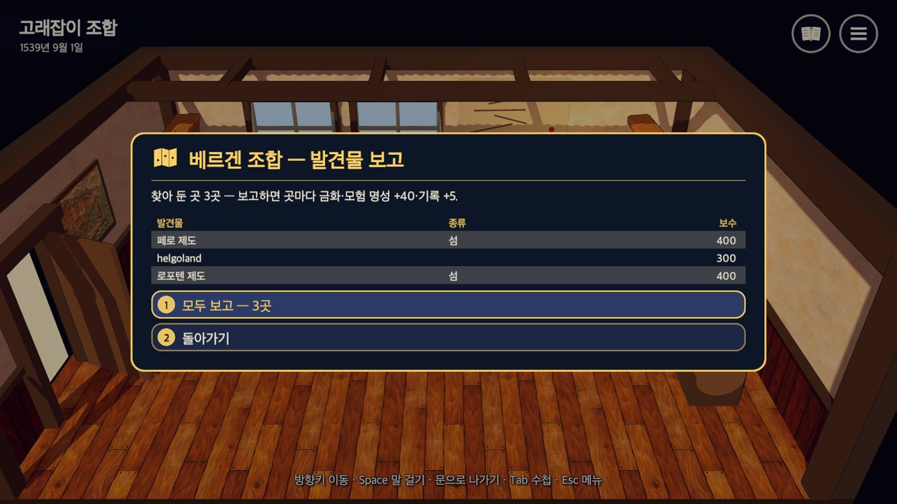

## 조합에서 맡는 일

의뢰판은 이레마다 바뀌고 동시에 세 건까지 맡습니다. 맡기 전에 목적지·짐·남은 날을 확인하세요. 편지를 전할 때와 화물을 배달할 때 필요한 적재량이 다릅니다. 이미 맡은 것은 **맡은 의뢰**에서 다시 봅니다. 기한을 넘기거나 그만두면 기록이 줄어듭니다.

항해 중 해안의 지형이나 유적을 발견하면 다음 조합의 **발견물 보고**로 가져가세요. 찾아낸 것과 보고를 마친 것은 따로 셉니다. 새 항구, 시세, 해적 출몰 해역에 관한 정보도 조합에서 살 수 있습니다.

## 괴물을 만나는 항해

술집에서 소문을 듣고 그 바다에 가서 흔적을 좇습니다. 계절과 항해 수준에 맞는지도 보세요. 첫 조우에서 살아 돌아온 뒤 다시 토벌에 나설 수 있습니다. 수첩에 모인 습성은 다음 싸움에서 어떤 징후를 볼지 알려 줍니다. 판에서는 위험 칸을 피하고 약점이 드러나면 작살을 겨눕니다. 설정에서 직접 조준을 고른 경우 조준점이 약점을 지날 때 던지세요.

| 소문 | 조사할 해역 | 철(월) | 소문을 들을 수 있는 항구 |
| --- | --- | --- | --- |
| 셰틀랜드 서쪽의 안개 선단 | 셰틀랜드서쪽 | 9·10·11·12·1·2 | 런던, 암스테르담, 베르겐 |
| 메시나 해협의 팔 | 메시나해협 | 1·4·7·10 | 나폴리, 제노바, 베네치아 |
| 폭풍 앞머리의 은빛 | 캘리컷앞바다 | 5·6·10 | 캘리컷, 고아, 말린디 |
| 얼음 바다의 엄니 | 얼음들판 | 11·12·1·2·3 | 베르겐, 암스테르담, 런던 |
| 은 항로의 물기둥 | 아조레스서쪽 | 8·9·10·11 | 세비야, 산토도밍고, 아바나 |

[발견물 위치 목록 — 탐험 내용 공개](/atlas/discoveries/)
