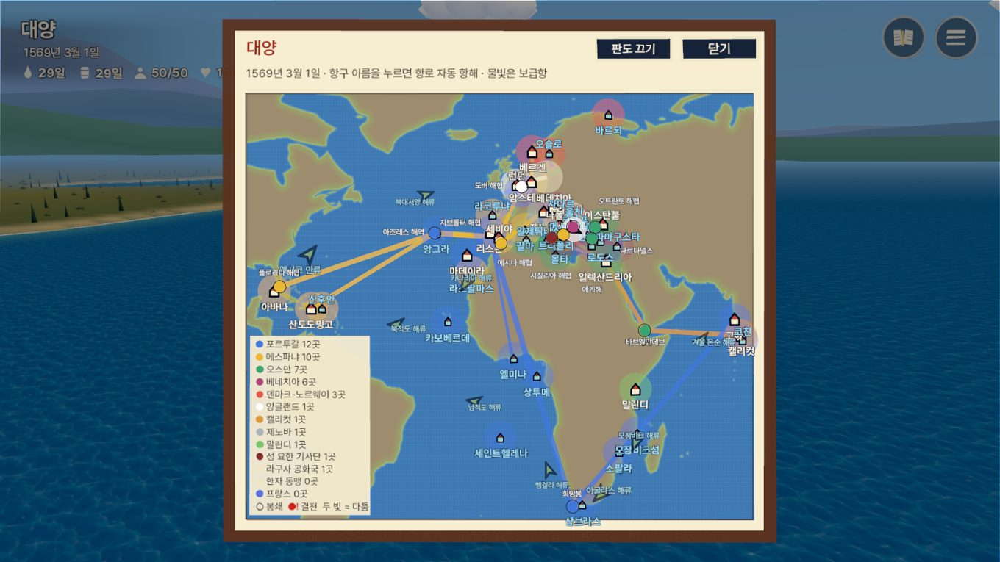

## 소속을 정할 때

마리나의 이야기에서는 임기의 계약 장면에서 깃발을 고릅니다. 자유 항해에서 일반 가입을 청할 때는 관저에서 선장 수준과 그 세력 평판을 봅니다. 일반 가입의 기준은 수준 20, 평판 60입니다. 이야기 속 재계약과 자유 선장의 탈퇴는 처리 방식이 다릅니다. 일반 탈퇴는 작위와 공훈을 잃고 180일 동안 재가입이 막히므로 관저에 표시된 조건을 먼저 읽으세요.

## 임무를 고르고 공훈을 쓰는 법

관저의 **세력 임무**에서 전쟁 상태, 목적 항구, 기한과 보수를 확인합니다. 호위·정찰·군수품 납품과 해상 전투가 각기 다른 방식으로 전선에 보탬이 됩니다. 공훈 청구서나 이름난 항해사 영입에 쓸 수 있는 몫과 작위 판정에 쓰는 누적 공훈은 따로 표시됩니다. 청구에 썼다고 얻어 놓은 작위가 내려가지는 않습니다.

| 작위 | 누적 공훈 | 부함대 한도 | 상관 한도 |
| --- | --- | --- | --- |
| 자유 선장 | 0 | 0 | 0 |
| 종군 선장 | 0 | 0 | 0 |
| 위임 선장 | 1,000 | 0 | 1 |
| 함장 | 3,000 | 1 | 2 |
| 전대장 | 7,000 | 2 | 3 |
| 제독 | 15,000 | 2 | 3 |
| 대제독 | 30,000 | 3 | 4 |
| 원수 | 40,000 | 3 | 4 |

최고 작위인 원수는 공훈과 함께 시즌의 세력 내 순위도 봅니다. 작위에 따라 열리는 **사략 면허, 상관, 부함대, 총독 후보, 세력 회의**는 관저의 「작위와 혜택」에서 확인합니다. 상관을 둔 항구는 수첩에서 시세를 추적하는 데 유리합니다.

## 판도가 바뀌는 때

판도는 이야기·설정에 따라 30일, 14일 또는 7일 단위로 진행됩니다. 교전 한 번 뒤 깃발이 그대로라면 전쟁 해도에서 항구 주변의 세력 차와 다음 판도 턴을 보세요. 해도가 가리키는 요충지에 상업 투자, 호위, 보급과 봉쇄를 집중할 수 있습니다. 세력 회의에서는 목표를 제안하고, 결전에 소집되면 참가해 함대를 지휘하거나 판정을 맡길 수 있습니다.

[임무와 공훈 청구](/systems/orders/) · [항구 통치와 전선 운용](/systems/govern/)
