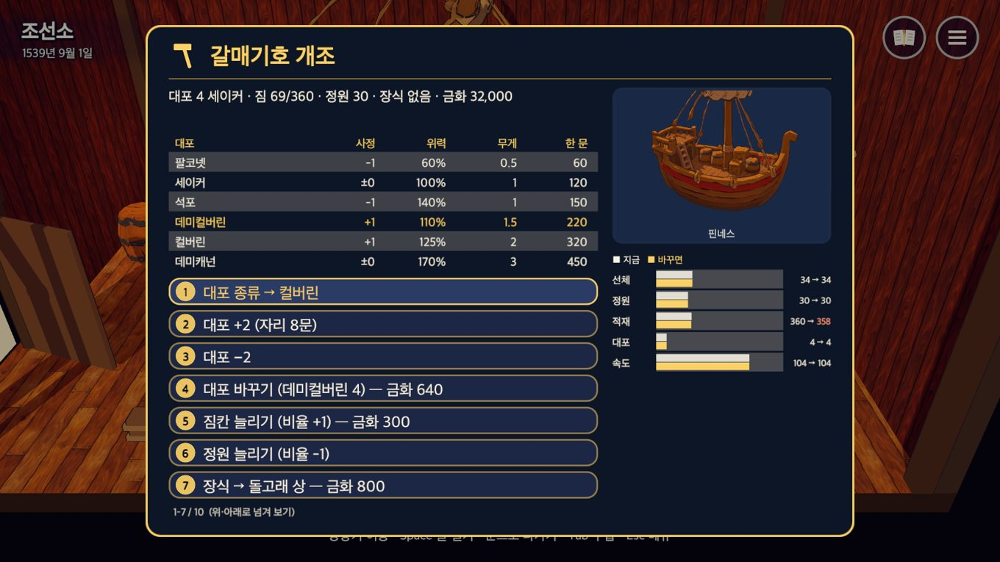

## 새 배와 중고 배

중고는 바로 인수할 수 있지만 선체가 낡았습니다. 구입비에 수리비를 더해 새 배와 비교하세요. 중고 목록은 달이 바뀌면 바뀝니다. 새 배는 주문 뒤 건조를 기다립니다. 이야기 진행, 작위, 토벌 실적으로 열 수 있는 등급과 항구의 조선소 수준·판매 선종을 함께 확인하세요.

## 내 배를 돌려 보고 제원 비교하기

신조·중고 목록에서 후보를 열면 3D 선박을 가로로 끌어 돌려 볼 수 있습니다. **비교할 내 배 변경**은 보유 선박이 둘 이상일 때 나타납니다. 후보와 현재 배의 최소 운항 인원, 대포 자리, 적재 여유를 보고 살 배를 고르세요. 개조할 때는 작업할 선박을 먼저 선택하세요.

항구관리소에서 **배별로 싣기·내리기**를 열고 배를 고르면 **선박 제원**과 **물자 적재**를 오갈 수 있습니다. 항해 중에는 화면 왼쪽 **선박 정보**로 기함을 돌려 보고 **보유 물자**를 확인하세요. 창을 닫으면 기존 항로를 이어갑니다. 동행함의 제원은 **선장 메뉴 → 함대**에서 배 이름을 눌러 봅니다.

## 포를 늘릴 때 잃는 것

대포는 종류에 따라 사거리·위력·무게가 다릅니다. 포문에 여유가 있어도 포를 더 실으면 짐칸이 줄어듭니다. 호위용은 포와 선원, 상선은 귀항할 식량과 적재 여유부터 정하세요. 뱃머리 장식은 항해나 전투에 영향을 줄 수 있습니다. 선체색·돛색·문양은 도색 화면에서 고릅니다.

## 어느 배가 실제 판에 나가나

조선소의 **함대 편성**에서 출전 순서를 확인하세요. 동료 배와 이야기의 출전 한도가 있어서 새로 산 배가 바로 싸움에 들어가지는 않을 수 있습니다. 군수품을 남긴 배와 싸울 배를 구분하고, 수리하고 선원을 채운 배를 앞에 두세요. 항구관리소에서는 여분의 배를 계류할 수 있습니다. 기함과 동료 배는 맡길 수 없습니다.

[선종별 최소 선원·포·짐칸](/atlas/ships/) · [선단 배치](/systems/govern/)
