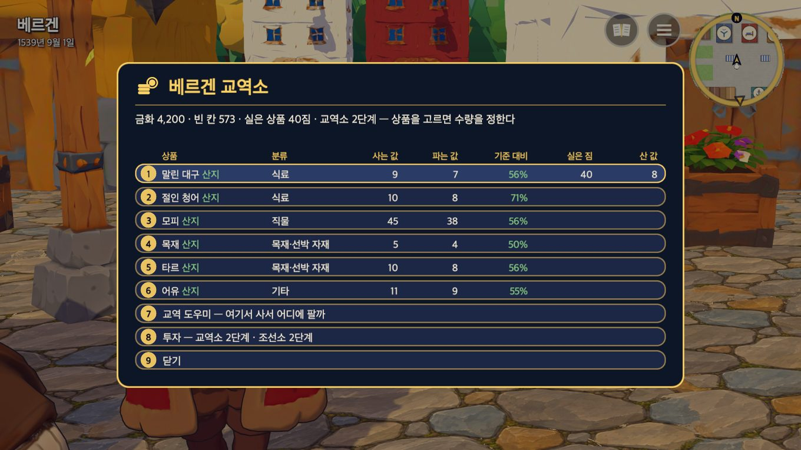

## 한 번 팔 때 얼마가 남나

같은 상품을 다른 가격으로 여러 번 사면 실은 짐의 평균 매입가가 바뀝니다. 팔 곳의 시세만 보고 전부 사지 말고, 매입 금액을 낸 뒤 남은 금화로 식량과 선원 삯까지 치를 수 있는지 확인하세요. 수첩의 시세는 전에 얻은 정보입니다. 항구 주인이 바뀌거나 전쟁으로 항로가 흔들리면 실제 창구에서 다시 값을 확인합니다.

## 어느 항구에서 파는 게 나을까?

교역소 목록의 **내가 살 때**와 **내가 팔 때**는 현재 항구의 한 짐 가격입니다. 상품을 누르고 수량을 바꾸면, 알고 있는 열린 해역의 다른 교역항 중 **받을 금화가 높은 세 곳**을 같은 수량으로 비교합니다. 살 때는 **매입 대비 차익**, 팔 때는 **현지 대비 차이**를 보세요. **항구별 시세 전체 보기**를 누르면 나머지 후보도 볼 수 있습니다. 차익에는 항해 비용이 빠져 있습니다. 비교표는 현재 시세로 계산하므로, 도착할 때 계절이나 전황이 달라지면 금액도 달라질 수 있습니다.

**오슬로와 코친에서는 보급할 수 있습니다.** 두 곳을 포함한 보급항 37곳에서는 일반 교역품을 팔 수 없어 시세 비교와 추천에서 제외됩니다. [전체 항구 도감](/atlas/ports/)에서 **마을항**을 고르면 교역소가 있는 항구 19곳을 찾을 수 있습니다. 게임에서는 그중 해도에 기록했고 현재 갈 수 있는 항구가 비교 후보입니다.

주문 화면에서 보는 금액은 선택한 수량을 **지금** 팔 때의 예상 매각액입니다. 수첩의 교역 추천은 방문하거나 소문을 들었을 때 기록한 가격을 사용하므로 정보의 날짜도 확인하세요. 예전에 수첩에 보급항 시세가 남아 있어도 그곳을 판매처로 추천하지 않습니다.

## 흥정과 투자

일반 주문에서는 수량을 정한 뒤 **흥정**을 고를 수 있습니다. 같은 거래에서 한 번 시도할 수 있고 이기면 가격이 10% 유리해집니다. 이야기의 지정 거래에도 별도 흥정이 붙습니다. 상대가 물러설 여지가 있는지 보면서 값을 고르세요. 소금 스무 가마니를 들고 가는 첫 거래는 흥정의 결과가 그 자리의 지급액에 반영되는 예입니다.

**상업 투자**는 교역소 발달에, **공업 투자**는 조선소 발달에 쓰입니다. 이미 투자한 금액과 다음 단계까지 필요한 금액을 먼저 보세요. 원하는 배가 안 보이면 [선박 주문 조건](/systems/fleet/)도 확인합니다.

## 월말에 장부 보기

상회의 어음 원금과 이자는 이야기에서 마라가 따로 기록합니다. 조합 **은행 창구**의 예금·대출은 별도 거래입니다. 은행 금리는 예금 월 1%, 대출 월 4%이며 대출 한도는 기록과 평판의 영향을 받습니다. 긴 항해 직전에는 장부에 갚을 돈과 다음 항구에서 물건을 살 현금을 따로 남겨 두세요.

[교역품 48종과 산지](/atlas/goods/) · [항구별 상업·공업](/atlas/ports/)
