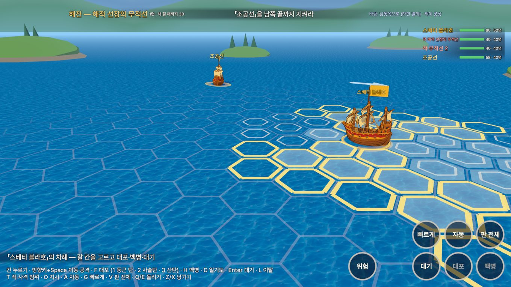

## 명령보다 승리 조건이 먼저

호위전에서는 지킬 배, 돌파전에서는 빠져나갈 판 끝, 항구 방어에서는 적이 들어오면 안 되는 포구를 확인합니다. 목표가 다른 판에서 적 기함만 쫓으면 수송선이나 포구를 비워 줄 수 있습니다. 해전은 최대 30턴이므로 남은 턴도 살피세요.

## 이동하면 뱃머리가 어디를 보나

배는 항로 마지막 걸음 쪽으로 고개를 돌립니다. 같은 거리라도 옆구리로 쏘는 **현측포**와 선수·선미포의 위력이 다릅니다. 도착할 칸을 가리켜 사격 범위와 닿는 적을 본 뒤 움직이세요. 풍상을 차지하면 사정이 한 칸 늘어납니다. 암초에 걸리면 움직임이 막히고, 얕은 여울은 큰 배가 통과하지 못할 수 있습니다.

| 목적 | 고를 행동 | 확인할 것 |
| --- | --- | --- |
| 적 선체를 깎기 | 둥근 탄 | 적의 선수나 선미를 현측으로 꿰뚫을 각도인지 봅니다. |
| 빠른 배의 발 묶기 | 사슬탄 | 돛이 찢어진 동안 호위선이나 아군이 자리를 잡습니다. |
| 배를 나포하기 | 근거리 산탄, 이어서 백병 | 상대 선원을 줄이고 붙습니다. 내 배의 남은 선원도 확인하세요. |
| 적 제독에게 도전하기 | 두 기함을 붙이고 일기토 | 한 판에 한 번이며 상대가 거절할 수 있습니다. 이겨도 선원 차가 크면 바로 생포되지 않습니다. |

[일기토의 상성과 결정타](/systems/duel/) · [전투 연습과 저장](/systems/pilot/)
