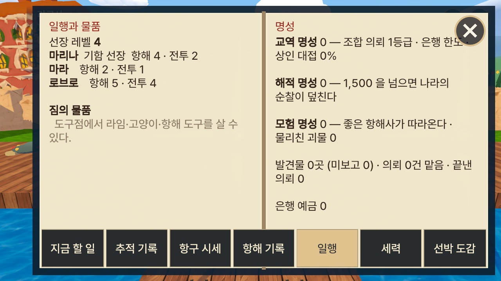
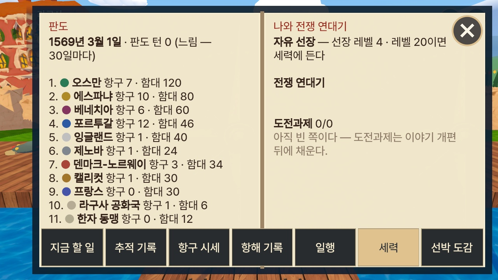

**이야기가 막혔다면 화면의 ‘퀘스트’를 먼저 누르세요.** 대화 중이면 지금 진행 중인 대화를 확인하고 창을 닫아 다음 대사를 읽습니다. 자유롭게 움직일 수 있을 때는 수첩을 열고 **지금 할 일 → 목적지와 퀘스트 보기**를 고르세요. 다음 항구뿐 아니라 *그 항구의 어디에서 무엇을 해야 하는지*까지 확인할 수 있습니다.

예를 들어 마리나로 소금을 가져가는 대목이라면 항구 이름만 보고 바로 출항하지 마세요. 먼저 필요한 소금 스무 가마니가 있는지 살펴보고, 항구에 닿으면 **지금 할 일**에 적힌 시설로 가세요. 니콜라로 시작해 곡물선을 만나야 할 때도 같은 방법으로 집결할 부두를 찾습니다. [선장별 첫 임무와 목적지](/start/captains/)

## 수첩의 일곱 탭

항구나 항해 중에 수첩 아이콘을 누르세요. 키보드에서는 **N** 또는 **Tab**으로 엽니다. 대화나 전투가 진행 중이라 수첩이 열리지 않으면 해당 장면을 마친 뒤 다시 여세요.

| 탭 | 이럴 때 펼치세요 |
| --- | --- |
| **지금 할 일** | 다음 행동, 목적지와 출발 준비를 확인합니다. **목적지와 퀘스트 보기**에서 이야기 목표, 맡은 조합 의뢰, 세력 임무를 함께 살핍니다. |
| **추적 기록** | 괴물이 보인 징후와 지금까지 알아낸 습성을 다시 읽거나 동맹에 관한 기록을 살핍니다. |
| **항구 시세** | 다녀왔거나 소문을 들은 항구의 가격과 조사 날짜, 배에 실린 짐을 살펴봅니다. 지금 수량으로 받을 금액은 교역소에서 비교합니다. |
| **항해 기록** | 항해 중 쌓인 기록, 발견물, 선원들의 사기를 확인합니다. 새 발견의 보수는 조합에서 보고한 뒤 받습니다. |
| **일행** | 함께 항해하는 사람과 직책·장비, 명성과 재산을 살핍니다. 직책을 바꾸려면 술집의 **일행 명부와 직책**으로 가세요. |
| **세력** | 세력마다 가진 항구 수와 해군력, 내 소속·공훈과 다음 작위, 전쟁의 흐름을 확인합니다. |
| **선박 도감** | 지금까지 보유했던 선종을 선종별로 찾아봅니다. 현재 타고 있는 배의 내구도와 적재량은 선박 상세에 있습니다. |

## 목적지를 알면 항로 잡기

목표에 항구나 해역이 지정돼 있다면 바다에서 **선장 메뉴 → 항해 → 목표로 항해**를 고르세요. 항구 안에서 사람을 만나거나 물건을 사는 목표라면 먼저 해당 시설에 가야 합니다. 먼 항구가 어떤 해역에 속하는지, 도착해서 교역할 수 있는지는 [세계 해도](/atlas/world-map/)와 [항구 도감](/atlas/ports/)에서 확인하세요.

## 숫자가 달라졌을 때 다시 볼 곳

| 궁금한 일 | 확인할 곳 |
| --- | --- |
| 방금 판 짐이 얼마 남았나? | **선장 메뉴 → 정보 → 교역 장부**에서 최근 거래의 수량·매입 원가·매각액·차익을 봅니다. [교역소에서 가격 비교하기](/systems/market/) |
| 내 기함에 식량이 얼마나 남았나? | **선장 메뉴 → 함대**에서 배를 골라 상세를 여세요. 항해 중에는 선박 정보 버튼으로도 열 수 있습니다. [배별로 보급하기](/systems/provisions/) |
| 쟁탈전 뒤 누가 항구를 가졌나? | 수첩의 **세력**에서 전황을 보고, 항구 단위의 주인과 점령 기록은 **선장 메뉴 → 세력**에서 확인하세요. [항구 점령과 전선](/systems/govern/) |

