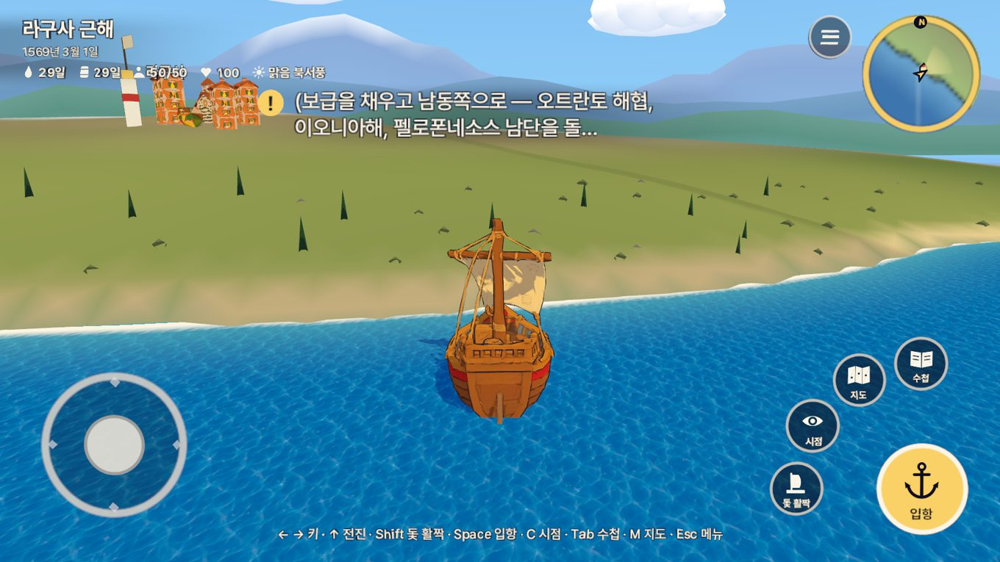
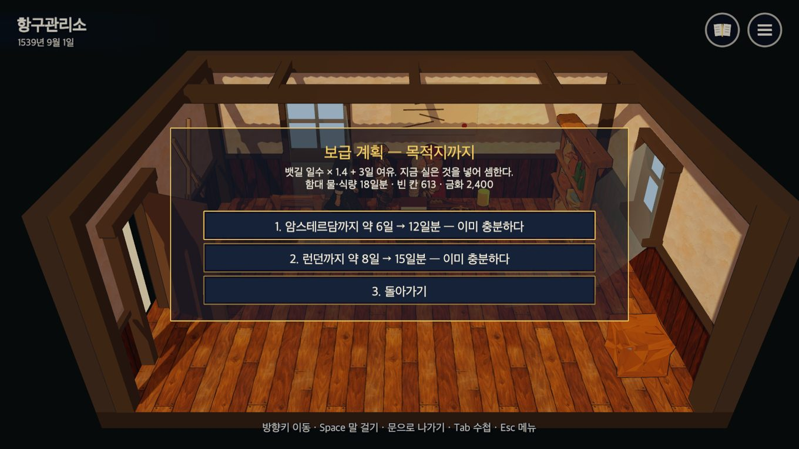

## 짐을 싣기 전에 항로부터

목적지를 정하고 항구관리소의 **보급 계획**에서 필요한 날수와 남은 적재량을 확인합니다. 쌓아 둔 상품 때문에 식량이 모자라면 일부를 내리거나 중간에 보급항을 넣으세요. 보급항에서는 마을 시설을 모두 이용할 수 없으므로 배를 고치거나 선원을 구할 때는 다음 기항지의 시설도 살피세요.

## 바다에서 먼저 볼 세 가지

| 계기나 징후 | 선장이 할 일 |
| --- | --- |
| 물이나 식량의 남은 일수가 목적지보다 짧다 | 지도를 열어 가까운 보급항으로 바꿉니다. 해안에 붙을 수 있으면 상륙해 물 긷기나 채집으로 하루를 보낼 수 있습니다. |
| 순풍이 끝나고 맞바람이나 무풍이 이어진다 | 어제 걸린 시간으로 귀항 일수를 잡지 마세요. 바람·해류와 남은 보급을 다시 확인합니다. |
| 폭풍이나 긴 항해 뒤 컨디션·사기가 떨어진다 | 입항해 쉬고 선원을 보충합니다. 사기가 낮으면 입항 때 선원이 떠날 수 있습니다. |

쥐떼와 괴혈병을 대비할 때는 도구점의 고양이와 라임을 확인하세요. 바다에서 배나 이상 징후를 만나면 소지품과 선원 상태에 따라 선택의 대가가 달라집니다. [첫 출항의 금지 조건과 경고](/start/first-voyage/)

목적지별 권장량을 계산하거나 항해 도중 물·식량·수리 자재가 부족해졌다면 [보급 계획과 함대 지시](/systems/provisions/)를 펼치세요.
